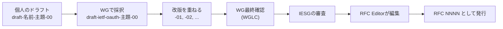

この付録でわかること:

- RFCがどのように作られ、どの種類があり、どこまでが確定した仕様か
- 1つのRFCの中で、どの節をどの順に読めば実装に必要な情報が得られるか
- MUST / SHOULD / MAY などの要請語の意味と、本書での訳し方
- ABNFで書かれた構文規則の読み方
- RFCの更新・正誤表・IANAレジストリ、OpenID仕様の位置づけ

本書は各章の「RFCを読む」「仕様を読む」の節で原文を引用し、平易な日本語に
言い換えています。この付録は、その読解の前提になる共通の知識をまとめたものです。
章を読む途中で、引用の形式や要請語の意味がわからなくなったときに参照してください。

## RFCとは何か

**RFC**(Request for Comments)は、インターネットで使われる技術の仕様を
番号付きで発行する文書の系列です。HTTP(RFC 9110)、TLS 1.3(RFC 8446)、
OAuth 2.0(RFC 6749)など、Webアプリケーションが前提にしている
プロトコルの多くがRFCとして定められています。

RFCの多くは**IETF**(Internet Engineering Task Force)が作成します。
IETFは、誰でもメーリングリストに参加して議論できる標準化の場であり、
会員制の団体ではありません。分野ごとに**ワーキンググループ**(working group、WG)があり、
OAuthに関する仕様は**OAuth WG**が担当しています。

RFCには、読む前に知っておくべき性質が2つあります。

- **一度発行されたRFCの本文は変更されません。** 誤りの修正や機能の追加は、
  新しい番号のRFCを発行して、古いRFCを「更新する」または「廃止する」と宣言する
  形で行います。このため、あるRFCの現在の内容を知るには、そのRFCを更新している
  後続のRFCも合わせて読む必要があります(後の節で説明します)
- **RFCには標準以外の文書も含まれます。** 後述する種別によって、
  標準、運用上の推奨、情報提供、実験などの位置づけが分かれています

### RFCの種別

RFCの冒頭には `Category:` という行があり、その文書の種別を示しています。
本書で扱うRFCに現れる種別は次の4つです。

| 種別 | 冒頭の表記 | 意味 | 本書の例 |
| --- | --- | --- | --- |
| 標準化過程 | Standards Track | プロトコルの仕様。多くは「提案標準」(Proposed Standard)の段階 | RFC 6749、RFC 7636、RFC 9449 |
| 現行の最善の慣行 | Best Current Practice | 既存のプロトコルをどう使うべきかの推奨 | RFC 9700、RFC 8252、RFC 10017 |
| 情報提供 | Informational | 標準ではない情報の共有。脅威の分析など | RFC 6819 |
| 実験 | Experimental | 実験的な仕様 | RFC 7592 |

**標準化過程**(Standards Track)の文書は、最初に**提案標準**
(Proposed Standard)として発行されます。名前は「提案」ですが、
RFC 6749 も RFC 7636 も提案標準のまま広く実装されています。
提案標準であることは、実装を避ける理由になりません。

**BCP**(Best Current Practice)は、既存のプロトコルの安全な使い方を定める文書であり、
新しいプロトコルを定める文書ではありません。OAuthでは、
RFC 6749 の発行後に見つかった攻撃への対策が RFC 9700(OAuth 2.0 Security BCP)に
まとめられており、RFC 6749 の一部の記述は RFC 9700 によって上書きされています。
BCPには RFC番号とは別にBCP番号も付きます。RFC 9700 は BCP 240 です。

### Internet-DraftからRFCになるまで

RFCになる前の文書は**Internet-Draft**(I-D、インターネットドラフト)と呼ばれます。
Internet-Draftは誰でも提出でき、`draft-<提出者>-<主題>-<版数>` という名前が付きます。
ワーキンググループが作業対象として採択すると、名前が `draft-ietf-<WG名>-<主題>` に変わります。



この図のとおり、ドラフトは改版を重ねてから審査を経てRFCになります。
読むときに注意する点は次の3つです。

- **Internet-Draftは確定した仕様ではありません。** 版が変わるたびに内容が
  変わる可能性があり、各ドラフトには6か月の有効期限があります。
  本書がドラフトを扱う箇所では、版数と確認日を本文に書いています
- 例えば OAuth 2.1 は、2026年10月16日時点で `draft-ietf-oauth-v2-1-16` という
  ドラフトであり、まだRFCではありません([25章](/security/25-high-security/))
- ドラフトがRFCになると、ドラフトの名前ではなくRFC番号で参照します。
  2026年8月に発行された RFC 10017(ブラウザアプリのBCP)は、発行前は
  `draft-ietf-oauth-browser-based-apps` という名前で長く参照されていました

ドラフトの状態は [IETF Datatracker](https://datatracker.ietf.org/) で確認できます。

## 1つのRFCの構成

RFCは決まった構成で書かれています。RFC 7636(PKCE)の冒頭を例に見ます。

```text
Internet Engineering Task Force (IETF)                  N. Sakimura, Ed.
Request for Comments: 7636                     Nomura Research Institute
Category: Standards Track                                     J. Bradley
ISSN: 2070-1721                                            Ping Identity
                                                              N. Agarwal
                                                                  Google
                                                          September 2015


          Proof Key for Code Exchange by OAuth Public Clients
```

左上の欄が文書の属性です。`Request for Comments: 7636` が番号、
`Category:` が種別です。他のRFCを更新・廃止する文書では、ここに
`Updates:` や `Obsoletes:` の行が加わります。例えば RFC 9700 の冒頭には
`Updates: 6749, 6750, 6819` と書かれています。

本文は、おおむね次の順に並んでいます。

| 節 | 内容 | 読むときの用途 |
| --- | --- | --- |
| Abstract | 1段落の要約 | 何を解決する文書かを確認する |
| Status of This Memo | 種別と承認の経緯の定型文 | 通常は読み飛ばしてよい |
| Introduction | 背景と動機 | 攻撃や問題の説明が書かれていることが多い |
| Terminology / Conventions | 要請語の宣言と用語の定義 | 必ず読む。語の意味が一般の英語と異なる |
| 本体の各節 | プロトコルの定義 | 実装の根拠になる |
| Security Considerations | セキュリティ上の考慮事項 | OAuth/OIDCでは本体と同じく重視して読む |
| IANA Considerations | 登録するパラメータ名など | 名前の一覧を探すときに使う |
| References | 規範的参照と参考参照 | 規範的参照(Normative)は読む必要がある前提文書 |
| Appendix | 例・テストベクタ・ABNF | 実装の検証に使う |

**Security Considerations**(セキュリティ上の考慮事項)は、すべてのRFCに
置くことが求められている節です。OAuthとOIDCでは、この節に攻撃とその対策が
具体的に書かれており、本体の手順がなぜその形なのかの説明もここにあります。
本書の多くの章が、この節を読解の対象にしています。

付録の例と**テストベクタ**(test vector)は、仕様が定める計算の入力と期待される
出力の組です。RFC 7636 の付録Bには、PKCEの `code_verifier` と、
そこから計算される `code_challenge` の組が記載されています。本書の実験の一部は、
RFCのテストベクタと同じ値が得られることを確かめる形にしています。

## 要請語: MUST・SHOULD・MAY

RFCの本文では、大文字で書かれた MUST、SHOULD、MAY などの語が、
仕様への適合の条件を表します。これらを**要請語**(requirement keywords)と呼びます。
意味は RFC 2119 で定義され、RFC 8174 で補足されています。
この2つを合わせて **BCP 14** と呼びます。

> The key words "MUST", "MUST NOT", "REQUIRED", "SHALL", "SHALL NOT", "SHOULD", "SHOULD NOT", "RECOMMENDED", "MAY", and "OPTIONAL" in this document are to be interpreted as described in RFC 2119.

(RFC 2119 より。各RFCの冒頭近くに置く定型文の例として示されています)

この定型文が置かれた文書では、大文字の要請語が次の意味を持ちます。

> 1. MUST This word, or the terms "REQUIRED" or "SHALL", mean that the definition is an absolute requirement of the specification.

(RFC 2119 1節)

> 3. SHOULD This word, or the adjective "RECOMMENDED", mean that there may exist valid reasons in particular circumstances to ignore a particular item, but the full implications must be understood and carefully weighed before choosing a different course.

(RFC 2119 3節)

RFC 2119 は、MUST を「仕様の絶対的な要求」、SHOULD を「特定の状況では
無視する正当な理由がありうるが、その影響を完全に理解し慎重に検討したうえで
なければ別の方法を選んではならない要求」と定めています。
SHOULD から外れる場合は、外れる理由と影響を説明できる必要があります。
SHOULD は、この説明の責任を伴う強さの要求です。

RFC 8174 は、これらの語が**大文字で書かれたときだけ**この意味を持つことを
明確にしました。

> The key words "MUST", "MUST NOT", "REQUIRED", "SHALL", "SHALL NOT", "SHOULD", "SHOULD NOT", "RECOMMENDED", "NOT RECOMMENDED", "MAY", and "OPTIONAL" in this document are to be interpreted as described in BCP 14 [RFC2119] [RFC8174] when, and only when, they appear in all capitals, as shown here.

(RFC 8174 2節で示されている、新しい定型文)

この文は、小文字の must や should は通常の英語として読む、という規則を定めています。
例えば RFC 7636 の付録Bには「the request must be rejected」という小文字の must がありますが、
これは付録の例を説明する文であり、要求そのものは本体の4.6節に大文字の MUST で書かれています。

### 本書での訳し方

本書の読解では、要請語を次の訳で統一し、原語を括弧で併記しています。

| 原語 | 本書の訳 | 意味 |
| --- | --- | --- |
| MUST / REQUIRED / SHALL | 〜しなければなりません(MUST) | 守らなければ仕様に適合しない |
| MUST NOT / SHALL NOT | 〜してはなりません(MUST NOT) | 行えば仕様に適合しない |
| SHOULD / RECOMMENDED | 〜すべきです(SHOULD) | 原則として守る。外れるなら理由と影響の説明が要る |
| SHOULD NOT / NOT RECOMMENDED | 〜すべきではありません(SHOULD NOT) | 原則として行わない。行うなら理由と影響の説明が要る |
| MAY / OPTIONAL | 〜してもかまいません(MAY) | 行っても行わなくても適合する |

要請語を読むときは、**誰に対する要求か**を必ず確認してください。
OAuthのRFCでは、同じ節の中で「クライアントは〜しなければならない」と
「認可サーバは〜しなければならない」が並ぶことがよくあります。
RPを実装するときに必要なのはクライアントが主語の要求であり、
OPを実装するときに必要なのは認可サーバが主語の要求です。

MAY で定められた機能にも注意が必要です。MAY は「実装しなくてよい」を意味する一方で、
相手が実装している可能性があることも意味します。RFC 2119 5節は、
任意の機能を実装していない側も、実装している相手と相互運用できるように
準備しなければならない(MUST)と定めています。

## ABNFで書かれた構文を読む

パラメータの値として使える文字や長さは、多くのRFCで**ABNF**
(Augmented Backus-Naur Form、拡張バッカス・ナウア記法)という記法で書かれています。
ABNF自体は RFC 5234 で定義されています。RFC 7636 の `code_verifier` の定義を例に読みます。

```text
code-verifier = 43*128unreserved
unreserved = ALPHA / DIGIT / "-" / "." / "_" / "~"
ALPHA = %x41-5A / %x61-7A
DIGIT = %x30-39
```

(RFC 7636 4.1節)

この規則は、`code_verifier` が「英大文字・英小文字・数字・`-`・`.`・`_`・`~`
のいずれかの文字を、43文字以上128文字以下並べたもの」であることを定めています。
記号の意味は次のとおりです。

| 記法 | 意味 | 上の規則での例 |
| --- | --- | --- |
| `名前 = 定義` | 規則の定義 | `unreserved = ...` |
| `A / B` | AまたはB | `ALPHA / DIGIT / ...` |
| `m*n要素` | 要素をm回以上n回以下繰り返す。省略時は0と無限 | `43*128unreserved` |
| `1*要素` | 要素を1回以上繰り返す | RFC 6749 の `state = 1*VSCHAR` |
| `%x41-5A` | 文字コードが16進で41から5Aの1文字 | `A`から`Z` |
| `"-"` | その文字そのもの | ハイフン1文字 |
| `[要素]` | 省略可能 | |
| `( ... )` | まとまり | RFC 6749 の `*( SP scope-token )` |

RFC 6749 は付録Aに、OAuthのパラメータの構文をまとめています。
`state` は `1*VSCHAR`(空白から`~`までの印字可能なASCII文字1文字以上)、
`scope` は空白で区切った `scope-token` の並びで、`scope-token` には
空白・二重引用符・バックスラッシュを含められません。

ABNFの規則は、そのまま入力検証の関数として実装できます。
次のコードは、上の3つの規則を判定する関数を書き、いくつかの値を判定します。

<RustPlay snippet="appendix/abnf" title="RFC 7636 と RFC 6749 付録AのABNFを判定関数として実装する" />

1つ目の `code_verifier` は RFC 7636 付録Bのテストベクタで、規則を満たします。
3つ目は `+` と `/` を含むため規則を満たしません。これは通常のBase64の出力に
現れる文字であり、`code_verifier` を作るときにBase64urlではなく通常のBase64を
使うと、仕様に適合しない値になることを示しています
([5章](/web-auth/05-crypto/)、[9章](/oidc/09-state-nonce-pkce/))。
`state` が日本語を受け付けないのは、VSCHAR がASCIIの印字可能文字に限られるためです。
スコープの2つ目は空白が2つ連続しているため、空の `scope-token` を含むことになり、
規則を満たしません。

## 更新・廃止・正誤表を追う

一度発行されたRFCの本文は変わらないため、RFCの「現在の内容」は
複数の文書の組み合わせで決まります。追う対象は次の3つです。

- **Updates / Updated by**: ある文書が別の文書の一部を変更・追加したことを示します。
  RFC 6749 は RFC 8252、RFC 8996、RFC 9700 によって更新されています。
  RFC 6749 を読むときは、RFC 9700 で禁止・変更された点(インプリシットグラントを使うべきではない(SHOULD NOT)こと、
  リソースオーナーパスワードクレデンシャルグラントを使ってはならない(MUST NOT)こと、など)を
  合わせて確認する必要があります
- **Obsoletes / Obsoleted by**: ある文書が別の文書を置き換えたことを示します。
  RFC 6749 は OAuth 1.0 の RFC 5849 を廃止しています
- **正誤表**(errata): 発行後に報告された誤りの記録です。RFC Editor が受け付け、
  検証済み(Verified)、保留(Held for Document Update)、却下(Rejected)などの
  状態が付きます。検証済みの正誤表は、本文の訂正として扱います

これらは、RFCごとの情報ページ `https://www.rfc-editor.org/info/rfcNNNN` で
確認できます。本書の読解で後続の文書による変更があった箇所は、
読解の中でそのことを明記しています。

## IANAレジストリ

**IANA**(Internet Assigned Numbers Authority)は、プロトコルで使う名前や番号の
一覧(**レジストリ**、registry)を管理する組織です。OAuthとOIDCでは、
パラメータ名、エラーコード、JWTのクレーム名、JOSEの `alg` 値などが
IANAのレジストリに登録されています。

各RFCの IANA Considerations 節は、そのRFCがどのレジストリに何を登録するかを
書いた節です。仕様書を横断して「使える `alg` の値の一覧」や「定義済みのクレーム名の一覧」が
必要な場合は、個々のRFCではなく、次のレジストリを参照します。

- OAuth Parameters: 認可リクエストのパラメータ名、トークンタイプ、エラーコード、
  認可サーバメタデータの項目など
- JSON Web Token Claims: `iss`、`sub`、`nonce` などのクレーム名
- JSON Object Signing and Encryption (JOSE): `alg`、`enc`、`kty`、`crv` などの値
- Well-Known URIs: `/.well-known/openid-configuration` などのパス

## OpenID仕様の読み方

OpenID Connect の仕様は**OpenID Foundation**(OIDF)が発行しており、RFCではありません。
OpenID Foundation は、OpenID関連の仕様を策定する非営利団体です。
IETFと同様にワーキンググループで仕様を作り、次の段階を経て確定させます。

- **Implementer's Draft**(実装者向けドラフト): 実装を始めてよい段階として
  承認された版です。知的財産権の扱いが確定しており、実装の対象にできます
- **Final**(最終仕様): 会員の投票で承認された確定版です

OpenID Connect Core 1.0 の現在の版は、2023年12月に発行された
「OpenID Connect Core 1.0 incorporating errata set 2」です。
OpenID仕様は、本文を改版する代わりに**正誤表セット**(errata set)を取り込んだ版を
発行する方式をとっています。また、OpenID Connect の主要な仕様群は2024年に
ISO/IEC 26131〜26141 として国際標準にもなっています。

OpenID仕様も冒頭で RFC 2119 の要請語を使うことを宣言しています。

> The key words "MUST", "MUST NOT", "REQUIRED", "SHALL", "SHALL NOT", "SHOULD", "SHOULD NOT", "RECOMMENDED", "NOT RECOMMENDED", "MAY", and "OPTIONAL" in this document are to be interpreted as described in RFC 2119 [RFC2119].

(OpenID Connect Core 1.0 1.1節)

このため、本書では OpenID 仕様の要請語も RFC と同じ訳で示しています。
OpenID Connect Core は OAuth 2.0(RFC 6749)と JWT(RFC 7519)を前提にしており、
OpenID Connect Core の多くの節は「RFC 6749 の該当節に、次の条件を加える」という
形で書かれています。OIDCの仕様を読むときは、参照されている RFC の節も
合わせて開く必要があります。

## 読む順序

本書の読解で使っている手順を、新しいRFCや仕様を自分で読むときの手順として
まとめます。

1. **現況を確認します。** 情報ページで種別、Updated by、Obsoleted by、
   正誤表を確認し、後続の文書による変更があるかを調べます
2. **Terminology の節を読みます。** 語の意味を確定させます。OAuthの
   「client」はアプリケーションを指し、ブラウザを指さない、といった違いがここで定義されます
3. **図とフローの概要を読みます。** 多くのRFCは Introduction か Overview に
   メッセージの流れの図を置いています
4. **自分が実装する役割が主語の要請語を抽出します。** MUST と MUST NOT を
   一覧にすると、実装の検査項目になります
5. **Security Considerations を読みます。** 手順の理由と、
   守らなかった場合に成立する攻撃がここに書かれています
6. **付録の例とテストベクタで実装を検証します。** 計算を含む仕様では、
   テストベクタと同じ出力が得られることを確認します
7. **BCPと後続の文書で上書きされた点を確認します。** OAuthでは
   RFC 9700 と、ブラウザアプリなら RFC 10017、ネイティブアプリなら RFC 8252 です

各RFCと仕様の要約、本書で読解している章は[RFC・仕様の索引](/appendix/rfc-index/)にまとめています。
