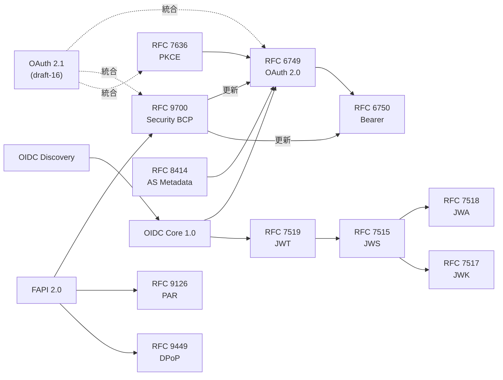

本書で扱った RFC と OpenID 仕様の一覧です。「扱う章」のうち**太字**の章は、
その文書を「RFCを読む」「仕様を読む」の節で原文から読解している章です。
RFC の種別や要請語の読み方は[RFCの読み方](/appendix/reading-rfcs/)にまとめています。
発行年月と現況は2026年10月16日に確認したものです。

## HTTPと標準化の基礎

| 文書 | 発行 | 内容 | 扱う章 |
| --- | --- | --- | --- |
| RFC 2119 / RFC 8174 (BCP 14) | 1997-03 / 2017-05 | 要請語 MUST・SHOULD・MAY の意味。大文字のときだけ要請語として読む | [1章](/web-auth/01-http-auth/) |
| RFC 9110 HTTP Semantics | 2022-06 | HTTP の意味論。ステートレス性、認証の枠組み、ステータスコード、リダイレクト | [1章](/web-auth/01-http-auth/)、[4章](/web-auth/04-tokens/)、[22章](/security/22-threats/) |
| RFC 7617 Basic認証 | 2015-09 | user-id とパスワードをコロンで連結し Base64 で送る認証スキーム。charset 引数 | [**1章**](/web-auth/01-http-auth/)、[13章](/oauth-deep/13-client-auth/) |
| RFC 6265 Cookie | 2011-04 | Set-Cookie と Cookie ヘッダ、Secure・HttpOnly 属性。SameSite は改訂版ドラフトで定義 | [**1章**](/web-auth/01-http-auth/)、[24章](/security/24-browser-native/) |

## OAuth 2.0 の中核

| 文書 | 発行 | 内容 | 扱う章 |
| --- | --- | --- | --- |
| RFC 6749 OAuth 2.0 Authorization Framework | 2012-10 | ロール、認可コードなど4つのグラント、エンドポイント、トークンレスポンス、エラー、セキュリティ上の考慮事項 | [**2章**](/web-auth/02-delegation/)、[**3章**](/web-auth/03-authorization-code/)、[**4章**](/web-auth/04-tokens/)、[**5章**](/web-auth/05-crypto/)、[**6章**](/oidc/06-oauth-to-oidc/)、[**9章**](/oidc/09-state-nonce-pkce/)、[**13章**](/oauth-deep/13-client-auth/)、[**15章**](/oauth-deep/15-refresh-tokens/)、[**20章**](/oidc-deep/20-other-grants/) |
| RFC 6750 Bearer Token Usage | 2012-10 | アクセストークンを Authorization: Bearer で送る方法と、WWW-Authenticate のエラー | [**4章**](/web-auth/04-tokens/)、[14章](/oauth-deep/14-token-validation/)、[16章](/oauth-deep/16-sender-constrained/) |
| RFC 6819 Threat Model and Security Considerations | 2013-01 | OAuth 2.0 の脅威モデルと対策の分析 | [**22章**](/security/22-threats/) |
| RFC 9700 OAuth 2.0 Security BCP (BCP 240) | 2025-01 | RFC 6749/6750/6819 を更新する現在のセキュリティ要件。PKCE、完全一致、インプリシットと ROPC の非推奨・禁止 | [**9章**](/oidc/09-state-nonce-pkce/)、[**12章**](/rust-impl/12-build-op/)、[**15章**](/oauth-deep/15-refresh-tokens/)、[**19章**](/oidc-deep/19-flows/)、[**22章**](/security/22-threats/)、[25章](/security/25-high-security/) |

## JOSE とトークンの形式

| 文書 | 発行 | 内容 | 扱う章 |
| --- | --- | --- | --- |
| RFC 7515 JWS | 2015-05 | JSON で署名・MAC を表すデータ構造とコンパクトシリアライゼーション | [**5章**](/web-auth/05-crypto/)、[**7章**](/oidc/07-jwt-jose/)、[23章](/security/23-jwt-attacks/) |
| RFC 7516 JWE | 2015-05 | JSON で暗号化を表すデータ構造 | [7章](/oidc/07-jwt-jose/) |
| RFC 7517 JWK | 2015-05 | 暗号鍵を JSON で表す形式と JWK Set | [**7章**](/oidc/07-jwt-jose/)、[10章](/rust-impl/10-discovery-jwks/) |
| RFC 7518 JWA | 2015-05 | JWS・JWE・JWK で使うアルゴリズム名(HS256、RS256、ES256 など) | [**5章**](/web-auth/05-crypto/)、[**7章**](/oidc/07-jwt-jose/)、[23章](/security/23-jwt-attacks/) |
| RFC 7519 JWT | 2015-05 | クレームの集合を JWS/JWE で表す形式と登録済みクレーム | [**7章**](/oidc/07-jwt-jose/)、[8章](/oidc/08-id-token-validation/)、[23章](/security/23-jwt-attacks/) |
| RFC 7638 JWK Thumbprint | 2015-09 | JWK の必須メンバーから鍵の識別子を計算する方法 | [**7章**](/oidc/07-jwt-jose/)、[10章](/rust-impl/10-discovery-jwks/)、[16章](/oauth-deep/16-sender-constrained/) |
| RFC 8725 JWT BCP | 2020-02 | JWT の安全な使い方。alg の検証、明示的型付け、issuer と audience の検証 | [**23章**](/security/23-jwt-attacks/)、[**26章**](/practice/26-operations/) |
| RFC 9068 JWT Profile for Access Tokens | 2021-10 | アクセストークンを JWT で発行するときの形式(typ=at+jwt)と検証 | [**14章**](/oauth-deep/14-token-validation/) |
| RFC 9864 Fully-Specified Algorithms | 2025-10 | 曲線やハッシュまで1つに決まるアルゴリズム識別子。Ed25519 など | [23章](/security/23-jwt-attacks/)、[25章](/security/25-high-security/) |
| RFC 9901 SD-JWT | 2025-11 | JWT のクレームを選択的に開示する形式。Disclosure と _sd ダイジェスト | [**27章**](/practice/27-ecosystem/) |

## OpenID Connect の仕様(OpenID Foundation)

| 文書 | 発行 | 内容 | 扱う章 |
| --- | --- | --- | --- |
| OpenID Connect Core 1.0 (errata set 2) | 2023-12 | ID トークン、認証リクエスト、ID トークンの検証、UserInfo、クレーム、pairwise 識別子 | [**6章**](/oidc/06-oauth-to-oidc/)、[**8章**](/oidc/08-id-token-validation/)、[**9章**](/oidc/09-state-nonce-pkce/)、[**10章**](/rust-impl/10-discovery-jwks/)、[**11章**](/rust-impl/11-build-rp/)、[**12章**](/rust-impl/12-build-op/)、[**13章**](/oauth-deep/13-client-auth/)、[**15章**](/oauth-deep/15-refresh-tokens/)、[**18章**](/oidc-deep/18-claims-identity/)、[**19章**](/oidc-deep/19-flows/)、[**26章**](/practice/26-operations/) |
| OpenID Connect Discovery 1.0 | 2023-12 | OP のメタデータを well-known URI で公開する方法と issuer の検証 | [**10章**](/rust-impl/10-discovery-jwks/) |
| OpenID Connect RP-Initiated Logout 1.0 | 2022-09 | RP が OP にログアウトを依頼する方法 | [**21章**](/oidc-deep/21-logout-session/) |
| OpenID Connect Front-Channel Logout 1.0 | 2022-09 | OP が iframe で RP にログアウトを伝える方法 | [**21章**](/oidc-deep/21-logout-session/) |
| OpenID Connect Back-Channel Logout 1.0 (errata set 1) | 2023-12 | OP がログアウトトークンを RP に直接送る方法 | [**21章**](/oidc-deep/21-logout-session/) |
| OpenID Connect Session Management 1.0 | 2022-09 | iframe と postMessage で OP のセッションの変化を検出する方法 | [**21章**](/oidc-deep/21-logout-session/) |
| OAuth 2.0 Multiple Response Type Encoding Practices | 2014-02 | response_type の組み合わせと response_mode | [**19章**](/oidc-deep/19-flows/) |
| OAuth 2.0 Form Post Response Mode | 2015-04 | 認可レスポンスを自動送信のフォームで POST する応答モード | [**19章**](/oidc-deep/19-flows/) |
| OpenID Connect CIBA Core 1.0 | 2021-09 | 利用者の別の端末で認証を行うバックチャネルのフロー | [**20章**](/oidc-deep/20-other-grants/) |
| FAPI 2.0 Security Profile / Attacker Model | 2025-02 | 高いセキュリティを要求する API のためのプロファイルと、その前提の攻撃者モデル | [**25章**](/security/25-high-security/) |
| FAPI 2.0 Message Signing | 2025-09 | リクエストとレスポンスの署名による否認防止 | [**25章**](/security/25-high-security/) |
| OpenID Federation 1.0 / 1.1 | 2026-02 / 2026-05 | トラストチェーンでエンティティ間の信頼を確立する仕組み | [**27章**](/practice/27-ecosystem/) |

## OAuth 2.0 の拡張

| 文書 | 発行 | 内容 | 扱う章 |
| --- | --- | --- | --- |
| RFC 7009 Token Revocation | 2013-08 | クライアントがトークンの失効を依頼するエンドポイント | [**14章**](/oauth-deep/14-token-validation/)、[21章](/oidc-deep/21-logout-session/) |
| RFC 7521 / RFC 7523 Assertion Framework / JWT Profile | 2015-05 | JWT をクライアント認証(private_key_jwt)と認可グラントに使う方法 | [**13章**](/oauth-deep/13-client-auth/)、[**20章**](/oidc-deep/20-other-grants/) |
| RFC 7591 Dynamic Client Registration | 2015-07 | クライアントを API で登録する方法 | [13章](/oauth-deep/13-client-auth/)、[27章](/practice/27-ecosystem/) |
| RFC 7636 PKCE | 2015-09 | code_verifier と code_challenge で認可コードの横取りを防ぐ方法 | [**9章**](/oidc/09-state-nonce-pkce/)、[11章](/rust-impl/11-build-rp/)、[12章](/rust-impl/12-build-op/) |
| RFC 7662 Token Introspection | 2015-10 | リソースサーバがトークンの状態を認可サーバに問い合わせる方法 | [**14章**](/oauth-deep/14-token-validation/) |
| RFC 7800 Proof-of-Possession Key Semantics for JWTs | 2016-04 | JWT に cnf クレームで鍵を結びつける方法 | [16章](/oauth-deep/16-sender-constrained/) |
| RFC 8176 Authentication Method Reference Values | 2017-06 | amr クレームの値(pwd、otp、hwk など) | [18章](/oidc-deep/18-claims-identity/) |
| RFC 8414 Authorization Server Metadata | 2018-06 | 認可サーバのメタデータの形式と取得方法 | [**10章**](/rust-impl/10-discovery-jwks/) |
| RFC 8628 Device Authorization Grant | 2019-08 | 入力手段の限られた端末のためのグラント | [**20章**](/oidc-deep/20-other-grants/) |
| RFC 8693 Token Exchange | 2020-01 | トークンを別のトークンに交換する方法。委任となりすまし | [**20章**](/oidc-deep/20-other-grants/) |
| RFC 8705 Mutual-TLS | 2020-02 | mTLS によるクライアント認証と証明書束縛トークン | [**13章**](/oauth-deep/13-client-auth/)、[**16章**](/oauth-deep/16-sender-constrained/) |
| RFC 8707 Resource Indicators | 2020-02 | resource パラメータでトークンの宛先を指定する方法 | [**14章**](/oauth-deep/14-token-validation/)、[27章](/practice/27-ecosystem/) |
| RFC 9101 JAR | 2021-08 | 認可リクエストを署名付き JWT で送る方法 | [**17章**](/oauth-deep/17-request-protection/) |
| RFC 9126 PAR | 2021-09 | 認可リクエストをバックチャネルで事前に送る方法 | [**17章**](/oauth-deep/17-request-protection/)、[25章](/security/25-high-security/) |
| RFC 9207 Issuer Identification | 2022-03 | 認可レスポンスに iss を付けてミックスアップ攻撃を防ぐ方法 | [**17章**](/oauth-deep/17-request-protection/) |
| RFC 9396 Rich Authorization Requests | 2023-05 | authorization_details で細かい権限を要求する方法 | [**17章**](/oauth-deep/17-request-protection/) |
| RFC 9449 DPoP | 2023-09 | アプリケーション層の所有証明でトークンを送信者に束縛する方法 | [**16章**](/oauth-deep/16-sender-constrained/) |
| RFC 9470 Step Up Authentication Challenge | 2023-09 | リソースサーバがより強い認証を要求する方法 | [**18章**](/oidc-deep/18-claims-identity/) |
| RFC 9701 JWT Response for Token Introspection | 2025-01 | イントロスペクションの応答を署名付き JWT で返す方法 | [14章](/oauth-deep/14-token-validation/) |
| RFC 9728 Protected Resource Metadata | 2025-04 | リソースサーバのメタデータと、対応する認可サーバの発見 | [14章](/oauth-deep/14-token-validation/)、[27章](/practice/27-ecosystem/) |

## アプリケーションの種類ごとの BCP

| 文書 | 発行 | 内容 | 扱う章 |
| --- | --- | --- | --- |
| RFC 8252 OAuth 2.0 for Native Apps (BCP 212) | 2017-10 | ネイティブアプリは外部ユーザーエージェントを使う。ループバックと claimed https | [**24章**](/security/24-browser-native/) |
| RFC 10017 OAuth 2.0 for Browser-Based Applications (BCP 212) | 2026-08 | ブラウザアプリの脅威と3つのアーキテクチャ(BFF、トークン仲介バックエンド、ブラウザ内クライアント) | [**11章**](/rust-impl/11-build-rp/)、[**24章**](/security/24-browser-native/) |
| RFC 10027 Cross-Device Flows (BCP) | 2026-08 | 別の端末で認可するフローの脅威と対策 | [**20章**](/oidc-deep/20-other-grants/) |

## 策定中の文書(Internet-Draft)

次の文書は策定中で、まだRFCになっていません。版が変わると内容も変わる可能性があります。表の版は2026年10月16日時点の最新版です。

| 文書 | 発行 | 内容 | 扱う章 |
| --- | --- | --- | --- |
| draft-ietf-oauth-v2-1-16 OAuth 2.1 | 2026-09 | OAuth 2.0 と後続の BCP を1つの文書に統合する改訂版 | [**25章**](/security/25-high-security/) |
| draft-ietf-oauth-rfc8725bis-10 JWT BCP 改訂 | 2026-08 | RFC 8725 の改訂版。kid・jku の扱いや明示的型付けを強化 | [**23章**](/security/23-jwt-attacks/) |
| draft-ietf-oauth-client-id-metadata-document-02 | 2026-07 | URL を client_id にしてメタデータを公開する登録方法 | [13章](/oauth-deep/13-client-auth/)、[27章](/practice/27-ecosystem/) |
| draft-ietf-oauth-sd-jwt-vc | 2026 | SD-JWT を検証可能クレデンシャルに使う形式 | [27章](/practice/27-ecosystem/) |

## 文書どうしの関係

主要な文書の更新関係と依存関係を図にまとめます。矢印は「左の文書が右の文書を前提にする、または更新する」ことを表します。

この図の中心は RFC 6749 です。OpenID Connect Core 1.0 は RFC 6749 と JWT を前提にした拡張であり、RFC 9700 は RFC 6749 の要件を更新しています。OAuth 2.1 はこれらを1つの文書に統合するドラフトで、FAPI 2.0 は RFC 9700 の推奨に加えて PAR や送信者制約を必須にしたプロファイルです。
