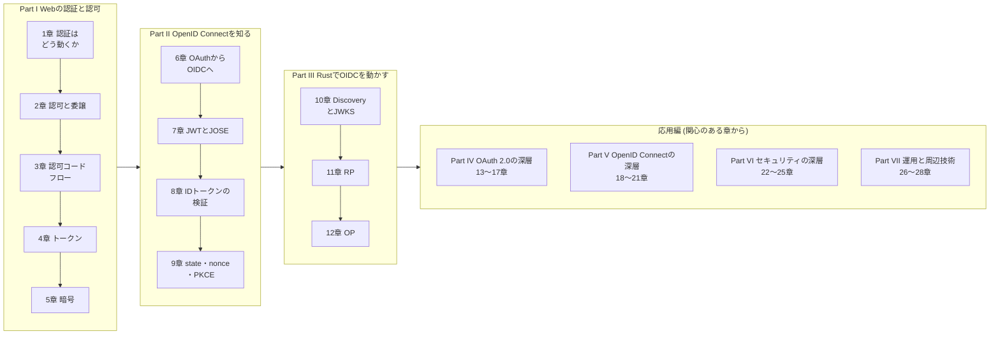

この本は、**Webアプリケーション開発者のための、OAuth 2.0 と OpenID Connect の教科書**です。
Rustのコードを題材にして、「Googleでログイン」のようなログインの仕組みと、
APIへのアクセスを第三者のアプリケーションに許可する仕組みを扱います。
これらがどのようなメッセージのやり取りで成り立っているのかを、仕様書(RFC)の原文を参照して理解することを目指します。

## 対象読者

本書は、Webアプリケーションの開発経験があり、OAuth や OpenID Connect(OIDC)については
名前を知っている程度、という読者を想定しています。Basic認証やセッションCookieを使った
ログインを実装した経験、またはその仕組みをおおまかに知っていることを前提にします。
Rustについては、所有権、トレイト、ジェネリクス、async などの主要な概念を把握している
水準を前提にします。

OAuth と OIDC は、ライブラリやクラウドのサービスを使えば、仕組みを知らなくても
動くものを作れます。一方で、設定を1つ誤るだけでアカウントの乗っ取りが成立する分野でもあります。
「なぜこのパラメータが必要なのか」「この検査を省くと何が起きるのか」を、
攻撃と仕様の両面から説明できるようになることが本書の目標です。

OAuth と OIDC については前提知識ゼロから説明しますが、Rustの文法そのものは解説しません。
技術用語は初出時に必ず説明し、巻末の[用語集](/appendix/glossary/)にすべてまとめてあります。

## この本で何がわかるか

読み終えると、次のことができるようになります。

- 認証と認可の違い、OAuth 2.0 が「パスワードを渡さずに権限だけを渡す」仕組みであることを説明できます
- 認可コードフローの各メッセージが、どの値をどこからどこへ送り、なぜその形なのかを説明できます
- ID トークンの検証手順を1項目ずつ実装し、各項目がどの攻撃を防いでいるかを説明できます
- `state`・`nonce`・PKCE がそれぞれ何を結びつけ、どの攻撃を防ぐかを区別できます
- Rust で RP(ログインする側)、OP(ログインさせる側)、リソースサーバ(API)を書けます
- DPoP、PAR、BFF、FAPI 2.0 などの拡張仕様が、どの弱点を補うために作られたのかを説明できます
- RFC や OpenID 仕様の原文を自分で読み、要請語(MUST、SHOULD、MAY)の意味を正確に読み取れます

## 構成

次の図は本書の全体の流れです。基礎編の3つのPartを順にたどり、
その先の応用編(Part IV〜VII)は関心のある章から読めます。

本書は**基礎編**(Part I〜III)と**応用編**(Part IV〜VII)の2部構成です。

基礎編は、前提知識ゼロから最短の順序で「OIDC のログインを、メッセージ単位で説明し、
Rust で実装できる」状態に到達することを目指します。

- **Part I(Webの認証と認可)**: Basic認証とセッションCookieから始めて、認証と認可の違い、
  OAuth 2.0 の委譲の考え方、認可コードフロー、アクセストークン、そして後の章が依存する
  暗号の基礎(ハッシュ、HMAC、署名)を説明します
- **Part II(OpenID Connectを知る)**: OAuth 2.0 だけではログインを安全に実装できない理由から始めて、
  ID トークン、JWT と JOSE、ID トークンの検証、`state`・`nonce`・PKCE を説明します
- **Part III(RustでOIDCを動かす)**: Discovery と JWKS で OP の設定値と公開鍵を取得し、
  Rust で RP と OP を実装して、手元で実際にログインを動かします

応用編は、基礎編で扱いきれなかった、体系を完成させるために必要な主題を扱います。
各章は独立して読めますが、いずれも基礎編の理解を前提とします。

- **Part IV(OAuth 2.0の深層)**: クライアント認証、リソースサーバでのトークンの検証、
  リフレッシュトークン、DPoP と mTLS、PAR・JAR・RAR を扱います
- **Part V(OpenID Connectの深層)**: クレームとユーザーの識別、フローの全体像、
  認可コード以外のグラント、ログアウトとセッション管理を扱います
- **Part VI(セキュリティの深層)**: 脅威モデルと RFC 9700、JWT への攻撃、
  ブラウザアプリとネイティブアプリ、OAuth 2.1 と FAPI 2.0 を扱います
- **Part VII(運用と周辺技術)**: 鍵のローテーションなどの運用、SD-JWT や
  OpenID Federation などの周辺の標準、そして設計判断のまとめと本書全体の知識の一覧を扱います

基礎編の各章は前の章の内容を前提にしているので、順に読むことをおすすめします。
応用編は関心のある章から読んでかまいません。

## RFCを原文で読みます

OAuth と OIDC の仕様は、IETF の RFC と OpenID Foundation の仕様書として公開されています。
仕様書は、実装者が誤解の余地なく読めるように書かれている一方で、
初めて読む人にとっては言い回しが独特で、どこが重要なのかがわかりにくい文書です。

本書では、概念を説明した直後に、その概念を定めている原文を引用して読み解きます。
各章の「RFCを読む」「仕様を読む」の節がそれにあたります。原文の英語を短く引用し、
その節が何を定めているのか、要請語がどの強さで何を求めているのか、
後続の文書で何が変わったのかを、平易な日本語で説明します。
RFCの構成や要請語の読み方は[付録 RFCの読み方](/appendix/reading-rfcs/)に、
本書で扱ったすべての文書の一覧は[付録 RFC・仕様の索引](/appendix/rfc-index/)にまとめています。

## コードをその場で実行できます

本文中のコードブロックの多くは、**ブラウザ上でそのまま実行できます**。
「▶ 実行」を押すと、Rust公式の実行環境([Rust Playground](https://play.rust-lang.org/))に
コードが送られ、コンパイルと実行の結果が表示されます。
「編集」を押せばコードを書き換えて試せます。

次のコードは、9章で扱う PKCE の計算を、RFC 7636 の付録Bに記載されている値で行うものです。
出力の `code_challenge` は、RFC に記載されている値と一致します。

<RustPlay snippet="intro/hello" />

Rust Playground はネットワークに接続できないため、本書の実験では OP・RP・リソースサーバの
やり取りを1つのプロセスの中で関数呼び出しとして再現しています。
実際にサーバを起動してブラウザでログインを動かすためのプロジェクトは、
リポジトリの `examples/` ディレクトリに用意しています([11章](/rust-impl/11-build-rp/)、[12章](/rust-impl/12-build-op/))。

## 表記について

- 本書の仕様の現況(RFC の発行状況、Internet-Draft の版数)は、2026年10月16日に確認したものです。
  策定中の文書を扱う箇所では、本文に版数と確認日を書いています
- 原文の引用は英語のまま示し、直後に出典(RFC番号と節番号)を書いています。
  要請語は「〜しなければなりません(MUST)」のように原語を併記して訳しています
- 鍵、トークン、パスワードの例は、すべて例示用のダミーの値か、RFC に掲載されている例の値です
- 「手元のMac」とある実行結果は、Apple M5 Pro、macOS 27.0、rustc 1.95.0 での実行結果です。
  Playground の実行結果は、共有の x86-64 Linux 環境で stable の rustc を使ったものです
- コマンドの実行例は macOS / Linux のシェルを想定しています
- Rustのコードはエディション2024を前提としています

[1章 認証はどう動くか](/web-auth/01-http-auth/)に進んでください。
