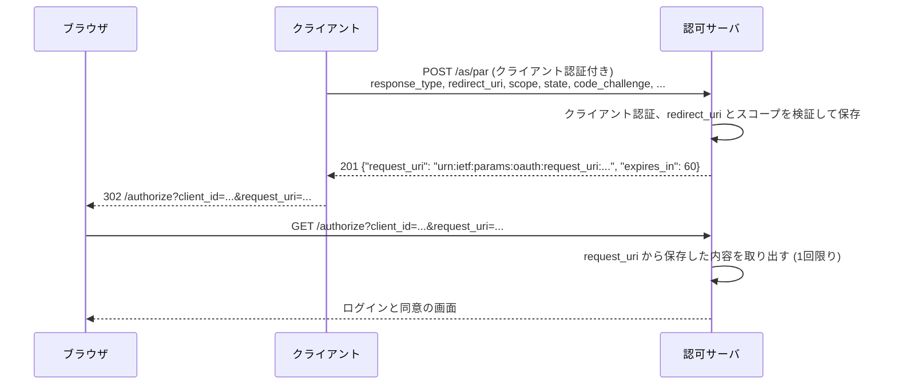
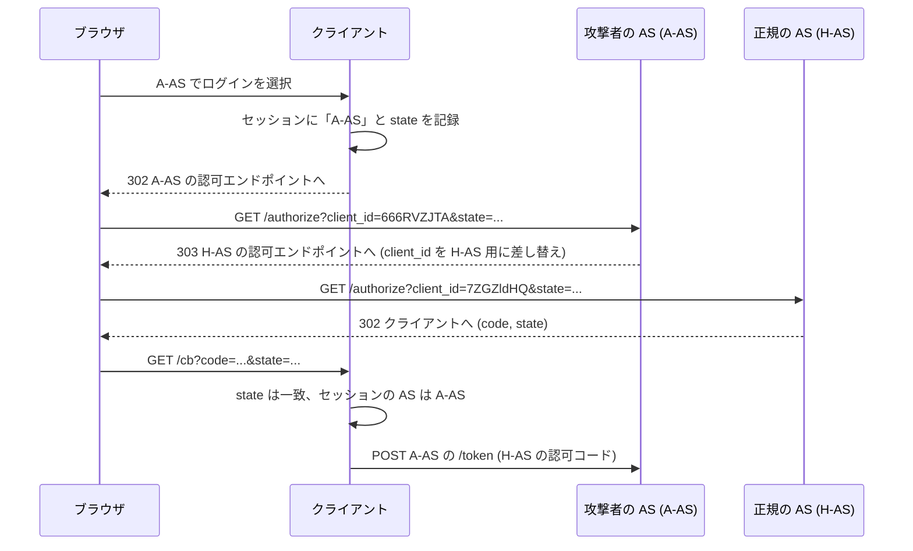

この章でわかること:

- ブラウザを経由する認可リクエストの3つの弱点(改ざん、漏洩、長さ)
- PAR で認可リクエストをバックチャネルで先に送り、ブラウザには `request_uri` だけを通す手順(実験)
- JAR のリクエストオブジェクトの署名検証と、オブジェクトの外のパラメータを使わない規則(RFC 9101 の例で検証)
- RAR の `authorization_details` による、スコープでは表せない細かい権限の要求
- 認可レスポンスの `iss` パラメータによるミックスアップ攻撃の検出(実験)と、JARM・`form_post`
- なぜ体系に必須か: 認可リクエストと認可レスポンスは、利用者のブラウザという、クライアントも認可サーバも制御できない経路を通ります。この区間の保護が欠けていると、トークンエンドポイントやリソースサーバの検証をどれだけ厳格にしても、要求の内容や認可コードの行き先を攻撃者に操作されます

## 基礎編からの接続

[2章](/web-auth/02-delegation/)では、ブラウザのリダイレクトを経由する通信をフロントチャネル、サーバ同士の直接の通信をバックチャネルと呼び分けました。[3章](/web-auth/03-authorization-code/)の認可コードフローでは、認可リクエストのパラメータ(`response_type`、`client_id`、`redirect_uri`、`scope`、`state`)をクエリ文字列に入れて、302 リダイレクトで認可エンドポイントに送りました。[9章](/oidc/09-state-nonce-pkce/)の `state`、`nonce`、PKCE は、このフロントチャネルの区間で起きる CSRF やコードの横取りへの対策でした。

この章では、フロントチャネルを通るメッセージそのものを保護する仕組みを扱います。認可リクエストについては PAR と JAR、認可レスポンスについては `iss` パラメータと JARM です。PAR のリクエストには[13章](/oauth-deep/13-client-auth/)のクライアント認証を、DPoP との組み合わせには[16章](/oauth-deep/16-sender-constrained/)の `dpop_jkt` を使います。

## フロントチャネルの弱点

RFC 9126(PAR)の1節は、クエリ文字列で送る認可リクエストの問題を3つ挙げています。

> There is no cryptographic integrity and authenticity protection. An attacker could, for example, modify the scope of access requested or swap the context of a payment transaction by changing scope values.

(RFC 9126 1節)

1つ目は、暗号による完全性と真正性の保護がないことです。認可リクエストの URL はクライアントが作りますが、ブラウザに渡った後は、利用者の端末上のマルウェアやブラウザ拡張、リダイレクトの途中の攻撃者が書き換えられます。引用は、要求するスコープの変更や、支払いの内容のすり替えを例に挙げています。認可サーバは、受け取った URL がクライアントの作ったとおりかを確かめられません。

2つ目は機密性です。認可エンドポイントには HTTPS が必須ですが、リクエストのデータはブラウザを平文のまま通過します。クエリ文字列は、Web サーバのログや Referer ヘッダを通じて他のサイトに漏れることがあります。同節は、認可リクエストに個人を特定できる情報や規制対象のデータが含まれる場合(本人確認やオープンバンキングの場面)、漏洩の影響が大きいと述べています。

3つ目は長さです。細かい権限を表すデータを含めると認可リクエストの URL は長くなり、ブラウザやプロキシの URL の長さの上限を超えてエラーになることがあります。

これに加えて、フロントチャネルの認可リクエストでは、認可サーバは利用者とのやり取りを始める前にクライアントを認証できません。`client_id` は誰でも URL に書けます。このため、認可サーバが「この認可リクエストは本当にこのクライアントが作ったか」を確認できるのは、トークンエンドポイントでクライアント認証が行われる時点、つまり利用者がログインと同意を終えた後になります。

## PAR: 認可リクエストを先に送る

**PAR**(Pushed Authorization Requests、RFC 9126)は、クライアントが認可リクエストの内容を、ブラウザを経由せずに認可サーバへ直接送る仕組みです。送り先は認可サーバの **PAR エンドポイント**(pushed authorization request endpoint)で、クライアントはクライアント認証を付けて POST します。認可サーバは内容を検証して保存し、その内容を指す参照の値を返します。この値を `request_uri`(request_uri パラメータ)と呼びます。ブラウザに通すのは `client_id` と `request_uri` だけです。



PAR のリクエストは、トークンエンドポイントへのリクエストと同じ形式で、認可リクエストのパラメータとクライアント認証のパラメータを本文に並べます。次は RFC 9126 2.1節の例で、`private_key_jwt` でクライアント認証をしています(`client_assertion` は途中を省略しています)。

```http
POST /as/par HTTP/1.1
Host: as.example.com
Content-Type: application/x-www-form-urlencoded

response_type=code&state=af0ifjsldkj&client_id=s6BhdRkqt3
&redirect_uri=https%3A%2F%2Fclient.example.org%2Fcb
&code_challenge=K2-ltc83acc4h0c9w6ESC_rEMTJ3bww-uCHaoeK1t8U
&code_challenge_method=S256&scope=account-information
&client_assertion_type=urn%3Aietf%3Aparams%3Aoauth%3Aclient-assertion-type%3Ajwt-bearer
&client_assertion=eyJraWQiOiJrMmJkYyIsImFsZyI6IlJTMjU2In0.eyJpc3Mi...
```

```http
HTTP/1.1 201 Created
Content-Type: application/json
Cache-Control: no-cache, no-store

{
 "request_uri": "urn:ietf:params:oauth:request_uri:6esc_11ACC5bwc014ltc14eY22c",
 "expires_in": 60
}
```

クライアントは、受け取った `request_uri` を使ってブラウザを認可エンドポイントに送ります。

```http
GET /authorize?client_id=s6BhdRkqt3&request_uri=urn%3Aietf%3Aparams%3Aoauth%3Arequest_uri%3A6esc_11ACC5bwc014ltc14eY22c HTTP/1.1
Host: as.example.com
```

ブラウザを通るのは、認可サーバの外では意味を持たない参照の値だけです。スコープも `redirect_uri` も URL に現れないため、書き換えの対象もログに漏れる内容もありません。URL の長さも、要求の内容にかかわらず一定です。

## RFCを読む: RFC 9126 2節

> The rules for client authentication as defined in [RFC6749] for token endpoint requests, including the applicable authentication methods, apply for the PAR endpoint as well.

(RFC 9126 2節)

この節は PAR エンドポイントを定めています。エンドポイントは `application/x-www-form-urlencoded` の本文を受け付ける POST の API で、URL は https でなければなりません(MUST)。引用した文は、トークンエンドポイントのクライアント認証の規則(使える方式を含む)が、PAR エンドポイントにもそのまま適用されることを定めています。クライアントが登録した `token_endpoint_auth_method` が、PAR エンドポイントでも使われます。同じ節は、クライアントアサーションの `aud` には認可サーバの issuer 識別子を使うべきであり(SHOULD)、認可サーバは issuer、トークンエンドポイント URL、PAR エンドポイント URL のどれも受け入れなければならない(MUST)とも定めています。13章で見た `aud` の曖昧さへの対応です。

2.1節は、リクエストの処理を3段階で定めています。認可サーバは次の順に処理しなければなりません(MUST)。

1. トークンエンドポイントと同じ方法でクライアントを認証します
2. `request_uri` パラメータが含まれていれば拒否します。PAR で送る内容そのものが、別の `request_uri` を参照することは許されません
3. 認可エンドポイントに送られた認可リクエストと同じように検証します。`redirect_uri` が登録済みのものと一致するか、クライアントがそのスコープを許可されているかを確認し、不正な要求を早い段階で拒否します

> This URI is a single-use reference to the respective request data in the subsequent authorization request.

(RFC 9126 2.2節、request_uri の項)

2.2節は成功の応答を定めています。認可サーバは `request_uri` を生成し、201 で返さなければなりません(MUST)。`request_uri` は、続く認可リクエストで使う、1回限りの参照です。`expires_in` は `request_uri` の有効期間(秒)で、同節は5秒から600秒程度を典型的な値として挙げています。`request_uri` の値は、推測や予測が計算上不可能になるよう、暗号論的に強い擬似乱数で生成した部分を含まなければならず(MUST)、要求を送ったクライアントに束縛しなければなりません(MUST)。`urn:ietf:params:oauth:request_uri:` に乱数を続けた形を使ってもかまいません(MAY)。

2.4節は、クライアントを事前に認証できることの利点の1つを定めています。通常の認可リクエストでは、`redirect_uri` は登録済みの値と完全に一致しなければなりません([22章](/security/22-threats/))。PAR では、認可サーバがクライアントを認証してから認可の手続きを始めるため、資格情報を持つクライアントに限って、登録していない `redirect_uri` の使用を認めてもかまいません(MAY)。7.2節は、PAR で新しい `redirect_uri` を受け入れるのは、認証されたクライアントからのリクエストに限らなければならない(MUST)と定めています。

## RFCを読む: RFC 9126 4節

> Since parts of the authorization request content, e.g., the "code_challenge" parameter value, are unique to a particular authorization request, the client MUST only use a "request_uri" value once. Authorization servers SHOULD treat "request_uri" values as one-time use but MAY allow for duplicate requests due to a user reloading/refreshing their user agent. An expired "request_uri" MUST be rejected as invalid.

(RFC 9126 4節)

この節は、`request_uri` を使う認可リクエストを定めています。`code_challenge` のように認可リクエストの内容の一部は1回の認可に固有なので、クライアントは `request_uri` を1回だけ使わなければなりません(MUST)。認可サーバは `request_uri` を1回限りのものとして扱うべきですが(SHOULD)、利用者がブラウザで再読み込みした場合の重複は許してもかまいません(MAY)。期限切れの `request_uri` は無効として拒否しなければなりません(MUST)。

認可サーバは、PAR 経由のリクエストも他の認可リクエストと同じように検証しなければなりません(MUST)。PAR の時点で行った検証の一部を省いてよいのは、そのリクエストが PAR 経由であることを確認でき、リクエストや認可サーバの方針が結果に影響する形で変わっていない場合に限られます。

同じ節は、認可サーバの方針として、全体またはクライアントごとに PAR だけを受け付けるようにしてもよいと述べています。その場合、PAR エンドポイントから得た `request_uri` を含まない認可リクエストを `invalid_request` で拒否します。この方針は、認可サーバのメタデータとクライアントのメタデータの `require_pushed_authorization_requests`(5節、6節)で表します。PAR を任意にしたままでは、攻撃者は PAR を使わない通常の認可リクエストを作れるため、保護の効果を確実にするにはこの方針が必要です。

## 実験: PAR で認可リクエストを送る

PAR エンドポイントと認可エンドポイントを持つ認可サーバを関数として作り、RFC 9126 の手順を確かめます。認可リクエストには、後で扱う RAR の `authorization_details`(RFC 9396 の例の JSON)を含め、URL の長さも比べます。クライアント認証は簡単のため `client_secret_post` にしています。PAR エンドポイントは、RFC 9126 2.1節の3つの手順を順に行います。まず、`client_id` に対応する登録と `client_secret` の両方が存在し、シークレットが一致することを確かめます。次に `request_uri` を拒否します。最後に、認可エンドポイントと同じ検証として、`response_type` が `code` であること、`redirect_uri` が登録済みの値と一致すること、`scope` の各値がそのクライアントに許可された範囲(`s6BhdRkqt3` は `openid` と `accounts`)に含まれることを確かめます。`request_uri` は乱数で生成するので、その値は実行ごとに変わります。

<RustPlay snippet="ch17/par" title="PAR で認可リクエストを事前に送り、request_uri の束縛と1回性を確かめる" />

[1] は、同じ内容をクエリ文字列で送る場合の URL で、919文字になります。[3] の PAR 後の URL は142文字で、`authorization_details` の内容は含まれません。認可リクエストに含める内容が増えても、PAR 後の URL の長さは変わりません。

[2] の応答は、RFC の規定どおり 201 で、`request_uri` と `expires_in` を含みます。[4] では、攻撃者が認可リクエストの URL に `scope=admin` と別の `redirect_uri` を書き足しました。認可サーバは `request_uri` が指す内容だけを使うため、`redirect_uri` は登録済みの値のままで、`scope` も PAR で送られていない(この要求には `scope` がない)ことがわかります。

[5] は同じ `request_uri` の再利用、[6] は別のクライアントによる使用、[7] は期限切れで、いずれも `invalid_request_uri` で拒否されます。[6] は、`request_uri` をクライアントに束縛する規定によるものです。[8] は未登録の `redirect_uri` を PAR で送った場合で、利用者がログイン画面を見る前に 400 で拒否されます。通常の認可リクエストでは、この検査は利用者がブラウザで認可エンドポイントに到達した時点で行われます。[9] はクライアント認証の失敗で、PAR エンドポイントは 401 と `invalid_client` を返します。正規のクライアント以外は、認可の手続きを始めることもできません。

[10] は、未登録の `client_id` で `client_secret` と `redirect_uri` を省いたリクエストです。登録済みのシークレットと送られたシークレットを、どちらも「値がない」状態のまま比較する実装では、2つの値が等しいと判定されて認証が成功します。`redirect_uri` の比較も同じ理由で通過し、201 が返ります。実験の PAR エンドポイントは、登録とシークレットのどちらかが欠けていれば `invalid_client` で拒否します。[11] は `response_type` を省いた場合で、`invalid_request` で拒否されます。[12] は、`s6BhdRkqt3` に許可されていない `admin` をスコープに含めた場合で、`invalid_scope` で拒否されます。RFC 9126 2.1節は、PAR の時点でクライアントがそのスコープを許可されているかを確かめる例を挙げています。エラーコードは、2.3節の規定に従って RFC 6749 4.1.2.1節のものを使っています。

## JAR: 認可リクエストに署名する

PAR は認可リクエストの経路を変えることで改ざんを防ぎました。もう1つの方法は、認可リクエストの内容そのものに署名することです。**JAR**(JWT-Secured Authorization Request、RFC 9101)は、認可リクエストのパラメータを JWT のクレームとして並べ、クライアントの鍵で署名して送る仕組みです。この JWT を**リクエストオブジェクト**(request object)と呼びます。

リクエストオブジェクトのクレームの例を示します(RFC 9101 4節の例です)。

```json
{
 "iss": "s6BhdRkqt3",
 "aud": "https://server.example.com",
 "response_type": "code id_token",
 "client_id": "s6BhdRkqt3",
 "redirect_uri": "https://client.example.org/cb",
 "scope": "openid",
 "state": "af0ifjsldkj",
 "nonce": "n-0S6_WzA2Mj",
 "max_age": 86400
}
```

リクエストオブジェクトの送り方は2つあります。`request`(request パラメータ)で JWT そのものを送る方法(値渡し)と、`request_uri` で JWT の置き場所を送る方法(参照渡し)です。PAR の `request_uri` は、後者の参照を認可サーバ自身が発行する形と見ることができます。PAR のリクエストの本文に `request` パラメータでリクエストオブジェクトを入れれば、PAR と JAR を組み合わせられます(RFC 9126 3節)。

```http
GET /authorize?client_id=s6BhdRkqt3&request=eyJhbGciOiJSUzI1NiIsImtpZCI6ImsyYmRjIn0.ewogICAg... HTTP/1.1
Host: server.example.com
```

PAR がクライアント認証によって「このクライアントが送った」ことを保証するのに対し、JAR は署名によって同じことを保証します。署名はリクエストオブジェクトと一緒に残るため、後から第三者に「このクライアントがこの内容を要求した」と示すことができます。送信した事実を後から否定できないようにする性質を**否認防止**(non-repudiation)と呼びます。RFC 9126 の1節は、否認防止が必要なクライアントは PAR と JAR を組み合わせられると述べています。

## RFCを読む: RFC 9101 4節

> It MUST contain all the parameters (including extension parameters) used to process the OAuth 2.0 [RFC6749] authorization request except the "request" and "request_uri" parameters that are defined in this document.

(RFC 9101 4節)

この節はリクエストオブジェクトの内容を定めています。リクエストオブジェクトは、認可リクエストの処理に使うすべてのパラメータ(拡張パラメータを含む)を含まなければなりません(MUST)。例外は `request` と `request_uri` の2つで、これらをリクエストオブジェクトに含めてはなりません(MUST NOT)。パラメータ名と文字列の値は JSON の文字列に、数値は JSON の数値にしなければなりません(MUST)。上の例の `max_age` が数値になっているのはこのためです。

署名には JWS を使います。署名する場合、リクエストオブジェクトは `iss` と `aud` を含むべきです(SHOULD)。`aud` は認可サーバの issuer 識別子にすべきです。`aud` を検査する規則は、RFC 9101 ではなく JWT の仕様にあります。RFC 7519 4.1.3節は、`aud` があるときに処理する側が自分を示す値をそこに見つけられなければ、その JWT を拒否しなければならない(MUST)と定めています。暗号化する場合は JWE を使い、署名と暗号化の両方を行うときは、署名してから暗号化しなければなりません(MUST)。メディアタイプは `application/oauth-authz-req+jwt` です。10.8節は、ヘッダの `typ` に `oauth-authz-req+jwt` を入れる明示的な型付けを、互換性を考慮しなくてよい新しい環境では採用するとよいと述べています。

## RFCを読む: RFC 9101 5節と6節

> The client MAY send the parameters included in the Request Object duplicated in the query parameters as well for backward compatibility, etc. However, the authorization server supporting this specification MUST only use the parameters included in the Request Object.

(RFC 9101 5節)

5節は、リクエストオブジェクトを使う認可リクエストを定めています。`request` と `request_uri` はどちらか一方だけを使い、両方を含めてはなりません(MUST NOT)。`client_id` はクエリにも必須で、リクエストオブジェクトの `client_id` と一致しなければなりません(MUST)。引用した部分が最も重要な規則です。クライアントは、後方互換性などのためにリクエストオブジェクトと同じパラメータをクエリにも重ねて入れてもかまいません(MAY)。しかし、この仕様をサポートする認可サーバは、リクエストオブジェクトに含まれるパラメータだけを使わなければなりません(MUST)。クエリ側の値を使うと、署名で保護した意味がなくなるためです。

5.2節は参照渡しについて定めています。`request_uri` は、512文字の ASCII を超えるべきではありません(SHOULD NOT)。認可サーバが取得する外部の URL なら https、認可サーバ自身が発行したものなら URN でなければなりません(MUST)。認可サーバが外部の URL を取得する構成は、13章の CIMD と同じく SSRF の対策が必要になります。

> The authorization server MUST validate the signature of the JWS-signed [RFC7515] Request Object. If a "kid" Header Parameter is present, the key identified MUST be the key used and MUST be a key associated with the client. The signature MUST be validated using a key associated with the client and the algorithm specified in the "alg" Header Parameter. Algorithm verification MUST be performed, as specified in Sections 3.1 and 3.2 of [RFC8725].

(RFC 9101 6.2節)

6.2節は署名の検証を定めています。認可サーバは、リクエストオブジェクトの署名を検証しなければなりません(MUST)。`kid` ヘッダがあれば、その鍵を使わなければならず、その鍵はクライアントに関連づけられたものでなければなりません(MUST)。検証は、クライアントの鍵と `alg` ヘッダのアルゴリズムで行い、RFC 8725 の3.1節と3.2節に従ってアルゴリズムを検証しなければなりません(MUST)。鍵がクライアントのものでない場合や署名の検証に失敗した場合は、`invalid_request_object` のエラーを返さなければなりません(MUST)。6.3節は、クエリの `client_id` とリクエストオブジェクトの `client_id` が同一でなければならない(MUST)ことを改めて定めています。

10.5節は、格下げ攻撃を扱っています。クライアントと認可サーバの間で JAR の使用を必須にしていなければ、攻撃者は署名のない通常の認可リクエストを作って JAR の保護を回避できます。このため、メタデータの `require_signed_request_object` が定められています。PAR の `require_pushed_authorization_requests` と同じ考え方です。

## 実験: リクエストオブジェクトを検証する

RFC 9101 4節の RS256 のリクエストオブジェクトを、同節に掲載された RSA 公開鍵(`kid` は `k2bdc`)で検証します。ring の `RsaPublicKeyComponents` に、JWK の `n` と `e` を Base64url から復号したバイト列を渡し、`RSA_PKCS1_2048_8192_SHA256` で検証します。署名を検証した後、`aud` があれば、自分の issuer(RFC の例の `https://server.example.com`)を含むことを確かめます。そのうえで、クエリとリクエストオブジェクトのパラメータが食い違う場合の扱いを確かめます。

<RustPlay snippet="ch17/request-object" title="RFC 9101 のリクエストオブジェクトを検証し、クエリのパラメータを使わないことを確かめる" />

[1] は、リクエストオブジェクトのヘッダとペイロードを復号した結果です(serde_json がキーを辞書順に並べて表示しています)。RFC の例のペイロードは、改行と空白を含む整形された JSON を Base64url にしたもので、`ewogICAg` は `{` と改行と4つの空白に当たります。署名はこの Base64url の文字列に対して計算されているため、JSON として同じ意味でも、整形の仕方が変われば検証は失敗します。

[2] は、RFC の公開鍵で署名の検証に成功し、パラメータを取り出した結果です。[3] では、クエリに攻撃者の `redirect_uri` と、`email` や `offline_access` を加えた `scope` を書き足しました。認可サーバはリクエストオブジェクトの値だけを使うため、取り出された `redirect_uri` と `scope` は [2] と同じです。

[4] はクエリの `client_id` がリクエストオブジェクトと異なる場合で、拒否されます。[5] は、リクエストオブジェクトのペイロードの `redirect_uri` を書き換えた場合です。署名の入力が変わるため、`invalid_request_object` になります。[6] は `alg` を `none` にした署名のないリクエストオブジェクトで、許可リストにないアルゴリズムとして拒否されます。[7] は、署名が正しい同じリクエストオブジェクトを、issuer が `https://other-as.example.net` の別の認可サーバが受け取った場合です。`aud` が自分を含まないため、`invalid_request_object` で拒否されます。`aud` を検査しない認可サーバでは、ある認可サーバ宛てのリクエストオブジェクトを入手した者が、同じクライアントを登録している別の認可サーバでそれを使えます。

## RAR: 細かい権限を要求する

スコープは `orders:read` のような短い文字列であり、「どの口座から、どの相手に、いくら送金するか」のような具体的な内容を表せません。**RAR**(Rich Authorization Requests、RFC 9396)は、認可の要求を JSON の構造で表す仕組みです。要求は `authorization_details`(authorization_details パラメータ)に、JSON の配列として入れます。

```json
[
   {
      "type": "payment_initiation",
      "actions": ["initiate", "status", "cancel"],
      "locations": ["https://example.com/payments"],
      "instructedAmount": {
         "currency": "EUR",
         "amount": "123.50"
      },
      "creditorName": "Merchant A",
      "creditorAccount": {
         "iban": "DE02100100109307118603"
      },
      "remittanceInformationUnstructured": "Ref Number Merchant"
   }
]
```

この例(RFC 9396 2節の Figure 2)は、Merchant A に123.50ユーロを送金する権限を要求しています。認可サーバは、この内容を同意画面に表示して利用者の同意を得ます。同意された内容はトークンレスポンスで返され、リソースサーバには JWT アクセストークンかイントロスペクションの応答で伝えられます(RFC 9396 7節、9節)。

## RFCを読む: RFC 9396 2節

> The request parameter authorization_details contains, in JSON notation, an array of objects. Each JSON object contains the data to specify the authorization requirements for a certain type of resource. The type of resource or access requirement is determined by the type field, which is defined as follows:

(RFC 9396 2節)

この節は `authorization_details` の構造を定めています。値はオブジェクトの JSON 配列で、各オブジェクトは、ある種類のリソースに対する認可の要求を表します。種類は `type` フィールドで決まり、`type` は必須です(REQUIRED)。`type` の値によって、そのオブジェクトに含められる内容が決まります。同じ `type` のオブジェクトを配列に複数含めてもかまいません(MAY)。

2.2節は、API の種類を問わず使える共通のフィールドを定めています。

- `locations`: リソースやリソースサーバの場所(通常は URI)の配列です
- `actions`: リソースに対して行う操作の種類の配列です
- `datatypes`: 要求するデータの種類の配列です
- `identifier`: API 内の特定のリソースを示す文字列です
- `privileges`: 要求する権限の種類やレベルの配列です

複数の共通フィールドを組み合わせた場合、要求する権限はすべての値の積になります。`actions` が2つ、`locations` が2つあれば、それぞれの操作をそれぞれの場所で行う4通りの権限を要求したことになります。

3節によれば、`authorization_details` は `scope` が使えるすべての場所で使え、認可リクエストでは JSON をシリアライズして form-urlencoded で符号化します。前の実験の [1] で見たとおり、符号化した URL は長くなるため、3節は PAR との併用を検討してもよい(MAY)と述べています。3.1節は、`scope` と `authorization_details` を同じリクエストで使うことを認めつつ、1つの API では一方の形式だけを使うことを推奨しています(RECOMMENDED)。

## 認可レスポンスを保護する

ここまでは、クライアントから認可サーバへの認可リクエストを扱いました。逆方向の認可レスポンス(`code` と `state`)も、ブラウザのリダイレクトでクライアントに届きます。クライアントは[9章](/oidc/09-state-nonce-pkce/)の `state` によって、そのレスポンスが自分の始めた認可に対するものかを確かめます。しかし `state` では、そのレスポンスをどの認可サーバが発行したかは確かめられません。

## ミックスアップ攻撃

複数の認可サーバと連携するクライアントを考えます。利用者は、ログイン画面で「A でログイン」「H でログイン」のように認可サーバを選びます。そのうちの1つが攻撃者の認可サーバ(A-AS)で、もう1つが正規の認可サーバ(H-AS)です。攻撃者は、動的クライアント登録([13章](/oauth-deep/13-client-auth/))を使えば、自分の認可サーバをクライアントに登録させることもできます。

**ミックスアップ攻撃**(mix-up attack)は、クライアントに、ある認可サーバが発行した認可コードを、別の認可サーバ(攻撃者の認可サーバ)のトークンエンドポイントへ送らせる攻撃です。RFC 9700 の4.4.1節の手順を図にします。



攻撃者の認可サーバは、受け取った認可リクエストの `client_id` を、そのクライアントの H-AS での `client_id` に差し替えて、ブラウザを H-AS へ転送します。利用者は H-AS で通常どおりログインし、H-AS はクライアントのリダイレクト URI に認可コードを返します。`state` はクライアントが作った値がそのまま往復するので一致します。クライアントは、セッションに記録した A-AS が認可コードを発行したと判断し、A-AS のトークンエンドポイントに H-AS の認可コードを送ります。

攻撃者は H-AS の認可コードを入手します。パブリッククライアントなら、そのコードを H-AS で交換できる可能性があり、そうでなくても[9章](/oidc/09-state-nonce-pkce/)のコードインジェクションに使えます。RFC 9207 の1節は、1つの認可サーバとしか連携しないクライアントはこの攻撃を受けないが、2つ目の認可サーバに対応した時点で対策が必要になると述べています。

## RFCを読む: RFC 9207 2節

> In authorization responses to the client, including error responses, an authorization server supporting this specification MUST indicate its identity by including the iss parameter in the response.

(RFC 9207 2節)

この節は、認可レスポンスの **iss パラメータ**(iss parameter)を定めています。この仕様をサポートする認可サーバは、エラーレスポンスを含むすべての認可レスポンスに `iss` パラメータを含め、自分の身元を示さなければなりません(MUST)。値は認可サーバの issuer 識別子(RFC 8414)で、https のスキームを使い、クエリとフラグメントを含まない URL でなければなりません(MUST)。

```http
HTTP/1.1 302 Found
Location: https://client.example/cb?code=x1848ZT64p4IirMPT0R-X3141MFPTuBX-VFL_cvaplMH58&state=ZWVlNDBlYzA1NjdkMDNhYjg3ZjUxZjAyNGQzMTM2NzI&iss=https%3A%2F%2Fhonest.as.example
```

2.3節によれば、RFC 8414 のメタデータを公開する認可サーバは、メタデータの `issuer` と同一の値を `iss` パラメータに使わなければならず(MUST)、メタデータの `authorization_response_iss_parameter_supported` を `true` にして対応を示さなければなりません(MUST)。

> Clients MUST then decode the value from its "application/x-www-form-urlencoded" form according to Appendix B of [RFC6749] and compare the result to the issuer identifier of the authorization server where the authorization request was sent to. This comparison MUST use simple string comparison as defined in Section 6.2.1 of [RFC3986]. If the value does not match the expected issuer identifier, clients MUST reject the authorization response and MUST NOT proceed with the authorization grant. For error responses, clients MUST NOT assume that the error originates from the intended authorization server.

(RFC 9207 2.4節)

2.4節はクライアントの検証を定めています。クライアントは `iss` の値を form-urlencoded から復号し、認可リクエストを送った認可サーバの issuer 識別子と比べなければなりません(MUST)。比較は単純な文字列比較でなければなりません(MUST)。一致しなければ、認可レスポンスを拒否し、認可の手続きを続けてはなりません(MUST NOT)。エラーレスポンスについては、そのエラーが意図した認可サーバから来たと仮定してはなりません(MUST NOT)。

同じ節は、`iss` パラメータに対応する認可サーバと対応しない認可サーバの両方と連携するクライアントに、認可サーバごとに対応の有無を記録しておくことを求めています(MUST)。対応している認可サーバからの `iss` のないレスポンスは拒否しなければなりません(MUST)。この記録がないと、攻撃者は `iss` を取り除いたレスポンスで検査を回避できます。OpenID Connect で認可エンドポイントから ID トークンが返される場合、`iss` パラメータの値は ID トークンの `iss` クレームと常に同一でなければなりません(MUST)。

RFC 9700 の4.4.2節は、ミックスアップ攻撃への対策として、この issuer の識別と、認可サーバごとに異なるリダイレクト URI を使う方法の2つを挙げています。どちらの場合も、クライアントは認可リクエストごとに送り先の issuer を記録し、ユーザーエージェントに結びつけておかなければなりません(MUST)。後者の方法は、攻撃者が正規の認可サーバに新しいクライアントを登録して回避できる場合があるため、他の方法が使えない場合に限るべきだ(SHOULD)とされています。ミックスアップ攻撃の変種と RFC 9700 の対策の全体は、[22章](/security/22-threats/)で扱います。

## 実験: iss パラメータでミックスアップ攻撃を検出する

RFC 9700 4.4.1節の例と同じ issuer と `client_id`(H-AS は `https://honest.as.example` と `7ZGZldHQ`、A-AS は `https://attacker.example` と `666RVZJTA`)で、クライアントのコールバック処理を再現します。クライアントはセッションに送り先の issuer と `state` を記録しています。`iss` を検査しない実装と、RFC 9207 2.4節に従って検査する実装を比べます。

<RustPlay snippet="ch17/iss-check" title="iss パラメータの検査でミックスアップ攻撃を検出する" />

[1] と [2] は攻撃の経過です。利用者は A-AS を選び、A-AS はブラウザを H-AS へ転送します。H-AS が発行した認可コードは、クライアントに届きます。

[3] は `iss` を検査しないクライアントです。`state` は一致するので検査を通過し、クライアントはセッションに記録した A-AS のトークンエンドポイントに、H-AS の認可コードを送ります。攻撃者は H-AS の認可コードを入手します。

[4] は `iss` を検査するクライアントです。レスポンスの `iss` は `https://honest.as.example` で、セッションに記録した送り先 `https://attacker.example` と一致しないため、クライアントは処理を中止します。認可コードはどこにも送られません。

[5] は正常な H-AS とのフローで、検査を通過します。[6] は、`iss` に対応していると記録された H-AS からのレスポンスに `iss` がない場合で、拒否されます。[7] は `iss` の末尾にスラッシュが付いている場合で、単純な文字列比較なので一致しません。issuer 識別子は、メタデータの値とバイト単位で同じ文字列でなければなりません。

## JARM と response_mode

認可レスポンスの返し方は、`response_mode`(response_mode パラメータ)で指定できます。OAuth 2.0 Multiple Response Type Encoding Practices は、このパラメータを次のように定義しています。

> Informs the Authorization Server of the mechanism to be used for returning Authorization Response parameters from the Authorization Endpoint.

(OAuth 2.0 Multiple Response Type Encoding Practices 2.1節)

`response_mode` は、認可エンドポイントから認可レスポンスのパラメータを返す方法を、認可サーバに指示するパラメータです。認可コードフローの既定はクエリ文字列(`query`)です。フラグメント(`fragment`)を含む他の値と、`response_type` との関係は[19章](/oidc-deep/19-flows/)で扱います。

`form_post`(form_post レスポンスモード)は、OAuth 2.0 Form Post Response Mode が定める値です。この方法では、認可サーバは認可レスポンスのパラメータを HTML フォームの隠しフィールドに入れて返します。ブラウザはこのフォームを自動送信し、パラメータはクライアントのリダイレクト URI に POST で届きます。

```http
HTTP/1.1 200 OK
Content-Type: text/html;charset=UTF-8
Cache-Control: no-cache, no-store
Pragma: no-cache

<html>
 <head><title>Submit This Form</title></head>
 <body onload="javascript:document.forms[0].submit()">
  <form method="post" action="https://client.example.org/callback">
    <input type="hidden" name="state" value="DcP7csa3hMlvybERqcieLHrRzKBra"/>
    <input type="hidden" name="code" value="SplxlOBeZQQYbYS6WxSbIA"/>
  </form>
 </body>
</html>
```

この例は仕様の付録Aの例を、認可コードを返す形に変えたものです。パラメータは POST の本文で届き URL には現れないため、ブラウザの履歴、サーバのアクセスログ、Referer ヘッダに残りません。仕様は、フォームの `action` をクライアントのリダイレクト URI にし、`method` を POST にしなければならない(MUST)と定めています。認可レスポンスは1回だけ使うものなので、ユーザーエージェントと中間者に内容を保存・再利用させないよう指示しなければなりません(MUST)。実装上の注意点として、認可サーバのオリジンからクライアントへの POST はクロスサイトのリクエストになるため、`SameSite=Lax` 以上を指定したクライアントのセッション Cookie はこの POST に付きません。コールバックでセッションを参照する設計とは両立しないため、Cookie の設計([24章](/security/24-browser-native/))と合わせて検討します。

**JARM**(JWT Secured Authorization Response Mode)は、認可レスポンスのパラメータを、認可サーバが署名した JWT に入れて返す方法です。OpenID Foundation の FAPI ワーキンググループが策定し、2022年11月に Final になっています。JWT には、認可レスポンスのパラメータ(`code`、`state` など)に加えて、`iss`(認可サーバの issuer)、`aud`(クライアントの `client_id`)、`exp`(推奨は10分以内)が必ず入ります。返し方として `query.jwt`、`fragment.jwt`、`form_post.jwt`、`jwt` の4つの `response_mode` が定められ、いずれも `response` という1つのパラメータに JWT を入れます。

```json
{
   "iss": "https://accounts.example.com",
   "aud": "s6BhdRkqt3",
   "exp": 1311281970,
   "code": "PyyFaux2o7Q0YfXBU32jhw.5FXSQpvr8akv9CeRDSd0QA",
   "state": "S8NJ7uqk5fY4EjNvP_G_FtyJu6pUsvH9jsYni9dMAJw"
}
```

JARM の2.4節は、クライアントの処理として、`iss` が期待する認可サーバであること、`aud` が自分の `client_id` であること、`exp` が過ぎていないこと、署名が正しく `alg` が `none` でないことを確認し、すべての検査に成功するまで認可レスポンスのパラメータを処理してはならない(MUST NOT)と定めています。署名された `iss` を確認するので、ミックスアップ攻撃への対策も兼ねます。RFC 9207 の2.4節の注記は、JARM を使う場合は JWT の `iss` が同じ保護を提供するため、JWT の外に `iss` パラメータを追加する必要はないと述べています。JARM はレスポンスの完全性と送信元の認証まで提供しますが、クライアントに署名検証の実装が必要になります。ミックスアップ攻撃への対策だけが目的なら、RFC 9207 の `iss` パラメータで足ります。

## まとめ

- ブラウザを通る認可リクエストには、改ざん、漏洩、長さの問題があり、認可サーバは利用者とのやり取りの前にクライアントを認証できません
- PAR は、クライアント認証付きで認可リクエストを認可サーバに先に送り、ブラウザには1回限りでクライアントに束縛された `request_uri` だけを通します。実験では、URL が919文字から142文字になり、クエリに書き足したパラメータは無視されました
- JAR は、認可リクエストのパラメータを署名付きのリクエストオブジェクトに入れます。認可サーバはオブジェクトの中のパラメータだけを使います。RFC 9101 の例の RS256 署名は、掲載の公開鍵で検証できました
- PAR も JAR も、`require_pushed_authorization_requests` や `require_signed_request_object` で必須にしなければ、通常の認可リクエストで回避されます
- RAR の `authorization_details` は、スコープで表せない具体的な権限を JSON の配列で要求します。URL が長くなるため PAR と併用します
- ミックスアップ攻撃は、RFC 9207 の `iss` パラメータを送り先の issuer と単純な文字列比較で照合して検出します。`state` では検出できません
- `form_post` はパラメータを URL に残さず、JARM は認可レスポンス全体に署名します

ここまでの Part IV で、OAuth 2.0 のクライアント認証、トークンの検証、リフレッシュ、送信者制約、認可リクエストの保護を扱いました。次章からの Part V では OpenID Connect に戻り、ID トークンのクレームを使ってユーザーを正しく識別する方法から始めます。
