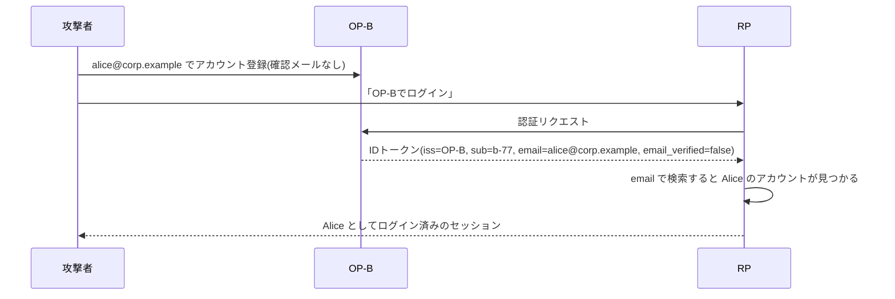
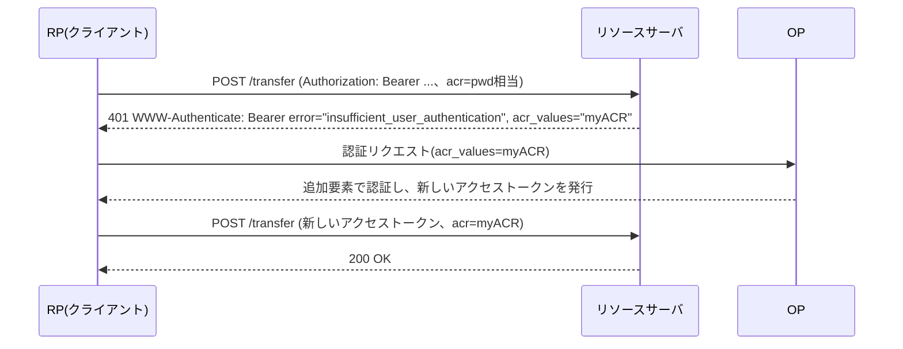

この章でわかること:

- RPが利用者を識別するキーが`iss`と`sub`の組である理由と、`email`をキーにしたときに起きるアカウント乗っ取りの具体的な手順
- pairwise識別子の計算方法(OpenID Connect Core 1.0 8.1節)と、ソルトと連結方法の注意点
- スコープと`claims`パラメータによるクレームの要求、Essentialクレーム、集約クレームと分散クレーム
- `acr_values`、`max_age`、`prompt`、ヒントのパラメータで認証のやり方を要求する方法と、ステップアップ認証(RFC 9470)
- なぜ体系に必須か: [8章](/oidc/08-id-token-validation/)で検証したIDトークンから利用者を取り出し、RPのアカウントに対応づける処理が、RPの認証の最後の段階だからです。ここを誤ると、署名検証がすべて正しくても別人のアカウントにログインさせます

## IDトークンを検証した後に残る問題

[8章](/oidc/08-id-token-validation/)では、IDトークンの署名、`iss`、`aud`、`exp`、`nonce`を検証する手順を実装しました。検証に成功すると、RPは「このOPが、このRP宛てに発行した、認証された利用者についての主張」を受け取ります。有効なIDトークンは、OPが既存のセッションをもとに発行することもあり、利用者がその場で認証をやり直したことは示しません。利用者が認証した時刻は、`auth_time`で判断します(この章の後半で扱います)。ただし、RPの処理はそこで終わりません。RPは自分のデータベースにある利用者のアカウント(注文履歴、権限、設定)のうち、どれをこの利用者に対応させるかを決める必要があります。

IDトークンには[6章](/oidc/06-oauth-to-oidc/)で紹介した標準クレームが複数入っています。

```json
{
  "iss": "https://server.example.com",
  "sub": "248289761001",
  "aud": "s6BhdRkqt3",
  "email": "janedoe@example.com",
  "email_verified": true,
  "name": "Jane Doe",
  "preferred_username": "j.doe"
}
```

アカウントを探すキーとして、人が読める`email`や`preferred_username`を使いたくなります。メールアドレスは利用者ごとに異なるように見え、既存のパスワード認証のアカウントとも突き合わせやすいからです。OpenID Connectの仕様は、この選択を明示的に禁じています。

## 仕様を読む: OpenID Connect Core 1.0 5.7節

> The sub (subject) and iss (issuer) Claims from the ID Token, used together, are the only Claims that an RP can rely upon as a stable identifier for the End-User, since the sub Claim MUST be locally unique and never reassigned within the Issuer for a particular End-User, as described in Section 2. Therefore, the only guaranteed unique identifier for a given End-User is the combination of the iss Claim and the sub Claim.

(OpenID Connect Core 1.0 5.7節)

この節は、RPが利用者を識別するために使ってよいクレームを定めています。`sub`は、OPの中で利用者ごとに一意であり、別の利用者に再び割り当てられることがない値でなければなりません(MUST)。この性質が保証されるのは1つのOPの中だけなので、OPをまたいで一意なのは`iss`と`sub`の組です。2つのOPがたまたま同じ`sub`の値`"1001"`を別々の利用者に割り当てることは、仕様の上で何の問題もありません。

同じ節は続けて、ほかのクレームの扱いを定めています。

> For instance, an Issuer MAY re-use an email Claim Value across different End-Users at different points in time, and the claimed email address for a given End-User MAY change over time. Therefore, other Claims such as email, phone_number, preferred_username, and name MUST NOT be used as unique identifiers for the End-User, whether obtained from the ID Token or the UserInfo Endpoint.

(OpenID Connect Core 1.0 5.7節)

OPは、あるメールアドレスを時期を変えて別の利用者に割り当ててもかまいません(MAY)。利用者のメールアドレスが変わることもかまいません(MAY)。このため、`email`、`phone_number`、`preferred_username`、`name`を利用者の一意な識別子として使ってはなりません(MUST NOT)。IDトークンから得た値でも、UserInfoエンドポイントから得た値でも同じです。

`sub`そのものの形式は2節で定められています。`sub`は255文字以内のASCII文字列で、大文字と小文字を区別します。RPの実装は、次の3点に従います。

- アカウントの表に`(iss, sub)`の一意制約を置き、ログイン時はこの組で検索します
- `sub`を小文字化したり空白を除いたりしません。受け取ったバイト列のまま比較します
- `iss`は[10章](/rust-impl/10-discovery-jwks/)の手順で検証した値を、そのまま保存します

## emailを識別子にすると何が起きるか

`email`でアカウントを検索するRPでは、攻撃者が被害者のメールアドレスを含むIDトークンを取得するだけで、被害者のアカウントにログインできます。IDトークンの署名は正しく、OPも正規のOPです。攻撃者は、自分が正当に取得したIDトークンに、他人のメールアドレスが入るように仕向けます。このように、正規の認証を経て他人のアカウントの操作権を得る攻撃を**アカウント乗っ取り**(account takeover)と呼びます。

起きかたは、次の3つに分けられます。

### シナリオ1: 未検証のメールアドレス

RPが「OP-Aでログイン」と「OP-Bでログイン」の2つを提供しているとします。被害者AliceはOP-Aでアカウントを作り、`alice@corp.example`でRPを使っています。OP-Bは誰でも登録でき、登録時にメールアドレスの所有を確かめません。



この図で、OP-Bが発行したIDトークンは正しく署名されています。`email_verified`は`false`であり、OP-Bは、このアドレスを利用者が管理していることを確かめていないと示しています。RPがこのクレームを読まずに`email`だけで検索したことが、乗っ取りの原因です。

`email_verified`(email_verified クレーム)は、OPがそのメールアドレスを利用者が管理していることを確かめたかどうかを示す真偽値です。5.1節の定義は次のとおりです。

> True if the End-User's e-mail address has been verified; otherwise false. When this Claim Value is true, this means that the OP took affirmative steps to ensure that this e-mail address was controlled by the End-User at the time the verification was performed.

(OpenID Connect Core 1.0 5.1節)

`true`が意味するのは、「検証を行った時点で」利用者がそのアドレスを管理していたことです。いま管理していることは保証されません。検証の方法もOPと利用者の間の取り決めに依存します。

### シナリオ2: マルチテナントのIdP

1つのOPが多数の組織(テナント)を収容する構成があります(マルチテナントの運用は[26章](/practice/26-operations/)で扱います)。この構成では、各テナントの管理者が自分のテナントの利用者の属性を設定できる実装があります。攻撃者は自分でテナントを作り、その中の利用者のメールアドレスを`alice@corp.example`に設定します。OPがその値を「テナント管理者が設定した値なので検証済み」として`email_verified=true`で発行すると、`email_verified`を確かめるRPでも乗っ取りが成立します。

問題は、OPが`corp.example`というドメインの管理者ではない点にあります。`email_verified=true`は「このOPの規則で検証した」という意味しか持たず、その規則が攻撃者のテナント管理者による設定を含む場合、RPにとっての保証にはなりません。マルチテナントのOPがテナントごとに異なる`iss`を使う場合でも、RPがどのテナントの`iss`でも受け付ける設定にしていれば、同じことが起きます。

### シナリオ3: メールアドレスの再割り当て

5.7節が明示的に許しているとおり、OPは同じメールアドレスを別の利用者に割り当て直すことがあります。社員Aliceが退職し、`alice@corp.example`が新しく入社した別の社員に割り当てられたとします。新しい社員の`sub`は`a-2002`で、Aliceの`a-1001`とは異なります。`email`で検索するRPは、新しい社員をAliceのアカウントにログインさせます。この場合は攻撃者がいなくても情報が漏れます。

### 実験: アカウントの照合方法を比べる

3つのシナリオと本人の再ログインについて、3種類の照合方法がどのアカウントを返すかを確かめます。RPには、OP-Aで登録したAliceのアカウントが1件だけあります。

<RustPlay snippet="ch18/account-key" title="email、検証済みemail、(iss, sub)による照合の比較" />

出力の各行は、照合方法ごとのログイン結果です。読み方は次のとおりです。

- `email`で照合すると、3つのシナリオすべてで「乗っ取り成立」になります
- `email_verified=true`の`email`で照合すると、シナリオ1は防げます。シナリオ2と3では`email_verified`が`true`なので、乗っ取りが成立します
- `(iss, sub)`で照合すると、3つのシナリオすべてで「該当なし」になり、本人の再ログインだけがAliceのアカウントに対応づけられます

この実験から、`email_verified`の確認は必要ですが、識別子の問題の対策にはならないことがわかります。対策は`(iss, sub)`をキーにすることです。`email`は表示や連絡先として保存する属性として扱います。

## アカウントリンク

1人の利用者が複数のOPでログインしたい場合や、既存のパスワード認証のアカウントにOIDCのログインを追加したい場合があります。複数の`(iss, sub)`の組を1つのローカルアカウントに対応づけることを**アカウントリンク**(account linking)と呼びます。メールアドレスによる自動照合は、このアカウントリンクを本人の確認なしに行う処理であり、前の節の乗っ取りの原因になります。

安全なアカウントリンクの手順は次のとおりです。

1. 利用者は既存のアカウントに、既存の方法でログインします
2. ログイン中のセッションから「OP-Bを連携する」操作を開始します
3. RPはOP-Bへの認証リクエストを送り、戻ってきたIDトークンを検証します
4. RPは検証した`(iss, sub)`を、ログイン中のアカウントに追加します

この手順では、連携先のアカウントを決めているのはRPのセッションです。IDトークンの`email`は判断に使いません。

自動リンクには、もう1つ注意点があります。攻撃者が被害者のメールアドレスで、RPにパスワードのアカウントを先に作っておく場合があります。後から被害者が「OP-Aでログイン」したときに、RPがメールアドレスで既存アカウントへ自動リンクすると、攻撃者は自分が設定したパスワードで被害者のアカウントにログインし続けられます。RP側のメールアドレス確認を済ませていないアカウントにOIDCのログインを自動で結びつけないことで、この攻撃を防ぎます。

:::note[自動リンクを許す条件]
自動リンクを提供する場合は、少なくとも次の条件をすべて満たすときに限ります。

- `email_verified`が`true`です
- OPがそのドメインのメールアドレスを管理する主体です(例えば、自社のOPが自社ドメインのアドレスを発行している場合です)
- 既存アカウントのメールアドレスも、RP側で検証済みです

それでもシナリオ3の再割り当ては防げません。このため、リンクを確定する前に、既存アカウント自身の認証方法(パスワードなど)での認証を条件にします。リンク時に利用者へ通知を送ることは、不正なリンクに後から気づくための補助的な手段であり、リンクそのものは防ぎません。
:::

## pairwise識別子

ここまで、`sub`は「OPの中で利用者ごとに一意」と説明しました。8節は、この`sub`を全RPに同じ値で渡すか、RPごとに別の値で渡すかの2種類を定めています。

- **public識別子**(public subject identifier)は、すべてのRPに同じ`sub`を渡す方式です。OPのDiscoveryメタデータに`subject_types_supported`がない場合の既定値です
- **pairwise識別子**(pairwise subject identifier)は、RPごとに異なる`sub`を渡す方式です。RPどうしが`sub`を突き合わせて、同じ利用者の行動を結びつけることを防ぎます

OPがどちらに対応するかは、Discoveryメタデータ([10章](/rust-impl/10-discovery-jwks/))の`subject_types_supported`に`["public", "pairwise"]`のように列挙されます。17.3節はプライバシーの観点から、RPをまたいだ追跡を防ぐためにpairwise識別子の利用を検討すべき(SHOULD)と述べています。

pairwise識別子の「RPごと」の単位は**セクター識別子**(sector identifier)であり、`client_id`ではありません。セクター識別子は、既定ではRPが登録したリダイレクトURIのホスト部分です。同じ組織が複数のホスト名でサービスを運用し、それらに同じ`sub`を渡したい場合は、`sector_identifier_uri`(sector_identifier_uri パラメータ)を登録します。これは、そのRPのリダイレクトURIの一覧を格納したJSONファイルを指すhttpsのURLで、そのURLのホスト部分がセクター識別子になります。登録したリダイレクトURIが複数のホスト名にまたがる場合、クライアントは`sector_identifier_uri`を登録しなければなりません(MUST)(8.1節)。ホスト名が1つに決まらなければ、既定のセクター識別子も決まらないからです。

## 仕様を読む: OpenID Connect Core 1.0 8.1節

> When pairwise Subject Identifiers are used, the OpenID Provider MUST calculate a unique sub (subject) value for each Sector Identifier. The Subject Identifier value MUST NOT be reversible by any party other than the OpenID Provider.

(OpenID Connect Core 1.0 8.1節)

この節は、pairwise識別子の計算方法に課す条件を定めています。OPはセクター識別子ごとに異なる`sub`を計算しなければなりません(MUST)。計算した`sub`から元の値を、OP以外の誰も逆算できてはなりません(MUST NOT)。

計算方法そのものは規定されず、次の3つの性質を満たせばどの方法でもよいとされています。

> - The Subject Identifier value MUST NOT be reversible by any party other than the OpenID Provider.
> - Distinct Sector Identifier values MUST result in distinct Subject Identifier values.
> - The algorithm MUST be deterministic.

(OpenID Connect Core 1.0 8.1節)

1つ目は逆算できないこと、2つ目は異なるセクター識別子から異なる`sub`が得られること、3つ目は同じ入力から常に同じ`sub`が得られること(決定的であること)です。3つ目がなければ、同じ利用者がログインするたびに別人として扱われます。

節の最後には計算方法の例が3つあり、1つ目は次の式です。

> Calculate sub = SHA-256 ( sector_identifier || local_account_id || salt ).

(OpenID Connect Core 1.0 8.1節)

`local_account_id`はOP内部の利用者番号、`salt`はOPだけが保持する秘密の値、`||`は連結です。2つ目の例はハッシュの代わりにAES-128で暗号化する方法、3つ目は(セクター識別子, 利用者番号)の組ごとに乱数の識別子を生成して保存する方法です。仕様には計算例の具体的な入力と出力(テストベクタ)は載っていません。

### 実験: pairwise識別子を計算する

1つ目の例の式を、[5章](/web-auth/05-crypto/)のSHA-256で実装します。出力の`sub`は[5章](/web-auth/05-crypto/)のBase64urlで表します。実験で確かめる点は次の3つです。

- RPごとに`sub`が変わり、同じセクターでは同じ値になることを確かめます
- ソルトが漏れた(または空の)場合に、RPが`local_account_id`を逆算できるかを確かめます
- 区切りを入れずに連結した場合に、異なるセクターで同じ値になることがあるかを確かめます

<RustPlay snippet="ch18/pairwise" mode="release" title="pairwise識別子の計算と、ソルトと連結の注意点" />

出力の読み方は次のとおりです。

1. RP-A(`shop.example`)とRP-B(`news.example`)の`sub`は異なります。RP-Aに2回目にログインしても同じ値になり、決定的であることを確かめられます。リダイレクトURIのパスが違うRP-Cも、ホストが`shop.example`なので同じ値です。セクター識別子はホスト単位であり、パスは区別に使われません
2. ソルトを空にした`sub`に対して、RPが自分のセクター識別子と候補の利用者番号0から順にハッシュを計算すると、約105万回の計算で`local_account_id=1048576`を特定できました。手元のMac(releaseビルド)では、この探索を含むプログラム全体の実行が1秒未満で終わりました。利用者番号が連番の整数であれば、探索の範囲はこの程度に収まります。秘密のソルトを含めた`sub`には、同じ探索で一致するものがありません。1つ目の性質(逆算できないこと)は、ソルトの秘密性によって成り立っています
3. 区切りを入れない連結では、`("rp.example", "12")`と`("rp.example1", "2")`がどちらも`rp.example12`という同じバイト列になり、同じ`sub`が出力されます。セクターが異なるのに`sub`が一致するので、2つ目の性質に反します。各要素の前に長さを置くと、両者は異なる値になります

3点目は、仕様の式を字義どおりに実装すると生じる問題です。実際のホスト名と利用者番号の組でこの一致が起きる確率は低いです。それでも性質を構造で保証するために、長さの前置きか、要素に現れない区切り文字を使います。

pairwise識別子の運用上の注意点は次のとおりです。

- RPがリダイレクトURIのホスト名を変えると、`sector_identifier_uri`を登録していない限りセクター識別子が変わり、全利用者の`sub`が変わります。RPから見ると、全員が別人になります
- OPがソルトを変えた場合も、全利用者の`sub`が変わります。ソルトは[26章](/practice/26-operations/)で扱う署名鍵とは異なり、ローテーションできない値です
- pairwise識別子を使っても、RPが`email`を受け取っていれば、RPどうしはメールアドレスで利用者を突き合わせられます。追跡を防ぐ目的であれば、要求するクレームも最小限にします

## クレームを要求する: スコープとclaimsパラメータ

RPがIDトークンやUserInfoレスポンス([10章](/rust-impl/10-discovery-jwks/))で受け取るクレームは、認証リクエストで要求します。方法は2つあります。

### スコープによる要求

5.4節は、クレームの組をまとめて要求するスコープ値を4つ定めています。

| スコープ | 要求されるクレーム |
| --- | --- |
| `profile` | `name`、`family_name`、`given_name`、`middle_name`、`nickname`、`preferred_username`、`profile`、`picture`、`website`、`gender`、`birthdate`、`zoneinfo`、`locale`、`updated_at` |
| `email` | `email`、`email_verified` |
| `address` | `address` |
| `phone` | `phone_number`、`phone_number_verified` |

これらのスコープで要求したクレームは、アクセストークンが発行される`response_type`ではUserInfoエンドポイントから返り、アクセストークンが発行されない`response_type=id_token`([19章](/oidc-deep/19-flows/))ではIDトークンに入ります。スコープで要求したクレームは任意のクレームとして扱われ、利用者が提供を拒否することもあります。

### claimsパラメータによる要求

`claims`(claims パラメータ)は、クレームを1つずつ指定し、返す場所(IDトークンかUserInfoか)と条件を付けて要求する認証リクエストのパラメータです。値はJSONオブジェクトで、`userinfo`と`id_token`の2つのメンバーを持てます。

```json
{
  "userinfo": {
    "given_name": {"essential": true},
    "email": {"essential": true},
    "email_verified": {"essential": true},
    "picture": null
  },
  "id_token": {
    "auth_time": {"essential": true},
    "acr": {"values": ["urn:mace:incommon:iap:silver"]}
  }
}
```

このJSONを[3章](/web-auth/03-authorization-code/)のURLエンコードをして、認証リクエストのクエリに入れます。

```http
GET /authorize?response_type=code&client_id=s6BhdRkqt3&scope=openid
  &redirect_uri=https%3A%2F%2Fclient.example.org%2Fcb&state=af0ifjsldkj
  &claims=%7B%22id_token%22%3A%7B%22auth_time%22%3A%7B%22essential%22%3Atrue%7D%7D%7D HTTP/1.1
Host: server.example.com
```

各クレームの値は、`null`(既定の方法で要求)か、次のメンバーを持つオブジェクトです。

- `essential`: `true`ならそのクレームを**Essentialクレーム**(Essential Claim)として要求します。Essentialクレームは、利用者が求めた操作を円滑に進めるために必要だとRPが示すクレームです。`false`または省略時は任意のクレーム(Voluntary Claim)です
- `value`: 特定の値で返すことを要求します。`"sub": {"value": "248289761001"}`は、その`sub`の利用者についての認証を要求し、値が一致しなければ認証は失敗しなければなりません(MUST)
- `values`: 候補の値を優先順に並べて要求します

5.5.1節は、Essentialクレームの扱いについて次のように定めています。

> Note that even if the Claims are not available because the End-User did not authorize their release or they are not present, the Authorization Server MUST NOT generate an error when Claims are not returned, whether they are Essential or Voluntary, unless otherwise specified in the description of the specific claim.

(OpenID Connect Core 1.0 5.5.1節)

利用者が提供を拒否した場合やOPがその値を持っていない場合でも、OPは、クレームを返さないことを理由にエラーを返してはなりません(MUST NOT)。このため、Essentialとして要求したクレームでも、RPは「含まれていないIDトークン」を受け取る可能性があります。RPは必要なクレームの有無を自分で確かめ、なければ処理を止めるか、利用者に入力を求めます。例外は`acr`です。5.5.1.1節は、`acr`をEssentialかつ値を指定して要求した場合の扱いを定めています。OPが`claims`パラメータに対応していれば、OPは指定した値のどれかに一致する`acr`を返さなければなりません(MUST)。満たせなければ認証の失敗として扱います。

`claims`パラメータへの対応は任意で、OPはDiscoveryメタデータの`claims_parameter_supported`で対応の有無を示します。

### 集約クレームと分散クレーム

5.6.2節は、OP以外の主体が発行したクレームをRPに渡す2つの形式を定めています。OP以外にクレームを発行する主体を**クレームプロバイダ**(Claims Provider)と呼びます。

- **集約クレーム**(aggregated claims)は、クレームプロバイダが署名したJWTを、OPがレスポンスの中にそのまま埋め込む形式です
- **分散クレーム**(distributed claims)は、クレームを取得できるエンドポイントとアクセストークンだけを渡し、RPが後からクレームプロバイダに問い合わせる形式です

どちらも、`_claim_names`(クレーム名から参照先への対応)と`_claim_sources`(参照先の中身)という2つのメンバーで表します。

```json
{
  "name": "Jane Doe",
  "_claim_names": {
    "birthdate": "src1",
    "payment_info": "src2"
  },
  "_claim_sources": {
    "src1": {"JWT": "eyJhbGciOiJSUzI1NiIsImtpZCI6ImtleTEifQ...."},
    "src2": {
      "endpoint": "https://bank.example.com/claim_source",
      "access_token": "dummy-claims-access-token"
    }
  }
}
```

集約クレームのJWTの署名はクレームプロバイダの鍵で検証し、OPの鍵は使いません。仕様は、そのJWTに`iss`を含めるべき(SHOULD)とし、`sub`は含めるべきではない(SHOULD NOT)としています。`sub`を含めると、OPの`sub`と取り違えるおそれがあるためです。

## 認証のやり方を要求する: acr・amr・max_age・prompt

RPは「誰が」認証されたかだけでなく、「どのように」「いつ」認証されたかを要求できます。[8章](/oidc/08-id-token-validation/)で、IDトークンの`acr`(認証コンテキストのクラス)、`amr`(使われた認証方式)、`auth_time`(認証した時刻)を説明しました。この節では、それらを要求する側のパラメータを扱います。

`acr_values`(acr_values パラメータ)は、RPが求める認証コンテキストのクラスを優先順に空白区切りで並べた値です。このパラメータによる要求は任意のクレームの扱いになり、OPは別の`acr`で認証を済ませることもあります。必ず満たさせたい場合は、前の節の`claims`パラメータで`acr`をEssentialとして要求します。

`amr`の値はRFC 8176(2017-06)のIANAレジストリから選ぶべき(SHOULD)とされています。主な値は次のとおりです。

| 値 | 意味(RFC 8176 2節) |
| --- | --- |
| `pwd` | パスワードによる認証 |
| `otp` | ワンタイムパスワード |
| `hwk` | ハードウェアで保護された鍵の所有の証明 |
| `swk` | ソフトウェアで保護された鍵の所有の証明 |
| `face` / `fpt` | 顔 / 指紋による生体認証 |
| `mfa` | 複数要素による認証 |
| `sms` | 登録済み番号へのSMSによる確認 |

`max_age`(max_age パラメータ)は、利用者が最後に能動的に認証してから許容する経過秒数です。`prompt`(prompt パラメータ)は、OPに再認証や同意の画面を出させるか、出させないかを指定します。`login_hint`(login_hint パラメータ)は、利用者がログインに使いそうな識別子(メールアドレスや電話番号)をOPに伝えるヒントで、使うかどうかはOPの判断に任されます。`id_token_hint`(id_token_hint パラメータ)は、以前にそのOPから受け取ったIDトークンを、利用者の現在または過去のセッションについてのヒントとして渡すパラメータです。

## 仕様を読む: OpenID Connect Core 1.0 3.1.2.1節(promptとmax_age)

`prompt`は空白区切りの値のリストで、4つの値が定義されています。

> none: The Authorization Server MUST NOT display any authentication or consent user interface pages. An error is returned if an End-User is not already authenticated or the Client does not have pre-configured consent for the requested Claims or does not fulfill other conditions for processing the request.

(OpenID Connect Core 1.0 3.1.2.1節)

`prompt=none`のとき、OPは認証や同意の画面を一切表示してはなりません(MUST NOT)。利用者がOPでログインしていない場合や、要求されたクレームへの同意がない場合は、エラーを返します。エラーコードは`login_required`、`interaction_required`、`consent_required`などです。RPはこれを、画面を出さずにOPのログイン状態を確かめる手段として使えます([21章](/oidc-deep/21-logout-session/)のセッション管理でも使います)。`none`をほかの値と組み合わせると、エラーになります。

残りの3つの値の要点は次のとおりです。

- `login`: OPは利用者に再認証を求めるべきです(SHOULD)。再認証できなければ、`login_required`などのエラーを返さなければなりません(MUST)
- `consent`: OPは情報をRPに返す前に同意を求めるべきです(SHOULD)。同意を得られなければ、`consent_required`などのエラーを返さなければなりません(MUST)
- `select_account`: OPは複数のアカウントからの選択を求めるべきです(SHOULD)。選択を得られなければ、`account_selection_required`などのエラーを返さなければなりません(MUST)

`max_age`の定義は次のとおりです。

> If the elapsed time is greater than this value, the OP MUST attempt to actively re-authenticate the End-User. [...] When max_age is used, the ID Token returned MUST include an auth_time Claim Value. Note that max_age=0 is equivalent to prompt=login.

(OpenID Connect Core 1.0 3.1.2.1節)

最後の能動的な認証からの経過時間が`max_age`を超えていれば、OPは利用者を再認証しようとしなければなりません(MUST)。`max_age`を使ったリクエストへの応答のIDトークンには、`auth_time`が含まれていなければなりません(MUST)。`max_age=0`は`prompt=login`と同じ意味です。

これらのパラメータは、仕様の上でも実装の上でもOPへの依頼です。OPが値を理解しない場合、`prompt`の未知の値は無視してもかまいません(MAY)。認証リクエストはブラウザを経由するフロントチャネル([2章](/web-auth/02-delegation/))で送られるため、攻撃者が`max_age`や`acr_values`を取り除くこともできます。このため、RPは要求が満たされたことを、返ってきたIDトークンで確かめます。3.1.3.7節の検証手順には次の項目があります。

> If the auth_time Claim was requested, either through a specific request for this Claim or by using the max_age parameter, the Client SHOULD check the auth_time Claim value and request re-authentication if it determines too much time has elapsed since the last End-User authentication.

(OpenID Connect Core 1.0 3.1.3.7節)

RPは`auth_time`を確かめ、経過時間が長すぎれば再認証を要求すべきです(SHOULD)。`acr`についても同じ節で、要求した場合は値が適切か確かめるべき(SHOULD)とされています。改ざんそのものを防ぐには、[17章](/oauth-deep/17-request-protection/)の署名付きリクエスト(JAR)やPARを使います。

`prompt`には、2022-12に最終版となった「Initiating User Registration via OpenID Connect 1.0」が`create`という値を追加しています。`prompt=create`は、ログイン画面の代わりにアカウント作成の画面を表示するようOPに求める値で、ほかの値と組み合わせないことが推奨されています(RECOMMENDED)。対応するOPは、Discoveryメタデータの`prompt_values_supported`に`create`を含めます。この仕様は、成功した認証応答を受け取るまでは、新しいアカウントが作られたと仮定してはならない(MUST NOT)とも定めています。

## ステップアップ認証

ネットバンキングで、残高の照会はパスワードだけで許し、送金には追加の要素(ワンタイムパスワードやパスキー)を求める、という設計はよくあります。操作の重要度に応じて、より強い認証やより新しい認証を途中から要求することを**ステップアップ認証**(step-up authentication)と呼びます。

RP自身がIDトークンの`acr`と`auth_time`を確かめる場合は、前の節のパラメータで十分です。問題になるのは、判断する主体がリソースサーバ(API)の場合です。リソースサーバは認証リクエストを送らず、受け取るのはアクセストークンだけです。RFC 9470(2023-09)「OAuth 2.0 Step Up Authentication Challenge Protocol」は、リソースサーバが「このアクセストークンを得たときの認証では不十分」とクライアントに伝え、クライアントが条件を満たす認証をやり直すための手順を定めています。



この図の2行目の応答で、リソースサーバは要求する認証の条件をクライアントに伝えています。クライアントはその条件を、3行目の認証リクエストにそのまま指定します。

## RFCを読む: RFC 9470 3節〜5節

3節は、新しいエラーコードを1つ定義しています。

> insufficient_user_authentication: The authentication event associated with the access token presented with the request does not meet the authentication requirements of the protected resource.

(RFC 9470 3節)

`insufficient_user_authentication`(insufficient_user_authentication エラー)は、提示されたアクセストークンに対応する認証が、保護されたリソースの要求を満たしていないことを示すエラーコードです。[4章](/web-auth/04-tokens/)で読んだRFC 6750の`WWW-Authenticate`ヘッダの`error`属性に入れて返します。同じ節は、要求の中身を伝える2つの属性を定義しています。`acr_values`は受け付ける認証コンテキストのクラスを優先順に並べた値、`max_age`は最後の能動的な認証からの許容経過秒数です。

```http
HTTP/1.1 401 Unauthorized
WWW-Authenticate: Bearer error="insufficient_user_authentication",
  error_description="More recent authentication is required",
  max_age="5"
```

この例は、RFC 9470の図3です。直近5秒以内の認証を求めています。

4節は、クライアントの動作を定めています。

> A client receiving a challenge from the resource server carrying the insufficient_user_authentication error code SHOULD parse the WWW-Authenticate header for acr_values and max_age and use them, if present, in constructing an authorization request.

(RFC 9470 4節)

このエラーを受け取ったクライアントは、`WWW-Authenticate`ヘッダから`acr_values`と`max_age`を取り出し、存在すれば認可リクエストの組み立てに使うべきです(SHOULD)。4節はさらに、これらのパラメータがOIDC Core 3.1.2.1節で定義済みのものであり、認可サーバの動作には変更を加えないと述べています。OIDCに対応したOPであれば、ほとんど変更なしにこの手順に対応できます。

5節は、アクセストークンを発行する認可サーバの動作を定めています。

> when it comes to access tokens in this specification, the authorization server SHOULD consider the requested acr value as necessary for successfully fulfilling the request. That is, the requested acr value is included in the access token if the authentication operation successfully met its requirements; otherwise, the authorization request fails and returns an unmet_authentication_requirements error as defined in [OIDCUAR].

(RFC 9470 5節)

この節は、`acr_values`で要求された`acr`を、アクセストークンの発行では成功の条件として扱うべき(SHOULD)と定めています。IDトークンの`acr_values`は任意の要求の扱いでしたが、アクセストークンでは扱いが異なります。認証が要求を満たせば、要求された`acr`をアクセストークンに含めます。満たせなければ認可リクエストは失敗し、`unmet_authentication_requirements`(unmet_authentication_requirements エラー)を返します。このエラーコードは、OPが要求された認証の条件を満たせなかったことを示す値で、OpenID Connect Unmet Authentication Requirements 1.0で定義されています。5節は理由として、リソースサーバが不十分と判定したトークンを認可サーバが発行し続け、クライアントが要求と拒否を繰り返す状態を防ぐことを挙げています。

リソースサーバがアクセストークンから認証の情報を得る方法は、6節に書かれています。[14章](/oauth-deep/14-token-validation/)のJWTアクセストークン(RFC 9068)では`acr`と`auth_time`のクレームを使い、トークンイントロスペクション(RFC 7662)では同名のメンバーを使います。6.1節は、これらの値は利用者が認証した時点で決まり、リフレッシュトークンでアクセストークンを更新しても変わらないことに注意を促しています。[15章](/oauth-deep/15-refresh-tokens/)のリフレッシュでは、`auth_time`は古いまま引き継がれます。

## まとめ

- RPが利用者を識別するキーは`(iss, sub)`の組だけです。`email`、`phone_number`、`preferred_username`、`name`を一意な識別子として使ってはなりません(OIDC Core 5.7節)
- `email`で照合すると、未検証メール、マルチテナントのIdP、メールアドレスの再割り当ての3つの経路でアカウント乗っ取りが成立します。実験では、`email_verified`を確かめても後の2つは防げませんでした
- アカウントリンクは、既存アカウントにログイン中のセッションから明示的に行います
- pairwise識別子はセクター識別子(リダイレクトURIのホスト)ごとに異なる`sub`を返します。実験では、ソルトがなければ約105万回のハッシュ計算で利用者番号を逆算でき、区切りのない連結では別セクターの値が一致しました
- クレームはスコープか`claims`パラメータで要求します。Essentialとして要求しても返らないことがあり、RPは有無を自分で確かめます
- `acr_values`、`max_age`、`prompt`はOPへの依頼であり、RPは結果をIDトークンの`acr`と`auth_time`で検証します。リソースサーバが認証の強さを求める場合は、RFC 9470の`insufficient_user_authentication`を使います

次章では、この章までに前提としてきた`response_type=code`以外の組み合わせを扱います。インプリシットフローとハイブリッドフローがなぜ作られ、現在どう扱われているかを、レスポンスの返し方と`c_hash`の検証とともに説明します。
