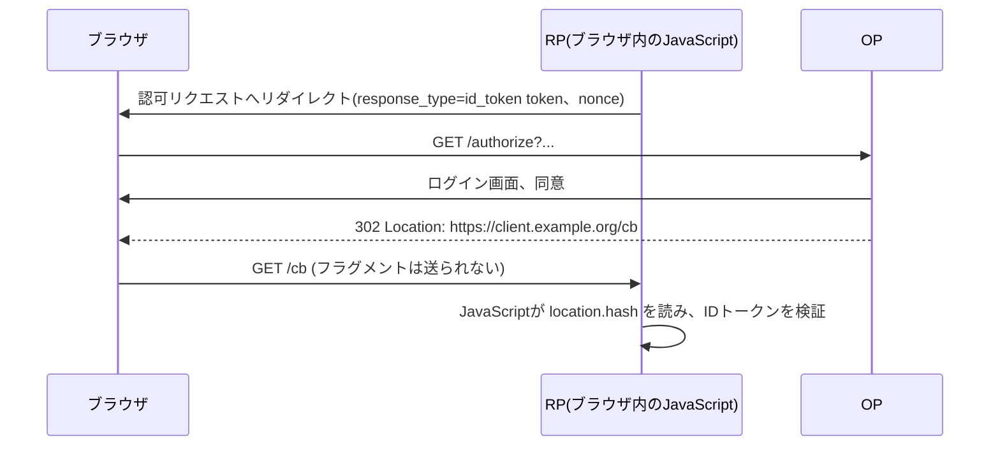
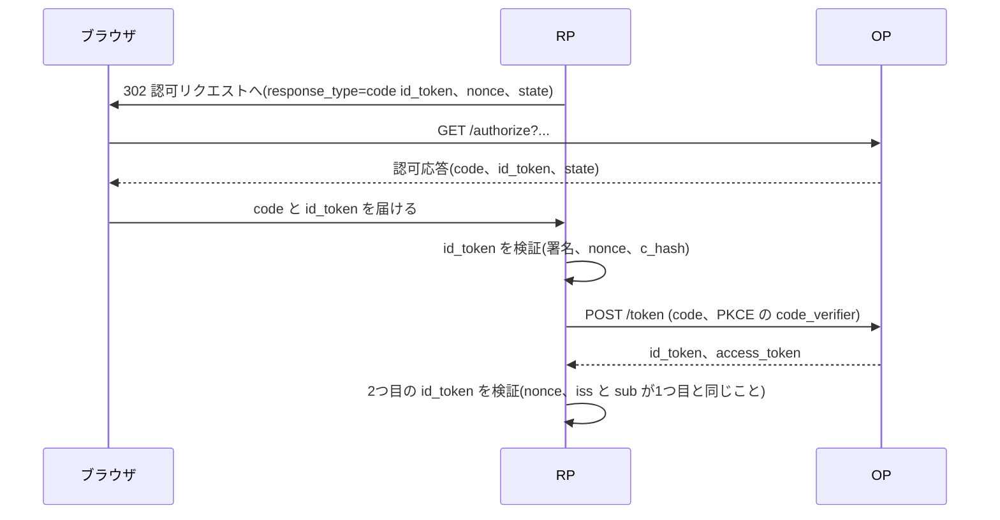

この章でわかること:

- `response_type`の値の組み合わせが、どのフローと、どの応答モードを決めるか
- インプリシットフローが作られた理由と、RFC 9700とOAuth 2.1で使われなくなった理由
- ハイブリッドフローの構造と、`c_hash`による認可コードの差し替えの検出(OIDC Core付録A.6の値で検証)
- フラグメント、クエリ、form_postの違いと、フラグメントがリダイレクトで引き継がれることによるトークンの漏洩
- なぜ体系に必須か: 基礎編は`response_type=code`だけを扱いました。既存のシステム、古い資料、ライブラリの設定項目には他の組み合わせが残っています。それらを安全かどうか判断するには、組み合わせの全体と、それぞれが廃れた理由を知る必要があります

## response_typeは何を決めるか

[3章](/web-auth/03-authorization-code/)では、認可リクエストの`response_type=code`が「認可エンドポイントは認可コードを返す」ことを意味すると説明しました。[6章](/oidc/06-oauth-to-oidc/)ではOpenID Connectの認可コードフローを、[9章](/oidc/09-state-nonce-pkce/)ではそのフローへの攻撃を防ぐ`state`、`nonce`、PKCEを扱いました。基礎編のフローでは、認可エンドポイントが返すのは認可コードだけで、IDトークンとアクセストークンはトークンエンドポイントがバックチャネルで返していました。

`response_type`は、この「何を、どこから返すか」を選ぶパラメータです。RFC 6749は`code`と`token`の2つの値を定めました。`token`は、認可エンドポイントがアクセストークンを直接返す値です。OpenID Connectは`id_token`を加え、さらにこれらを空白区切りで組み合わせる方法を定めました。組み合わせの規則を定めた仕様が、OpenID Foundationの「OAuth 2.0 Multiple Response Type Encoding Practices」(Final、2014-02-25)です。

## 仕様を読む: OAuth 2.0 Multiple Response Type Encoding Practices 1.2節・2節

1.2節は、2つの用語を定義しています。

> If a Response Type contains one of more space characters (%20), it is compared as a space-delimited list of values in which the order of values does not matter.

(OAuth 2.0 Multiple Response Type Encoding Practices 1.2節)

この節は、空白を含む`response_type`を値の集合として比較することを定めています。順序は意味を持たないので、`code id_token`と`id_token code`は同じ値です。このように複数の値を組み合わせた`response_type`を、本書では**Multiple Response Type**(multiple-valued response type)と呼びます。

もう1つの用語は応答モードです。[17章](/oauth-deep/17-request-protection/)で説明した`response_mode`は、認可エンドポイントが結果のパラメータをどの方法でクライアントに届けるかを指定するパラメータでした。2節はその前提として、各`response_type`に既定の応答モードがあることを定めています。

> Each Response Type value also defines a default Response Mode mechanism to be used, if no Response Mode is specified using the request parameter.

(OAuth 2.0 Multiple Response Type Encoding Practices 2節)

2.1節は、`query`と`fragment`の2つの応答モードを定義しています。`query`はリダイレクトURIのクエリ文字列にパラメータを付けて返す方法、`fragment`はフラグメントに付けて返す方法です。**フラグメント**(fragment)は、URIの`#`より後ろの部分です。ブラウザは、フラグメントをHTTPリクエストに含めてサーバへ送りません。フラグメントを読めるのは、そのページで実行されるJavaScriptだけです。`response_mode=fragment`(fragment 応答モード)は、認可応答のパラメータをこのフラグメントに入れて返す指定です。

```http
HTTP/1.1 302 Found
Location: https://client.example.org/cb#access_token=SlAV32hkKG&token_type=bearer&state=af0ifjsldkj
```

この応答を受けたブラウザがサーバに送るのは`GET /cb HTTP/1.1`だけです。`access_token`以降は、ブラウザの中に残ります。

同じ2.1節は、`code`の既定を`query`、`token`の既定を`fragment`としています。`response_mode`は、既定と同じ値を指定する使い方は推奨されません(NOT RECOMMENDED)。2.2節は、1回の応答のすべてのパラメータを同じ応答モードで返すべき(SHOULD)と定めています。一部をクエリ、一部をフラグメントに分けると、クライアントの処理が複雑になるためです。

## 仕様を読む: OAuth 2.0 Multiple Response Type Encoding Practices 3節・5節・7節

3節は`id_token`を、5節は4つの組み合わせを定義しています。各定義は同じ形をしています。`code id_token`の定義を引用します。

> When supplied as the value for the response_type parameter, a successful response MUST include both an Authorization Code and an id_token. The default Response Mode for this Response Type is the fragment encoding and the query encoding MUST NOT be used.

(OAuth 2.0 Multiple Response Type Encoding Practices 5節)

この定義は、`code id_token`の成功応答には認可コードとIDトークンの両方が含まれなければならない(MUST)こと、既定の応答モードはフラグメントであり、クエリを使ってはならない(MUST NOT)ことを定めています。`id_token`、`code token`、`id_token token`、`code id_token token`も、含める値が異なるだけで、既定がフラグメント、クエリは禁止という点は同じです。

クエリが禁止される理由は7節に書かれています。

> The HTTP Referer header includes query parameters, and so any values encoded in query parameters will leak to third parties. Thus, while it is safe to encode an Authorization Code as a query parameter when using a Confidential Client (because it can't be used without the Client Secret, which third parties won't have), more sensitive information such as Access Tokens and ID Tokens MUST NOT be encoded in the query string.

(OAuth 2.0 Multiple Response Type Encoding Practices 7節)

クエリパラメータはHTTPの`Referer`ヘッダ([22章](/security/22-threats/)で扱います)を通じて第三者に漏れます。認可コードは、機密クライアントであればクライアントシークレットなしに使えないので、クエリで返しても安全とされます。アクセストークンとIDトークンは、クエリに入れてはなりません(MUST NOT)。この節が書かれた2014年の時点では、フラグメントはクエリより漏れにくい場所と考えられていました。後の節で見るとおり、RFC 9700はこの前提を見直しています。

ここまでの規則を、OpenID Connect Coreのフローの区分(3.1節〜3.3節)と合わせて表にします。

| `response_type` | フロー | 認可エンドポイントが返す値 | 既定の応答モード | `nonce` |
| --- | --- | --- | --- | --- |
| `code` | 認可コードフロー | `code` | `query` | 任意 |
| `id_token` | インプリシットフロー | `id_token` | `fragment` | 必須 |
| `id_token token` | インプリシットフロー | `id_token`、`access_token` | `fragment` | 必須 |
| `code id_token` | ハイブリッドフロー | `code`、`id_token` | `fragment` | 必須 |
| `code token` | ハイブリッドフロー | `code`、`access_token` | `fragment` | 任意 |
| `code id_token token` | ハイブリッドフロー | `code`、`id_token`、`access_token` | `fragment` | 必須 |

OpenID Connectは`token`単独を使いません。IDトークンが返らないからです(3.2.2.1節)。

### 実験: response_typeを解析する

表の規則をRustで実装し、いくつかの入力を与えます。確かめるのは、値の順序を入れ替えても同じフローになるか、既定がフラグメントの組み合わせにクエリを要求するとどうなるか、未知の値がどう扱われるか、の3点です。

<RustPlay snippet="ch19/response-types" title="response_typeからフローと応答モードを決める" />

出力の読み方は次のとおりです。

- `"code id_token"`と`"id_token code"`は、どちらもハイブリッドフローになり、返す値も同じです。集合として比較しているためです
- `"code id_token"`に`response_mode=form_post`を要求すると受け付けられ、`query`を要求するとエラーになります。5節の「クエリを使ってはならない」を実装した結果です
- `"token"`はOAuthのインプリシットグラントとして解釈されますが、OpenID Connectでは使いません
- `"code idtoken"`のように未登録の値を含むと、`unsupported_response_type`になります

各行の「認可応答にアクセストークン」が`true`になる組み合わせが、次の節以降で問題にする対象です。

## インプリシットフロー: 作られた理由

**インプリシットフロー**(implicit flow)は、認可エンドポイントがIDトークン(と、`id_token token`の場合はアクセストークン)を直接返し、トークンエンドポイントを使わないフローです。OpenID Connect Core 3.2節が定義し、OAuthの同種のフローはRFC 6749 4.2節のインプリシットグラントです。



図の4行目で、トークンはフラグメントに入ってブラウザに届きます。5行目のHTTPリクエストにはフラグメントが含まれないので、RPのサーバのアクセスログにはトークンが残りません。6行目で、ページのJavaScriptがフラグメントからトークンを取り出します。

このフローが作られた事情は、RFC 10017(2026-08)7.2.1節の「Historic Note」に整理されています。

> Historically, the Implicit grant type provided an advantage to browser-based applications since JavaScript could always arbitrarily read and manipulate the fragment portion of the URL without triggering a page reload. [...] Additionally, until CORS was widespread in browsers, the Implicit grant type offered an alternative flow that didn't require CORS support in the browser or on the server.

(RFC 10017 7.2.1節)

この節は、インプリシットグラントが選ばれた2つの理由を挙げています。1つ目は、JavaScriptがページを再読み込みせずにURLのフラグメントを読み書きできたことです。取り出したトークンをURLから消すのに必要でした。2つ目は、トークンエンドポイントを呼ぶ手段がなかったことです。ブラウザは、ページと異なるオリジンのサーバへJavaScriptからリクエストを送ることを制限します。その制限を、サーバ側の許可に基づいて緩める仕組みが**CORS**(Cross-Origin Resource Sharing)です。CORSが普及する前は、ブラウザ内のJavaScriptから別のドメインにあるトークンエンドポイントを呼べませんでした。インプリシットフローは、当時のブラウザの制約の中で、ブラウザ内のアプリケーションにトークンを渡す方法でした。

OpenID Connect Coreは、インプリシットフローに追加の要求を課しています。`nonce`は必須です(3.2.2.1節)。`id_token token`の場合、IDトークンには[8章](/oidc/08-id-token-validation/)で実装した`at_hash`が必須です(3.2.2.10節)。認可応答の中のアクセストークンとIDトークンを結びつけ、攻撃者がアクセストークンだけを差し替えることを検出するためです。

## インプリシットフローが使われなくなった理由

同じHistoric Noteは、2つの理由がどちらも解消したことを続けて述べています。現在のブラウザはSession History APIでクエリ文字列もページの再読み込みなしに書き換えられ、CORSも広く使えます。このため、ブラウザ内のアプリケーションも認可コードとPKCEを使えるようになりました。理由がなくなった一方で、リスクは残っています。

## RFCを読む: RFC 9700 2.1.2節

> The implicit grant (response type token) and other response types causing the authorization server to issue access tokens in the authorization response are vulnerable to access token leakage and access token replay as described in Sections 4.1, 4.2, 4.3, and 4.6.

(RFC 9700 2.1.2節)

この節は、認可応答でアクセストークンを発行するすべての`response_type`を対象に、2つの問題を指摘しています。アクセストークンの漏洩と、漏洩したアクセストークンの再利用です。参照先の4つの節は、それぞれ次の経路を扱っています。

- 4.1節: リダイレクトURIの検証が不十分な場合に、トークンが攻撃者のURIへ届く経路です。後の実験で再現します
- 4.2節: `Referer`ヘッダを通じた漏洩です
- 4.3節: ブラウザの履歴に残ったURLからの漏洩です。RFC 10017 7.2.3.2節は、履歴を複数の端末やクラウドサービスに同期するブラウザでは、漏洩の範囲がさらに広がると補足しています
- 4.6節: **アクセストークンインジェクション**(access token injection)です。攻撃者が、盗んだアクセストークンを正規のクライアントの認可応答に差し込み、被害者として振る舞わせる攻撃です。純粋なOAuthでは検出する方法がなく、OpenID Connectでは`at_hash`と`nonce`で検出できると、4.6.1節は述べています

同じ節は、もう1つの問題を挙げています。

> Moreover, no standardized method for sender-constraining exists to bind access tokens to a specific client (as recommended in Section 2.2) when the access tokens are issued in the authorization response.

(RFC 9700 2.1.2節)

認可応答で発行するアクセストークンを、[16章](/oauth-deep/16-sender-constrained/)の送信者制約で特定のクライアントに束縛する標準の方法はありません。DPoPもmTLSも、クライアントがトークンエンドポイントで鍵や証明書を示すことを前提にしているためです。このため、漏れたトークンは誰でもリソースサーバで使えます。

同じ節は、次の文で推奨を述べています。

> In order to avoid these issues, clients SHOULD NOT use the implicit grant (response type token) or other response types issuing access tokens in the authorization response, unless access token injection in the authorization response is prevented and the aforementioned token leakage vectors are mitigated.

(RFC 9700 2.1.2節)

クライアントは、インプリシットグラントと、認可応答でアクセストークンを発行するその他の`response_type`を使うべきではありません(SHOULD NOT)。例外は、アクセストークンインジェクションを防ぎ、前述の漏洩経路への対策をすべて講じた場合だけです。代わりに、`code`か、`code id_token`のようにアクセストークンをトークンエンドポイントで発行する`response_type`を使うべきです(SHOULD)。

この推奨は、さらに強い形で後続の文書に引き継がれています。RFC 10017 7.2節は、ブラウザベースのクライアントはアクセストークンの取得にインプリシットグラントを使ってはならない(MUST NOT)と定めています。OAuth 2.1(draft-ietf-oauth-v2-1-16、2026-09-03版、2026-10-16確認)は10.1節で、`response_type=token`の定義そのものを削除しました。同じ節は、この削除が`response_type=id_token`のようにアクセストークン以外を返す拡張には影響しないと明記しています。

### 実験: フラグメントがリダイレクトで引き継がれる

4.1.2節が説明する攻撃を再現します。この攻撃は、HTTPのリダイレクトの規則を利用します。RFC 9110 10.2.2節は、`Location`ヘッダにフラグメントがない場合、ブラウザは元のURIのフラグメントを引き継いでリダイレクトしなければならない(MUST)と定めています。

攻撃の前提は次の2つです。

- 認可サーバが、リダイレクトURIを前方一致で検査しています
- クライアントのサイトに、`redirect_to`パラメータで指定された任意のURLへ転送するページ(オープンリダイレクタ、[22章](/security/22-threats/))があります

実験では、認可サーバの検査方法を前方一致と完全一致の2通りで試し、トークンがどこへ届くかを確かめます。

<RustPlay snippet="ch19/fragment-leak" title="オープンリダイレクタとフラグメントの引き継ぎ" />

前方一致の場合の出力は、次の順に読みます。

1. 認可サーバは`/cb?redirect_to=...`を登録済みURIの前方一致として受け付け、フラグメントにアクセストークンを入れて返します。ブラウザがクライアントに送るリクエストには、フラグメントが含まれません
2. クライアントのリダイレクタは、`Location: https://attacker.example/`を返します。この値にはフラグメントがありません
3. ブラウザは元のフラグメントを引き継ぎ、`https://attacker.example/#access_token=...`へ移動します。攻撃者のサーバへのリクエストにもトークンは含まれませんが、攻撃者のページのJavaScriptが`location.hash`からトークンを読み取ります

完全一致の場合は、認可サーバがリダイレクトURIを拒否し、トークンは発行されません。フラグメントについて保証されるのはサーバに送られないことだけであり、ブラウザの外に出ないことは保証されません。ブラウザの中でトークンを読めるJavaScriptが1つでも攻撃者のものであれば、トークンは漏れます。RFC 10017 7.2.3.4節は、同じページで実行される解析ツールなどの第三者のスクリプトにも、フラグメントのトークンが見えることを指摘しています。

## ハイブリッドフロー

**ハイブリッドフロー**(hybrid flow)は、認可エンドポイントが認可コードと、IDトークンかアクセストークン(または両方)を同時に返し、RPは認可コードをトークンエンドポイントで交換するフローです。OpenID Connect Core 3.3節が定義しています。

ハイブリッドフローの中で、RFC 9700の推奨に沿うのは`code id_token`です。認可応答にアクセストークンを含めないからです。



図の5行目で、RPはトークンエンドポイントへ行く前に、認可応答のIDトークンを検証します。このIDトークンは`nonce`でRPのセッションに束縛され、次に説明する`c_hash`で同じ応答の認可コードに束縛されています。このため、攻撃者が認可応答の認可コードだけを自分のものに差し替えると、5行目の検証で検出できます。PKCEが普及する前は、この性質が認可コードインジェクション([9章](/oidc/09-state-nonce-pkce/))への対策の1つでした。

`c_hash`(c_hash クレーム)は、認可コードのハッシュ値をIDトークンに入れたクレームです。`at_hash`がアクセストークンに対して行うことを、認可コードに対して行います。

## 仕様を読む: OpenID Connect Core 1.0 3.3.2.11節・3.3.2.10節

> c_hash: Code hash value. Its value is the base64url encoding of the left-most half of the hash of the octets of the ASCII representation of the code value, where the hash algorithm used is the hash algorithm used in the alg Header Parameter of the ID Token's JOSE Header. For instance, if the alg is HS512, hash the code value with SHA-512, then take the left-most 256 bits and base64url-encode them.

(OpenID Connect Core 1.0 3.3.2.11節)

この節は、`c_hash`の計算方法を定めています。認可コードの文字列をASCIIのバイト列としてハッシュし、ハッシュ値の左半分をBase64urlで表した値です。ハッシュ関数は、IDトークンのJOSEヘッダの`alg`([7章](/oidc/07-jwt-jose/))が使うものに合わせます。`RS256`や`ES256`ならSHA-256の左128ビット、`HS512`ならSHA-512の左256ビットです。同じ節は、認可エンドポイントが認可コードと一緒にIDトークンを返す場合(`code id_token`と`code id_token token`)、`c_hash`は必須(REQUIRED)としています。

検証の手順は3.3.2.10節にあります。

> 1. Hash the octets of the ASCII representation of the code with the hash algorithm specified in JWA [JWA] for the alg Header Parameter of the ID Token's JOSE Header. [...]
> 2. Take the left-most half of the hash and base64url-encode it.
> 3. The value of c_hash in the ID Token MUST match the value produced in the previous step if c_hash is present in the ID Token.

(OpenID Connect Core 1.0 3.3.2.10節)

RPは同じ計算をし、その結果はIDトークンの`c_hash`と一致しなければなりません(MUST)。手順の前置きは「SHOULD do the following」なので、手順全体の実施は推奨(SHOULD)の扱いです。

3.3.3.6節は、トークンエンドポイントが返す2つ目のIDトークンについて定めています。2つのIDトークンの`iss`と`sub`は同一でなければなりません(MUST)。2つ目のIDトークンでは`at_hash`と`c_hash`を省略してもかまいません(MAY)。トークンエンドポイントの応答はTLSで要求と結びついているので、ハッシュで結びつける必要がないためです。RFC 9700 4.5.3.2節は、`nonce`で認可コードインジェクションを防ぐクライアントについて定めています。このクライアントは、認可応答で別のIDトークンを受け取っていても、トークンエンドポイントから得たIDトークンの`nonce`を検証しなければなりません(MUST)。

### 実験: 付録A.6の値でc_hashを検証する

OpenID Connect Coreの付録A.6には、`response_type=code id_token token`の認可応答の例があります。この応答の`code`と`access_token`から`c_hash`と`at_hash`を計算し、例のIDトークンに入っている値と一致するかを確かめます。後半では、攻撃者が`code`だけを差し替えた応答を検査し、さらに`alg`による長さの違いを確かめます。

<RustPlay snippet="ch19/c-hash" title="付録A.6の値でc_hashとat_hashを再計算する" />

出力の読み方は次のとおりです。

- 最初の行は、例のIDトークンのペイロードをBase64urlから戻したJSONです。`c_hash`は`LDktKdoQak3Pk0cnXxCltA`、`at_hash`は`77QmUPtjPfzWtF2AnpK9RQ`です
- 計算した`c_hash`と`at_hash`は、どちらも仕様の値と一致します(`一致: true`)
- `code`を`SplxlOBeZQQYbYS6WxSbIA`に差し替えた応答は、`c_hash`が一致せず拒否されます。攻撃者は`c_hash`を書き換えたIDトークンを作れません。IDトークンにはOPの署名があるからです
- `ES256`では16バイト、`ES384`では24バイト、`HS512`では32バイトになります。`ES256`の値が`RS256`の値と同じなのは、どちらもSHA-256を使うためです

この実験はIDトークンの署名を検証していません。付録A.7には検証用のRSA公開鍵が載っており、[8章](/oidc/08-id-token-validation/)の手順で署名も検証できます。実際のRPでは、署名検証を通過するまで`c_hash`の値を信用しません。

## form_postと応答モードの選び方

クエリにもフラグメントにも漏洩の経路があるため、OpenID Foundationは3つ目の応答モードを定めました。

## 仕様を読む: OAuth 2.0 Form Post Response Mode 2節

> In this mode, Authorization Response parameters are encoded as HTML form values that are auto-submitted in the User Agent, and thus are transmitted via the HTTP POST method to the Client, with the result parameters being encoded in the body using the application/x-www-form-urlencoded format. The action attribute of the form MUST be the Client's Redirection URI. The method of the form attribute MUST be POST.

(OAuth 2.0 Form Post Response Mode 2節)

この節は、`form_post`([17章](/oauth-deep/17-request-protection/)で導入しました)の動作を定めています。認可サーバは、認可応答のパラメータをHTMLフォームの値として埋め込んだページを返し、ブラウザがそのフォームを自動で送信します。パラメータはHTTP POSTの本文に、[3章](/web-auth/03-authorization-code/)の`application/x-www-form-urlencoded`形式で入ります。フォームの`action`属性はクライアントのリダイレクトURIで、`method`属性はPOSTでなければなりません(MUST)。同じ節は、認可サーバがブラウザと中継者に応答の保存と再利用をさせないよう指示しなければならない(MUST)とも定めています。付録Aの例は、`Cache-Control: no-cache, no-store`を付けています。

```http
HTTP/1.1 200 OK
Content-Type: text/html;charset=UTF-8
Cache-Control: no-cache, no-store

<html>
 <body onload="javascript:document.forms[0].submit()">
  <form method="post" action="https://client.example.org/callback">
   <input type="hidden" name="state" value="DcP7csa3hMlvybERqcieLHrRzKBra"/>
   <input type="hidden" name="id_token" value="eyJhbGciOiJSUzI1NiIsImtpZCI6IjEifQ..."/>
  </form>
 </body>
</html>
```

```http
POST /callback HTTP/1.1
Host: client.example.org
Content-Type: application/x-www-form-urlencoded

id_token=eyJhbGciOiJSUzI1NiIsImtpZCI6IjEifQ...&state=DcP7csa3hMlvybERqcieLHrRzKBra
```

パラメータはURLに入らないので、ブラウザの履歴、`Referer`ヘッダ、リダイレクト時のフラグメントの引き継ぎのいずれにも現れません。4節は、既定の応答モードがクエリでもフラグメントでも、`form_post`で返すことは安全であると述べています。RFC 9700 4.3節も、ブラウザ履歴への漏洩の対策として`form_post`を挙げています。

`form_post`には実装上の注意点が1つあります。RPのサーバが`state`の照合に使うセッションCookieを[1章](/web-auth/01-http-auth/)の`SameSite=Lax`で発行していると、OPのページからRPへのクロスサイトのPOSTにはそのCookieが付きません。RPはセッションを見つけられず、正規のログインを`state`の不一致として拒否します。`form_post`を使うRPは、コールバック用のCookieの`SameSite`属性を設計し直す必要があります(Cookieの設計は[24章](/security/24-browser-native/)で扱います)。

## 現在の推奨

ここまでの内容を、組み合わせごとの現在の扱いとしてまとめます。

| `response_type` | 現在の扱い | 理由 |
| --- | --- | --- |
| `code` | 推奨。PKCEと組み合わせる | トークンはすべてトークンエンドポイントから、送信者制約も可能 |
| `code id_token` | 使ってよい | 認可応答にアクセストークンを含まない。`c_hash`と`nonce`の検証が必要 |
| `id_token` | 限定的 | アクセストークンは含まないが、IDトークン(個人情報を含む)がURLに出る。使うなら`form_post` |
| `code token`、`code id_token token` | 使うべきではない(RFC 9700) | 認可応答にアクセストークンを含む |
| `id_token token` | 使うべきではない(RFC 9700) | 同上。ブラウザ内アプリはRFC 10017でMUST NOT |
| `token` | OAuth 2.1で削除 | 同上。IDトークンもない |

応答モードは、`code`ならクエリ(既定)のままで構いません。認可コードは1回限りで短寿命であり、PKCEで横取りされても使えないからです。URLにパラメータを出したくない場合は`form_post`、応答そのものに署名を付けたい場合は[17章](/oauth-deep/17-request-protection/)のJARMを使います。

## まとめ

- `response_type`は空白区切りの値の集合で、順序は意味を持ちません。組み合わせごとに、認可エンドポイントが返す値と既定の応答モードが決まっています
- 認可コード以外を含む組み合わせの既定はフラグメントで、クエリは禁止です(MUST NOT)。フラグメントはサーバに送られませんが、ページのJavaScriptからは読めます
- インプリシットフローは、CORSが普及する前のブラウザの制約から作られました。RFC 9700は、認可応答でアクセストークンを返す組み合わせを使うべきではないとし(SHOULD NOT)、OAuth 2.1は`response_type=token`を削除しました
- 実験では、前方一致のリダイレクトURI検査とオープンリダイレクタの組み合わせで、フラグメントのアクセストークンが攻撃者のページに届くことを確かめました。完全一致の検査では発行されませんでした
- ハイブリッドフローの`code id_token`では、`c_hash`がIDトークンと認可コードを結びつけます。付録A.6の値で`c_hash`と`at_hash`を再計算し、仕様の値と一致することを確かめました
- `form_post`はパラメータをPOSTの本文で返し、URLに出しません。`SameSite`属性のCookieとの組み合わせに注意が必要です

次章では、ブラウザのリダイレクトを使わないグラントを扱います。サーバ間のクライアントクレデンシャル、入力手段の少ない端末のためのデバイス認可グラント、トークン交換、CIBAと、それらに共通するクロスデバイスフローの危険を説明します。
