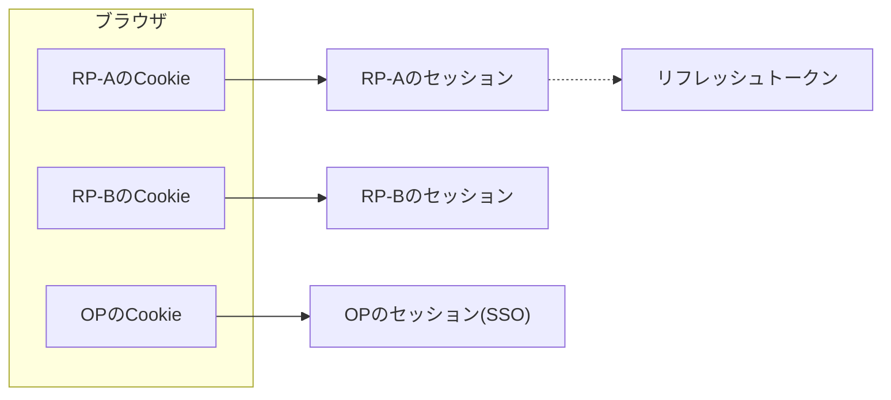
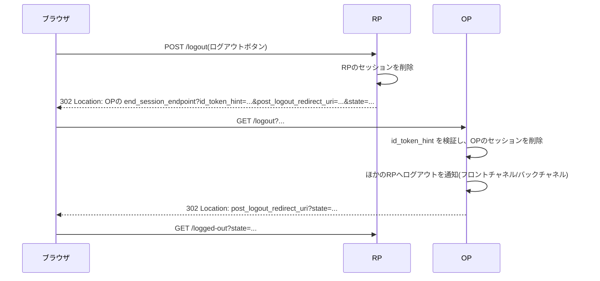
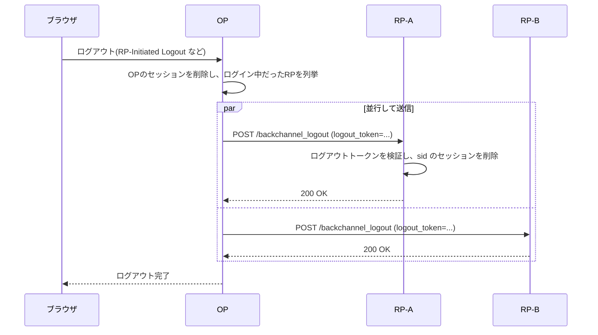
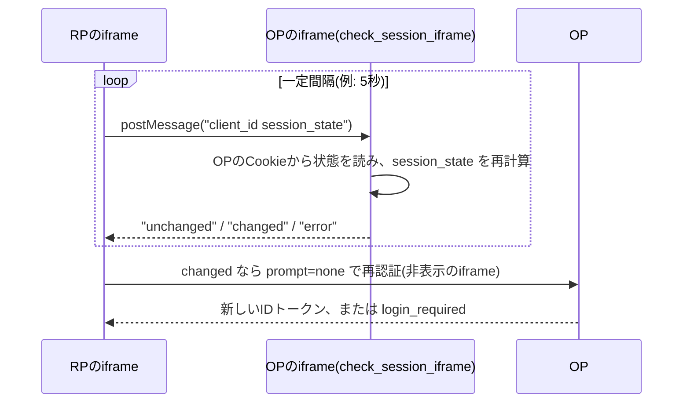

この章でわかること:

- 「ログアウト」がRPのセッションとOPのセッションにまたがり、1か所の操作では完了しない理由
- RP-Initiated Logoutの`end_session_endpoint`、`post_logout_redirect_uri`、`id_token_hint`の役割
- フロントチャネルログアウト、バックチャネルログアウト、Session Management 1.0の違いと、サードパーティCookieの遮断がそれぞれに与える影響
- ログアウトトークンの構造(Back-Channel Logout 1.0 2.4節)と検証手順(2.6節)を、ringのES256で署名したトークンで確かめる
- なぜ体系に必須か: 基礎編はログインでセッションを作るところまでを扱いました。セッションを終わらせる手順がなければ、共用端末でログアウトしたつもりの利用者のセッションが残り、OPの側でアカウントを停止しても各RPの利用が続きます

## ログアウトはどこで起きるか

[1章](/web-auth/01-http-auth/)で、HTTPのログイン状態はセッションIDを入れたCookieで保たれると説明しました。OpenID Connectでログインした利用者のブラウザには、少なくとも2つのセッションがあります。

- RPのセッション: [11章](/rust-impl/11-build-rp/)で、RPはIDトークンを検証した後に自分のセッションを発行しました。RPのドメインのCookieで識別されます
- OPのセッション: [12章](/rust-impl/12-build-op/)のOPは、ログインフォームで利用者を認証した後、OPのドメインのCookieでログイン状態を保ちます。次に別のRPが認証リクエストを送ってきたとき、OPはこのセッションを使ってパスワードの入力を省略します。これがSSO([6章](/oidc/06-oauth-to-oidc/))の仕組みです

さらに、RPが[15章](/oauth-deep/15-refresh-tokens/)のリフレッシュトークンを持っていれば、利用者がブラウザを閉じた後もRPはAPIを呼び続けられます。



図のように、セッションはRPごとに1つと、OPに1つあります。RP-Aの「ログアウト」ボタンがRP-AのCookieを消すだけなら、OPのセッションは残ります。利用者が次にRP-Aの「ログイン」を押すと、OPはパスワードを求めずにIDトークンを返し、利用者はすぐにログイン済みの状態になります。共用端末では、次にその端末を使った人が前の利用者としてログインできます。逆にOPでログアウトしても、RP-AとRP-Bのセッションはそれぞれのサーバに残ります。

1回のログアウト操作で、関係するすべてのRPとOPのセッションを終わらせることを**シングルログアウト**(single logout)と呼びます。OpenID Connectは、これを4つの仕様に分けて定めています。

| 仕様 | 版 | 役割 |
| --- | --- | --- |
| RP-Initiated Logout 1.0 | Final(2022-09-12) | RPがOPに利用者のログアウトを依頼する |
| Front-Channel Logout 1.0 | Final(2022-09-12) | OPがブラウザのiframeを通じて各RPにログアウトを伝える |
| Back-Channel Logout 1.0 | Final、errata set 1(2023-12-15) | OPがサーバ間の通信で各RPにログアウトを伝える |
| Session Management 1.0 | Final(2022-09-12) | RPがOPのログイン状態の変化をブラウザ内で監視する |

1つ目はRPからOPへの依頼、残りの3つはRPがOP側の状態変化を検出する方法です。フロントチャネルログアウトとバックチャネルログアウトではOPがRPに通知し、Session ManagementではRPがOPに問い合わせます。4つは組み合わせて使えるように設計されています。

## RP-Initiated Logout

**RP-Initiated Logout**は、RPが利用者のブラウザをOPのログアウト用のエンドポイントへリダイレクトし、OPでのログアウトを依頼する仕組みです。



図の6行目で、OPはこの利用者がログインしていたほかのRPに通知を送ります。通知の方法は、後の節のフロントチャネルログアウトかバックチャネルログアウトです。7行目のリダイレクトは、その通知が終わった後に行います。

## 仕様を読む: OpenID Connect RP-Initiated Logout 1.0 2節・3節

2節は、OPのログアウト用エンドポイントのURLを、Discoveryメタデータ([10章](/rust-impl/10-discovery-jwks/))の`end_session_endpoint`(end_session_endpoint メタデータ)で公開すると定めています。このURLはhttpsでなければなりません(MUST)。ログアウトリクエストのパラメータは次のとおりです。

- `id_token_hint`: そのOPが以前にこのRPへ発行したIDトークンです。推奨(RECOMMENDED)で、どの利用者のログアウトを求めているかの手がかりになります。[18章](/oidc-deep/18-claims-identity/)の認証リクエストの`id_token_hint`と同じ名前ですが、用途はログアウトです
- `logout_hint`: ログアウトする利用者についてのヒントで、値の意味はOPが決めます
- `client_id`: `id_token_hint`なしで`post_logout_redirect_uri`を使う場合などに、RPを示します。`id_token_hint`と両方ある場合、OPは2つが一致することを確かめなければなりません(MUST)
- `post_logout_redirect_uri`(post_logout_redirect_uri パラメータ): ログアウト後にブラウザを戻す先のURIです。事前に登録した値でなければなりません(MUST)
- `state`: RPがリクエストと戻り先の間で状態を保つための値で、OPは戻すときにそのまま返します

```http
GET /logout?id_token_hint=eyJhbGciOiJFUzI1NiIsImtpZCI6Im9wLWtleS0xIn0...
  &post_logout_redirect_uri=https%3A%2F%2Fclient.example.org%2Flogged-out
  &state=dummy-logout-state HTTP/1.1
Host: server.example.com
```

`id_token_hint`の検証について、2節は次のように定めています。

> When an id_token_hint parameter is present, the OP MUST validate that it was the issuer of the ID Token. The OP SHOULD accept ID Tokens when the RP identified by the ID Token's aud claim and/or sid claim has a current session or had a recent session at the OP, even when the exp time has passed.

(OpenID Connect RP-Initiated Logout 1.0 2節)

OPは、`id_token_hint`のIDトークンを自分が発行したことを確かめなければなりません(MUST)。一方で、`exp`を過ぎたIDトークンでも、そのRPが現在または最近OPにセッションを持っていれば、受け付けるべきです(SHOULD)。IDトークンの寿命は数分程度であることが多く、ログアウトは何時間も後に行われるからです。ここでのIDトークンは、どのセッションについての要求かを示すヒントとして使い、[8章](/oidc/08-id-token-validation/)のようなログインの証明としては使いません。

2節は、OPが利用者に確認を求める条件も定めています。

> At the Logout Endpoint, the OP SHOULD ask the End-User whether to log out of the OP as well. Furthermore, the OP MUST ask the End-User this question if an id_token_hint was not provided or if the supplied ID Token does not belong to the current OP session with the RP and/or currently logged in End-User.

(OpenID Connect RP-Initiated Logout 1.0 2節)

OPは、OPからもログアウトするかを利用者に尋ねるべきです(SHOULD)。`id_token_hint`がない場合や、そのIDトークンが現在のセッションに対応しない場合は、尋ねなければなりません(MUST)。この規定がない場合を考えると、攻撃者のページに``を置くだけで、そのページを開いた利用者をOPからログアウトさせられます。6節はこれをサービス妨害の手段として挙げ、明示的な確認を求めています。

3節は、ログアウト後のリダイレクトの条件を定めています。

> An id_token_hint carring an ID Token for the RP is also RECOMMENDED when requesting post-logout redirection; if it is not supplied with post_logout_redirect_uri, the OP MUST NOT perform post-logout redirection unless the OP has other means of confirming the legitimacy of the post-logout redirection target. The OP also MUST NOT perform post-logout redirection if the post_logout_redirect_uri value supplied does not exactly match one of the previously registered post_logout_redirect_uris values.

(OpenID Connect RP-Initiated Logout 1.0 3節)

`id_token_hint`なしで`post_logout_redirect_uri`が指定された場合、OPは戻り先の正当性をほかの方法で確かめられない限り、リダイレクトしてはなりません(MUST NOT)。`post_logout_redirect_uri`が登録済みの値と完全に一致しない場合も、リダイレクトしてはなりません(MUST NOT)。この2つの規定は、ログアウト用のエンドポイントが任意のURLへ転送するオープンリダイレクタ([22章](/security/22-threats/))になることを防ぎます。完全一致を求める理由は、[19章](/oidc-deep/19-flows/)の実験で見たリダイレクトURIの前方一致の問題と同じです。

RPが自分のセッションをいつ消すかは、RPに任されています。2節は、OPからのログアウト通知を待ってRPのセッションを消す方法を挙げています。同時に、通知の方法によっては通知が届かないことがあり、利用者がOPでのログアウトを承認しないこともあると注意しています。前の図のように、リダイレクトの前にRPのセッションを消しておくと、どちらの場合でもRPからはログアウトできます。

## フロントチャネルログアウト

OPがログアウトした後、ほかのRPに知らせる方法の1つ目が**フロントチャネルログアウト**(front-channel logout)です。OPは、ログアウト完了のページの中に、各RPが登録した`frontchannel_logout_uri`(frontchannel_logout_uri メタデータ)を表示する非表示のiframeを並べます。ブラウザがそれぞれのiframeを読み込むと、各RPはそのリクエストに付く自分のCookieからセッションを特定し、消去します。

```html
<!-- OPのログアウト完了ページ -->
<iframe src="https://rp-a.example/frontchannel_logout?iss=https%3A%2F%2Fserver.example.com&sid=08a5019c-17e1-4977-8f42-65a12843ea02" hidden></iframe>
<iframe src="https://rp-b.example/frontchannel_logout?iss=https%3A%2F%2Fserver.example.com&sid=5d3a1f20-0000-4000-8000-000000000002" hidden></iframe>
```

## 仕様を読む: OpenID Connect Front-Channel Logout 1.0 2節・3節

> The OP renders `<iframe src="frontchannel_logout_uri">` in a page with the registered logout URI as the source to trigger the logout actions by the RP. Upon receiving a request to render the logout URI in an iframe, the RP clears state associated with the logged-in session, including any cookies and HTML5 local storage.

(OpenID Connect Front-Channel Logout 1.0 2節)

この節は、OPが登録されたログアウトURIをiframeで表示し、RPがそのリクエストを受けたらログイン中のセッションに関する状態(CookieとHTML5のローカルストレージを含む)を消去することを定めています。RPがすでにログアウト済みであれば、成功として扱います。

OPは、このURIに`iss`と`sid`の2つのクエリパラメータを付けてもかまいません(MAY)。どちらかを付けるなら、両方を付けなければなりません(MUST)。`sid`(sid クレーム)は、OPが発行するセッションの識別子です。3節の定義は次のとおりです。

> sid: OPTIONAL. Session ID - String identifier for a Session. This represents a Session of a User Agent or device for a logged-in End-User at an RP. Different sid values are used to identify distinct sessions at an OP. The sid value need only be unique in the context of a particular issuer. Its contents are opaque to the RP.

(OpenID Connect Front-Channel Logout 1.0 3節)

`sid`は、ある利用者の、あるブラウザ(または端末)での、あるRPに対するログインのセッションを表す文字列です。OPの中で異なるセッションには異なる値を使い、一意であればよいのは発行者の中だけです。RPにとって中身は意味を持ちません。OPがこの機能に対応する場合、`sid`はIDトークンにもクレームとして入ります。RPはログイン時にIDトークンの`sid`を自分のセッションに記録しておき、ログアウトの通知に含まれる`sid`と照合します。5節は、推測や衝突を防ぐために`sid`に十分なエントロピーを持たせるよう求めています。

## サードパーティCookieとログアウト

フロントチャネルログアウトのiframeは、OPのページの中でRPのURLを読み込みます。このとき、ブラウザのアドレスバーに表示されているのはOPのサイトで、iframeの中はRPのサイトです。表示中のサイトとは異なるサイトのCookieを**サードパーティCookie**(third-party cookie)と呼びます。このiframeへのリクエストに付くRPのCookieは、サードパーティCookieです。

サードパーティCookieは、広告などでサイトをまたいで利用者を追跡するために使われてきました。このため、一部のブラウザは既定でサードパーティCookieを遮断しており、ほかのブラウザでも利用者の設定や追跡防止の機能によって遮断されることがあります。Front-Channel Logout 1.0の4.1節は、この影響を次のように述べています。

> This can prevent the ability for notifications from the OP at the RP from being able to access the RP's User Agent state to implement local logout actions. In particular, the frontchannel_logout_uri might not be able to access the RP's login state when rendered by the OP in an iframe because the iframe is in a different origin than the OP's page.

(OpenID Connect Front-Channel Logout 1.0 4.1節)

サードパーティのコンテンツが遮断されると、OPからの通知を受けたRPは、ブラウザに保存した自分の状態(Cookieやストレージ)にアクセスできず、ログアウトの処理を行えないことがあります。同じ節は、この状況を検出する防御的なコードを入れ、可能であればRPのログアウトを完了できなかったことを利用者に知らせるよう推奨しています。最後に、バックチャネルログアウトはこの影響を受けないと付け加えています。

`iss`と`sid`が付いていれば、RPはCookieを読めなくても、サーバ側のセッションストアから`sid`でセッションを探して消せます。多くの実装では、この方法でフロントチャネルの通知を処理できます。ただし、通知そのものはブラウザがOPのログアウトページを表示している間にしか届きません。利用者がページを閉じれば、iframeは読み込まれません。

## バックチャネルログアウト

**バックチャネルログアウト**(back-channel logout)は、OPがブラウザを経由せず、各RPが登録した`backchannel_logout_uri`(backchannel_logout_uri メタデータ)へ直接HTTP POSTでログアウトを伝える仕組みです。



図の4行目以降の通信は、ブラウザの状態に依存しません。仕様の1節は、この利点と引き換えの欠点を2つ挙げています。1つ目は、ブラウザのCookieやストレージが使えないので、RPがどのセッションを消すかを判断するための情報をすべてOPが明示的に送る必要があることです。RPは、`sid`や`sub`から自分のセッションを探して消す仕組みを、自分で実装しなければなりません。2つ目は、RPの`backchannel_logout_uri`がOPから到達可能でなければならないことです。ファイアウォールの内側にあるRPは、公開されたOPからの通知を受け取れません。

OPは、この通知をJWTで送ります。

## 仕様を読む: OpenID Connect Back-Channel Logout 1.0 2.4節

**ログアウトトークン**(logout token)は、OPがRPにログアウトを求めるために送る、IDトークンに似たJWTです。2.4節は、次のクレームを使うと定めています。

| クレーム | 要否 | 内容 |
| --- | --- | --- |
| `iss` | 必須 | 発行者識別子。IDトークンと同じ |
| `sub` | 任意 | 利用者の識別子 |
| `aud` | 必須 | 宛先のRPの`client_id` |
| `iat` | 必須 | 発行時刻 |
| `exp` | 必須 | 有効期限 |
| `jti` | 必須 | トークンの一意な識別子 |
| `events` | 必須 | ログアウトトークンであることの宣言 |
| `sid` | 任意 | セッションの識別子 |
| `nonce` | 禁止 | 含めてはならない |

`events`(events クレーム)は、JSONオブジェクトで、メンバー名`http://schemas.openid.net/event/backchannel-logout`を含まなければなりません。その値はJSONオブジェクトでなければならず(MUST)、空のオブジェクト`{}`にすべきです(SHOULD)。このクレームがあることで、このJWTがログアウトトークンであることが示されます。

`sub`と`sid`については、少なくとも一方を含まなければなりません(MUST)。`sid`がない場合は、`iss`と`sub`で識別される利用者のRPでのすべてのセッションをログアウトさせる意図であると定められています。

`nonce`の禁止には、理由が書かれています。

> nonce: PROHIBITED. A nonce Claim MUST NOT be present. Its use is prohibited to make a Logout Token syntactically invalid if used in a forged Authentication Response in place of an ID Token.

(OpenID Connect Back-Channel Logout 1.0 2.4節)

ログアウトトークンに`nonce`があってはなりません(MUST NOT)。ログアウトトークンは、IDトークンと同じ鍵で署名され、`iss`、`aud`、`sub`も同じ値を持ちます。攻撃者がログアウトトークンを入手して、認証応答のIDトークンの代わりに差し込んだとします。RPは[9章](/oidc/09-state-nonce-pkce/)のとおり、IDトークンの`nonce`をセッションの値と照合します。ログアウトトークンには`nonce`がないので、RPが`nonce`を送った認証では、この照合で必ず失敗します。逆向きに、IDトークンをログアウトトークンとして送り込む攻撃は、`events`がないことで検出します。

同じ節は、ログアウトトークンに`typ`ヘッダ`logout+jwt`を付けて明示的に型を示すことを推奨しています(RECOMMENDED)。4.1節は、これを[23章](/security/23-jwt-attacks/)で扱うJWTの取り違えへの対策として説明しています。ただし、`typ`を必須にすると既存の多くの実装と互換性がなくなるため、互換性を気にしない新しいプロファイルで必須にするのがよいと述べています。ログアウトトークンには署名しなければならず(MUST)、暗号化してもかまいません(MAY)。署名と暗号化には、IDトークンと同じ鍵を使います。

```json
{
  "iss": "https://server.example.com",
  "sub": "248289761001",
  "aud": "s6BhdRkqt3",
  "iat": 1471566154,
  "exp": 1471569754,
  "jti": "bWJq",
  "sid": "08a5019c-17e1-4977-8f42-65a12843ea02",
  "events": {
    "http://schemas.openid.net/event/backchannel-logout": {}
  }
}
```

このJWTを、2.5節の形式でRPへPOSTします。

```http
POST /backchannel_logout HTTP/1.1
Host: rp.example.org
Content-Type: application/x-www-form-urlencoded

logout_token=eyJhbGci...eyJpc3Mi...T3BlbklE...
```

## 仕様を読む: OpenID Connect Back-Channel Logout 1.0 2.6節

2.6節は、RPがログアウトトークンを受け取ったときに行わなければならない(MUST)検証を、順に並べています。

> 1. If the Logout Token is encrypted, decrypt it using the keys and algorithms that the Client specified during Registration that the OP was to use to encrypt ID Tokens. [...]
> 2. Validate the Logout Token signature in the same way that an ID Token signature is validated, with the following refinements.
> 3. Validate the alg (algorithm) Header Parameter in the same way it is validated for ID Tokens. [...] Additionally, an alg with the value none MUST NOT be used for Logout Tokens.
> 4. Validate the iss, aud, iat, and exp Claims in the same way they are validated in ID Tokens.
> 5. Verify that the Logout Token contains a sub Claim, a sid Claim, or both.
> 6. Verify that the Logout Token contains an events Claim whose value is JSON object containing the member name http://schemas.openid.net/event/backchannel-logout.
> 7. Verify that the Logout Token does not contain a nonce Claim.
> 8. Optionally verify that another Logout Token with the same jti value has not been recently received.

(OpenID Connect Back-Channel Logout 1.0 2.6節)

各手順の意味は次のとおりです。

1. 暗号化されていれば復号します。IDトークンの暗号化を取り決めているのに暗号化されていないトークンは、拒否すべきです(SHOULD)
2. IDトークンと同じ方法で署名を検証します。鍵は[10章](/rust-impl/10-discovery-jwks/)のJWKSから得ます
3. `alg`をIDトークンと同じ方法で検証します。`none`を使ってはなりません(MUST NOT)
4. `iss`、`aud`、`iat`、`exp`を、[8章](/oidc/08-id-token-validation/)のIDトークンと同じ方法で検証します
5. `sub`と`sid`の少なくとも一方があることを確かめます
6. `events`にバックチャネルログアウトのメンバーがあることを確かめます
7. `nonce`がないことを確かめます
8. 同じ`jti`を最近受け取っていないかを確かめます。これは任意です

9〜11の手順(任意)は、`iss`、`sub`、`sid`が、このRPの現在または最近のセッションのIDトークンの値と一致するかの確認です。どれかの検証に失敗したら、トークンを拒否し、HTTP 400を返します。

2.7節は、検証後の動作を定めています。RPは`iss`と`sub`、または`sid`で識別されるセッションを探し、関連するすべての状態を消去します。利用者がすでにログアウト済みでも成功として扱います。`offline_access`([15章](/oauth-deep/15-refresh-tokens/))なしで発行されたリフレッシュトークンは無効化すべき(SHOULD)であり、`offline_access`で発行されたものは通常は無効化すべきではない(SHOULD NOT)とされています。2.8節は、成功時は200、失敗時は400を返さなければならない(MUST)とし、応答に`Cache-Control: no-store`を付けるべき(SHOULD)としています。

4節は、OPにログアウトトークンの有効期限を短くするよう推奨しています。望ましくは発行から2分以内で、盗まれたトークンを再送されにくくするためです。

### 実験: ログアウトトークンを検証する

OPの署名鍵をringで生成し、[7章](/oidc/07-jwt-jose/)のES256(`ECDSA_P256_SHA256_FIXED_SIGNING`、rとsを連結した64バイトの署名)でログアウトトークンに署名します。RP側には、暗号化を利用しない構成で2.6節の手順2〜8を実装した検証器と、3つのセッションを持つセッションストアを置きます。セッションのうち2つは同じ利用者(`sub=248289761001`)の別々のブラウザのもので、1つは別の利用者のものです。

検証器に、正しいトークンと、各手順に違反するトークンを順に与えます。確かめるのは、それぞれがどの手順で拒否されるか、正しいトークンでどのセッションが消えるか、です。時刻は固定値(`1800000000`)を使います。

<RustPlay snippet="ch21/logout-token" title="ログアウトトークンの検証手順(2.6節)を実装する" />

署名鍵を実行ごとに生成するため、トークン全体(署名部分)は実行ごとに変わります。表示するのはヘッダとペイロードの先頭90文字だけなので、表示される文字列は毎回同じです。各ケースの判定と削除されるセッションの数も、毎回同じです。

出力の読み方は次のとおりです。

- 正しいトークンは`sid`を持つので、その`sid`のセッション1つだけが消え、200 OKになります
- 同じトークンを再送すると、手順8で`jti`の再利用として拒否されます。この実験では`jti`の記録を必須にしています
- IDトークンをログアウトトークンとして送ると、OPの正しい署名を持つにもかかわらず、手順6(`events`がない)で拒否されます
- `events`と`nonce`を両方持つトークンは、手順7で拒否されます。このトークンは2.4節に適合しないので、OPが正しく実装されていれば発行されません。適合するログアウトトークンは`nonce`を持たないので、IDトークンとして差し込まれても、RPのIDトークン検証の`nonce`照合で拒否されます
- 期限切れ、別のRP宛ては手順4で拒否されます。`aud`に自分の`client_id`を含んでいても、信頼できない別の宛先(`unknown-rp`)を含むトークンは手順4で拒否されます。OIDC Core 3.1.3.7節の手順3は、IDトークンが信頼できない追加の宛先を含む場合に拒否しなければならない(MUST)と定めています。2.6節の手順4は、この方法に従います
- JOSEヘッダの`crit`([8章](/oidc/08-id-token-validation/))に理解できない拡張を挙げたトークンは、手順2で拒否されます。RFC 7515 4.1.11節は、列挙された拡張を受信者が理解しない場合、そのJWSは無効であると定めています。この実験のRPは拡張に1つも対応していないので、`crit`を含むトークンをすべて拒否します
- `alg=none`、ペイロードの改ざん、攻撃者の鍵による署名は、それぞれ手順3、手順2、手順2で拒否されます
- `sub`も`sid`もないトークンは、手順5で拒否されます。`sub`が`null`のトークンと、`sid`が数値のトークンも手順5で拒否されます。キーが存在するかだけを確かめる実装では、この2つが手順5を通過します。この実験では、`sub`と`sid`は存在すれば空でない文字列であることを求めています
- `sid`のないトークンは、同じ`iss`と`sub`のセッションをすべて消します。最初のトークンですでに1つ消えているので、残っていたもう1つが消え、別の利用者の`cookie-3`だけが残ります

実装上の注意点が2つあります。1つ目は、検証の順序です。この実験では、`alg`の検査(手順3)を署名検証(手順2)より先に行っています。`alg`を許可リストで固定してから署名を検証することで、`alg=none`のトークンが署名検証の処理に入ることを防ぎます([8章](/oidc/08-id-token-validation/))。2つ目は、ペイロードを読むのは署名検証の後にすることです。改ざんされたペイロードの`sub`を、署名検証の前にセッションの検索に使ってはなりません。

## Session Management 1.0

Session Management 1.0は、RPのページがブラウザの中でOPのログイン状態を監視し、OPでのログアウトを検出する仕組みです。RP側が定期的にOPへ問い合わせる方式で、OPからRPへの通知は使いません。

認証応答の中で、OPは`session_state`(session_state パラメータ)を返します。これは、OPでの利用者のログイン状態を表す文字列で、RPにとって中身は意味を持ちません。OPはDiscoveryメタデータの`check_session_iframe`(check_session_iframe メタデータ)で、ログイン状態を返すページのURLを公開します。



RPのページには非表示のiframeが2つあります。1つはRP自身のページ、もう1つはOPの`check_session_iframe`です。2つのiframeは、ブラウザの`postMessage`(異なるオリジンのウィンドウ間で文字列を受け渡すAPI)でやり取りします。ネットワークへの通信は、状態が変わったときの`prompt=none`([18章](/oidc-deep/18-claims-identity/))の再認証だけです。

## 仕様を読む: OpenID Connect Session Management 1.0 3.1節・3.2節・5.1節

3.1節は、RPのiframeの動作を定めています。

> Upon receipt of changed, the RP MUST perform re-authentication with prompt=none to obtain the current session state at the OP. Upon receipt of error, the RP MUST NOT perform re-authentication with prompt=none, so as to not cause potential infinite loops that generate network traffic to the OP.

(OpenID Connect Session Management 1.0 3.1節)

`changed`を受け取ったRPは、`prompt=none`で再認証して、OPの現在のセッション状態を得なければなりません(MUST)。`error`を受け取った場合は、`prompt=none`の再認証をしてはなりません(MUST NOT)。OPへの通信が終わらずに繰り返されることを防ぐためです。同じ節は、RPのiframeがOPのオリジン以外からのメッセージを拒否しなければならない(MUST)とも定めています。再認証でIDトークンが得られなかったか、別の利用者のIDトークンが返った場合、RPは元の利用者がログアウトしたものとして扱います。

3.2節は、OPのiframeが受け取った`session_state`を再計算して比較すると定め、計算方法の例を擬似コードで示しています。

```javascript
var ss = CryptoJS.SHA256(client_id + ' ' + e.origin + ' ' +
  opuas + ' ' + salt) + "." + salt;
```

`opuas`はOPのオリジンのCookieなどに保存された、OPでのログイン状態を表す値です。計算に`e.origin`(メッセージを送ってきたRPのオリジン)と`client_id`を含めるので、同じブラウザで動く別のRPには異なる`session_state`が渡ります。ログインやログアウトで`opuas`が変わると、再計算の結果が以前の`session_state`と一致しなくなり、OPのiframeは`changed`を返します。この節は、`opuas`を保存するCookieにはJavaScriptから読む必要があるため`HttpOnly`を付けられないことにも注意を促しています。

この仕組みは、OPのiframeがRPのページの中でOPのCookieを読めることを前提にしています。RPのページの中のOPのiframeにとって、OPのCookieはサードパーティCookieです。5.1節は、その影響を次のように書いています。

> The side effect here is that, depending on the used mechanism (cookies or web storage), the data needed to recalculate session_state might not be available. Cookie based implementations might then return changed for every single call, resulting in infinite loops of re-authentications.

(OpenID Connect Session Management 1.0 5.1節)

サードパーティのコンテンツが遮断されると、OPのiframeは`session_state`の再計算に必要なデータを読めないことがあります。Cookieを使う実装では、毎回`changed`を返し、再認証が終わらずに繰り返される可能性があります。

### 実験: session_stateの計算とサードパーティCookieの遮断

3.2節の擬似コードと同じ計算でOPのiframeを実装し、2つの条件で確認を繰り返します。OPのCookieが読める場合と、遮断されて読めない場合です。`prompt=none`の再認証も、OPのCookieが届かなければ`login_required`を返す関数として再現します。

<RustPlay snippet="ch21/session-state" title="session_stateの再計算と、Cookieが読めない場合の誤判定" />

出力の読み方は次のとおりです。

- Cookieが読める場合、最初の確認は`unchanged`です。別のオリジン(`https://evil.example`)からの問い合わせには`error`を返します。OPでログアウトして`opuas`が変わると`changed`になり、RPは`prompt=none`で`login_required`を受け取って、自分もログアウトします。仕様が想定する動作です
- Cookieが遮断された場合、OPのiframeは`opuas`を読めず、毎回`changed`を返します。RPの`prompt=none`の再認証も、非表示のiframeの中ではOPのCookieが届かないので`login_required`になります。利用者はOPにログインしたままなのに、RPは利用者がログアウトしたと判断します

2つ目の結果は、仕様の5.1節が述べる「無限の再認証」とは別の形の誤動作です。RPが`login_required`をログアウトとして扱えば、利用者は理由なくログアウトさせられます。扱わなければ、`changed`のたびに再認証を繰り返します。どちらの場合も、この仕組みはOPのログイン状態を正しく伝えられません。

## どの仕組みを選ぶか

4つの仕様の性質を、サードパーティCookieの遮断の影響とともに整理します。

| 仕組み | 通信の経路 | サードパーティCookie遮断の影響 | 届かなくなる条件 |
| --- | --- | --- | --- |
| RP-Initiated Logout | ブラウザのトップレベルのリダイレクト | なし | なし(RPからOPへの依頼) |
| フロントチャネルログアウト | OPのページ内のiframe | RPがCookieを読めない。`sid`があればサーバ側で処理できる | 利用者がページを閉じた |
| バックチャネルログアウト | OPからRPへの直接のPOST | なし | RPがOPから到達できない |
| Session Management | RPのページ内のiframeと`postMessage` | OPのiframeがCookieを読めず、誤判定する | RPのページを開いていない |

この表から、現在の構成では次の組み合わせが基本になります。RPのログアウトボタンはRP-Initiated Logoutを使い、リダイレクトの前に自分のセッションを消します。OPからの通知はバックチャネルログアウトで受け取ります。RPは、ログイン時にIDトークンの`sid`と`sub`をセッションに記録し、ログアウトトークンから自分のセッションを探せるようにしておきます。フロントチャネルログアウトとSession Managementは、ブラウザのCookieの扱いに依存するので、使う場合は動作しない場合の検出と利用者への通知を組み込みます。

ログアウトの範囲には、セッションのほかにトークンも含まれます。RPが持つリフレッシュトークンは、[14章](/oauth-deep/14-token-validation/)のトークン失効(RFC 7009)で無効にします。ただし、Back-Channel Logout 1.0 2.7節は、`offline_access`で発行されたリフレッシュトークンは通常は無効化すべきではない(SHOULD NOT)としています。利用者がその場にいないときのアクセスのために発行されたトークンであり、ログアウトで終わらせる対象ではないからです。無効にするのは、`offline_access`なしで発行されたリフレッシュトークンです。アクセストークンは有効期限まで使える場合があるので、その寿命を短くしておくことが、ログアウト後に操作が続く時間の上限を決めます。

## まとめ

- OpenID Connectのログインでは、RPごとのセッションとOPのセッションが別々に作られます。RPのCookieだけを消すと、OPのセッションからすぐに再ログインされます
- RP-Initiated Logoutは`end_session_endpoint`へのリダイレクトです。`id_token_hint`は期限切れでもセッションのヒントとして受け付け、`post_logout_redirect_uri`は登録値と完全に一致しなければリダイレクトしません
- フロントチャネルログアウトはiframeで各RPに通知し、`iss`と`sid`でセッションを示します。サードパーティCookieが遮断されると、RPはCookieからセッションを特定できません
- バックチャネルログアウトは、署名したログアウトトークンをOPからRPへ直接POSTします。ログアウトトークンは`events`を必須とし、`nonce`を禁止することで、IDトークンとの取り違えを防ぎます
- 実験では、2.6節の手順で、IDトークンの送り込み(手順6)、`nonce`入り(手順7)、`jti`の再送(手順8)、`alg=none`(手順3)、改ざんと未知の`crit`(手順2)、信頼できない追加の宛先(手順4)、型の誤った`sub`と`sid`(手順5)を拒否し、`sid`の有無で消えるセッションの範囲が変わることを確かめました
- Session Managementは、OPのCookieをiframeで読むことを前提にしています。実験では、Cookieが遮断されると毎回`changed`になり、ログイン中の利用者をログアウトと誤判定しました

この章で、OpenID Connectのログインからログアウトまでの流れがそろいました。次章からはPart VIとして、ここまでの章で個別に見てきた攻撃と対策を、RFC 6819とRFC 9700の脅威モデルに沿って体系的に整理します。
