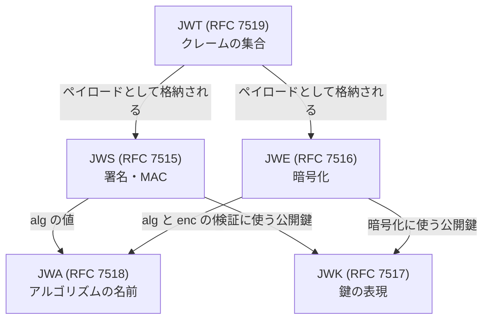
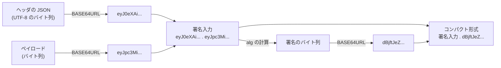

この章でわかること:

- JOSE の仕様群(JWS、JWE、JWK、JWA、JWT)がそれぞれ何を定めているか
- JWS コンパクトシリアライゼーションの3つの部分と、署名の対象になるバイト列(署名入力)
- RFC 7515 付録A.1 の HS256 の例を再計算し、RFC 記載の署名と一致することの確認
- JWT の登録済みクレーム(`iss`、`aud`、`exp` など)と NumericDate の意味
- 公開鍵を JSON で表す JWK・JWK Set と、鍵の識別に使う JWK Thumbprint(RFC 7638 の例で一致を確認)

## JOSEの全体像

[6章](/oidc/06-oauth-to-oidc/)で、IDトークンは `.` で区切られた3つの部分からなる文字列で、
それぞれを Base64url で復号するとヘッダ・ペイロード・署名が得られることを見ました。
この形式を定めているのが、**JOSE**(JSON Object Signing and Encryption)と総称される
IETF の仕様群です。JOSE は、JSON を使って署名・MAC・暗号化を表すための
データ構造とアルゴリズムの名前を定めています。

| 仕様 | 名前 | 定めるもの |
| --- | --- | --- |
| RFC 7515 | JWS(JSON Web Signature) | 署名または MAC で保護したメッセージの構造 |
| RFC 7516 | JWE(JSON Web Encryption) | 暗号化したメッセージの構造 |
| RFC 7517 | JWK(JSON Web Key) | 鍵を JSON で表す形式 |
| RFC 7518 | JWA(JSON Web Algorithms) | `alg` などに書くアルゴリズムの名前と処理 |
| RFC 7519 | JWT(JSON Web Token) | クレームの集合を JWS や JWE で保護して伝送する形式 |
| RFC 7638 | JWK Thumbprint | JWK から鍵の識別子を計算する方法 |

5つの仕様の関係を図に示します。



JWT は「何を表すか」(クレームの集合)を定め、JWS と JWE は「どう保護するか」を定めます。
JWK は検証や暗号化に使う鍵を、JWA はアルゴリズムの名前を定めます。
IDトークンは、JWS で署名した JWT です。この章では JWS を中心に読み、
JWE は概要だけを扱います。

署名と MAC の違い、ECDSA や RSA などのアルゴリズムそのものは
[5章](/web-auth/05-crypto/)で扱いました。この章では、それらの計算結果を
どのバイト列に対して求め、どう並べて1つの文字列にするかを扱います。

## JWS: 署名付きのメッセージ

**JWS**(JSON Web Signature)は、デジタル署名または MAC で保護したメッセージを表す
データ構造です。JWS は論理的には次の3つの値からなります。

- **JOSE ヘッダ**(JOSE Header): 署名に使ったアルゴリズムや鍵の識別子など、
  暗号処理を説明するパラメータの JSON オブジェクトです。
  ヘッダの1つ1つの名前と値の組をヘッダパラメータ(Header Parameter)と呼びます
- JWS ペイロード(JWS Payload): 保護する対象のバイト列です。JSON である必要はありません
- JWS 署名(JWS Signature): ヘッダとペイロードに対するデジタル署名または MAC です

この3つの値を1つの文字列や JSON に並べる方法を、シリアライゼーションと呼びます。
RFC 7515 は2つを定めています。

- **コンパクトシリアライゼーション**(JWS Compact Serialization): 3つの値をそれぞれ
  Base64url で符号化し、`.` で連結した文字列です。URL やHTTP ヘッダにそのまま入れられます
- **JSON シリアライゼーション**(JWS JSON Serialization): 3つの値を JSON オブジェクトの
  メンバーとして表す形式です。1つのペイロードに複数の署名を付けられますが、
  文字列は長くなり、URL にそのまま入れることはできません

OpenID Connect Core 1.0 は1.1節で、JWS と JWE はすべてコンパクトシリアライゼーションを使い、
JSON シリアライゼーションは使わないと定めています。署名だけを付けた IDトークンは、
常に `xxx.yyy.zzz` の3つの部分からなります。

## RFCを読む: RFC 7515 3節

3節は、JWS を構成する値と、シリアライゼーションの概要を述べています。

> JWS represents digitally signed or MACed content using JSON data structures and base64url encoding. These JSON data structures MAY contain whitespace and/or line breaks before or after any JSON values or structural characters, in accordance with Section 2 of RFC 7159 [RFC7159].

(RFC 7515 3節)

この節は、JWS が JSON のデータ構造と Base64url 符号化を使って、署名または MAC された内容を
表すと定めています。2文目は、JSON の値や構造文字の前後に空白や改行を含めてもかまわない(MAY)
と述べています。この許容が、後の付録A.1 の実験で意味を持ちます。
JSON としての書き方に自由がある以上、署名の対象は送信者が実際に書いたバイト列で
なければならず、JSON の意味(値)であってはなりません。

コンパクトシリアライゼーションの形は、3.1節が次のように定めています。

> In the JWS Compact Serialization, no JWS Unprotected Header is used. In this case, the JOSE Header and the JWS Protected Header are the same.
>
> In the JWS Compact Serialization, a JWS is represented as the concatenation:
>
>    BASE64URL(UTF8(JWS Protected Header)) || '.' ||
>    BASE64URL(JWS Payload) || '.' ||
>    BASE64URL(JWS Signature)

(RFC 7515 3.1節)

`||` はバイト列の連結、`UTF8(x)` は文字列 x の UTF-8 表現、`BASE64URL(x)` は
パディングなしの Base64url 符号化を表します。JWS には、署名で保護されるヘッダ
(JWS Protected Header)と、保護されないヘッダ(JWS Unprotected Header)の2種類がありますが、
コンパクトシリアライゼーションでは保護されないヘッダを使いません。このため、
コンパクト形式の JOSE ヘッダは全体が署名で保護されます。
`alg` や `kid` を書き換えると署名入力が変わり、元の署名とは一致しなくなります。
ただし、検証側が書き換え後の `alg` に従って検証方法を選ぶと、攻撃者が新しく作った署名で
検証を通過される場合があります。その対策は5.2節の読解で扱います。

## 署名入力: 署名の対象になるバイト列

JWS の署名は、ヘッダとペイロードを Base64url で符号化して `.` で連結した文字列に対して
計算し、JSON そのものに対しては計算しません。この文字列を
**署名入力**(JWS Signing Input)と呼びます。RFC 7515 2節の定義は次のとおりです。

> JWS Signing Input
> The input to the digital signature or MAC computation. Its value is ASCII(BASE64URL(UTF8(JWS Protected Header)) || '.' || BASE64URL(JWS Payload)).

(RFC 7515 2節)

コンパクトシリアライゼーションの文字列のうち、2つ目の `.` より前の部分がそのまま
署名入力になっています。受信者は、受け取った文字列の先頭から2つ目の `.` の手前までを
切り出せば、送信者が署名したバイト列を JSON の解析なしに正確に再現できます。
JSON を解析して書き直すと空白や順序が変わりうるため、この設計が必要です。



## RFCを読む: RFC 7515 5.1節

5.1節は、JWS を作る手順を8つに分けています。コンパクトシリアライゼーションに関係する
手順を抜き出します。

> 1. Create the content to be used as the JWS Payload.
> 2. Compute the encoded payload value BASE64URL(JWS Payload).
> 3. Create the JSON object(s) containing the desired set of Header Parameters, which together comprise the JOSE Header (the JWS Protected Header and/or the JWS Unprotected Header).
> 4. Compute the encoded header value BASE64URL(UTF8(JWS Protected Header)). [...]
> 5. Compute the JWS Signature in the manner defined for the particular algorithm being used over the JWS Signing Input ASCII(BASE64URL(UTF8(JWS Protected Header)) || '.' || BASE64URL(JWS Payload)). The "alg" (algorithm) Header Parameter MUST be present in the JOSE Header, with the algorithm value accurately representing the algorithm used to construct the JWS Signature.
> 6. Compute the encoded signature value BASE64URL(JWS Signature).

(RFC 7515 5.1節。`[...]` は JSON シリアライゼーションについての文の省略)

この節は、ペイロードとヘッダをそれぞれ Base64url で符号化し(手順2と4)、
署名入力に対して `alg` のアルゴリズムで署名を計算し(手順5)、署名も Base64url で
符号化する(手順6)、という順序を定めています。手順5には要請が2つあります。
JOSE ヘッダに `alg` が存在しなければならないこと(MUST)と、その値が署名の計算に
実際に使ったアルゴリズムを正確に表していなければならないこと(MUST)です。

検証の手順は5.2節にあり、作成の逆の順序で処理します。5.2節の最後の段落は、
8章の検証器の設計に直接関わります。

> Finally, note that it is an application decision which algorithms may be used in a given context. Even if a JWS can be successfully validated, unless the algorithm(s) used in the JWS are acceptable to the application, it SHOULD consider the JWS to be invalid.

(RFC 7515 5.2節)

どのアルゴリズムを使ってよいかはアプリケーションが決めることであり、
JWS の検証に成功しても、使われたアルゴリズムをアプリケーションが受け入れない場合は、
その JWS を無効とみなすべきです(SHOULD)。ヘッダの `alg` は攻撃者も書ける値なので、
検証側は自分が許可するアルゴリズムの一覧と照合し、`alg` の値に従って検証方法を選ぶことはしません。
この「alg の固定」は[8章](/oidc/08-id-token-validation/)で実装し、
固定しなかった場合の攻撃は[23章](/security/23-jwt-attacks/)で扱います。

## RFCを読む: RFC 7515 付録A.1

付録A.1 は、HS256(HMAC SHA-256)で保護した JWS の作成手順を、すべてのバイト列とともに
示しています。ヘッダは次の JSON です。

```json
{"typ":"JWT",
 "alg":"HS256"}
```

この JSON は2行に分かれており、RFC はこの書き方の曖昧さを次のように説明しています。

> In the representation used in this example, the first line has no leading or trailing spaces, a CRLF line break (13, 10) occurs between the first and second lines, the second line has one leading space (32) and no trailing spaces, and the last line does not have a terminating line break.

(RFC 7515 付録A.1.1)

1行目の末尾に CRLF(バイト値13と10)があり、2行目の先頭に空白(32)が1つあり、
最後の行には改行がない、という記述です。改行コードが LF か CRLF か、行頭の空白が
いくつか、最後に改行があるかによって UTF-8 のバイト列は変わり、署名も変わります。
このため RFC は、ヘッダのバイト列を JSON 配列の記法で明示しています。

```text
[123, 34, 116, 121, 112, 34, 58, 34, 74, 87, 84, 34, 44, 13, 10, 32,
34, 97, 108, 103, 34, 58, 34, 72, 83, 50, 53, 54, 34, 125]
```

ペイロードも同様に、3行の JSON が CRLF と行頭の空白1つで区切られています。

```json
{"iss":"joe",
 "exp":1300819380,
 "http://example.com/is_root":true}
```

鍵は JWK 形式の対称鍵で、`k` メンバーに鍵のバイト列が Base64url で書かれています
(JWK はこの章の後半で扱います)。

```json
{"kty":"oct",
 "k":"AyM1SysPpbyDfgZld3umj1qzKObwVMkoqQ-EstJQLr_T-1qS0gZH75aKtMN3Yj0iPS4hcgUuTwjAzZr1Z9CAow"
}
```

この鍵で署名入力の HMAC SHA-256 を計算した結果として、RFC は次の値を示しています。

```text
dBjftJeZ4CVP-mB92K27uhbUJU1p1r_wW1gFWFOEjXk
```

## 実験: RFC 7515 付録A.1 の署名を再計算する

付録A.1 の値から署名を再計算し、RFC 記載の値と一致するかを確かめます。
Rust の文字列リテラルでは CRLF を `\r\n` と書けるので、ヘッダとペイロードを
RFC の説明どおりのバイト列で作り、まず RFC の配列と一致することを確認します。
後半では、同じ意味の JSON を空白なしで書き直したときに署名がどうなるかも確かめます。
HMAC の計算と定数時間比較は5章で扱った `hmac` クレートを使います。

<RustPlay snippet="ch07/jws-hs256" title="RFC 7515 付録A.1 の HS256 署名を再計算する" />

出力は次のように読みます。

- 1行目の `true` は、`\r\n` と空白で組み立てたヘッダが RFC の配列とバイト単位で
  一致したことを示します
- 鍵は64バイトです。HMAC は任意長の鍵を受け付けますが、SHA-256 のブロック長と
  同じ64バイトの鍵が使われています
- 署名入力は `eyJ0eXAiOiJKV1QiLA0KICJhbGciOiJIUzI1NiJ9` で始まります。
  途中の `LA0K` が `,`・CR・LF の3バイトを符号化した部分です
- 計算した署名は `dBjftJeZ4CVP-mB92K27uhbUJU1p1r_wW1gFWFOEjXk` で、
  RFC 記載の文字列とも、RFC 記載の32バイトの配列とも一致します
- 空白を除いたヘッダは、`serde_json` で解析すると元のヘッダと同じ値になります。
  しかし空白を除いて計算した署名は RFC の署名と一致しません

最後の結果が、署名入力の設計の理由を示しています。受信者が JSON を解析して
自分の方法で書き直してから署名を検証すると、正しい JWS でも検証に失敗します。
受信者は、受け取った文字列の Base64url 部分をそのまま署名入力として使います。

:::note[同じ32バイトが RFC 7636 にも現れる]
この署名の32バイトは、PKCE の仕様である RFC 7636 の付録B で、
`code_verifier` を作るための乱数の例としてそのまま使われています。
付録B の `code_verifier` は `dBjftJeZ4CVP-mB92K27uhbUJU1p1r_wW1gFWFOEjXk` で、
この実験の署名と同じ文字列です。両方の RFC の例を照合すると確かめられます。
PKCE は[9章](/oidc/09-state-nonce-pkce/)で扱います。
:::

## JOSEヘッダのパラメータ

RFC 7515 4.1節は、JOSE ヘッダに書けるパラメータを登録しています。
IDトークンの検証で使うのは主に次の3つです。

`alg`(algorithm)は、JWS を保護したアルゴリズムを示すパラメータです。
4.1.1節は `alg` を必須とし(MUST be present)、実装はこれを理解して処理しなければならない
(MUST be understood and processed)と定めています。値は大文字と小文字を区別する文字列で、
JWA の登録簿(次節)の名前を使います。

`kid`(key ID)は、JWS の保護に使った鍵を示すヒントです。4.1.4節は、
`kid` の構造は規定しないとしたうえで、JWK と組み合わせて使うときは JWK の
`kid` パラメータの値と照合すると定めています。OP は複数の鍵を公開することがあり、
RP は `kid` で検証に使う鍵を選びます。ヒントであるため、`kid` が一致した鍵で
検証に成功するまで、その JWS を信用してはなりません。

`typ`(type)は、JWS 全体のメディアタイプを宣言するパラメータです。
4.1.9節は、1つのアプリケーションで複数の種類のオブジェクトが現れうるときに、
それらを区別するために使うと説明しています。JWT の仕様(RFC 7519 5.1節)は、
JWT であることを示す場合は値を `JWT` にすることを推奨しています(RECOMMENDED)。
IDトークンでは `typ` を省略する実装も多いのですが、アクセストークンの JWT
(RFC 9068 の `at+jwt`、[14章](/oauth-deep/14-token-validation/))のように、
`typ` で種類を区別する仕様もあります。種類の取り違えを防ぐ使い方は23章で扱います。

この他に、検証に使う鍵の場所や鍵そのものをヘッダに埋め込む `jku`、`jwk`、`x5u`、`x5c` が
登録されています。OpenID Connect Core 1.0 2節は、IDトークンでこれらを使うべきではない
(SHOULD NOT)と定めています。鍵は Discovery と登録の手順で事前に伝えるのが
OpenID Connect の方法です。ヘッダに書かれた鍵をそのまま信用すると、
攻撃者が自分の鍵で署名し、その公開鍵をヘッダに書くだけで検証を通過できてしまうからです。

## JWA: アルゴリズムの名前

**JWA**(JSON Web Algorithms)は、JWS・JWE・JWK で使うアルゴリズムの名前と、
それぞれの計算方法を定めた仕様(RFC 7518)です。`alg` の値として書く文字列は、
JWA と、JWA が作成した IANA の「JSON Web Signature and Encryption Algorithms」登録簿で
決まっています。

## RFCを読む: RFC 7518 3.1節

3.1節は、JWS の `alg` に使う値の一覧を表で定めています。表の一部を引用します。

```text
+--------------+-------------------------------+--------------------+
| "alg" Param  | Digital Signature or MAC      | Implementation     |
| Value        | Algorithm                     | Requirements       |
+--------------+-------------------------------+--------------------+
| HS256        | HMAC using SHA-256            | Required           |
| RS256        | RSASSA-PKCS1-v1_5 using       | Recommended        |
|              | SHA-256                       |                    |
| ES256        | ECDSA using P-256 and SHA-256 | Recommended+       |
| PS256        | RSASSA-PSS using SHA-256 and  | Optional           |
|              | MGF1 with SHA-256             |                    |
| none         | No digital signature or MAC   | Optional           |
|              | performed                     |                    |
+--------------+-------------------------------+--------------------+
```

(RFC 7518 3.1節の表から抜粋。384と512の各版は省略)

この節は、名前ごとに署名または MAC のアルゴリズムと、実装要件(Implementation Requirements)を
定めています。実装要件の「Required」は JOSE の実装が必ず実装すること、
「Recommended」は実装を推奨することを表します。`ES256` の「Recommended+」の `+` は、
将来の版で要件が強められる可能性が高いことを示す記号だと、表の後の文が説明しています。

本書で使う3つを説明します。

- **HS256**: HMAC SHA-256 による MAC です。署名側と検証側が同じ秘密の鍵を共有します。
  OpenID Connect では、クライアントシークレットを鍵にして IDトークンを保護する場合に使われます
  (OpenID Connect Core 1.0 3.1.3.7節の8項目目、8章で読みます)
- **RS256**: RSASSA-PKCS1-v1_5 と SHA-256 による RSA 署名です。
  OpenID Connect Core 1.0 3.1.3.7節が IDトークンの既定のアルゴリズムとしている値で、
  多くの実装で使われています。2048ビットの鍵では署名は256バイトです
- **ES256**: P-256 曲線と SHA-256 による ECDSA 署名です。RS256 と同程度の安全性を
  より短い鍵と署名で得られます。本書の mini-op(12章)は ES256 で IDトークンに署名します

`none` は署名なしを表します。3.6節が定めるこの値を受け入れる検証器は、
誰でも作れるトークンを受け入れることになります。8章の検証器は許可リストで `none` を拒否します。

ES256 の署名のバイト列の形式は、3.4節が次のように定めています。

> The output will be the pair (R, S), where R and S are 256-bit unsigned integers.
> Turn R and S into octet sequences in big-endian order, with each array being be 32 octets long. The octet sequence representations MUST NOT be shortened to omit any leading zero octets contained in the values.
> Concatenate the two octet sequences in the order R and then S.
> The resulting 64-octet sequence is the JWS Signature value.

(RFC 7518 3.4節。手順の番号を省いて引用)

ECDSA の署名は2つの整数 R と S の組です。JWS では R と S をそれぞれ32バイトの
ビッグエンディアンで表し、先頭のゼロのバイトを省略せずに、R、S の順に連結した
64バイトを署名とします。X.509 証明書などで使われる ASN.1 DER 形式とは異なる形式です。
ring では `ECDSA_P256_SHA256_FIXED_SIGNING`(署名)と `ECDSA_P256_SHA256_FIXED`(検証)が
この64バイト形式に対応し、名前に `ASN1` を含む方が DER 形式です。
形式を取り違えると、正しい署名でも検証に失敗します。

:::note[RFC 9864 と EdDSA]
JWA の `EdDSA` という値は、Ed25519 と Ed448 のどちらの曲線かを `alg` だけでは
決められない名前でした。2025年10月に発行された RFC 9864 は、曲線まで含めて
1つのアルゴリズムを表す完全指定のアルゴリズム識別子として `Ed25519` と `Ed448` を登録し、
`EdDSA` を非推奨(Deprecated)にしました。完全指定のアルゴリズムの考え方は23章で扱います。
本書の基礎編では ES256 と RS256 だけを使います。
:::

## 実験: ES256 で署名し、検証する

ring で P-256 の鍵ペアを生成し、IDトークンと同じ形の JWS を作って検証します。
公開鍵は JWK(次節)の形にし、`kid` には JWK Thumbprint(この章の最後で扱います)を使います。
検証側はまず、JWS が `.` で区切った3つの部分からなること(RFC 7515 5.2節の1項目目)と、
ヘッダの `alg` が `ES256` であることを確かめます。その後、JWK の `x` と `y` から組み立てた
公開鍵で署名を検証します。後半では、ペイロードを書き換えた JWS、別の鍵ペアの公開鍵、
`alg` を書き換えた JWS、部分が4つある JWS での検証も試します。

<RustPlay snippet="ch07/jws-es256" title="ES256 の JWS を作り、改ざんを検出する" />

鍵ペアは実行のたびに新しく生成されるため、JWK の `x`・`y`、`kid`、署名の値は
実行ごとに変わります。それ以外の行は毎回同じです。出力は次のように読みます。

- 署名は86文字で、64バイトを Base64url で符号化した長さです
  (64 × 4 / 3 を切り上げた86文字)
- 正しい JWS の検証は `Ok(())` です
- `sub` を書き換えた JWS は、ヘッダと署名を元のまま付けても `Err("署名が一致しない")` になります。
  ペイロードの1文字の変化で署名入力が変わるためです
- 別の鍵ペアの公開鍵では検証できません。検証に成功したことは、
  対応する秘密鍵の持ち主が署名したことを意味します
- ヘッダの `alg` を `none` に書き換えた JWS は、署名を計算する前に
  `Err("ヘッダの alg が ES256 ではない")` で拒否されます。検証器が期待するアルゴリズムを
  自分で決めておき、ヘッダの値と照合しているためです。この検査がない検証器では、
  攻撃者がヘッダに書いた `alg` によって検証方法が決まります(この攻撃は23章で扱います)
- 部分が4つある JWS は `Err("'.' で区切った部分が3つではない")` になります。
  コンパクトシリアライゼーションの区切りの `.` はちょうど2つです
- 同じ入力にもう一度署名すると、署名の値は1回目と異なりますが、どちらも検証に成功します。
  ECDSA は署名のたびに乱数を使うためで、HMAC とは異なり、署名の値を比較して
  検証することはできません

## JWT: クレームの集合を伝送する形式

**JWT**(JSON Web Token)は、クレームの集合を JSON オブジェクトとして表し、
JWS または JWE で保護して伝送する形式です(RFC 7519)。RFC 7519 2節は次のように定義しています。

> JSON Web Token (JWT)
> A string representing a set of claims as a JSON object that is encoded in a JWS or JWE, enabling the claims to be digitally signed or MACed and/or encrypted.

(RFC 7519 2節)

JWT のペイロードの JSON オブジェクトを、JWT Claims Set と呼びます。
JWT 自体はクレームの名前を自由に決めてよい形式ですが、相互運用のための共通の名前として、
RFC 7519 は7つのクレームを IANA の登録簿に登録しています。
これを **登録済みクレーム**(registered claim names)と呼びます。

## RFCを読む: RFC 7519 4.1節

4.1節の冒頭は、登録済みクレームの位置づけを述べています。

> None of the claims defined below are intended to be mandatory to use or implement in all cases, but rather they provide a starting point for a set of useful, interoperable claims. Applications using JWTs should define which specific claims they use and when they are required or optional.

(RFC 7519 4.1節)

この節は、登録済みクレームのどれも、すべての場合に必須とすることは意図していないと述べ、
JWT を使うアプリケーションが、どのクレームをいつ必須とするかを決めるべきだとしています。
OpenID Connect は、IDトークンで `iss`・`sub`・`aud`・`exp`・`iat` を必須(REQUIRED)と
定めたアプリケーションです(OpenID Connect Core 1.0 2節、8章で読みます)。

7つのクレームを、4.1.1〜4.1.7節の定義に沿って説明します。

- `iss`(issuer): JWT を発行した主体を識別するクレームです。値は大文字と小文字を
  区別する StringOrURI(任意の文字列。ただし `:` を含むなら URI でなければならない値)です。
  OpenID Connect では OP の Issuer Identifier(`https` の URL)を書きます
- `sub`(subject): JWT の主題となる主体を識別するクレームです。
  発行者の中で一意か、全体で一意でなければなりません(MUST)。
  IDトークンでの意味は[6章](/oidc/06-oauth-to-oidc/)で説明しました
- `aud`(audience): JWT の宛先を識別するクレームです。値は文字列の配列か、
  宛先が1つなら1つの文字列です
- `exp`(expiration time): この時刻以降は JWT を受け入れてはならない(MUST NOT)という
  有効期限です
- `nbf`(not before): この時刻より前は JWT を受け入れてはならない(MUST NOT)という
  有効開始時刻です
- `iat`(issued at): JWT が発行された時刻です
- `jti`(JWT ID): JWT の一意な識別子です。同じ JWT の再利用を検出するために使えます

`aud` の検証は、4.1.3節が受信者の義務として定めています。

> Each principal intended to process the JWT MUST identify itself with a value in the audience claim. If the principal processing the claim does not identify itself with a value in the "aud" claim when this claim is present, then the JWT MUST be rejected.

(RFC 7519 4.1.3節)

JWT を処理するはずの主体は、`aud` のいずれかの値で自分自身を識別できなければならず(MUST)、
`aud` があるのに自分を示す値が含まれていなければ、その JWT を拒否しなければなりません(MUST)。
6章のトークン置換攻撃の実験で行った検査は、この規定に対応します。

`exp` の処理について、4.1.4節は時計のずれへの対処も述べています。

> The processing of the "exp" claim requires that the current date/time MUST be before the expiration date/time listed in the "exp" claim.
> Implementers MAY provide for some small leeway, usually no more than a few minutes, to account for clock skew. Its value MUST be a number containing a NumericDate value.

(RFC 7519 4.1.4節)

現在時刻は `exp` の時刻より前でなければなりません(MUST)。実装は時計のずれ(clock skew)を
考慮して、通常は数分以内の小さな猶予を設けてもかまいません(MAY)。
値は NumericDate を含む数値でなければなりません(MUST)。猶予の設計は8章で扱います。

時刻のクレームに使う **NumericDate** は、RFC 7519 2節が定める時刻の表し方です。

> A JSON numeric value representing the number of seconds from 1970-01-01T00:00:00Z UTC until the specified UTC date/time, ignoring leap seconds.

(RFC 7519 2節)

1970-01-01T00:00:00Z(UTC)から指定の時刻までの秒数を、うるう秒を無視して表した
JSON の数値です。UNIX 時刻と同じ数え方で、ミリ秒ではなく秒である点に注意が必要です。
6章で表示した IDトークンの `exp` の 1311281970 は 2011-07-21T20:59:30Z、
`iat` の 1311280970 はその1000秒前を表します。

## JWKとJWK Set: 鍵をJSONで表す

**JWK**(JSON Web Key)は、暗号鍵を表す JSON オブジェクトです(RFC 7517)。
RP は OP の署名鍵の公開鍵を JWK の形で受け取り、IDトークンの検証に使います。
複数の JWK をまとめた JSON オブジェクトを **JWK Set**(JWKS)と呼び、
OP は JWK Set を `jwks_uri` という URL で公開します(`jwks_uri` の取得は[10章](/rust-impl/10-discovery-jwks/)で扱います)。

RFC 7517 付録A.1 の JWK Set の例を示します(値の途中の改行は表示のためです)。

```json
{"keys":
  [
    {"kty":"EC",
     "crv":"P-256",
     "x":"MKBCTNIcKUSDii11ySs3526iDZ8AiTo7Tu6KPAqv7D4",
     "y":"4Etl6SRW2YiLUrN5vfvVHuhp7x8PxltmWWlbbM4IFyM",
     "use":"enc",
     "kid":"1"},
    {"kty":"RSA",
     "n": "0vx7agoebGcQSuuPiLJXZptN9nndrQmbXEps2aiAFbWhM78LhWx
4cbbfAAtVT86zwu1RK7aPFFxuhDR1L6tSoc_BJECPebWKRXjBZCiFV4n3oknjhMs
tn64tZ_2W-5JsGY4Hc5n9yBXArwl93lqt7_RN5w6Cf0h4QyQ5v-65YGjQR0_FDW2
QvzqY368QQMicAtaSqzs8KJZgnYb9c7d0zgdAZHzu6qMQvRL5hajrn1n91CbOpbI
SD08qNLyrdkt-bFTWhAI4vMQFh6WeZu0fM4lFd2NcRwr3XPksINHaQ-G_xBniIqb
w0Ls1jF44-csFCur-kEgU8awapJzKnqDKgw",
     "e":"AQAB",
     "alg":"RS256",
     "kid":"2011-04-29"}
  ]
}
```

(RFC 7517 付録A.1)

1つ目は P-256 の楕円曲線の公開鍵、2つ目は RSA の公開鍵です。

## RFCを読む: RFC 7517 4節

4節は、JWK の形式の一般的な規則を定めています。

> A JWK is a JSON object that represents a cryptographic key. The members of the object represent properties of the key, including its value.

(RFC 7517 4節)

この節は、JWK を暗号鍵を表す JSON オブジェクトと定め、オブジェクトのメンバーが
鍵の値を含む鍵の性質を表すとしています。続く段落は、メンバー名の重複を
禁止し(MUST be unique)、理解できない追加のメンバーは無視しなければならない
(MUST be ignored)と定めています。

4.1節以降が各メンバーの定義です。すべての鍵に共通するものを挙げます。

- `kty`(key type): 鍵の種類を表すメンバーで、JWK に必ず存在しなければなりません(MUST)。
  値は `EC`(楕円曲線)、`RSA`、`oct`(対称鍵)などです
- `use`(public key use): 公開鍵の用途で、`sig`(署名の検証)か `enc`(暗号化)です。
  上の例の EC 鍵は `enc` なので、署名の検証には使いません
- `alg`(algorithm): この鍵を使うアルゴリズムです。省略可能(OPTIONAL)ですが、
  鍵を1つのアルゴリズムに限定するために役立ちます(8章)
- `kid`(key ID): 鍵の識別子です。4.5節は、JWK Set の中で異なる鍵には異なる `kid` を
  使うべきである(SHOULD)と定め、JWS の `kid` ヘッダパラメータとの照合に使うと述べています

鍵の値を表すメンバーは `kty` ごとに異なり、RFC 7518 6節が定めています。

- `kty` が `EC` の公開鍵は、`crv`(curve)で曲線を示し(`P-256` など)、`x` と `y` で
  曲線上の点の座標を表します。`x`(x coordinate)と `y`(y coordinate)は、
  座標の値を曲線の大きさのバイト列(P-256 なら32バイト)にして Base64url で
  符号化した文字列です。先頭のゼロのバイトも省略しません
- `kty` が `RSA` の公開鍵は、`n`(modulus、法)と `e`(exponent、公開指数)で表します。
  どちらも整数をビッグエンディアンのバイト列にして Base64url で符号化した値です。
  65537 を表す `e` は、3バイト [1, 0, 1] を符号化した `AQAB` になると RFC 7518 6.3.1.2節が
  例示しています

ring で検証するときは、EC 鍵は `0x04 || x || y` の65バイト(非圧縮形式の点)に、
RSA 鍵は `n` と `e` のバイト列に戻して使います。前の実験の `verify` 関数と、
8章の検証器がこの変換を行っています。

JWK Set について、5節は `keys` メンバーを必須とし(MUST)、理解できない `kty` の鍵や
必須のメンバーが欠けている鍵は無視すべきである(SHOULD)と定めています。
`keys` の配列の順序は、既定では優先順位を表しません(5.1節)。

## JWK Thumbprint: 鍵から識別子を計算する

`kid` の構造は規定されていないため、OP ごとに日付や連番など異なる方式で付けられます。
鍵そのものから一意な識別子を計算する方法として、RFC 7638 が **JWK Thumbprint** を定めています。
JWK Thumbprint は、JWK の必須メンバーだけを決まった規則で並べた JSON のハッシュ値です。
同じ鍵からは誰が計算しても同じ値が得られるため、`kid` の値に使えるほか、
DPoP([16章](/oauth-deep/16-sender-constrained/))でトークンを鍵に結びつけるときの
識別子(`jkt`)にも使われます。

## RFCを読む: RFC 7638 3.1節

3節は、計算方法を2つの手順で定めています。

> 1. Construct a JSON object [RFC7159] containing only the required members of a JWK representing the key and with no whitespace or line breaks before or after any syntactic elements and with the required members ordered lexicographically by the Unicode [UNICODE] code points of the member names. (This JSON object is itself a legal JWK representation of the key.)
> 2. Hash the octets of the UTF-8 representation of this JSON object with a cryptographic hash function H. For example, SHA-256 [SHS] might be used as H. See Section 3.4 for a discussion on the choice of hash function.

(RFC 7638 3節)

手順1は、鍵を表す JWK の必須メンバーだけを含み、構文要素の前後に空白や改行を入れず、
必須メンバーをメンバー名の Unicode コードポイントの辞書順に並べた JSON オブジェクトを
作ると定めています。手順2は、その UTF-8 のバイト列をハッシュ関数 H でハッシュします。
署名入力と同じく、ハッシュの対象はバイト列なので、空白と順序を1通りに決めておく必要があります。

必須メンバーは鍵の種類ごとに決まっています(3.2節)。

| `kty` | 必須メンバー(辞書順) |
| --- | --- |
| `EC` | `crv`、`kty`、`x`、`y` |
| `RSA` | `e`、`kty`、`n` |
| `oct` | `k`、`kty` |

3.1節は、RFC 7517 の例と同じ RSA 鍵(`"alg":"RS256"` と `"kid":"2011-04-29"` を含む JWK)を
使って計算例を示しています。`alg` と `kid` は必須メンバーではないので除外され、
ハッシュの入力は次の JSON になります(表示用に改行しています)。

```text
{"e":"AQAB","kty":"RSA","n":"0vx7agoebGcQSuuPiLJXZptN9nndrQmbXEps2
aiAFbWhM78LhWx4cbbfAAtVT86zwu1RK7aPFFxuhDR1L6tSoc_BJECPebWKRXjBZCi
FV4n3oknjhMstn64tZ_2W-5JsGY4Hc5n9yBXArwl93lqt7_RN5w6Cf0h4QyQ5v-65Y
GjQR0_FDW2QvzqY368QQMicAtaSqzs8KJZgnYb9c7d0zgdAZHzu6qMQvRL5hajrn1n
91CbOpbISD08qNLyrdkt-bFTWhAI4vMQFh6WeZu0fM4lFd2NcRwr3XPksINHaQ-G_x
BniIqbw0Ls1jF44-csFCur-kEgU8awapJzKnqDKgw"}
```

SHA-256 を H とした結果の Base64url 符号化として、RFC は次の値を示しています。

```text
NzbLsXh8uDCcd-6MNwXF4W_7noWXFZAfHkxZsRGC9Xs
```

省略可能なメンバーを除く理由を、3.2.2節は、それらの有無によって値が変わらないようにするため
と説明しています。同じ鍵に別の `kid` や `alg` を付けた JWK からも、同じ Thumbprint が
得られます。

## 実験: RFC 7638 のJWK Thumbprintを再計算する

RFC 7638 3.1節の例から JWK Thumbprint を計算し、RFC 記載の値と一致するかを確かめます。
後半では、規則を外した入力(省略可能なメンバーを含める、順序を変える、空白を入れる)で
値がどう変わるかと、`serde_json` で組み立てた入力が規則どおりになるかを確かめます。

<RustPlay snippet="ch07/jwk-thumbprint" title="RFC 7638 3.1節の JWK Thumbprint を再計算する" />

出力は次のように読みます。

- ハッシュの入力は373バイトで、SHA-256 の結果は RFC 記載の32バイトの配列と一致し、
  Base64url 符号化した値 `NzbLsXh8uDCcd-6MNwXF4W_7noWXFZAfHkxZsRGC9Xs` も一致します
- `n` は256バイトで、この鍵が2048ビットの RSA 鍵であることがわかります
- `alg` と `kid` を含めた場合、メンバーの順序を変えた場合、空白を入れた場合は、
  いずれも別の値になります。同じ鍵を表す JSON でも、規則どおりでなければ
  同じ Thumbprint は得られません
- `serde_json::json!` で組み立てた値を `to_string` で文字列にすると、手書きの入力と一致します。
  `serde_json` の `Map` は既定ではメンバー名の順に並び、`to_string` は空白を入れないためです。
  ただし `serde_json` の `preserve_order` 機能を有効にすると挿入順になるため、
  実装では順序を明示して組み立てるほうが確実です

## JWEの概要

**JWE**(JSON Web Encryption)は、暗号化したメッセージを表すデータ構造です(RFC 7516)。
JWS が完全性と発行者の確認を提供するのに対し、JWE は内容の機密性を提供します。
コンパクトシリアライゼーションは5つの部分からなり、RFC 7516 3.1節は次の形を示しています。

```text
BASE64URL(UTF8(JWE Protected Header)) || '.' ||
BASE64URL(JWE Encrypted Key) || '.' ||
BASE64URL(JWE Initialization Vector) || '.' ||
BASE64URL(JWE Ciphertext) || '.' ||
BASE64URL(JWE Authentication Tag)
```

(RFC 7516 3.1節)

`.` が4つあるため、受け取ったトークンの `.` の数で JWS(3つの部分)と JWE(5つの部分)を
区別できます。OpenID Connect では、IDトークンを暗号化する場合は署名してから暗号化し、
JWE の中に JWS が入った入れ子の JWT(Nested JWT)にすると定めています
(OpenID Connect Core 1.0 2節)。本書の基礎編の OP は IDトークンを暗号化しないため、
8章の検証器は5つの部分のトークンを受け付けない設定にしています。

## まとめ

- JOSE は、JWS(署名・MAC)、JWE(暗号化)、JWK(鍵)、JWA(アルゴリズムの名前)、
  JWT(クレームの集合)からなる仕様群です。IDトークンは JWS で署名した JWT です
- JWS コンパクトシリアライゼーションは `BASE64URL(ヘッダ).BASE64URL(ペイロード).BASE64URL(署名)` で、
  署名の対象は2つ目の `.` より前の文字列(署名入力)です
- RFC 7515 付録A.1 の再計算では、CRLF と空白を含むヘッダのバイト列から RFC 記載の署名
  `dBjftJeZ...` が得られ、空白を除いた同じ意味の JSON からは別の署名が得られました。
  署名は送信されたバイト列に対して計算され、JSON の意味は対象になりません
- ヘッダの `alg` は検証に使うアルゴリズムを示しますが、どのアルゴリズムを受け入れるかは
  アプリケーションが決めます(RFC 7515 5.2節)。ES256 の署名は R と S を連結した64バイトです
- JWT の登録済みクレームは `iss`・`sub`・`aud`・`exp`・`nbf`・`iat`・`jti` の7つで、
  時刻は NumericDate(1970年からの秒数)で表します
- 公開鍵は JWK(`kty` と鍵の種類ごとのメンバー)で表し、JWK Set にまとめて公開します。
  JWK Thumbprint は必須メンバーを辞書順・空白なしで並べた JSON のハッシュで、
  RFC 7638 の例の値 `NzbLsXh8...` を再計算で確認しました

次章では、この章で読んだ形式を前提に、OpenID Connect Core 1.0 3.1.3.7節の
IDトークン検証の手順を1項目ずつ読み、ring を使って ES256 と RS256 の検証器を Rust で実装します。
