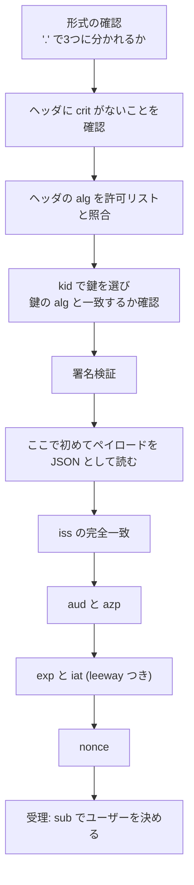

この章でわかること:

- IDトークンのクレーム(`iss`、`sub`、`aud`、`exp`、`iat`、`auth_time`、`nonce`、`acr`、`amr`、`azp`)の意味
- OpenID Connect Core 1.0 3.1.3.7節の13項目の検証手順と、それぞれを Rust で書いたコード
- 署名を検証する前にペイロードを信用してはいけない理由と、alg を固定する理由
- 時計のずれ(leeway)と `iat` の扱い、`at_hash` によるアクセストークンとの結びつけ
- IDトークンとアクセストークンを取り違えて使うと何が起きるか

## 検証の全体像

[6章](/oidc/06-oauth-to-oidc/)の最後で見たとおり、認可コードフローの手順8は
「IDトークンを検証し、エンドユーザーの `sub` を取り出す」ことでした。
RP がログインを安全に作れるかどうかは、この手順で決まります。

**IDトークン検証**(ID token validation)は、受け取った IDトークンについて、
信頼する OP が発行したこと、自分(この RP)に宛てたものであること、
有効期間内であること、自分が送った認証リクエストへの応答であることを確かめる処理です。
1つでも確かめられなければ、その IDトークンでログインさせてはなりません。

検証は大きく2段に分かれます。

1. **署名検証**(signature verification): IDトークンの署名が、信頼する OP の鍵で
   作られたものであることを確かめます。成功すれば、ペイロードのクレームは
   OP が書いたものから変更されていないことがわかります
2. クレームの検証: 署名で保護されたクレームの値を、RP の設定と認証リクエストの値に照合します

署名を検証する前のペイロードは、誰でも作れる
Base64url の文字列にすぎません。署名検証の前にペイロードの値を使って処理を分けると、
攻撃者が書いた値で RP の動作を変えられてしまいます。
例えば、検証前のペイロードの `iss` を見て「どの OP の鍵で検証するか」を選ぶ実装では、
攻撃者が自分で用意した OP を `iss` に書くことで、攻撃者の鍵で検証させられる場合があります。

本章の検証器は、次の順序で処理します。ヘッダは署名の前に読む必要がありますが、
使うのは `crit`・`alg`・`kid` だけです。`crit` は存在しないことの確認に、
`alg` と `kid` は RP が事前に持っている値(許可リストと鍵の一覧)との照合にだけ使います。



以降の節では、まず2節でクレームの定義を読み、次に3.1.3.7節の検証手順を
1項目ずつ読みながら、この検証器のコードを示します。

## 仕様を読む: OpenID Connect Core 1.0 2節

2節は、IDトークンで使うクレームを定義しています。必須(REQUIRED)の5つと、
条件付きまたは任意の5つがあります。

### iss

> REQUIRED. Issuer Identifier for the Issuer of the response. The iss value is a case-sensitive URL using the https scheme that contains scheme, host, and optionally, port number and path components and no query or fragment components.

(OpenID Connect Core 1.0 2節)

`iss` は応答の発行者の Issuer Identifier で、必須です。値は大文字と小文字を区別する
`https` スキームの URL で、スキームとホスト、任意でポート番号とパスを含み、
クエリとフラグメントを含みません。

### sub

> REQUIRED. Subject Identifier. A locally unique and never reassigned identifier within the Issuer for the End-User, which is intended to be consumed by the Client, e.g., 24400320 or AItOawmwtWwcT0k51BayewNvutrJUqsvl6qs7A4. It MUST NOT exceed 255 ASCII [RFC20] characters in length. The sub value is a case-sensitive string.

(OpenID Connect Core 1.0 2節)

`sub` は発行者の中で一意で、再割り当てされないエンドユーザーの識別子です。
ASCII で255文字を超えてはなりません(MUST NOT)。RP はユーザーのアカウントを
`iss` と `sub` の組で識別します。本章の検証器は、他の検査がすべて通った後に、
`sub` が ASCII だけからなる255文字以下の文字列であることを確かめます。

```rust
let sub = claims["sub"].as_str().ok_or("sub がない")?;
if !sub.is_ascii() || sub.len() > 255 {
    return Err("sub が255文字以下の ASCII 文字列ではない".into());
}
```

### aud

> REQUIRED. Audience(s) that this ID Token is intended for. It MUST contain the OAuth 2.0 client_id of the Relying Party as an audience value. It MAY also contain identifiers for other audiences. In the general case, the aud value is an array of case-sensitive strings. In the common special case when there is one audience, the aud value MAY be a single case-sensitive string.

(OpenID Connect Core 1.0 2節)

`aud` は IDトークンの宛先で、RP の `client_id` を含まなければなりません(MUST)。
他の宛先を含んでもかまいません(MAY)。値は一般には文字列の配列で、
宛先が1つの場合は1つの文字列でもかまいません(MAY)。
RP の実装は、文字列と配列の両方を受け付ける必要があります。

### exp と iat

> REQUIRED. Expiration time on or after which the ID Token MUST NOT be accepted by the RP when performing authentication with the OP. [...] Implementers MAY provide for some small leeway, usually no more than a few minutes, to account for clock skew. [...] NOTE: The ID Token expiration time is unrelated the lifetime of the authenticated session between the RP and the OP.

(OpenID Connect Core 1.0 2節 `exp`。`[...]` は省略)

`exp` は有効期限で、この時刻以降、RP は IDトークンを受け入れてはなりません(MUST NOT)。
時計のずれに対して小さな猶予を設けてもかまいません(MAY)。最後の NOTE は、
`exp` が RP と OP の間のログインセッションの寿命とは無関係だと述べています。
IDトークンはログインの瞬間の結果を伝えるもので、RP のセッションの長さは RP が決めます。
`iat`(必須)は JWT の発行時刻です。どちらも NumericDate([7章](/oidc/07-jwt-jose/))です。

### auth_time

`auth_time` は、エンドユーザーの認証が行われた時刻を表すクレームです。

> When a max_age request is made or when auth_time is requested as an Essential Claim, then this Claim is REQUIRED; otherwise, its inclusion is OPTIONAL.

(OpenID Connect Core 1.0 2節)

`iat` は IDトークンの発行時刻であり、認証の時刻ではありません。OP に既存のログイン状態が
あれば、エンドユーザーがパスワードを入力したのは数時間前で、IDトークンの発行は
今、ということが起こります。RP が認証リクエストに `max_age`(認証からの経過時間の上限)を
付けた場合、OP は `auth_time` を必ず含めます。`max_age` は[18章](/oidc-deep/18-claims-identity/)で扱います。

### nonce

`nonce` は、RP のセッションと IDトークンを結びつけ、リプレイ攻撃を緩和するための文字列です。

> The value is passed through unmodified from the Authentication Request to the ID Token. If present in the ID Token, Clients MUST verify that the nonce Claim Value is equal to the value of the nonce parameter sent in the Authentication Request. If present in the Authentication Request, Authorization Servers MUST include a nonce Claim in the ID Token with the Claim Value being the nonce value sent in the Authentication Request.

(OpenID Connect Core 1.0 2節)

値は認証リクエストから IDトークンへ変更されずに渡されます。IDトークンに `nonce` があれば、
RP はそれが認証リクエストで送った値と等しいことを検証しなければならず(MUST)、
認証リクエストに `nonce` があれば、OP は同じ値の `nonce` クレームを IDトークンに
含めなければなりません(MUST)。RP が値を生成し、OP がそのまま IDトークンに入れ、RP が照合する、という流れです。
`nonce` が防ぐ攻撃と、`state` や PKCE との違いは[9章](/oidc/09-state-nonce-pkce/)で扱います。

### acr と amr

`acr`(Authentication Context Class Reference)は、行われた認証が満たした
認証コンテキストクラス(同等とみなす認証方法の集まり)を表す文字列です。
例えば「パスワードのみ」と「多要素認証」を別のクラスとして定義しておき、
RP は `acr` を見て、送金のような操作に必要な強さの認証が行われたかを判断します。
値の意味は当事者間で取り決める必要がある、と仕様は述べています。

`amr`(Authentication Methods References)は、認証に使われた方法の識別子の配列です。
例えばパスワードとワンタイムパスワードの両方が使われたことを示せます。
値は RFC 8176 が作成した IANA の登録簿から選ぶべきです(SHOULD)。
`acr` と `amr` の使い方は18章で扱います。

### azp

`azp`(authorized party)は、IDトークンが発行された相手(認可された当事者)の
`client_id` を表すクレームです。

> Note that in practice, the azp Claim only occurs when extensions beyond the scope of this specification are used; therefore, implementations not using such extensions are encouraged to not use azp and to ignore it when it does occur.

(OpenID Connect Core 1.0 2節)

errata set 2 の版は、`azp` は実際にはこの仕様の範囲外の拡張を使う場合にだけ現れるので、
そのような拡張を使わない実装は `azp` を使わず、現れても無視することが勧められる、
と書いています。本章の検証器は、
`azp` があれば自分の `client_id` と一致することを確認します(3.1.3.7節の5項目目が
許している検査です)。`azp` がない場合は検査を省き、`azp` が文字列以外の値の場合は拒否します。

2節の最後は、理解できないクレームは無視しなければならない(MUST be ignored)と定めています。
RP は知らないクレームがあることを理由に拒否してはなりません。

## 仕様を読む: OpenID Connect Core 1.0 3.1.3.7節

3.1.3.7節は、RP がトークンレスポンスの IDトークンを検証する手順を13項目で定めています。
冒頭は次の1文です。

> Clients MUST validate the ID Token in the Token Response in the following manner:

(OpenID Connect Core 1.0 3.1.3.7節)

クライアントは、トークンレスポンスの IDトークンを次の方法で検証しなければなりません(MUST)。
項目の番号は仕様の順で、実装の順序とは一致しません。実装の順序は前の図のとおりです。

### 1. 暗号化されたIDトークン

> If the ID Token is encrypted, decrypt it using the keys and algorithms that the Client specified during Registration that the OP was to use to encrypt the ID Token. If encryption was negotiated with the OP at Registration time and the ID Token is not encrypted, the RP SHOULD reject it.

この項目は、IDトークンが暗号化されていれば、登録時に指定した鍵とアルゴリズムで復号すると
定めています。登録時に暗号化を取り決めたのに暗号化されていない IDトークンは、
拒否すべきです(SHOULD)。本章の RP は暗号化を取り決めていないため、
JWE(`.` で5つに分かれる形式)を受け付けない設定にしています。

```rust
let parts: Vec<&str> = token.split('.').collect();
if parts.len() == 5 {
    return Err("暗号化された ID トークン(JWE)は受け付けない設定".into());
}
let [h64, p64, s64] = parts[..] else {
    return Err("JWS コンパクトシリアライゼーションではない".into());
};
```

### 2. iss の完全一致

> The Issuer Identifier for the OpenID Provider (which is typically obtained during Discovery) MUST exactly match the value of the iss (issuer) Claim.

OP の Issuer Identifier(通常は Discovery で得た値)は、`iss` クレームの値と
完全に一致しなければなりません(MUST)。完全一致とは文字列としての一致で、
末尾の `/` の有無や大文字と小文字の違いも不一致として扱います。
URL として正規化してから比較すると、別の発行者を同じとみなす誤りが生じます。
Issuer Identifier を Discovery で得て検証する手順は[10章](/rust-impl/10-discovery-jwks/)で扱います。

```rust
let iss = claims["iss"].as_str().ok_or("iss がない")?;
if iss != cfg.issuer {
    return Err(format!("iss={iss} は期待する {} と完全一致しない", cfg.issuer));
}
```

### 3. aud に自分の client_id があること

> The Client MUST validate that the aud (audience) Claim contains its client_id value registered at the Issuer identified by the iss (issuer) Claim as an audience. The aud (audience) Claim MAY contain an array with more than one element. The ID Token MUST be rejected if the ID Token does not list the Client as a valid audience, or if it contains additional audiences not trusted by the Client.

クライアントは、`aud` が `iss` の発行者に登録した自分の `client_id` を含むことを
検証しなければなりません(MUST)。`aud` は複数の要素の配列でもかまいません(MAY)。
IDトークンが自分を宛先として挙げていない場合と、自分が信頼しない宛先を追加で含む場合は、
拒否しなければなりません(MUST)。後半の条件は見落とされやすい点です。
自分の `client_id` を含んでいても、知らない宛先が一緒に書かれた IDトークンは、
その宛先の側でも同じトークンが使える可能性があるため拒否します。

```rust
let auds: Vec<&str> = match &claims["aud"] {
    Value::String(s) => vec![s.as_str()],
    Value::Array(a) => a
        .iter()
        .map(|v| v.as_str().ok_or("aud の配列に文字列以外の要素がある"))
        .collect::<Result<_, _>>()?,
    _ => return Err("aud がないか、文字列でも配列でもない".into()),
};
if !auds.contains(&cfg.client_id) {
    return Err(format!("aud={auds:?} に自分の client_id がない"));
}
if let Some(other) = auds
    .iter()
    .find(|a| **a != cfg.client_id && !cfg.trusted_extra_audiences.contains(a))
{
    return Err(format!("aud に信頼しない宛先 {other} が含まれる"));
}
```

配列の要素は、すべて文字列であることを確かめます。文字列以外の要素を読み飛ばすと、
`["rp-demo", 123]` のように型の誤った要素を含む `aud` を、要素が1つの正しい `aud` として
受理することになります。

### 4. と 5. azp

> 4. If the implementation is using extensions (which are beyond the scope of this specification) that result in the azp (authorized party) Claim being present, it SHOULD validate the azp value as specified by those extensions.
> 5. This validation MAY include that when an azp (authorized party) Claim is present, the Client SHOULD verify that its client_id is the Claim Value.

`azp` が現れる拡張を使っている実装は、その拡張の定めに従って `azp` を検証すべきです(SHOULD)。
その検証には、`azp` があるときに値が自分の `client_id` であることの確認を含めてもかまいません(MAY)。
本章の検証器は5項目目の確認を行います。`azp` がないことと、`azp` が文字列以外の値で
あることは区別します。前者は検査を省き、後者は拒否します。

```rust
match claims.get("azp") {
    None => {}
    Some(Value::String(azp)) if azp == cfg.client_id => {}
    Some(Value::String(azp)) => return Err(format!("azp={azp} が自分の client_id ではない")),
    Some(_) => return Err("azp が文字列ではない".into()),
}
```

### 6. 署名の検証

> If the ID Token is received via direct communication between the Client and the Token Endpoint (which it is in this flow), the TLS server validation MAY be used to validate the issuer in place of checking the token signature. The Client MUST validate the signature of all other ID Tokens according to JWS [JWS] using the algorithm specified in the JWT alg Header Parameter. The Client MUST use the keys provided by the Issuer.

IDトークンをトークンエンドポイントとの直接の通信で受け取った場合(認可コードフローはこれに
当たります)は、署名の検証の代わりに TLS のサーバ検証で発行者を確認してもかまいません(MAY)。
それ以外の IDトークンは、JWS に従って署名を検証しなければなりません(MUST)。
鍵は発行者が提供したものを使わなければなりません(MUST)。

前半の MAY は、TLS で接続先が OP であることを確認しているなら、その応答の中身も
OP が書いたものだと判断できる、という考え方です。本書の RP は、この MAY を使わずに
常に署名を検証します。理由は2つあります。1つは、受け取った経路の情報が失われやすいことです。
IDトークンは、トークンレスポンスを受け取った後もセッションに保存されたり、
`id_token_hint`(18章)として OP に送り返されたり、他の処理に渡されたりします。
もう1つは、TLS を終端するプロキシや HTTP クライアントの設定の誤りによって、
サーバ検証が実際には行われていない構成がありうることです。署名を検証していれば、
IDトークン自体から発行者を確認できます。

署名の検証は、ヘッダの `kid` で JWK Set から鍵を選んで行います。
鍵の `alg` とヘッダの `alg` が一致しない場合は、署名を検証する前に拒否します。
1つの鍵を1つのアルゴリズムにだけ使う、という規則です(次の7項目目で読みます)。

```rust
let kid = header["kid"].as_str().ok_or("kid がない")?;
let jwk = jwks
    .iter()
    .find(|k| k.kid == kid)
    .ok_or(format!("kid={kid} の鍵を持っていない"))?;
if jwk.alg != alg {
    return Err(format!("kid={kid} の鍵は {} 用で、alg={alg} には使えない", jwk.alg));
}

let signing_input = format!("{h64}.{p64}");
let sig = b64d(s64)?;
let verified = match &jwk.key {
    KeyMaterial::EcP256 { point } => {
        UnparsedPublicKey::new(&signature::ECDSA_P256_SHA256_FIXED, point)
            .verify(signing_input.as_bytes(), &sig)
    }
    KeyMaterial::Rsa { n, e } => RsaPublicKeyComponents { n, e }.verify(
        &signature::RSA_PKCS1_2048_8192_SHA256,
        signing_input.as_bytes(),
        &sig,
    ),
};
verified.map_err(|_| "署名が一致しない")?;
```

ES256 には ring の `ECDSA_P256_SHA256_FIXED`(R と S を連結した64バイトの形式、7章)を、
RS256 には `RSA_PKCS1_2048_8192_SHA256`(2048〜8192ビットの鍵の RSASSA-PKCS1-v1_5)を使います。
署名入力は受け取った文字列の Base64url 部分をそのまま連結したもので、JSON を書き直していません。

本章の検証器は `kid` がない IDトークンを拒否します。鍵を1つしか公開しない OP では
`kid` が省略されることがありますが、鍵を入れ替える期間には複数の鍵が並ぶため、
`kid` で選ぶ設計にしておくと鍵の入れ替えに対応できます(10章)。

### 7. alg

> The alg value SHOULD be the default of RS256 or the algorithm sent by the Client in the id_token_signed_response_alg parameter during Registration.

`alg` の値は、既定の RS256 か、クライアントが登録時に `id_token_signed_response_alg` で
指定したアルゴリズムであるべきです(SHOULD)。この項目は、RP が受け入れる `alg` が
事前に決まっていることを前提にしています。

IDトークンのヘッダの `alg` は、署名を検証する前の、攻撃者も書ける値です。
RP が `alg` の値に従って検証方法を選ぶと、`alg` を `none` にして署名を空にしたトークンや、
`alg` を `HS256` にして RSA の公開鍵(公開されている値)を HMAC の鍵として署名した
トークンを受け入れる場合があります。後者はアルゴリズム混同攻撃と呼ばれ、
[23章](/security/23-jwt-attacks/)で詳しく扱います。

このため RP は、受け入れるアルゴリズムの一覧を設定として持ち、ヘッダの `alg` が
一覧にない IDトークンを署名検証の前に拒否します。これを **alg の固定**(algorithm pinning)、
または **アルゴリズム許可リスト**(algorithm allowlist)と呼びます。
JWT の BCP である RFC 8725 は、ライブラリの側の要請として次のように定めています。

> Libraries MUST enable the caller to specify a supported set of algorithms and MUST NOT use any other algorithms when performing cryptographic operations. The library MUST ensure that the "alg" or "enc" header specifies the same algorithm that is used for the cryptographic operation. Moreover, each key MUST be used with exactly one algorithm, and this MUST be checked when the cryptographic operation is performed.

(RFC 8725 3.1節)

ライブラリは、呼び出し側がサポートするアルゴリズムの集合を指定できるようにしなければならず(MUST)、
それ以外のアルゴリズムを暗号処理に使ってはなりません(MUST NOT)。
`alg` が暗号処理に実際に使うアルゴリズムと同じであることを保証しなければならず(MUST)、
各鍵はちょうど1つのアルゴリズムで使われなければならず、そのことを暗号処理のときに
検査しなければなりません(MUST)。本章の検証器は、許可リストの照合と、
6項目目のコードにある鍵の `alg` との照合で、この2つの要請を満たしています。

```rust
let alg = header["alg"].as_str().ok_or("alg がない")?;
if !cfg.allowed_algs.contains(&alg) {
    return Err(format!("alg={alg} は許可リスト {:?} にない", cfg.allowed_algs));
}
```

ヘッダには、`alg` の前にもう1つ確かめる値があります。`crit`(crit ヘッダパラメータ、critical)です。

> If any of the listed extension Header Parameters are not understood and supported by the recipient, then the JWS is invalid.

(RFC 7515 4.1.11節)

この節は、`crit` を、受信者が理解して処理しなければならない拡張のヘッダパラメータ名の
配列と定め、列挙された拡張を受信者が理解せずサポートもしていなければ、
その JWS は無効であるとしています。本章の検証器はどの拡張にも対応していないため、
`crit` があれば値によらず拒否します。

```rust
if header.get("crit").is_some() {
    return Err("crit の拡張には対応していない".into());
}
```

### 8. MAC のアルゴリズム

> If the JWT alg Header Parameter uses a MAC based algorithm such as HS256, HS384, or HS512, the octets of the UTF-8 [RFC3629] representation of the client_secret corresponding to the client_id contained in the aud (audience) Claim are used as the key to validate the signature. For MAC based algorithms, the behavior is unspecified if the aud is multi-valued.

`alg` が HS256 などの MAC のアルゴリズムの場合は、`aud` の `client_id` に対応する
`client_secret` の UTF-8 表現を鍵として検証します。`aud` が複数の値を持つ場合の動作は
規定されていません。この方式では OP と RP が同じ鍵を持つため、RP も同じ形の IDトークンを
作れます。本章の RP は HS256 を登録しておらず、許可リストにも含めていないため、
HS256 の IDトークンは7項目目の検査で拒否されます。

### 9. exp

> The current time MUST be before the time represented by the exp Claim.

現在時刻は `exp` が表す時刻より前でなければなりません(MUST)。

RP と OP の時計は完全には一致しません。OP の時計が RP より進んでいれば、
RP から見て未来の `iat` を持つ IDトークンが届きます。遅れていれば、`exp` は RP の時計で見て本来より早い時刻になります。
このずれを **クロックスキュー**(clock skew)と呼び、検査に設ける猶予を
**leeway** と呼びます。2節と RFC 7519 4.1.4節が述べるとおり、leeway は通常数分以内にします。
本章の検証器は leeway を60秒にし、`exp` から60秒以内のトークンを受け入れます。

```rust
let exp = numeric_date(&claims, "exp")?;
if now - cfg.leeway >= exp {
    return Err(format!("期限切れ (exp から {} 秒経過)", now.saturating_sub(exp)));
}
```

加減算は `now` と設定値の側で行います。`exp + cfg.leeway` と書くと、攻撃者が `exp` に
`i64` の最大値に近い値を書いたときに桁あふれが起こります。Rust の release ビルドでは
桁あふれした値は負の数になり、比較の結果が変わります。`now` と `leeway` は RP が決める値なので、
`now - cfg.leeway` は桁あふれしません。表示用の差には `saturating_sub` を使います。

`exp` と `iat` の値は NumericDate で、RFC 7519 2節は整数以外の値も認めています。
`as_i64()` だけで読むと、`1800000300.5` のような小数の値を「`exp` がない」と扱ってしまいます。
本章の検証器は、次の `numeric_date` で小数を受け付け、小数部を切り捨てて秒単位の整数にします。
`exp` の切り捨ては期限を最大1秒早めるため、受け入れる範囲は広がりません。

```rust
fn numeric_date(claims: &Value, name: &str) -> Result<i64, String> {
    let n = claims[name].as_number().ok_or(format!("{name} がないか数値ではない"))?;
    if let Some(i) = n.as_i64() {
        return Ok(i);
    }
    match n.as_f64() {
        Some(f) if f.is_finite() && f >= i64::MIN as f64 && f < i64::MAX as f64 => {
            Ok(f.floor() as i64)
        }
        _ => Err(format!("{name} が扱える範囲の数値ではない")),
    }
}
```

leeway を大きくするほど、期限切れのトークンを受け入れる期間が延びます。
RP のサーバの時計は NTP(ネットワーク経由で時刻を合わせるプロトコル)で同期し、leeway は時計のずれを許容するための小さな値にとどめます。

### 10. iat

> The iat Claim can be used to reject tokens that were issued too far away from the current time, limiting the amount of time that nonces need to be stored to prevent attacks. The acceptable range is Client specific.

`iat` は、現在時刻からかけ離れた時刻に発行されたトークンを拒否するために使えます。
その結果、攻撃を防ぐために `nonce` を保存しておく期間を限定できます。
許容範囲はクライアントが決めます。

`exp` が長い IDトークンでも、発行から長い時間が経ったものは拒否する、という検査です。
本章の検証器は、発行から600秒を超えたもの(`max_iat_age`)と、leeway を超えて未来の
`iat` を持つものを拒否します。認可コードフローでは、IDトークンはトークンリクエストの
応答として受け取った直後に検証するため、数分を超える `iat` の古さは異常を示します。

```rust
let iat = numeric_date(&claims, "iat")?;
if iat > now + cfg.leeway {
    return Err("iat が未来の時刻".into());
}
if iat < now - cfg.max_iat_age {
    return Err(format!("発行から {} 秒経っていて古すぎる", now.saturating_sub(iat)));
}
```

`now - iat` と書くと、`iat` が `i64` の最小値に近い場合に桁あふれが起こります。
`exp` と同じく、`now` の側で `max_iat_age` を引いてから比較します。

### 11. nonce

> If a nonce value was sent in the Authentication Request, a nonce Claim MUST be present and its value checked to verify that it is the same value as the one that was sent in the Authentication Request. The Client SHOULD check the nonce value for replay attacks. The precise method for detecting replay attacks is Client specific.

認証リクエストで `nonce` を送った場合は、`nonce` クレームが存在し、その値が送った値と
同じであることを確認しなければなりません(MUST)。クライアントはリプレイ攻撃
(9章で扱う、一度使われたトークンの再利用)を検出するために `nonce` を確認すべきです(SHOULD)。

`nonce` を送ったのに IDトークンに `nonce` がない場合も、不一致として拒否します。
「`nonce` があれば照合する」という実装は、`nonce` を含まない IDトークンを
検査なしで受け入れてしまいます。本書の RP は常に `nonce` を送るので、常に必須にしています。
比較は定数時間で行います([5章](/web-auth/05-crypto/))。

```rust
let nonce = claims["nonce"].as_str().ok_or("nonce がない")?;
if !bool::from(nonce.as_bytes().ct_eq(expected.nonce.as_bytes())) {
    return Err("nonce が認証リクエストで送った値と一致しない".into());
}
```

照合に使う値(`expected.nonce`)は、ログイン開始時にブラウザのセッションに保存したものです。
照合が終わったら、セッションから削除して2度使えないようにします。

### 12. と 13. acr と auth_time

> 12. If the acr Claim was requested, the Client SHOULD check that the asserted Claim Value is appropriate. The meaning and processing of acr Claim Values is out of scope for this specification.
> 13. If the auth_time Claim was requested, either through a specific request for this Claim or by using the max_age parameter, the Client SHOULD check the auth_time Claim value and request re-authentication if it determines too much time has elapsed since the last End-User authentication.

`acr` を要求した場合は、示された値が適切かを確認すべきです(SHOULD)。
`auth_time` を要求した場合(`max_age` パラメータによる場合を含む)は、
`auth_time` を確認し、最後の認証から時間が経ちすぎていれば再認証を要求すべきです(SHOULD)。
本章の RP は `acr` も `max_age` も要求しないため、検証器はこの2つを検査していません。
`max_age` を要求する RP では、次のような検査を `nonce` の後に加えます。

```rust
// max_age を送った場合だけ行う検査の例
let auth_time = claims["auth_time"].as_i64().ok_or("auth_time がない")?;
if now - auth_time > max_age + cfg.leeway {
    return Err("最後の認証から max_age を超えている".into());
}
```

## 実験: IDトークンの検証器を動かす

前節のコードをまとめた検証器を動かします。テスト用の OP は ring で生成した P-256 の鍵で
ES256 の IDトークンに署名し、RP の JWK Set にはその公開鍵(`kid` は `ec-2026`)と、
OpenID Connect Core 1.0 付録A.7 の RSA 公開鍵(`kid` は `1e9gdk7`)を登録します。
現在時刻は `NOW = 1800000000`(2027-01-15T08:00:00Z)に固定しています。

検証するトークンは次の3群に分かれます。

- 1群目は、署名とヘッダの規則に違反するトークンです(`alg=none`、`alg=HS256`、
  知らない `kid`、鍵と `alg` の不一致、知らない `crit`、署名後の改ざん)
- 2群目は、署名は正しいものの、クレームが規則に違反するトークンです
- 3群目は、OpenID Connect Core 1.0 の例に記載された RS256 の IDトークン2つです

<RustPlay snippet="ch08/validate" title="IDトークンの検証器と、規則に違反するトークンの検出" />

鍵ペアは実行のたびに生成されますが、表示しているのは検証の結果だけなので、
出力は毎回同じです。出力は次のように読みます。

- 「正しい ID トークン」だけが、最初の群で受理されています
- `alg=none` と `alg=HS256` は、どちらも署名を検証する前に許可リストで拒否されています。
  `alg=HS256` のトークンには ES256 の署名が付いていますが、検証器はその署名を
  HMAC として扱うことはしません
- 「RSA 鍵の kid に alg=ES256」は、`kid` は存在するものの、その鍵が RS256 用であるため
  拒否されています。RFC 8725 3.1節の「1つの鍵は1つのアルゴリズム」の検査です
- 「知らない crit の拡張」は、`crit` に `exp` を挙げたヘッダです。検証器はこの拡張を
  処理できないため、署名を検証する前に拒否しています
- 「署名後に sub を書き換え」は、ヘッダと署名を元のまま付けても署名の検証で拒否されます
- 2つ目の群はすべて正しい鍵で署名されていますが、`iss` の末尾の `/`、別のクライアント宛て、
  信頼しない宛先の追加、`aud` の配列の数値、`azp` の不一致と型の誤り、`nonce` の不一致と欠落、
  256文字の `sub`、ASCII 以外の文字を含む `sub` で拒否されています。
  署名が正しいことは、OP がそのクレームを書いたことしか意味しません。
  そのクレームが自分のログインに使えるかは、クレームの検証で判断します
- `exp` を30秒過ぎたトークンは leeway(60秒)の範囲内なので受理され、
  120秒過ぎたトークンは拒否されています
- 「exp が小数」は `exp` が `1800000300.5` のトークンで、小数部を切り捨てた
  `exp=1800000300` として受理されています
- 「exp が i64 の最大値」は、桁あふれを起こさずに有効期限内として受理されています。
  `exp` の上限は仕様が定めていないため、この値は拒否の理由になりません。
  「iat が i64 の最小値」は、`iat` の古さの検査で拒否されています。
  表示している経過秒数 9223372036854775807 は `saturating_sub` が返した `i64` の最大値です
- 「1時間前に発行された」トークンは `exp` がまだ先ですが、`iat` の検査で拒否されています

3つ目の群は、仕様の例を検証器で検証した結果です。

- A.3節の IDトークンは、A.7節の RSA 公開鍵で署名の検証に成功し、
  `iss`・`aud`・`nonce` も一致して受理されています(現在時刻は例の `iat` と `exp` の間の
  1311281000 にしています)。この結果から、検証器の RS256 の経路が仕様の例と
  整合していることがわかります
- 3.1.3.3節の IDトークン(6章で中身を表示したもの)は、署名の検証には成功しますが、
  `iss` が `http://server.example.com` であるため拒否されています。
  RP の設定の Issuer Identifier は `https` なので、完全一致の検査で不一致になります
- A.3節の IDトークンを `NOW` で検証すると、`exp` から約4億9千万秒(約15年)が経過して
  いるため拒否されます

## 仕様を読む: OpenID Connect Core 1.0 3.1.3.6節と3.1.3.8節

認可コードフローの IDトークンは、`at_hash` クレームを持つことがあります。
**at_hash**(access token hash)は、同時に発行されたアクセストークンのハッシュ値で、
IDトークンとアクセストークンを結びつけるためのクレームです。3.1.3.6節の定義は次のとおりです。

> OPTIONAL. Access Token hash value. Its value is the base64url encoding of the left-most half of the hash of the octets of the ASCII representation of the access_token value, where the hash algorithm used is the hash algorithm used in the alg Header Parameter of the ID Token's JOSE Header. For instance, if the alg is RS256, hash the access_token value with SHA-256, then take the left-most 128 bits and base64url-encode them. The at_hash value is a case-sensitive string.

(OpenID Connect Core 1.0 3.1.3.6節)

`at_hash` は、`access_token` の値の ASCII のバイト列をハッシュし、その左半分を Base64url で
符号化した値です。ハッシュ関数は IDトークンの `alg` が使うハッシュ関数で、
RS256 なら SHA-256 の左128ビット(16バイト)を使います。

検証については、3.1.3.8節が次のように定めています。

> When using the Authorization Code Flow, if the ID Token contains an at_hash Claim, the Client MAY use it to validate the Access Token in the same manner as for the Implicit Flow, as defined in Section 3.2.2.9, but using the ID Token and Access Token returned from the Token Endpoint.

(OpenID Connect Core 1.0 3.1.3.8節)

認可コードフローでは、IDトークンに `at_hash` があれば、それを使ってアクセストークンを
検証してもかまいません(MAY)。手順はインプリシットフローの3.2.2.9節と同じで、
`access_token` をハッシュし、左半分を Base64url で符号化し、`at_hash` と一致しなければ
なりません(MUST)。

認可コードフローで MAY にとどまっているのは、IDトークンとアクセストークンが
同じ TLS 接続の同じ応答で届き、途中で一方だけを差し替えられないためです。
アクセストークンがフロントチャネル(ブラウザ経由のリダイレクト)で届くフローでは、
攻撃者がアクセストークンだけを差し替える余地があり、`at_hash` の検証が必要になります
(19章)。6章で読んだ OpenID Connect Core 1.0 16.11節も、`at_hash` が
アクセストークンの置換を防ぐと述べています。

## 実験: at_hashを計算する

OpenID Connect Core 1.0 付録A.3 には、アクセストークン
`jHkWEdUXMU1BwAsC4vtUsZwnNvTIxEl0z9K3vx5KF0Y` と、`at_hash` が `77QmUPtjPfzWtF2AnpK9RQ` の
IDトークン(前の実験で RS256 の検証に使ったもの)が記載されています。
アクセストークンから `at_hash` を計算し、この値と一致するかを確かめます。

<RustPlay snippet="ch08/at-hash" title="付録A.3 の at_hash を再計算する" />

出力は次のように読みます。

- SHA-256 の32バイトの左半分は16バイトで、Base64url で符号化すると22文字になります
- 計算した値は IDトークンの `at_hash` と一致します
- 別のアクセストークン(3.1.3.3節の例の `SlAV32hkKG`)に差し替えると一致しません。
  攻撃者が IDトークンはそのままに、アクセストークンだけを別のものに差し替えた場合は、
  この照合で検出できます
- `alg` の末尾の数字によってハッシュ関数が変わり、`at_hash` の長さも変わります。
  ES256 は RS256 と同じ SHA-256 なので同じ値になり、384 系は32文字、512 系は43文字です

## IDトークンとアクセストークンを取り違えない

ここまでの検証は、IDトークンを RP のログインに使うためのものです。
IDトークンとアクセストークンは、宛先と用途が異なります。

| | IDトークン | アクセストークン |
| --- | --- | --- |
| 受け取って検査する者 | RP | リソースサーバ |
| 宛先(`aud`) | RP の `client_id` | リソースサーバ(API) |
| 用途 | RP にログインの結果を伝える | API を呼ぶ権限を示す |
| RP にとって中身は | 検証して読む | 不透明(4章) |

この表から、避けるべき使い方が2つ導かれます。

1つ目は、アクセストークンを IDトークンの代わりに使うことです。アクセストークンが
JWT 形式であっても、その `aud` は API であり、RP ではありません。
`nonce` も通常は含まれません。アクセストークンの中身を読んでログインさせる RP は、
6章のトークン置換攻撃と同じ問題を持ちます。アクセストークンの形式は OP と API の間の
取り決めで、OP が予告なく変更することもあります。

2つ目は、IDトークンを API の認可に使うことです。ブラウザ上で動く JavaScript のアプリケーションが IDトークンを
`Authorization: Bearer` に入れて自社の API を呼ぶ構成がこれに当たります。
IDトークンの `aud` は RP の `client_id` なので、API が `aud` を正しく検査していれば
受け入れません。受け入れる API は、同じ OP から IDトークンを受け取った
別の RP(攻撃者のアプリを含む)が、その IDトークンで API を呼ぶことを許してしまいます。
API が受け入れるべきなのは、自分を `aud` とするアクセストークンです。
リソースサーバでのアクセストークンの検証は[14章](/oauth-deep/14-token-validation/)で扱います。

## まとめ

- IDトークン検証は、署名検証と、クレームの検証の2段からなります。
  署名を検証するまでペイロードの値を使わず、ヘッダも `crit` がないことの確認と、
  `alg` と `kid` を RP が事前に持つ値と照合するためだけに使います
- OpenID Connect Core 1.0 3.1.3.7節の13項目のうち、本書の RP は暗号化の拒否、
  `iss` の完全一致、`aud` に自分があり信頼しない宛先がないこと、`azp`、署名、
  `alg` の許可リスト、`exp`、`iat`、`nonce` の照合を実装しました。
  加えて、未対応の `crit` の拒否(RFC 7515 4.1.11節)と、`sub` の文字種と長さの検査
  (2節)も行います
- 攻撃者が書ける `exp` と `iat` の値では加減算せず、`now` の側で計算して桁あふれを防ぎます
- `alg` はヘッダの値に従わず、許可リストで固定します。さらに鍵ごとにアルゴリズムを
  1つに決め、ヘッダの `alg` と照合します(RFC 8725 3.1節)
- 時計のずれは leeway(数分以内)で許容し、`iat` で古すぎるトークンを拒否します
- 仕様の例の IDトークンを検証器で検証すると、A.3節の例は受理され、3.1.3.3節の例は
  `iss` が `http` であるため拒否されました
- `at_hash` はアクセストークンのハッシュの左半分で、IDトークンとアクセストークンを結びつけます。
  付録A.3 の値 `77QmUPtjPfzWtF2AnpK9RQ` を再計算で確認しました
- IDトークンは RP のため、アクセストークンはリソースサーバのためのトークンであり、
  互いの代わりに使ってはなりません

検証器は、`nonce` が認証リクエストで送った値と一致することを確かめました。
次章では、`nonce` と、3章で導入した `state`、そして PKCE の3つの値が、
それぞれ何と何を結びつけ、どの攻撃を防いでいるかを比較します。
