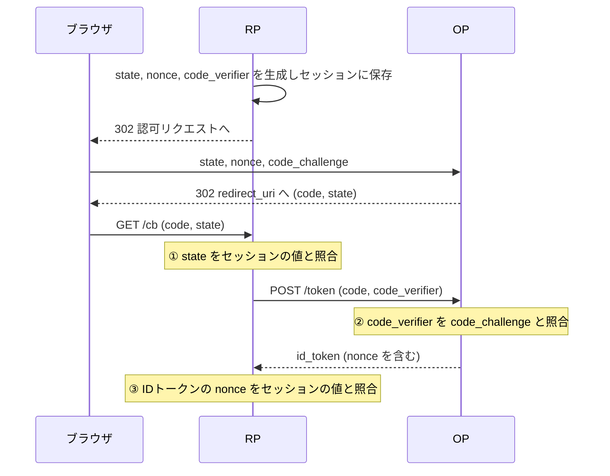
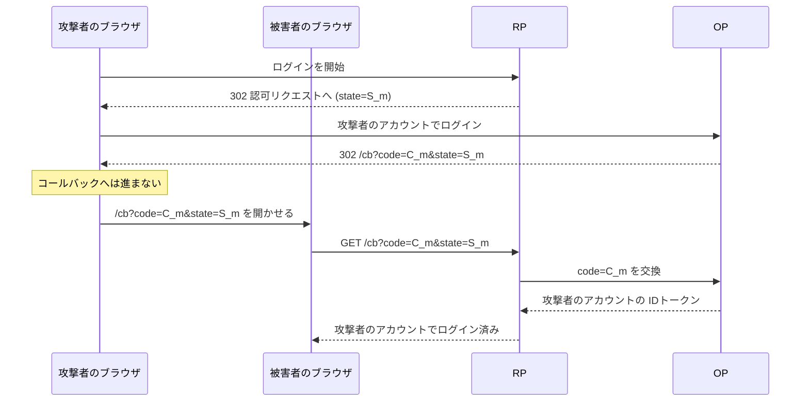

この章でわかること:

- `state`・`nonce`・PKCE の3つの値が、それぞれ何と何を結びつけ、どの攻撃を防ぐか(比較表つき)
- ログインCSRF の手順と、3つの値のどれでも防げる理由(実験つき)
- 認可コード横取り攻撃とコードインジェクションを、PKCE がどう防ぐか(実験つき)
- PKCE の `S256` と `plain` の違いと、RFC 7636 付録B のテストベクタによる確認
- PKCE を機密クライアントにも使う理由(RFC 9700)と、`nonce` と PKCE の関係

## 3つの値に共通する構造

ここまでの章で、RP が認可リクエストに付けるランダムな値が3つ登場しました。
[3章](/web-auth/03-authorization-code/)の `state`、[8章](/oidc/08-id-token-validation/)で
照合した `nonce`、そしてこの章で扱う PKCE の `code_verifier` です。

3つの値には共通の構造があります。

1. RP がログインを開始するときに、推測できない値を CSPRNG([5章](/web-auth/05-crypto/))で生成します
2. その値(または値から計算したもの)を認可リクエストに付けて送ります
3. 同じ値をブラウザのセッション(RP のサーバ側に保存し、Cookie で対応づけたもの)に保存します
4. フローの後の段階で、届いた値とセッションの値を照合します

3つの値が異なるのは、2の「どこへ送るか」と4の「どこで、何と照合するか」です。
この違いによって、それぞれが結びつけるものと防ぐ攻撃が決まります。



図の①〜③が照合の位置です。`state` は認可レスポンスの時点で RP が照合します。
`code_verifier` はトークンリクエストの時点で OP が照合します。`nonce` は IDトークンを受け取った
時点で RP が照合します。以降の節で1つずつ説明し、最後に比較表にまとめます。

## state: 認可レスポンスをブラウザのセッションに結びつける

3章で見たとおり、`state` は RP が認可リクエストに付け、OP が認可レスポンスにそのまま付けて
返す値です。RP はコールバックで、届いた `state` がこのブラウザのセッションに保存した値と
一致することを確かめます。これにより、コールバックに届いた認可レスポンスが、
このブラウザで開始したログインへの応答であることを確認できます。

`state` が防ぐのは、RP のリダイレクト URI(コールバック)に対する CSRF です。
OpenID Connect のようにログインに使う場面では、この攻撃は特に
**ログインCSRF**(login CSRF)と呼ばれます。ログインCSRF は、被害者のブラウザを
攻撃者のアカウントで RP にログインさせる攻撃です。手順は次のとおりです。



攻撃者は自分のブラウザでログインを開始し、OP で自分のアカウントにログインします。
OP がコールバックへのリダイレクトを返したところで止め、その URL(攻撃者のアカウントに
対応する認可コードを含む)を、画像やリンクの形で被害者のブラウザに読み込ませます。
RP が `state` を照合しなければ、RP はコードを交換し、被害者のブラウザに
攻撃者のアカウントのセッションを発行します。

被害者は自分のアカウントにログインしていると思い込んだまま操作を続けます。
クレジットカードの番号を登録したり、非公開の文書をアップロードしたりすると、
それらは攻撃者のアカウントに保存され、攻撃者が後から読めます。
ログインCSRF は、被害者の入力した情報を攻撃者のアカウントに集める攻撃であり、
被害者のアカウントを奪う攻撃ではありません。

RP が `state` を照合していれば、被害者のブラウザのセッションには `S_m` が保存されていない
(被害者がログインを開始していれば、別の値 `S_v` が保存されている)ため、
コールバックは拒否されます。`S_m` は攻撃者のブラウザのセッションにしか存在しません。

## RFCを読む: RFC 6749 10.12節

RFC 6749 は、リダイレクト URI への CSRF を10.12節で扱っています。

> A CSRF attack against the client's redirection URI allows an attacker to inject its own authorization code or access token, which can result in the client using an access token associated with the attacker's protected resources rather than the victim's (e.g., save the victim's bank account information to a protected resource controlled by the attacker).

(RFC 6749 10.12節)

この節は、クライアントのリダイレクト URI への CSRF 攻撃によって、攻撃者が自分の
認可コードやアクセストークンを注入でき、その結果クライアントが被害者のものではなく
攻撃者の保護されたリソースに結びついたアクセストークンを使うことになる、と述べています。
括弧内の例は、被害者の銀行口座の情報を攻撃者が管理するリソースに保存してしまう場合です。
前節のログインCSRF と同じ構造です。

> The client MUST implement CSRF protection for its redirection URI. This is typically accomplished by requiring any request sent to the redirection URI endpoint to include a value that binds the request to the user-agent's authenticated state (e.g., a hash of the session cookie used to authenticate the user-agent). The client SHOULD utilize the "state" request parameter to deliver this value to the authorization server when making an authorization request.

(RFC 6749 10.12節)

クライアントはリダイレクト URI に CSRF 対策を実装しなければなりません(MUST)。
典型的には、リダイレクト URI に届くリクエストに、そのリクエストを
ユーザーエージェントの認証済みの状態(例えばセッション Cookie のハッシュ)に結びつける値を
含めることを要求します。クライアントは、この値を認可サーバに届けるために
`state` パラメータを使うべきです(SHOULD)。

> The binding value used for CSRF protection MUST contain a non-guessable value (as described in Section 10.10), and the user-agent's authenticated state (e.g., session cookie, HTML5 local storage) MUST be kept in a location accessible only to the client and the user-agent (i.e., protected by same-origin policy).

(RFC 6749 10.12節)

CSRF 対策に使う値は推測できない値を含まなければならず(MUST)、ユーザーエージェントの
認証済みの状態は、クライアントとユーザーエージェントだけがアクセスできる場所
(同一オリジンポリシーで保護された場所)に置かなければなりません(MUST)。
推測できる値(連番や時刻)では、攻撃者は被害者のセッションに入る値を予測して
偽のコールバックを作れます。

10.12節の後半は、認可サーバ自身の認可エンドポイントに対する CSRF の対策も
認可サーバに求めています(MUST)。悪意のあるクライアントが、エンドユーザーに気づかれずに
同意を得ることを防ぐためで、OP の実装の問題として[12章](/rust-impl/12-build-op/)で扱います。

## 実験: ログインCSRFを3つの値で防ぐ

ログインCSRF を1つのプロセスの中で再現し、RP の防御を4通りに変えて結果を比べます。
「検査なし」、「`state` だけを照合」、「`nonce` だけを照合」、「PKCE だけを使う」の4つです。
被害者のブラウザも、攻撃が始まる前にログインを開始していた(セッションに自分の値を
持っている)状況にしています。

<RustPlay snippet="ch09/login-csrf" title="ログインCSRF: state・nonce・PKCE のそれぞれで防げるか" />

`state`・`nonce`・`code_verifier` は実行のたびに生成されますが、表示しているのは結果だけなので、
出力は毎回同じです。出力は次のように読みます。

- 「検査なし」では、被害者のブラウザが攻撃者(mallory)としてログインしています
- 「`state` だけ」では、コールバックの `state` が被害者のセッションの値と一致せず、
  コードを交換する前に拒否されています
- 「`nonce` だけ」では、コードの交換までは進みますが、IDトークンの `nonce` は
  攻撃者のセッションで生成された値なので、被害者のセッションの値と一致せず拒否されています
- 「PKCE だけ」では、RP は被害者のセッションの `code_verifier` を送りますが、
  攻撃者のコードは攻撃者の `code_challenge` に結びついているため、OP が
  トークンリクエストを拒否しています
- 3つをすべて使った正規のログインは成功します

3つの値のどれでも、このログインCSRF を防げました。いずれも、コールバックに届いた
コードや IDトークンが「このブラウザで開始したログイン」に属するかを、
攻撃者が知らない値で確かめているからです。RFC 9700 4.7.1節も、PKCE と `nonce` が
`state` と同じ保護を提供すると述べています。ただし、3つは照合する場所と前提が異なります。

## nonce: IDトークンをブラウザのセッションに結びつける

`nonce` は、IDトークンを、その IDトークンを要求したブラウザのセッションに結びつける値です。
RP は `nonce` を認証リクエストに付け、OP はそれを IDトークンの `nonce` クレームに書き、
署名します。RP は IDトークンの署名を検証した後、`nonce` がセッションの値と一致することを
確かめます。

`nonce` が防ぐ代表的な攻撃は、IDトークンのリプレイ攻撃です。
**リプレイ攻撃**(replay attack)は、正規のやり取りで一度使われたメッセージやトークンを
記録しておき、後で再び送って受け入れさせる攻撃です。IDトークンは署名されていて
改ざんできませんが、正規の IDトークンを丸ごと再送することはできます。

IDトークンをそのまま再送する攻撃が成り立つのは、RP がコールバックで IDトークンを
直接受け取るフローです。IDトークンが認可レスポンス(フロントチャネル)で返る
インプリシットフローやハイブリッドフロー([19章](/oidc-deep/19-flows/))がこれにあたります。
例えば、ログやブラウザの履歴から漏れた被害者の IDトークンを、攻撃者が自分のセッションの
コールバックに送り込みます。署名・`iss`・`aud` はすべて正しいため、
`nonce` を照合しない RP はこの IDトークンで被害者としてログインさせます。
`nonce` を照合する RP では、漏れた IDトークンの `nonce` は被害者のセッションで
生成された値であり、攻撃者のセッションの値とは一致しないため、拒否されます。

本書の認可コードフローでは、コールバックが受け取るのは認可コードであり、
RP は IDトークンを OP のトークンエンドポイントから受け取ります。攻撃者が漏れた IDトークンを
コールバックに送っても、RP はそれを IDトークンとして扱いません。
このフローで攻撃者がとる手段は、盗んだ被害者の認可コードを自分のセッションのコールバックに
送り込むコードインジェクション(後の節で扱います)です。RP がそのコードを交換すると、
OP は被害者の認証リクエストの `nonce` を入れた IDトークンを返します。
この `nonce` は攻撃者のセッションの値と一致しないため、RP は拒否します。

`state` は認可レスポンスを結びつけますが、IDトークンの中身には関与しません。
`nonce` は OP の署名の対象に含まれるため、IDトークンそのものをセッションに結びつけます。

## 仕様を読む: OpenID Connect Core 1.0 3.1.2.1節と15.5.2節

認証リクエストの `nonce` パラメータは、3.1.2.1節で次のように定義されています。

> OPTIONAL. String value used to associate a Client session with an ID Token, and to mitigate replay attacks. The value is passed through unmodified from the Authentication Request to the ID Token. Sufficient entropy MUST be present in the nonce values used to prevent attackers from guessing values. For implementation notes, see Section 15.5.2.

(OpenID Connect Core 1.0 3.1.2.1節)

この節は、`nonce` をクライアントのセッションと IDトークンを関連づけ、リプレイ攻撃を
緩和するための文字列と定めています。値は認証リクエストから IDトークンへ変更されずに渡されます。
攻撃者が値を推測できないよう、十分なエントロピーを持たなければなりません(MUST)。

認可コードフローでは `nonce` は OPTIONAL です(インプリシットフローでは REQUIRED)。
認可コードフローでは IDトークンがバックチャネルで届くため、仕様は `nonce` を必須にしていません。
それでも本書の RP は、後述するコードインジェクション対策のために常に `nonce` を送ります。

生成と保存の方法については、15.5.2節が実装上の注意を書いています。

> The nonce parameter value needs to include per-session state and be unguessable to attackers. One method to achieve this for Web Server Clients is to store a cryptographically random value as an HttpOnly session cookie and use a cryptographic hash of the value as the nonce parameter. In that case, the nonce in the returned ID Token is compared to the hash of the session cookie to detect ID Token replay by third parties.

(OpenID Connect Core 1.0 15.5.2節)

`nonce` の値は、セッションごとの状態を含み、攻撃者に推測できないものである必要があります。
Web サーバのクライアントでの実現方法の1つとして、暗号学的な乱数を HttpOnly の
セッション Cookie に保存し、その値の暗号学的ハッシュを `nonce` パラメータとして使う方法が
挙げられています。返された IDトークンの `nonce` を Cookie の値のハッシュと比較すれば、
第三者による IDトークンのリプレイを検出できます。

この方法では、RP はサーバ側に `nonce` を保存しなくて済みます。Cookie の値そのものは
認証リクエストに現れず、ハッシュだけが OP と IDトークンに現れるため、
認証リクエストや IDトークンが漏れても Cookie の値は漏れません。
本書の RP はサーバ側のセッションストアに `nonce` を保存する方法をとりますが、
どちらの方法でも、`nonce` がそのブラウザのセッションからしか得られない値であることが要点です。

## PKCE: 認可コードを、それを要求したクライアントに結びつける

**PKCE**(Proof Key for Code Exchange)は、認可コードを、それを要求した
クライアントのインスタンス(その端末のそのアプリ、またはそのブラウザのセッション)に結びつける
OAuth 2.0 の拡張です(RFC 7636。RFC の要旨は「pixy」と発音すると書いています)。もともとはスマートフォンなどのネイティブアプリを
**認可コード横取り攻撃**(authorization code interception attack)から保護するために作られました。
認可コード横取り攻撃は、認可レスポンスのリダイレクトで送られる認可コードを攻撃者が
途中で取得し、トークンエンドポイントでアクセストークンに交換する攻撃です。

この攻撃が成立する前提には、2種類のクライアントの違いが関わります。
**機密クライアント**(confidential client)は、クライアントシークレットなどの認証情報を
安全に保持できるクライアントで、サーバ上で動く Web アプリケーションが典型です。
**パブリッククライアント**(public client)は、認証情報を安全に保持できないクライアントで、
ネイティブアプリやブラウザ上の JavaScript アプリケーションが該当します。
アプリの実行ファイルに埋め込んだシークレットは取り出せるため、秘密として扱えません。
この区別は RFC 6749 2.1節が定めており、[13章](/oauth-deep/13-client-auth/)で詳しく扱います。

パブリッククライアントのトークンリクエストにはクライアント認証がないため、
認可コードを取得した者は誰でもアクセストークンに交換できます。
ネイティブアプリの場合、認可コードが届く経路の1つが **カスタムURIスキーム**
(custom URI scheme)です。カスタムURIスキームは、`com.example.photo:/cb` のように
アプリが独自に登録した URI スキームで、OS はそのスキームの URI を登録したアプリに渡します。
同じスキームを複数のアプリが登録できる OS では、悪意のあるアプリが認可コードを受け取れます。

## RFCを読む: RFC 7636 1節

1節は、認可コード横取り攻撃を図で示しています。

```text
    +~~~~~~~~~~~~~~~~~~~~~~~~~~~~~~~~+
    | End Device (e.g., Smartphone)  |
    |                                |
    | +-------------+   +----------+ | (6) Access Token  +----------+
    | |Legitimate   |   | Malicious|<--------------------|          |
    | |OAuth 2.0 App|   | App      |-------------------->|          |
    | +-------------+   +----------+ | (5) Authorization |          |
    |        |    ^          ^       |        Grant      |          |
    |        |     \         |       |                   |          |
    |        |      \   (4)  |       |                   |          |
    |    (1) |       \  Authz|       |                   |          |
    |   Authz|        \ Code |       |                   |  Authz   |
    | Request|         \     |       |                   |  Server  |
    |        |          \    |       |                   |          |
    |        |           \   |       |                   |          |
    |        v            \  |       |                   |          |
    | +----------------------------+ |                   |          |
    | |                            | | (3) Authz Code    |          |
    | |     Operating System/      |<--------------------|          |
    | |         Browser            |-------------------->|          |
    | |                            | | (2) Authz Request |          |
    | +----------------------------+ |                   +----------+
    +~~~~~~~~~~~~~~~~~~~~~~~~~~~~~~~~+
             Figure 1: Authorization Code Interception Attack
```

(RFC 7636 1節 Figure 1)

正規のアプリは OS とブラウザを通じて認可リクエストを送り((1)と(2))、認可サーバは
認可コードを返します((3))。(4)で OS が認可コードをリダイレクト URI のアプリに渡すとき、
同じカスタムスキームを登録した悪意のあるアプリが認可コードを受け取り、
(5)と(6)でアクセストークンに交換します。RFC は次のように述べています。

> Note that it is possible for a malicious app to register itself as a handler for the custom scheme in addition to the legitimate OAuth 2.0 app. Once it does so, the malicious app is now able to intercept the authorization code in step (4).

(RFC 7636 1節)

悪意のあるアプリが、正規のアプリに加えてカスタムスキームのハンドラとして自身を登録できる
場合があり、そうすると手順(4)で認可コードを横取りできる、という記述です。

1節は攻撃の前提条件を4つ挙げています。4つ目の条件は、PKCE の2つの方式の違いに関わります。

> 4a. The attacker (via the installed application) is able to observe only the responses from the authorization endpoint. When "code_challenge_method" value is "plain", only this attack is mitigated.
>
> 4b. A more sophisticated attack scenario allows the attacker to observe requests (in addition to responses) to the authorization endpoint. The attacker is, however, not able to act as a man in the middle. This was caused by leaking http log information in the OS. To mitigate this, "code_challenge_method" value must be set either to "S256" or a value defined by a cryptographically secure "code_challenge_method" extension.

(RFC 7636 1節)

4a は、攻撃者が認可エンドポイントのレスポンスだけを観測できる場合で、`plain` 方式で
防げるのはこの場合だけです。4b は、攻撃者がリクエストも観測できる場合(OS の HTTP ログの
漏洩が原因として挙げられています)で、これを防ぐには `S256` か、暗号学的に安全な
拡張の方式を使わなければなりません。この違いは後の実験の [C] で確かめます。

1節の後半は、対策の考え方を次のようにまとめています。

> To mitigate this attack, this extension utilizes a dynamically created cryptographically random key called "code verifier". A unique code verifier is created for every authorization request, and its transformed value, called "code challenge", is sent to the authorization server to obtain the authorization code. The authorization code obtained is then sent to the token endpoint with the "code verifier", and the server compares it with the previously received request code so that it can perform the proof of possession of the "code verifier" by the client.

(RFC 7636 1節)

PKCE は、認可リクエストごとに動的に作る暗号学的な乱数の鍵(code verifier)を使います。
その変換値(code challenge)を認可リクエストで送って認可コードを得て、
トークンエンドポイントには認可コードと code verifier を送ります。サーバは2つを比較し、
クライアントが code verifier を持っていることを確認します。
code verifier はトークンリクエストで TLS の中だけを通るため、認可レスポンスを横取りした
攻撃者は code verifier を知りません。

## RFCを読む: RFC 7636 4.1〜4.6節

4節は、PKCE の手順を6つの節に分けて定めています。

### 4.1節: code_verifier を作る

> code_verifier = high-entropy cryptographic random STRING using the unreserved characters [A-Z] / [a-z] / [0-9] / "-" / "." / "_" / "~" from Section 2.3 of [RFC3986], with a minimum length of 43 characters and a maximum length of 128 characters.

(RFC 7636 4.1節)

`code_verifier` は、RFC 3986 の非予約文字(英大文字、英小文字、数字、`-`、`.`、`_`、`~`)からなる、
高いエントロピーを持つ暗号学的な乱数の文字列で、長さは43文字以上128文字以下です。
ABNF では次のように書かれています。

```text
code-verifier = 43*128unreserved
unreserved = ALPHA / DIGIT / "-" / "." / "_" / "~"
ALPHA = %x41-5A / %x61-7A
DIGIT = %x30-39
```

`43*128unreserved` は「`unreserved` を43回以上128回以下繰り返す」という意味です。
同じ節の NOTE は、32バイトの乱数を Base64url で符号化して43文字の文字列にする方法を
推奨しています(RECOMMENDED)。32バイトを Base64url で符号化すると、
ちょうど43文字(パディングなし)になり、使われる文字(英数字と `-`、`_`)はすべて
`unreserved` に含まれます。7.1節は、`code_verifier` が最低256ビットのエントロピーを
持つべきだ(SHOULD)と述べており、32バイトの乱数はこれを満たします。

### 4.2節: code_challenge を作る

> plain
>    code_challenge = code_verifier
>
> S256
>    code_challenge = BASE64URL-ENCODE(SHA256(ASCII(code_verifier)))

(RFC 7636 4.2節)

`code_challenge` は、`code_verifier` から2つの変換のどちらかで作ります。
**plain** は変換なしで、`code_challenge` は `code_verifier` そのものです。
**S256** は、`code_verifier` の ASCII のバイト列の SHA-256 を Base64url で符号化した値です。
SHA-256 は原像を求めることが困難なので、`code_challenge` を見た者も `code_verifier` を
計算できません。

> If the client is capable of using "S256", it MUST use "S256", as "S256" is Mandatory To Implement (MTI) on the server.

(RFC 7636 4.2節)

クライアントが `S256` を使えるなら、`S256` を使わなければなりません(MUST)。
`S256` はサーバが必ず実装しなければならない方式(MTI)だからです。
`plain` は、技術的な理由で `S256` を使えず、サーバが `plain` に対応していることを
帯域外の設定で確認できている場合にだけ許されます。

### 4.3節: 認可リクエストで送る

認可リクエストには2つのパラメータを加えます。

- `code_challenge`: `code_challenge` の値です(REQUIRED)
- `code_challenge_method`: 変換の方式で、`S256` か `plain` です。省略すると `plain` として
  扱われます(OPTIONAL, defaults to "plain")

既定値が `plain` であることは注意点です。`S256` で計算した値を送るときに
`code_challenge_method=S256` を付け忘れると、サーバはその値を `plain` として保存し、
正しい `code_verifier` を送っても照合に失敗します。

### 4.4節: サーバがコードに結びつける

> When the server issues the authorization code in the authorization response, it MUST associate the "code_challenge" and "code_challenge_method" values with the authorization code so it can be verified later.

(RFC 7636 4.4節)

サーバは、認可コードを発行するときに、`code_challenge` と `code_challenge_method` を
認可コードに関連づけて、後で検証できるようにしなければなりません(MUST)。
PKCE を要求するサーバは、パブリッククライアントが `code_challenge` を送らなかった場合、
`error=invalid_request` のエラーレスポンスを返さなければなりません(MUST、4.4.1節)。
対応していない変換方式が要求された場合も同じです。

### 4.5節と4.6節: トークンリクエストで照合する

クライアントは、トークンリクエストに `code_verifier` を加えます(REQUIRED、4.5節)。
サーバは、受け取った `code_verifier` を、認可コードに結びつけた方式で変換し、
保存しておいた `code_challenge` と比較します(4.6節)。

> If the values are equal, the token endpoint MUST continue processing as normal (as defined by OAuth 2.0 [RFC6749]). If the values are not equal, an error response indicating "invalid_grant" as described in Section 5.2 of [RFC6749] MUST be returned.

(RFC 7636 4.6節)

一致すればトークンエンドポイントは通常どおり処理を続けなければならず(MUST)、
一致しなければ RFC 6749 5.2節の `invalid_grant` のエラーレスポンスを返さなければなりません(MUST)。

PKCE を加えた認可リクエストとトークンリクエストは次のようになります
(値は RFC 7636 付録B と OpenID Connect Core 1.0 の例を組み合わせたものです)。

```http
GET /authorize?response_type=code&client_id=s6BhdRkqt3
  &redirect_uri=https%3A%2F%2Fclient.example.org%2Fcb
  &scope=openid&state=af0ifjsldkj&nonce=n-0S6_WzA2Mj
  &code_challenge=E9Melhoa2OwvFrEMTJguCHaoeK1t8URWbuGJSstw-cM
  &code_challenge_method=S256 HTTP/1.1
Host: server.example.com
```

```http
POST /token HTTP/1.1
Host: server.example.com
Content-Type: application/x-www-form-urlencoded

grant_type=authorization_code&code=SplxlOBeZQQYbYS6WxSbIA
  &redirect_uri=https%3A%2F%2Fclient.example.org%2Fcb
  &client_id=s6BhdRkqt3
  &code_verifier=dBjftJeZ4CVP-mB92K27uhbUJU1p1r_wW1gFWFOEjXk
```

トークンリクエストに `client_id` を付けているのは、パブリッククライアントで
クライアント認証がない場合の形です(RFC 6749 4.1.3節)。機密クライアントは
これに加えてクライアント認証を行います。

## RFCを読む: RFC 7636 付録B

付録B は、`S256` の計算例をすべてのバイト列とともに示しています。
クライアントは32バイトの乱数を作ります。

```text
[116, 24, 223, 180, 151, 153, 224, 37, 79, 250, 96, 125, 216, 173,
187, 186, 22, 212, 37, 77, 105, 214, 191, 240, 91, 88, 5, 88, 83,
132, 141, 121]
```

これを Base64url で符号化した `code_verifier` は `dBjftJeZ4CVP-mB92K27uhbUJU1p1r_wW1gFWFOEjXk` です。
その SHA-256 は次の32バイトです。

```text
[19, 211, 30, 150, 26, 26, 216, 236, 47, 22, 177, 12, 76, 152, 46,
8, 118, 168, 120, 173, 109, 241, 68, 86, 110, 225, 137, 74, 203,
112, 249, 195]
```

これを Base64url で符号化した `code_challenge` は `E9Melhoa2OwvFrEMTJguCHaoeK1t8URWbuGJSstw-cM` です。

この32バイトの乱数は、[7章](/oidc/07-jwt-jose/)で再計算した RFC 7515 付録A.1 の
HS256 の署名と同じバイト列です。`code_verifier` の文字列も、7章の署名の文字列と一致します。

## 実験: RFC 7636 付録Bと一致を確かめる

付録B の32バイトから `code_verifier` と `code_challenge` を計算し、RFC 記載の値と
一致するかを確かめます。続けてサーバ側の照合(4.6節)を試し、最後に CSPRNG で
新しい `code_verifier` を生成して ABNF を満たすかを確かめます。

<RustPlay snippet="ch09/pkce" title="RFC 7636 付録B の S256 を再計算する" />

最後の「新しい `code_verifier` の生成」の2行の値は実行ごとに変わります。
それ以外の行は毎回同じです。出力は次のように読みます。

- `code_verifier`、SHA-256 の32バイト、`code_challenge` のすべてが付録B と一致します
- サーバ側の照合では、正しい `code_verifier` だけが `true` になります。
  `code_challenge` をそのまま `code_verifier` として送っても一致しません。
  `S256` では、`code_challenge` を観測した攻撃者もトークンリクエストを通せないことを示しています
- 32バイトの乱数から作った `code_verifier` は43文字で ABNF を満たし、
  先頭の42文字だけでは最小長に足りず満たしません

## 実験: 認可コード横取りとコードインジェクション

認可サーバのトークンエンドポイントを1つのプロセスの中で再現し、PKCE の有無で
攻撃の結果を比べます。認可サーバは認可コードを、発行先の `client_id`、`redirect_uri`、
PKCE の値に結びつけて保存し、トークンリクエストでそれらを照合します。
PKCE なしで発行したコードのトークンリクエストに `code_verifier` が付いていた場合も拒否します
(RFC 9700 4.8.2節のダウングレード対策)。`code_challenge_method` は認可リクエストの時点で
検査し、`S256` と `plain`(省略時の既定値)以外の値は `invalid_request` で拒否します
(4.4.1節)。保存する方式は `S256` と `plain` の2つの値だけをとる列挙型にしているため、
トークンエンドポイントが未知の方式で照合することはありません。

5つの場面を試します。

- [A] パブリッククライアント(ネイティブアプリ)で PKCE を使わず、悪意のあるアプリが
  認可コードを横取りする場面です
- [B] 同じ場面で PKCE(`S256`)を使う場合です
- [C] 攻撃者が認可リクエストも観測できる場合(RFC 7636 1節の条件 4b)で、
  `plain` と `S256` を比べます
- [D] 機密クライアント(Web の RP)に対し、攻撃者が盗んだ認可コードを
  自分のセッションのコールバックに注入する場面です。PKCE の有無で比べます
- [E] 認可リクエストの `code_challenge_method` に、認可サーバが対応していない値を
  指定する場面です

<RustPlay snippet="ch09/code-interception" title="認可コード横取りとコードインジェクションを PKCE で防ぐ" />

`code_verifier` は実行ごとに生成されますが、表示していないため出力は毎回同じです。
出力は次のように読みます。

- [A] では、悪意のあるアプリがコードを交換して alice のアクセストークンを得ています。
  パブリッククライアントにはクライアント認証がないため、`client_id` と `redirect_uri` が
  正しければ交換できます。その後の正規アプリの交換は、コードが使用済みのため失敗します
- [B] では、悪意のあるアプリは `code_verifier` を持たないため、送らなければ
  「`code_verifier` がない」、推測した値を送れば「`code_challenge` に合わない」で
  失敗します。正規アプリは自分の `code_verifier` で交換に成功します
- [C] では、攻撃者が観測した `code_challenge` をそのまま送っています。`plain` では
  `code_challenge` と `code_verifier` が同じ値なので交換に成功し、`S256` では失敗します。
  RFC 7636 7.2節が `plain` を新しい実装で使うべきではない(SHOULD NOT)としている理由です
- [D] では、RP は機密クライアントなのでクライアントシークレットで認証されています。
  PKCE がなければ、盗まれたコードは RP 自身のトークンリクエストで交換に成功し、
  攻撃者のセッションが alice のトークンに結びつきます。PKCE があれば、RP が送るのは
  攻撃者のセッションの `code_verifier` であり、コードに結びついた alice の
  `code_challenge` とは一致しないため、交換は失敗します
- [E] では、`code_challenge_method=S512` の認可リクエストに対し、認可サーバは
  認可コードを発行せず、`invalid_request` の認可エラーレスポンスを返しています。
  未知の方式を `plain` とみなして受け付けると、クライアントが `S256` 以外の安全な方式を
  要求したつもりでも、`code_challenge` を観測した攻撃者に [C] の `plain` と同じ方法で
  交換されます

[D] の結果は、クライアント認証だけではコードインジェクションを防げないことを示しています。

## RFCを読む: RFC 9700 4.5節と2.1.1節

**コードインジェクション**(authorization code injection)は、攻撃者が盗んだ認可コードを、
正規のクライアントとの自分のセッションに注入し、自分のセッションを被害者のリソースや
身元に結びつける攻撃です。RFC 9700 4.5節は、その手順を次のようにまとめています。

> 3. In the response of the authorization server to the legitimate client, the attacker replaces the newly created authorization code with the stolen authorization code. Since this response is passing through the attacker's device, the attacker can use any tool that can intercept and manipulate the authorization response to this end. The attacker does not need to control the network.

(RFC 9700 4.5.1節の手順3)

攻撃者は自分の端末で正規のクライアントとのフローを開始し、認可サーバからの応答の中の
新しい認可コードを、盗んだ認可コードに置き換えます。応答は攻撃者の端末を通るため、
ネットワークを制御する必要はありません。その後、正規のクライアントは自分の
クライアント認証情報とともにコードを交換し、すべての検査が通ります。
4.5.2節は、正規のクライアントが自分で認証するため、クライアント認証は
非対称鍵の方式であってもこの攻撃を防げない、と述べています。

この攻撃の対策として、RFC 9700 2.1.1節は次のように定めています。

> Clients MUST prevent authorization code injection attacks (see Section 4.5) and misuse of authorization codes using one of the following options:
>
> *  Public clients MUST use PKCE [RFC7636] to this end, as motivated in Section 4.5.3.1.
> *  For confidential clients, the use of PKCE [RFC7636] is RECOMMENDED, as it provides strong protection against misuse and injection of authorization codes as described in Section 4.5.3.1. Also, as a side effect, it prevents CSRF even in the presence of strong attackers as described in Section 4.7.1.
> *  With additional precautions, described in Section 4.5.3.2, confidential OpenID Connect [OpenID.Core] clients MAY use the nonce parameter and the respective Claim in the ID Token instead.

(RFC 9700 2.1.1節)

クライアントは、コードインジェクション攻撃と認可コードの悪用を、次のいずれかで
防がなければなりません(MUST)。パブリッククライアントは PKCE を使わなければなりません(MUST)。
機密クライアントには PKCE の使用を推奨します(RECOMMENDED)。PKCE は認可コードの悪用と注入に
対する強い保護を提供し、副次的に、強い攻撃者がいる場合でも CSRF を防ぎます。
追加の注意(4.5.3.2節)に従えば、OpenID Connect の機密クライアントは代わりに `nonce` を
使ってもかまいません(MAY)。

同じ節は続けて、PKCE はネイティブアプリを保護するために設計されたが、この助言は
Web アプリケーションを含むあらゆる種類の OAuth クライアントに当てはまる、と注記しています。
RFC 9700 は RFC 6749 を更新する BCP(2025年1月発行)であり、PKCE はパブリッククライアント
だけの仕組みから、すべてのクライアントが使う仕組みへと位置づけが変わりました。
2.1.1節は認可サーバにも PKCE への対応を求めています(Authorization servers MUST support PKCE)。

`nonce` で代える場合の注意について、4.5.3.2節は、クライアントがトークンエンドポイントから
得た IDトークンの `nonce` を必ず検証し(MUST)、検証に成功するまでは発行されたすべての
トークンを使わない(MUST)ことを条件にしています。また、`nonce` はパブリッククライアントの
認可コードを保護しないとも述べています。パブリッククライアントの場合、攻撃者は注入する
必要がなく、盗んだコードを直接トークンエンドポイントに送れるからです。

## nonceとPKCEの関係

`nonce` と PKCE は、どちらも「このフローを開始したセッションでなければ完了できない」
ことを保証する値で、コードインジェクションと CSRF を防ぐ点で効果が重なります。
違いは次の3点です。

1つ目は、照合する者です。`nonce` は RP が照合し、PKCE は認可サーバが照合します。
`nonce` では、認可コードの交換は成功し、トークンは RP に発行されます。RP が `nonce` の
不一致を検出してトークンを破棄するまで、トークンは存在します。PKCE では、
認可サーバがトークンの発行そのものを拒否します。RP の実装に照合の漏れがあっても、
認可サーバが PKCE を強制していれば攻撃は失敗します。

2つ目は、保護できるクライアントの範囲です。前節のとおり、`nonce` はパブリッククライアントの
認可コード横取りを防げません。攻撃者は RP を通さずにコードを交換するため、
RP の `nonce` の照合は行われないからです。PKCE は、コードの交換に `code_verifier` を
要求するため、誰が交換しようとしても防げます。

3つ目は、前提となる対応です。PKCE は認可サーバが対応していなければ機能せず、
RFC 9700 4.7.1節は、PKCE を CSRF 対策に使う前に認可サーバが対応していることを
確かめなければならない(MUST)としています。`nonce` は OpenID Connect の OP なら
必ず扱う値で、OAuth 2.0 だけの認可サーバには存在しません。

本書の RP は、`state`・`nonce`・PKCE(`S256`)の3つをすべて使います。
1つの値の照合が漏れても他の値で攻撃を防げること、照合する場所が RP と OP に
分かれていることが理由です。11章の RP と12章の OP は、この3つを実装します。

## 3つの値を比較する

この章で扱った3つの値を、何と何を結びつけ、どの攻撃を防ぐかで比較します。

| | `state` | `nonce` | PKCE(`S256`) |
| --- | --- | --- | --- |
| 定める仕様 | RFC 6749 | OpenID Connect Core 1.0 | RFC 7636 |
| 生成する者 | RP | RP | RP |
| 認可リクエストで送る値 | 値そのもの | 値そのもの(または Cookie の値のハッシュ) | `code_challenge`(`code_verifier` のハッシュ) |
| 値が戻ってくる場所 | 認可レスポンス(フロントチャネル) | IDトークンの中(OP の署名つき) | トークンリクエストで RP が送る |
| 照合する者 | RP(コールバック) | RP(IDトークンの検証) | 認可サーバ(トークンエンドポイント) |
| 結びつけるもの | 認可レスポンスとブラウザのセッション | IDトークンとブラウザのセッション | 認可コードと、認可リクエストを送ったクライアントのインスタンス(セッション) |
| 防ぐ主な攻撃 | CSRF、ログインCSRF | IDトークンのリプレイ、ログインCSRF、機密クライアントへのコードインジェクション | 認可コード横取り、コードインジェクション、ログインCSRF |
| 防げない場合 | 認可レスポンスを読める攻撃者は値を知ることができる(RFC 9700 4.7.1節) | パブリッククライアントの認可コード横取り | 認可サーバが PKCE に対応していない場合、`plain` で認可リクエストを読まれた場合 |

表の「防げない場合」の1行目は、RFC 9700 4.7.1節の次の記述に基づいています。
認可レスポンスを読める攻撃者は `state` の値を知り、偽の認可レスポンスに入れられます。
一方、`code_verifier` は認可レスポンスにもリクエストにも現れないため、
PKCE はそのような攻撃者に対しても CSRF を防ぎます。

## まとめ

- `state`・`nonce`・PKCE は、いずれも RP がログインごとに生成し、ブラウザのセッションに
  保存するランダムな値です。違いは、どこへ送り、どこで誰が照合するかにあります
- `state` は認可レスポンスをブラウザのセッションに結びつけ、リダイレクト URI への CSRF
  (ログインCSRF)を防ぎます。RFC 6749 10.12節は、クライアントに CSRF 対策を義務づけています(MUST)
- `nonce` は OP の署名の対象に含まれ、IDトークンをブラウザのセッションに結びつけます。
  IDトークンのリプレイを防ぎ、十分なエントロピーを持たなければなりません(MUST)
- PKCE は、`code_challenge` を認可リクエストで、`code_verifier` をトークンリクエストで送り、
  認可サーバが照合します。RFC 7636 付録B の値 `E9Melhoa2OwvFrEMTJguCHaoeK1t8URWbuGJSstw-cM` を
  再計算で確認しました。`plain` は認可リクエストを読める攻撃者を防げないため、`S256` を使います
- RFC 9700 は、パブリッククライアントに PKCE を義務づけ(MUST)、機密クライアントにも推奨しています
  (RECOMMENDED)。クライアント認証はコードインジェクションを防げません
- 3つの値は防ぐ攻撃が重なりますが、照合する場所と前提が異なるため、本書の RP はすべてを使います

Part II では、OpenID Connect のメッセージとトークンの形式、検証の手順、3つのランダムな値を
読みました。次章からの Part III では、これらを Rust で RP と OP として実装します。
最初に、RP が OP の設定値と公開鍵を取得する Discovery と JWKS を扱います。
