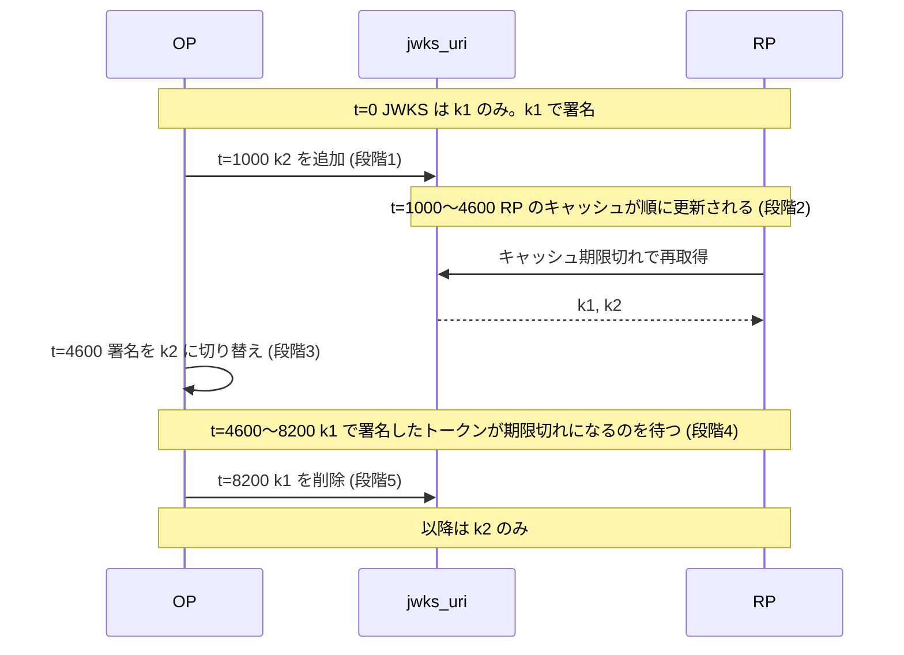
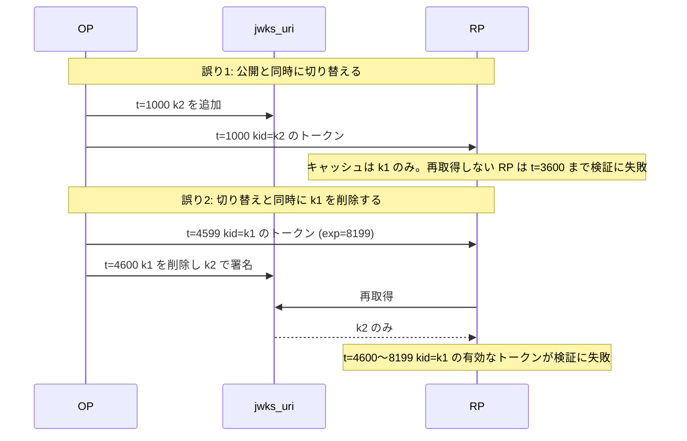
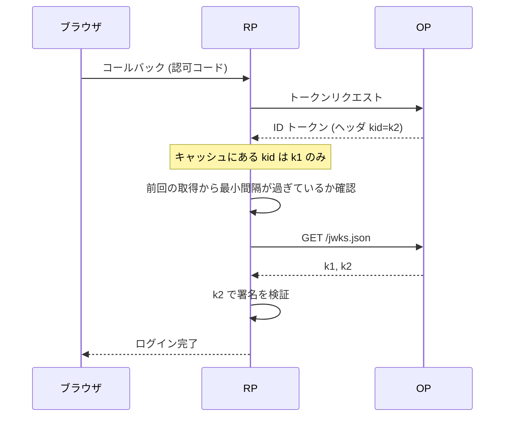

この章でわかること:

- 署名鍵のローテーションを「公開→待つ→切り替え→待つ→退役」の順に進める理由と、順序を誤ったときに検証が失敗する時間帯
- JWKS のキャッシュ期間、未知の `kid` での再取得、その再取得にレート制限が必要な理由
- マルチテナント OP の issuer をテンプレートで一括許可すると、別テナントのユーザーを受け入れてしまう仕組み
- ログに残すもの・残さないもの、レート制限、監視指標、鍵やトークンが漏洩したときの対応手順
- なぜ体系に必須か: 基礎編で実装した検証([8章](/oidc/08-id-token-validation/))は、鍵・時刻・issuer の設定が正しいことを前提にしています。これらの前提は運用中に変化するため、変化の手順を誤ると、検証のコードが正しくても認証は失敗するか、受け入れてはならないトークンを受け入れます

## 検証の前提は運用中に変化する

[8章](/oidc/08-id-token-validation/)の ID トークン検証は、次の3つの入力に依存していました。

- 署名を検証する公開鍵です。[10章](/rust-impl/10-discovery-jwks/)で説明したとおり、RP は OP の `jwks_uri` から JWK Set を取得し、トークンのヘッダの `kid` で鍵を選びます
- 現在時刻です。`exp`・`iat`・`nbf` の判定は、RP のサーバの時計が正しいことを前提にしています
- 期待する issuer 識別子です。`iss` クレームと完全一致で比較する値は、RP の設定ファイルか Discovery の結果から得ます

基礎編の実験では、これらは固定値でした。実際のサービスでは、OP は署名鍵を定期的に替え、サーバの時計はずれ、契約するテナントは増減します。この章は、これらの値が変化する手順と、手順を誤ったときに何が起きるかを扱います。後半では、障害や攻撃に気づくためのログと監視、漏洩時の対応、ライブラリの選び方を説明します。

## 署名鍵のローテーション

### 鍵を替える理由

[10章](/rust-impl/10-discovery-jwks/)で定義した鍵ローテーションは、署名鍵を新しい鍵に置き換える運用です。鍵を替える理由は次の3つです。

- 漏洩したときの被害の期間を限定するためです。秘密鍵が気づかれないまま漏洩していた場合、攻撃者はその鍵が使われている間、任意の ID トークンを作れます。鍵を定期的に替えると、漏洩した鍵が有効な期間に上限ができます
- アルゴリズムや鍵長を移行するためです。RSA 2048 ビットから ES256 へ、または `EdDSA` から完全指定アルゴリズムの `Ed25519` へ([23章](/security/23-jwt-attacks/))移る場合も、手順は鍵ローテーションと同じです
- 鍵にアクセスできた人や環境が変わったときに、それらが鍵を使える状態を終わらせるためです。担当者の異動や、鍵を保管していたサーバの廃棄が該当します

秘密鍵の保管には **HSM**(hardware security module)やクラウドの鍵管理サービスがよく使われます。HSM は秘密鍵を装置の外に出さずに署名処理だけを行う専用の装置で、サーバが侵害されても秘密鍵そのものは複製されません。HSM を使う場合も、鍵を替える手順は同じです。

### 正しい順序

鍵ローテーションは次の5段階で進めます。古い鍵を k1、新しい鍵を k2 とします。

1. **新鍵を JWKS に公開します**。JWK Set に k2 を追加します。この時点では署名にはまだ k1 を使います
2. **キャッシュ期間を待ちます**。すべての RP が k2 を含む JWK Set を取得し終えるまで待ちます。待つ時間は、JWK Set のレスポンスに付けたキャッシュ期間(後述の `max-age`)の最大値です
3. **署名を新鍵に切り替えます**。以降に発行する ID トークンとアクセストークンは k2 で署名し、ヘッダの `kid` を k2 にします
4. **旧鍵で署名したトークンの寿命を待ちます**。k1 で署名した最後のトークンの `exp` が過ぎるまで待ちます。RP の leeway([8章](/oidc/08-id-token-validation/))の分も加えます
5. **旧鍵を JWKS から外します**。JWK Set から k1 を削除します。この段階を本書では**鍵の退役**(key retirement)と呼びます。退役した鍵は、署名にも検証にも使われなくなった状態です

時系列で並べると次の図のようになります。図の時刻は、JWK Set のキャッシュ期間を3600秒、トークンの寿命を3600秒とした例です。



段階2と段階4の待ち時間は、それぞれ別の理由で必要です。段階2の待ち時間は、RP が古い JWK Set をキャッシュしている間に k2 で署名したトークンが届くことを防ぎます。段階4の待ち時間は、まだ有効な k1 のトークンを RP が検証できなくなることを防ぎます。どちらも、OP には RP のキャッシュの状態を直接確認する手段がないために必要な待ち時間です。OP が取れる手段は、OP が宣言したキャッシュ期間とトークンの寿命の分だけ待つことです。

### 順序を誤ると何が起きるか

順序の誤りは2種類あります。

1つ目は、段階2を省き、k2 を公開した直後に署名を k2 に切り替える誤りです。k1 だけを含む JWK Set をキャッシュしている RP には、キャッシュにない `kid` を持つトークンが届きます。未知の `kid` で JWK Set を再取得する RP(後述)は回復しますが、再取得しない RP は、キャッシュが期限切れになるまで、新しく発行されたすべてのトークンの検証に失敗します。利用者から見ると、ログインが一定時間すべて失敗します。

2つ目は、段階4を省き、署名を切り替えると同時に k1 を JWK Set から削除する誤りです。切り替えの直前に k1 で署名されたトークンは、`exp` まで有効なはずです。RP が JWK Set を再取得すると k1 が消えているため、これらのトークンの検証は失敗します。アクセストークンが JWT の場合、リソースサーバは有効なトークンを持つ API 呼び出しを拒否します。



2つの誤りは、どちらも可用性の障害として現れ、セキュリティ上の欠陥としては現れません。障害の時間帯は、誤り1ではキャッシュ期間、誤り2ではトークンの寿命の長さになります。

鍵の漏洩が判明した場合は、この順序の待ち時間を意図的に省きます。漏洩した鍵は段階4を待たずに削除します。漏洩した鍵で署名された有効なトークンも検証できなくなりますが、攻撃者が作ったトークンを受け入れ続けるよりも被害が小さいためです(後述の「障害時の対応」)。

## 仕様を読む: OpenID Connect Core 1.0 10.1.1節

OpenID Connect Core 1.0 は、非対称鍵の署名鍵ローテーションを10.1.1節で扱っています。

> Keys can be rolled over by periodically adding new keys to the JWK Set at the jwks_uri location. The signer can begin using a new key at its discretion and signals the change to the verifier using the kid value. The verifier knows to go back to the jwks_uri location to re-retrieve the keys when it sees an unfamiliar kid value. The JWK Set document at the jwks_uri SHOULD retain recently decommissioned signing keys for a reasonable period of time to facilitate a smooth transition.

(OpenID Connect Core 1.0 10.1.1節)

この節は、署名する側と検証する側の役割分担を定めています。署名する側(OP)は、新しい鍵を `jwks_uri` の JWK Set に追加し、使い始めたことを `kid` の値で検証する側に知らせます。検証する側(RP)は、知らない `kid` を見たら `jwks_uri` から鍵を取得し直します。最後の文は、使わなくなった署名鍵を、適切な期間 JWK Set に残すべきです(SHOULD)と定めています。これが本章の段階4に対応します。

読むうえでの注意点は次の3つです。

- 「at its discretion」(署名する側の判断で)と書かれており、新鍵を公開してから使い始めるまでの待ち時間を規定していません。検証する側が未知の `kid` で再取得することを前提にしているためです。実際には再取得しない実装や、再取得をレート制限で抑制している実装があるため、本章の段階2の待ち時間を置くほうが安全です
- 「reasonable period of time」の長さは定めていません。本章では、旧鍵で署名した最後のトークンの寿命と leeway の合計を目安にしました
- 同じ文書の10.2.1節(暗号化鍵のローテーション)は、`jwks_uri` のレスポンスに `Cache-Control` ヘッダの `max-age` ディレクティブを付けるべきです(SHOULD)と定め、キャッシュ期間と鍵の切り替えを連携させるよう求めています。署名鍵についての10.1.1節にはこの記述がありませんが、同じ考え方が署名鍵にも当てはまります

## 実験: ローテーションの各段で検証が通るか

ring で ES256 の鍵ペアを2つ生成し、OP が鍵を公開・切り替え・削除する様子と、2種類の RP の検証結果を時刻を進めながら表示します。RP-A は未知の `kid` で JWK Set を再取得します(60秒に1回まで)。RP-B は再取得せず、キャッシュ期間(3600秒)が過ぎたときだけ取得し直します。トークンの寿命は3600秒です。各時刻で、OP がその時刻に発行した新規トークンと、切り替えの直前に旧鍵で発行したトークンの両方を検証します。

<RustPlay snippet="ch26/key-rotation" title="鍵ローテーションの順序と検証結果" />

鍵は実行のたびに生成し直しますが、表示する結果は毎回同じです。手元の Mac と Playground の両方で、次の結果になりました。

- シナリオ1(正しい順序)では、すべての時刻で、有効なトークンの検証が両方の RP で成功しました。t=8200 の旧鍵のトークンは t=8199 に期限切れになっているため、検証の対象外です
- シナリオ2(公開と同時に切り替え)では、RP-B が t=1000 と t=2000 に新規トークンを「未知の kid k2」で拒否しました。RP-B のキャッシュが期限切れになる t=3600 に回復しました。RP-A は再取得により t=1000 から成功しています
- シナリオ3(切り替えと同時に旧鍵を削除)では、t=4599 に発行された旧鍵のトークンが、t=4600 と t=6000 に両方の RP で拒否されました。このトークンの `exp` は 8199 であり、本来は受け入れるべきトークンです

シナリオ2の結果は、未知の `kid` で再取得する RP であれば段階2を省いても問題ないように見えます。ただし RP-A が回復できたのは、再取得の時点で `jwks_uri` が新しい JWK Set を返したからです。`jwks_uri` の前段に **CDN**(content delivery network)や**リバースプロキシ**(reverse proxy)のキャッシュがあると、再取得しても古い JWK Set が返り、RP-A も RP-B と同じ結果になります。CDN は、利用者に近い多数の拠点にレスポンスの複製を置いて配信するサービスで、リバースプロキシは、サーバの前段でリクエストを受けて中継するサーバです。どちらもレスポンスをキャッシュすることがあります。OP 側の段階2の待ち時間は、こうした中間のキャッシュも含めて新しい JWK Set が行き渡るための時間です。

## JWKS のキャッシュ

### キャッシュ期間

RP が ID トークンを検証するたびに `jwks_uri` を取得すると、ログインのたびに OP への HTTP リクエストが1回増え、OP が応答しない間はログインもできなくなります。このため RP は JWK Set をキャッシュします。キャッシュ期間は、OP がレスポンスに付ける `Cache-Control` ヘッダの **max-age ディレクティブ**(max-age directive)で伝えます。max-age は、レスポンスを再取得せずに使ってよい秒数を表す、HTTP キャッシュの指示です(RFC 9111)。

```http
GET /jwks.json HTTP/1.1
Host: op.example

HTTP/1.1 200 OK
Content-Type: application/json
Cache-Control: public, max-age=3600

{"keys":[
  {"kty":"EC","crv":"P-256","kid":"k1","use":"sig","alg":"ES256","x":"...","y":"..."},
  {"kty":"EC","crv":"P-256","kid":"k2","use":"sig","alg":"ES256","x":"...","y":"..."}
]}
```

max-age は OP のローテーション手順と結びついています。max-age を大きくすると OP への負荷は減りますが、段階2の待ち時間が長くなります。max-age を小さくすると段階2は短くなりますが、取得の回数が増えます。多くの実装では、数分から1日程度の値が使われています。RP 側では、OP が `Cache-Control` を返さない場合の既定値を設定で決めておきます。

### 未知の kid での再取得

[10章](/rust-impl/10-discovery-jwks/)で説明したとおり、RP はキャッシュにない `kid` のトークンを受け取ったときに JWK Set を取得し直します。この動作の流れを図に示します。



この再取得には注意点があります。トークンのヘッダは署名の検証前に読む値であり、攻撃者が自由に書けます。攻撃者が、存在しない `kid` を持つトークンを RP に大量に送ると、再取得を無条件に行う RP は、そのたびに OP の `jwks_uri` を取得します。RP が OP への負荷を増幅する経路になり、RP 自身も JWK Set の取得待ちでリクエストの処理が遅れます。

対策は、未知の `kid` による再取得に**レート制限**(rate limiting)をかけることです。レート制限は、一定時間あたりに許可する処理の回数に上限を設け、超えた分を拒否または遅延させる制御です。JWKS の再取得では、「前回の取得から一定時間(例えば60秒)以内なら再取得せず、未知の `kid` のトークンを拒否する」という制限が一般的です。正規の鍵の切り替えでは、最初の1回の再取得で新しい鍵を取得できるため、この制限で正規の利用者が拒否されることはほとんどありません。

## 実験: 未知の kid とレート制限

JWK Set のキャッシュを3つの方式で実装し、同じ入力を与えて OP への取得回数を数えます。入力は、t=100 に OP が k2 を追加してすぐに k2 で署名を始める操作と、t=200〜799 の600秒間に攻撃者が毎秒1回、毎回異なる未知の `kid` を送る操作です。同じ600秒間に、正規の k2 のトークンも毎秒1回届きます。

- 方式A: 未知の `kid` で再取得しますが、前回の取得から60秒以内は再取得しません
- 方式B: 未知の `kid` で毎回再取得します
- 方式C: 未知の `kid` では再取得せず、max-age が過ぎたときだけ取得します

<RustPlay snippet="ch26/jwks-cache" title="未知のkidによる再取得とレート制限" />

出力は実行ごとに変わりません。手元の Mac と Playground で同じ結果でした。

- 方式Aは、攻撃の600秒間の取得が**10回**でした。60秒に1回の上限どおりで、590回の再取得を抑制しました。正規の k2 のトークンは600回すべて鍵を見つけています
- 方式Bは、同じ600秒間に**600回**取得しました。攻撃者のリクエスト数がそのまま OP への取得回数になります
- 方式Cは、攻撃の600秒間の取得回数は0回でしたが、t=100 以降の正規の k2 のトークンを1回も検証できませんでした。方式Cのキャッシュは t=0 に取得したものなので、max-age の3600秒が過ぎる t=3600 に期限切れになります。出力の t=3600 の行で、期限切れによる取得(`FetchedOnExpiry`)が行われ、k2 が初めて見つかっています

この結果から、未知の `kid` での再取得とレート制限は組で実装する必要があるとわかります。再取得しない方式Cは OP の鍵ローテーションに追従できず、制限なく再取得する方式Bは、攻撃者が RP を経由して OP に負荷をかけられる状態を作ります。方式Aでも、攻撃中は最大60秒に1回の取得が発生します。RP の前段で、署名検証に失敗するリクエストの送信元を監視する必要があります(後述の監視指標)。

## 時計のずれ

`exp` と `iat` の判定は、OP の時計と RP の時計が一致していることを前提にしています。サーバの時計は放置すると1日に数秒程度ずれることがあり、仮想マシンの一時停止や復元の後には、より大きくずれることがあります。

時計のずれが検証に与える影響は、トークンの寿命が短いほど大きくなります。例えば、`iat` からの許容時間を60秒とする DPoP 証明の検証([16章](/oauth-deep/16-sender-constrained/))や、寿命を60秒にしたクライアントアサーション([13章](/oauth-deep/13-client-auth/))では、30秒のずれで有効期間の半分が失われます。RP の時計が OP より遅れていると、発行直後のトークンの `iat` が未来の時刻に見え、`iat` の未来方向を検査する実装は拒否します。

対策は次の3つです。

- すべてのサーバで **NTP**(Network Time Protocol)による時刻同期を有効にします。NTP は、ネットワーク上の時刻サーバと通信して、OS の時計を一定の誤差内に保つプロトコルです
- 検証側では、[8章](/oidc/08-id-token-validation/)の leeway を数十秒から数分程度に設定します。leeway を大きくしすぎると、期限切れのトークンを受け入れる時間が延びます
- 時刻同期の状態(NTP のオフセット)を監視指標に加えます。`exp` や `iat` による拒否が急に増えた場合は、攻撃より先に時計のずれを疑います

## マルチテナント OP の issuer 検証

### マルチテナントとは

**マルチテナント**(multi-tenant)は、1つのサービスの実体で、互いに独立した複数の利用組織を収容する構成です。それぞれの利用組織を**テナント**(tenant)と呼びます。企業向けの OP の多くはマルチテナントで、テナントごとにユーザーのディレクトリ、ログインの方針、管理者を分けています。

マルチテナント OP は、テナントごとに異なる issuer 識別子を使うことがあります。例えば `https://login.example.com/acme/v2` と `https://login.example.com/globex/v2` のように、パスにテナント ID を含める形です。OpenID Connect Discovery は、issuer 識別子にパスを含めることで1つのホストに複数の issuer を置く構成を認めています([10章](/rust-impl/10-discovery-jwks/))。

### テンプレートで一括許可する誤り

**SaaS**(software as a service)のように、多数の企業の利用者が同じ RP にログインするサービスでは、RP を OP に1回だけ登録し、同じ `client_id` をすべてのテナントで使う構成がよく取られます。SaaS は、利用者が自分で導入せずに、インターネット経由で提供される業務用のソフトウェアサービスです。この構成では、どのテナントのユーザーがログインしても、ID トークンの `aud` は同じ `client_id` になります。

ここで RP の開発者が、「issuer はテナントごとに変わるので、`https://login.example.com/{テナントID}/v2` の形であれば受け入れる」というテンプレートで `iss` を検証すると、次の攻撃が成立します。

1. 攻撃者は、同じ OP に自分のテナントを作ります。多くのマルチテナント OP では、テナントの作成は誰でもできます
2. 攻撃者は自分のテナントにユーザーを作り、そのユーザーで RP にログインします
3. OP は `iss=https://login.example.com/evil/v2`、`aud=` RP の `client_id` の ID トークンを、正しい署名付きで発行します
4. RP のテンプレートは `evil` を含む issuer にも一致するため、RP はこのトークンを受け入れます

署名の検証もこの攻撃を防ぎません。多くのマルチテナント OP では、全テナントの ID トークンを共通の署名鍵で署名しているため、攻撃者のテナントのトークンも同じ JWK Set の鍵で検証に成功します。後述の RFC 8725 3.8節が求める「鍵が issuer に属することの確認」は、鍵が全テナントに属しているため、テナントの区別には役立ちません。

被害は、RP が受け入れた後のアカウントの対応づけで決まります。RP が `sub` だけをユーザーのキーにしていると、攻撃者は自分のテナントで、被害者と同じ `sub` を持つユーザーを作れる場合があります。[18章](/oidc-deep/18-claims-identity/)で説明したとおり、`sub` は issuer の中でだけ一意な値であり、ユーザーのキーは `iss` と `sub` の組でなければなりません。RP が `email` をキーにしている場合は、攻撃者が自分のテナントで被害者のメールアドレスを持つユーザーを作るだけで、被害者のアカウントにログインできます。

正しい検証は、テナントを許可リストで管理することです。

- RP が契約したテナントの issuer 識別子を、完全一致で比較できる一覧として保持します。テンプレートや前方一致は使いません
- 多くのマルチテナント OP は、テナント ID を独自のクレームとして ID トークンに含めます(本書の例では `tid` と呼びます)。このクレームと `iss` に含まれるテナント ID が一致することも確認します
- ユーザーのキーは `iss` と `sub` の組にし、issuer からテナント(契約した組織)を引いて、その組織のデータだけにアクセスを許します

どのテナントのユーザーでもログインできる一般消費者向けサービスでは、許可リストを作れません。この場合も、`iss` と `sub` の組をキーにし、テナントの違いを別のユーザーとして扱えば、別テナントのユーザーが既存のアカウントにログインすることは防げます。

## 仕様を読む: OpenID Connect Core 1.0 16.15節

OpenID Connect Core 1.0 は、1つのホストに複数の issuer がある場合の扱いを16.15節で定めています。

> OpenID Connect supports multiple Issuers per Host and Port combination. The issuer returned by discovery MUST exactly match the value of iss in the ID Token. OpenID Connect treats the path component of any Issuer URI as being part of the Issuer Identifier. For instance, the subject "1234" with an Issuer Identifier of "https://example.com" is not equivalent to the subject "1234" with an Issuer Identifier of "https://example.com/sales".

(OpenID Connect Core 1.0 16.15節)

この節は、issuer 識別子のパスまで含めた完全一致の比較を定めています。Discovery が返した issuer は、ID トークンの `iss` と完全に一致しなければなりません(MUST)。パスが異なる issuer は別の issuer であり、同じ `sub` の値でも、issuer が異なれば別のユーザーです。

マルチテナント OP の場合、テナントごとの issuer は、それぞれが独立した issuer です。テンプレートで一括許可する検証は、「Discovery で取得した特定の issuer と完全一致する」というこの節の要求を、「ある形をした任意の issuer と一致する」に緩めています。この緩め方が、前節の攻撃の原因です。同じ節の最後の文は、1つのホストでは issuer を1つだけ使うことを推奨しつつ(RECOMMENDED)、マルチテナントでは複数の issuer が必要になりうると認めています。

## RFCを読む: RFC 8725 3.8節

JWT の BCP である RFC 8725([23章](/security/23-jwt-attacks/)で全体を読みます)は、issuer と鍵の関係を3.8節で定めています。

> When a JWT contains an "iss" (issuer) claim, the application MUST validate that the cryptographic keys used for the cryptographic operations in the JWT belong to the issuer. If they do not, the application MUST reject the JWT.

(RFC 8725 3.8節)

この節は、JWT の署名に使われた鍵が、その JWT の `iss` が示す issuer の鍵であることを確認するよう求めています。確認できない JWT は拒否しなければなりません(MUST)。同じ節は続けて、`sub` についても、issuer と subject の組がアプリケーションにとって有効であることを確認しなければならない(MUST)と定め、その確認には issuer をアプリケーションが信頼しているかの確認が含まれうると述べています。

マルチテナント OP では、鍵の確認だけでは不十分です。全テナントが同じ鍵を共有している場合、その鍵は攻撃者のテナントの鍵でもあります。このため、3.8節後半の「issuer がアプリケーションに信頼されているか」の確認、すなわち前節の許可リストが必要になります。

## 実験: テナントの issuer を検証する

3種類の ID トークン(契約済みテナント Acme の正規ユーザー、攻撃者が作ったテナントのユーザー、`iss` と `tid` が食い違うトークン)を、3つの検証方法で判定します。署名は共通鍵で正しく検証できたものとし、`iss`・`tid`・`aud` の判定だけを比較します。攻撃者のユーザーには、Acme のユーザーと同じ `sub` の値 `u-100` を与えています。

<RustPlay snippet="ch26/tenant-issuer" title="テンプレートと許可リストによるissuer検証" />

出力は実行ごとに変わりません。

- テンプレートによる検証は、3つのトークンをすべて受け入れました。攻撃者のトークンは「ユーザー u-100」として受け入れられ、`sub` だけをキーにする RP では Acme のユーザー u-100 と区別できません
- テンプレートに `iss` と `tid` の一致確認を加えると、食い違うトークンは拒否できますが、攻撃者のテナントのトークンは「テナント evil のユーザー」として受け入れました。テナントを識別できても、そのテナントを許可しているかは確認していないためです
- 許可リストによる検証だけが、攻撃者のテナントを「未登録の issuer」として拒否しました。受け入れた正規ユーザーは、`iss` と `sub` の組で識別しています

## エラーとログ

### ログに残さないもの

OAuth と OIDC のメッセージには、それ自体が権限を表す値が含まれます。ログに書いた時点で、ログを読める人とログを保存するシステムのすべてが、その権限を使える状態になります。次の値は、ログに出力しません。

- アクセストークン、リフレッシュトークン、ID トークンの全体です。JWT 形式のトークンは、署名部分を除いても個人情報を含みます
- 認可コードと `code_verifier` です。認可コードは短寿命ですが、ログ収集の遅延が短ければ使える場合があります
- クライアントシークレット、クライアントアサーション、`Authorization` ヘッダの値です
- パスワードと、ログインフォームの送信内容です

RFC 6819 は、クエリパラメータで送られたトークンがログファイルに残る脅威を4.6.7節で挙げ、対策として、トークンを URI に含めないこととログの設定を適切に行うことを挙げています。トークンを URI に含めない規則は[4章](/web-auth/04-tokens/)で説明した RFC 6750 2.3節の内容と同じです。アプリケーションのログに加えて、Web サーバのアクセスログ、リバースプロキシ、性能監視ツールの HTTP トレースにも、ヘッダやクエリがそのまま記録される設定があるため、それぞれ確認します。

### ログに残すもの

トークンそのものの代わりに、後から調査できる識別子を残します。

- トークンの `jti`、署名の `kid`、`iss`、`client_id`、`aud` です
- ユーザーを表す値は、`iss` と `sub` の組か、それをハッシュ化した値です
- 検証の失敗理由(署名不一致、期限切れ、`aud` 不一致、未知の `kid` など)と、リクエストの送信元です

このうち、ログイン、同意、トークンの発行と失効、管理者による設定変更のように、「誰が、いつ、何をしたか」を後から証明する必要がある記録を**監査ログ**(audit log)と呼びます。監査ログは通常のアプリケーションログと分け、改ざんできない保存先に、決められた期間保存します。インシデントの調査では、監査ログから「漏洩した鍵で署名されたトークンがいつ、どのクライアントに発行されたか」を特定します。

### エラーレスポンスに書くもの

クライアントに返すエラーは、仕様が定めるエラーコード([3章](/web-auth/03-authorization-code/)の `invalid_request`、[4章](/web-auth/04-tokens/)の `invalid_token` など)にとどめます。「`aud` が不一致」「署名の検証に失敗」のような詳しい理由は、ログにだけ残します。詳しい理由をクライアントに返すと、攻撃者が検証のどの段階を通過したかを判断する材料になります。

## レート制限

JWKS の再取得以外にも、OP と RP にはレート制限が必要なエンドポイントがあります。

| 対象 | 何を防ぐか | 制限の単位の例 |
| --- | --- | --- |
| ログインフォーム | パスワードの総当たり、**リスト型攻撃**(credential stuffing) | アカウント、送信元 IP |
| トークンエンドポイント | クライアントシークレットの総当たり、認可コードの推測 | `client_id`、送信元 IP |
| デバイス認可のポーリング | 過剰なポーリング([20章](/oidc-deep/20-other-grants/)の `slow_down`) | `device_code` |
| イントロスペクション | リソースサーバの誤設定による過剰な呼び出し | 呼び出し元のクライアント |
| RP の JWKS 再取得 | 未知の `kid` による増幅 | OP ごと |

制限を超えたリクエストには、HTTP では **429 Too Many Requests**(RFC 6585)を返し、**Retry-After ヘッダ**(Retry-After header)で再試行まで待つ秒数を伝えます。Retry-After は、クライアントが次のリクエストまで待つべき時間を示すレスポンスヘッダです(RFC 9110 10.2.3節)。

```http
HTTP/1.1 429 Too Many Requests
Content-Type: application/json
Cache-Control: no-store
Retry-After: 30

{"error":"slow_down","error_description":"too many requests"}
```

OAuth のエンドポイントでは、エラーコードを仕様の定義に合わせる必要があります。デバイス認可グラントのポーリングでは `slow_down` が仕様で定められています。それ以外のエンドポイントで429を返す場合、ボディのエラーコードは OAuth の仕様では定められていないため、クライアントは HTTP ステータスで判断することになります。ログインフォームのレート制限で、制限に達したアカウントを長時間ロックすると、攻撃者が被害者のアカウントを意図的にロックできます。このため、ロック時間を短くするか、多要素認証([12章](/rust-impl/12-build-op/))のような追加の認証を求める方式にします。リスト型攻撃は、他のサービスから漏洩したメールアドレスとパスワードの組を、別のサービスのログインに大量に試す攻撃です。

## 監視指標

運用中に異常に気づくための指標を、OP と RP・リソースサーバに分けて示します。

| 指標 | 増えたときに疑うこと |
| --- | --- |
| ID トークン・アクセストークンの検証失敗率(理由別) | 鍵ローテーションの順序の誤り、時計のずれ、攻撃 |
| 未知の `kid` による JWKS 再取得の回数 | OP のローテーション、または未知の `kid` を使う攻撃 |
| `exp`・`iat` による拒否の割合 | 時計のずれ(NTP のオフセットと合わせて見る) |
| トークンエンドポイントの `invalid_grant` | 認可コードの再利用、リフレッシュトークンの再利用検知([15章](/oauth-deep/15-refresh-tokens/)) |
| `invalid_client` | クライアントシークレットの総当たり、設定の誤り |
| ログイン失敗率とロック数 | パスワードの総当たり、リスト型攻撃 |
| state 不一致・PKCE 検証失敗 | CSRF やコードインジェクションの試み([9章](/oidc/09-state-nonce-pkce/))、または RP のセッション設定の誤り |
| JWKS とDiscovery の取得失敗 | OP の障害、ネットワークの障害 |

検証失敗率は、理由別に分けて記録することが重要です。全体の失敗率だけでは、鍵の切り替えの失敗と攻撃の区別ができません。例えば、未知の `kid` による失敗が特定の時刻から全送信元で増えた場合は、OP 側の鍵の切り替えが原因である可能性が高いと判断できます。少数の送信元から毎回異なる `kid` が届く場合は、攻撃である可能性が高いと判断できます。

## 障害時の対応

**インシデント対応**(incident response)は、セキュリティ上の事故を検知してから、被害の拡大を止め、原因を取り除き、通常の運用に戻すまでの一連の手順です。OIDC の運用では、漏洩したものの種類によって手順が変わります。手順は事前に文書化し、定期的に訓練しておきます。

### 署名鍵の漏洩

OP の署名鍵が漏洩すると、攻撃者は任意のユーザーの ID トークンとアクセストークンを作れます。被害の範囲は、その鍵を信頼するすべての RP とリソースサーバです。

1. 新しい鍵を生成し、JWK Set に公開すると同時に、署名を新しい鍵に切り替えます。段階2の待ち時間は置きません
2. 漏洩した鍵を JWK Set から直ちに削除します。段階4の待ち時間も置きません。JWK Set から鍵を外しても、すでに JWK Set をキャッシュしている RP とリソースサーバでは、漏洩した鍵がキャッシュの期限切れまで検証に使われます。JWK Set を新たに取得した RP では、漏洩した鍵で署名されたトークンの検証が失敗するようになります
3. RP とリソースサーバの運用者に連絡し、JWK Set のキャッシュを破棄して再取得するよう依頼します。キャッシュを破棄するまで、またはキャッシュ期間が過ぎるまで、RP は漏洩した鍵で署名されたトークンを受け入れ続けるためです
4. 漏洩の期間中に確立したセッションを失効させるよう RP の運用者に依頼し、OP はその期間に発行したリフレッシュトークンを失効させます。RP は ID トークンを検証した後、自分のセッションを作り、以降のリクエストでは ID トークンを検証し直しません。このため鍵を JWK Set から外しても、すでに確立したセッションは終わりません。攻撃者が偽造した ID トークンは OP の発行記録に残らないため、「漏洩した鍵で OP が署名したトークン」だけを失効させる方法では、偽造トークンから作られたセッションが残ります。漏洩の期間が特定できない場合は、その鍵が使われていた期間全体に確立したセッションを対象にします
5. 監査ログから、漏洩の期間に発行されたトークンと、その期間のアクセスを調査します

この手順の1と2は、鍵ローテーションの正しい順序の待ち時間を意図的に省く操作です。この手順を取ると可用性の障害(全利用者の再ログイン)が発生しますが、攻撃者が作ったトークンを受け入れ続けるよりも被害が小さいと判断した場合に選びます。このような、漏洩を理由として待ち時間を置かずに行うローテーションを、本書では**緊急ローテーション**(emergency rotation)と呼びます。

### トークンの漏洩

個別のトークンが漏洩した場合は、そのトークンを失効させます。

- リフレッシュトークンは、トークン失効(RFC 7009、[14章](/oauth-deep/14-token-validation/))で失効させ、同じトークンファミリーのトークンも失効させます([15章](/oauth-deep/15-refresh-tokens/))
- 不透明なアクセストークンは、失効させればイントロスペクションで `active` が `false` になります
- JWT 形式のアクセストークンは、リソースサーバが OP に問い合わせずに検証します。このため OP が失効させても寿命が切れるまで有効であり、失効をリソースサーバに伝える標準の手段はありません。このため JWT のアクセストークンの寿命は短く(数分から1時間程度)設定し、送信者制約([16章](/oauth-deep/16-sender-constrained/))で盗まれたトークンを使えないようにしておきます
- ログに大量のトークンが残っていた場合は、ログの範囲に含まれるトークンを発行したセッションをまとめて失効させます

### クライアントシークレットの漏洩

クライアントシークレットが漏洩すると、攻撃者は横取りしたリフレッシュトークンを、正規のクライアントとして新しいトークンに交換できます。認可コードについては、PKCE([9章](/oidc/09-state-nonce-pkce/))を使っていなければ、横取りした認可コードもシークレットだけで交換できます。PKCE を使っている場合、トークンリクエストには認可リクエストを送ったクライアントだけが持つ `code_verifier` も必要なため、シークレットと認可コードだけでは交換できません。新しいシークレットを発行し、古いシークレットを無効にします。OP が1つのクライアントに複数のシークレットを同時に登録できる場合は、新旧を並行して有効にしてから旧シークレットを削除すると、鍵ローテーションと同じ順序で停止時間なく切り替えられます。漏洩が起きにくい構成として、`private_key_jwt` や mTLS([13章](/oauth-deep/13-client-auth/))への移行も検討します。

## ライブラリ選定

ID トークンの検証や OP の実装は、自分で書くよりも、実績のあるライブラリを使うほうが安全です。本書の[11章](/rust-impl/11-build-rp/)では openidconnect クレートを使いました。ライブラリを選ぶときは、次の点を確認します。

- 検証の既定値が安全側かどうかを確認します。`alg` の許可リストを指定させるか、`alg=none` を拒否するか、`iss`・`aud`・`exp` の検証が既定で有効か、を見ます([23章](/security/23-jwt-attacks/))
- JWKS のキャッシュ期間、未知の `kid` での再取得、その最小間隔を設定できるかを確認します
- leeway を設定できるか、既定値がいくつかを確認します
- 適合性テスト([25章](/security/25-high-security/))に合格し、OpenID 認定を受けているかを確認します。OpenID Connect の認定は、実装者が OpenID Foundation の適合性テストを自分で実行し、結果と適合の宣言を提出する**自己認定**(self-certification)の制度です。認定は、実装者がテストに合格したことを宣言し OpenID Foundation が公開したものであり、第三者の監査による確認ではありません。テストが扱わない要件や、認定後の版の変更は、利用する側が確認します
- 保守が続いているか、脆弱性の報告窓口と修正の履歴があるかを確認します。JWT ライブラリでは、署名検証の欠陥(例えば [CVE-2022-21449](/security/23-jwt-attacks/) のような ECDSA の検証の誤り)が過去に何度も報告されています
- 依存関係の数と、暗号処理をどのライブラリに任せているかを確認します

ライブラリを使う場合も、本章の運用上の設定(許可する issuer の一覧、キャッシュ期間、leeway、ログの出力内容)は、利用する側が決める値です。ライブラリはこれらの値を自動では決められません。

## まとめ

- 署名鍵のローテーションは「新鍵を公開→キャッシュ期間を待つ→署名を切り替え→旧鍵のトークンの寿命を待つ→旧鍵を退役」の順に進めます。待ち時間を省くと、キャッシュ期間またはトークンの寿命の間、有効なトークンの検証が失敗しました
- RP は未知の `kid` で JWK Set を再取得し、その再取得にレート制限をかけます。実験では、制限のない方式で攻撃の600回がそのまま OP への600回の取得になり、60秒の制限で10回に減りました
- 時計のずれは短寿命のトークンほど影響が大きく、NTP による同期、leeway、オフセットの監視で対処します
- マルチテナント OP の issuer をテンプレートで許可すると、攻撃者が作ったテナントのトークンを受け入れます。契約したテナントの issuer を完全一致の許可リストで管理し、ユーザーを `iss` と `sub` の組で識別します
- トークン・コード・シークレットはログに書かず、`jti`・`kid`・`iss`・`sub` などの識別子を残します。検証失敗は理由別に監視し、鍵の漏洩時には待ち時間を置かない緊急ローテーションを行います

次章では、OIDC の周辺にある標準を扱います。SAML・SCIM・パスキーとの関係、OpenID Federation のトラストチェーン、SD-JWT による選択的開示、AI エージェントが使う MCP の認可までを説明します。
