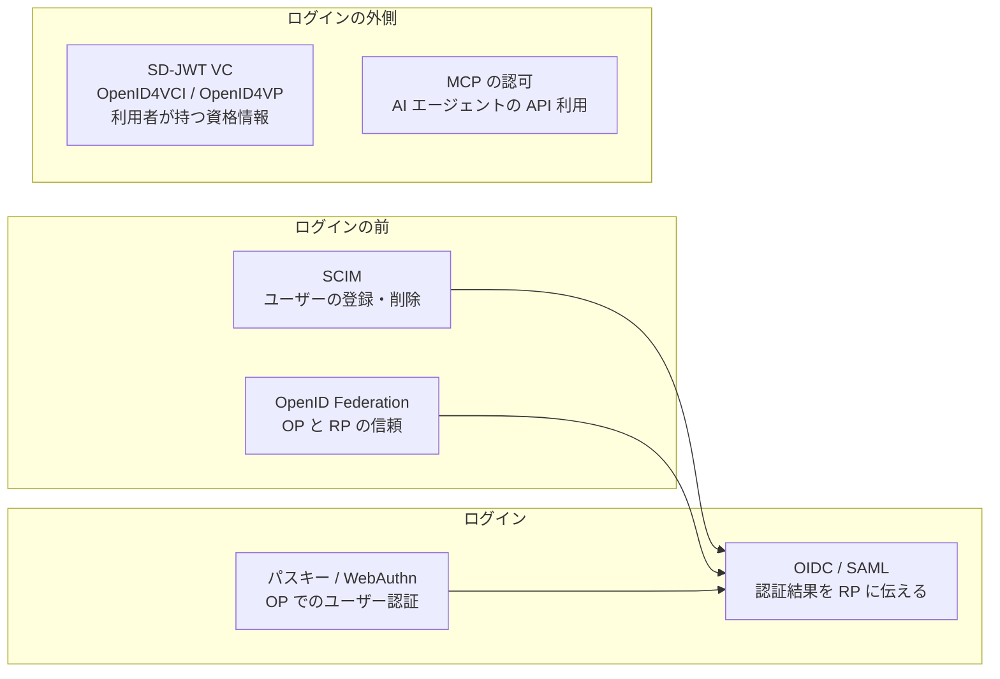
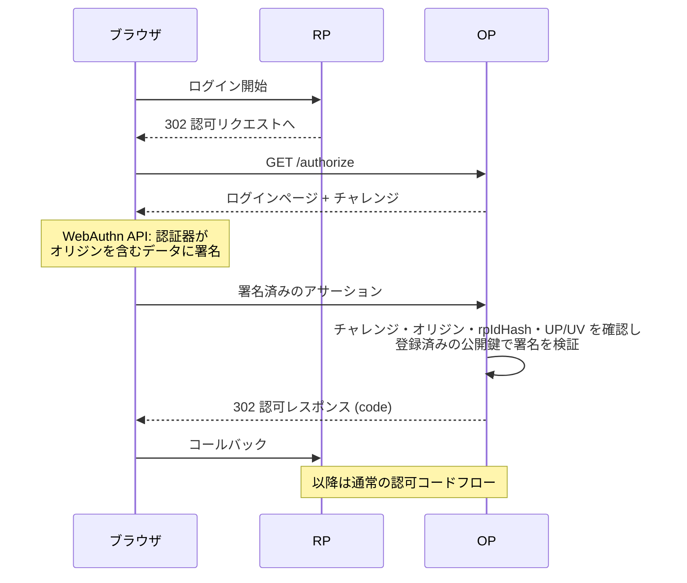
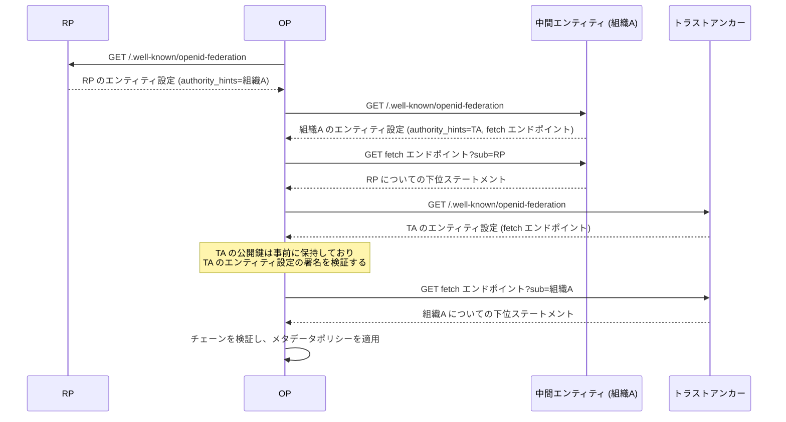
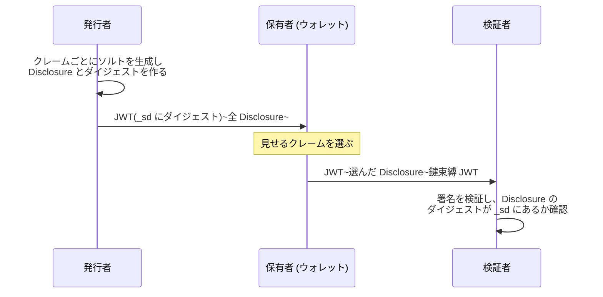
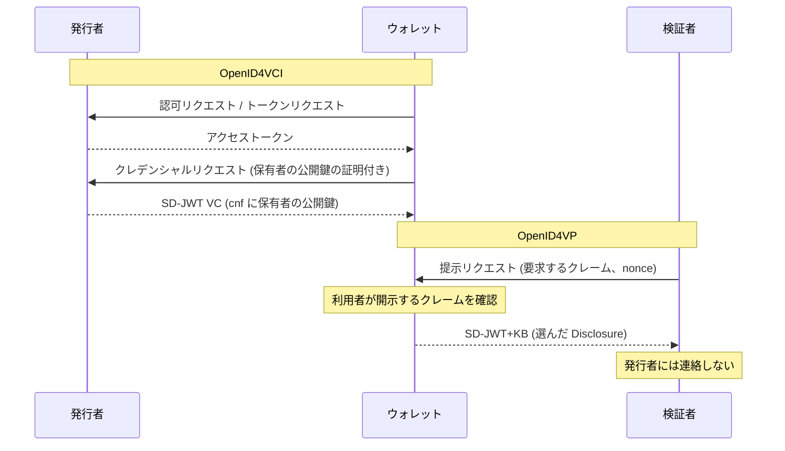
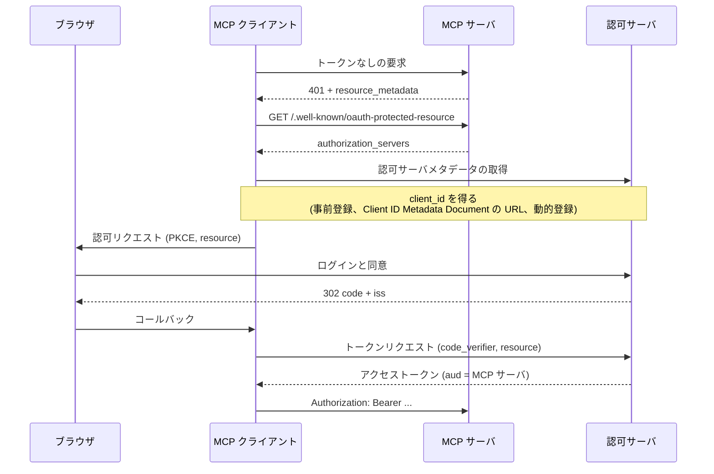

この章でわかること:

- SAML・SCIM・パスキー(WebAuthn)が、OIDC とどう役割を分けているか
- OpenID Federation のトラストチェーンが、事前登録なしに OP と RP の信頼を確立する仕組み
- SD-JWT(RFC 9901)の Disclosure と `_sd` ダイジェストの作り方と検証手順(RFC の例と一致することを実装で確認)
- SD-JWT VC と OpenID4VCI・OpenID4VP によるウォレットのモデルと、MCP の認可が要求する OAuth の仕様
- なぜ体系に必須か: 実際の認証基盤は OIDC 単独では構成されません。ユーザーの登録と削除、OP でのログイン手段、組織をまたぐ信頼、利用者が持ち運ぶ資格情報、AI エージェントの認可は、本書で扱った OAuth と JOSE の部品を組み合わせた別の標準が担当しています。それぞれの担当範囲を知らないと、OIDC で解決できない問題を OIDC で解決しようとする設計になります

## OIDC の周辺にある標準

[6章](/oidc/06-oauth-to-oidc/)で説明したとおり、OIDC は「OP が RP にユーザーの認証結果を伝える」仕様です。この章で扱う標準は、その前後や外側にある問題を担当します。



図の左は、ログインより前に済ませておく準備を表します。ユーザーのアカウントを RP 側に作る処理(SCIM)と、OP と RP が互いを信頼するための設定(OpenID Federation)です。中央は、ログインそのものです。OP がユーザーを確認する手段(パスキー)と、確認した結果を RP に伝える仕様(OIDC、または古くからある SAML)に分かれます。右は、OIDC と同じ部品で作られていても、OP と RP の2者の関係だけでは扱えない仕組みです。

## SAML との比較

**SAML**(Security Assertion Markup Language)は、XML で書かれた認証結果を [IdP](/oidc/06-oauth-to-oidc/) から SP に渡すための仕様で、OASIS が標準化しています。現在使われている SAML 2.0 は、2005年3月に OASIS 標準として承認されました。SAML の IdP は OIDC の OP に、**SP**(service provider)は RP に相当します。

SAML で認証結果を表す XML 文書を **SAML アサーション**(SAML assertion)と呼びます。IdP はアサーションを SAML の応答メッセージである `<Response>` 要素に入れ、ブラウザの自動送信フォームで SP に POST します。この POST で届けるアサーションは、XML 署名で保護しなければなりません。署名はアサーション自体に付けても、アサーションを含む `<Response>` に付けてもかまいません。SAML Core 2.0 の5.3節は、署名のないアサーションが、それを含む署名付きの要素から署名を引き継ぐと定めています。SP は、署名がアサーションと `<Response>` のどちらにあるかを確かめ、アプリケーションが読むアサーションが署名の範囲に含まれることを確認する必要があります。この形は、OIDC の `response_mode=form_post`([17章](/oauth-deep/17-request-protection/))と同じ構造です。

| 観点 | SAML 2.0 | OpenID Connect |
| --- | --- | --- |
| 発行年 | 2005年 | 2014年 |
| 認証結果の形式 | XML(SAML アサーション) | JSON(JWT の ID トークン) |
| 署名 | XML 署名 | JWS |
| 主な受け渡し | ブラウザ経由の POST | 認可コードとトークンエンドポイント |
| API の認可 | 対象外 | OAuth 2.0 のアクセストークン |
| ネイティブアプリ・SPA | 想定していない | 想定している([24章](/security/24-browser-native/)) |
| メタデータ | XML のメタデータ文書 | Discovery([10章](/rust-impl/10-discovery-jwks/)) |

SAML の主な弱点は、XML 署名の検証の複雑さです。XML 文書は、同じ内容を異なるバイト列で表せるため、署名の前に**正規化**(canonicalization)が必要になります。正規化は、意味が同じ文書を決まった1つのバイト列に変換する処理です。署名の検証と正規化が複雑なため、署名した要素とアプリケーションが読む要素が異なる文書を作る **XML 署名ラッピング**(XML signature wrapping)という攻撃が、多くの実装で繰り返し報告されてきました。JWS は、署名の対象を Base64url のバイト列として固定するため([7章](/oidc/07-jwt-jose/))、この種の攻撃が成立しにくい構造です。SD-JWT も同じ考え方を採っていることを、この章の後半で確認します。

新しく作るシステムでは OIDC を選ぶのが一般的です。ただし企業向けの SaaS([26章](/practice/26-operations/))では、顧客の IdP が SAML にしか対応していない場合に備えて、両方に対応することが多くあります。SAML と OIDC の両方を受け付ける場合も、RP の内部ではユーザーを「issuer と subject の組」([18章](/oidc-deep/18-claims-identity/))で識別する設計にしておくと、プロトコルの違いをログイン処理の部分だけに限定できます。

## SCIM: ユーザーの登録と削除

OIDC は、ユーザーがログインしたときに認証結果を RP に伝えます。ユーザーがログインしない限り、RP は何も知らされません。このため、次の2つの問題が残ります。

- 新しい社員が初めてログインする前に、RP 側にアカウントや権限を用意しておけません
- 退職した社員のアカウントを、RP 側で削除するきっかけがありません。OP でアカウントを無効にしても、RP のセッションやリフレッシュトークンが残っていれば、RP は退職を検出できません

この問題を扱うのが**プロビジョニング**(provisioning)です。プロビジョニングは、ID 管理の元となるシステムから、各サービスにユーザーのアカウントを作成・更新・削除して反映する処理です。**SCIM**(System for Cross-domain Identity Management)は、プロビジョニングを HTTP と JSON で行うための IETF の標準で、2015年9月に RFC 7643(スキーマ)と RFC 7644(プロトコル)として発行されました。SCIM では、`/Users` と `/Groups` というリソースに対して、HTTP の GET・POST・PUT・PATCH・DELETE で操作します。

```http
POST /scim/v2/Users HTTP/1.1
Host: rp.example
Authorization: Bearer (ダミーのアクセストークン)
Content-Type: application/scim+json

{
  "schemas": ["urn:ietf:params:scim:schemas:core:2.0:User"],
  "userName": "alice@example.com",
  "externalId": "u-100",
  "name": {"givenName": "Alice", "familyName": "Example"},
  "active": true
}
```

SCIM の要求を送るのは IdP 側(多くの場合、企業の ID 管理システム)で、受けるのは RP 側です。この向きは OIDC の逆です。SCIM のエンドポイントは、OAuth のアクセストークンで保護するのが一般的で、RP はリソースサーバとして振る舞います([14章](/oauth-deep/14-token-validation/))。

SCIM と OIDC を組み合わせる場合、SCIM で作成したアカウントと、OIDC でログインしたユーザーを対応づける必要があります。対応づけには、`externalId` などに OP の `sub` を入れ、ログイン時に `iss` と `sub` の組で照合する方法が使えます。`email` で照合すると、[18章](/oidc-deep/18-claims-identity/)で説明したアカウント乗っ取りの危険がそのまま残ります。退職時の処理では、SCIM でアカウントを無効にすることに加えて、RP 側でそのユーザーのセッションとリフレッシュトークンを失効させます。OIDC のバックチャネルログアウト([21章](/oidc-deep/21-logout-session/))はセッションの終了を伝えますが、アカウントの削除は伝えません。

## パスキーと WebAuthn: OP でのユーザー認証

OIDC の仕様は、OP がユーザーをどう確認するかを定めていません。[12章](/rust-impl/12-build-op/)の mini-op はパスワードでログインさせましたが、パスワードはフィッシングサイトに入力されると、攻撃者がそのまま再利用できます。この問題に対する現在の主要な手段がパスキーです。

**WebAuthn**(Web Authentication)は、ブラウザの JavaScript API を通じて、公開鍵暗号によるユーザー認証を行う W3C の仕様です。2026年8月25日に Level 3 が W3C 勧告になりました。WebAuthn では、ユーザーの端末にある**認証器**(authenticator)がサービスごとに鍵ペアを生成し、公開鍵だけをサービスに登録します。ログインのたびに、サービスが送る乱数(チャレンジ)に秘密鍵で署名して返します。**FIDO2** は、WebAuthn と **CTAP**(Client to Authenticator Protocol)を合わせた、FIDO Alliance と W3C の仕様群の総称です。CTAP は、外付けのセキュリティキーなどの認証器とブラウザ(または OS)の間の通信プロトコルです。

**パスキー**(passkey)は、WebAuthn の資格情報のうち、ユーザー名の入力なしに選択でき、多くの場合は端末間で同期される資格情報を指す呼び名です。

WebAuthn がフィッシングによる認証情報の詐取を防げる理由は、ブラウザの検査とサーバ側の検証の2つです。

1つ目はブラウザの検査です。鍵は登録時に **RP ID**(relying party identifier)と結びつけられます。RP ID は鍵を登録したサービスを識別するドメイン名です(WebAuthn の RP は鍵を登録したサービスを指し、OIDC の RP とは別の概念です)。[オリジン](/security/24-browser-native/)は URL のスキーム・ホスト・ポートの組です。RP ID はスキームとポートを含まないため、2つは同じ単位ではありません。ブラウザは、表示しているページのオリジンのドメインが RP ID と等しいか、RP ID の下位のドメインである場合にだけ、その鍵で署名させます。例えば RP ID が `example.com` の鍵は、`https://login.example.com` のページでは使えますが、`https://example.com.evil.example` のページでは使えません。このため、偽サイトに誘導されたユーザーは、パスワードと異なり、正規サイト用の署名を偽サイトに渡すことができません。

2つ目はサーバ側の検証です。認証器が署名する対象は、RP ID の SHA-256 ハッシュである `rpIdHash`(RP ID ハッシュ)を含む認証器データと、ブラウザが作るクライアントデータ(チャレンジとページのオリジンを含む JSON)のハッシュです。WebAuthn Level 3 の7.2節は、サーバ(次の図では OP)が、登録済みの公開鍵で署名を検証することに加えて、次の点も確認するよう定めています。

- クライアントデータのチャレンジが、サーバが今回送ったチャレンジと一致することを確認します
- クライアントデータのオリジンが、サーバが期待するオリジンであることを確認します
- 認証器データの `rpIdHash` が、サーバが期待する RP ID の SHA-256 ハッシュであることを確認します
- 認証器データの **UP フラグ**(user present flag)が1であることを確認します。UP フラグは、認証器がユーザーの在席を確認したことを示すビットです
- ユーザー検証を要求した場合は、**UV フラグ**(user verified flag)が1であることを確認します。UV フラグは、認証器が PIN や生体情報でユーザー本人を確認したことを示すビットです

ブラウザの検査は RP ID の単位で行われるため、RP ID が `example.com` の鍵は、同じドメインの下にある別のサブドメインのページでも署名に使えます。サーバ側でオリジンを確認すると、期待するオリジン以外のページで作られた署名を拒否できます。チャレンジを確認すると、過去の署名の再送を拒否できます。



図のとおり、パスキーが変えるのは OP とブラウザの間のログイン処理だけです。RP から見た OIDC のフローは変わりません。RP がログイン手段を確認する場合は、ID トークンの `amr` と `acr`([18章](/oidc-deep/18-claims-identity/))を使います。RFC 8176 は `amr` の値として、ハードウェアで保護された鍵の所有証明を表す `hwk`、ソフトウェアで保護された鍵の所有証明を表す `swk`、ユーザーの在席確認を表す `user` などを登録しています。

## OpenID Federation: トラストチェーン

### 事前登録の限界

[13章](/oauth-deep/13-client-auth/)までの構成では、RP は OP に事前に登録され、`client_id` と認証情報を受け取っていました。OP と RP が数個なら問題ありませんが、大学間の学術認証連携や、国の電子行政のように、数百の OP と数千の RP が相互に接続する環境では、組み合わせごとの登録は現実的ではありません。動的クライアント登録([13章](/oauth-deep/13-client-auth/))は登録を自動化しますが、登録を要求した RP が信頼できる組織のものかどうかは判断できません。

**OpenID Federation** は、信頼できる第三者を介して、事前の個別登録なしに OP と RP の信頼を確立する OpenID Foundation の仕様です。2026年2月に OpenID Federation 1.0 が最終版(Final)になりました。2026年5月に最終版になった 1.1 は、1.0 の内容を、プロトコルに依存しない部分(OpenID Federation 1.1)と、OIDC と OAuth 固有の部分(OpenID Federation for OpenID Connect 1.1)の2つの文書に分けたもので、新しい機能は追加していません。本節の引用と節番号は OpenID Federation 1.1 に基づきます。

### エンティティステートメント

OpenID Federation では、フェデレーションに参加する OP・RP・組織などをエンティティと呼びます。エンティティは **エンティティ識別子**(Entity Identifier)で識別します。エンティティ識別子は、`https` のスキームとホストを持ち、クエリとフラグメントを含まない URL です。エンティティは役割によって3種類に分かれます。

- **トラストアンカー**(Trust Anchor)は、フェデレーションの信頼の起点となるエンティティです。フェデレーションの運営者が管理します
- **中間エンティティ**(Intermediate Entity)は、トラストアンカーと末端の間にあるエンティティです。大学や省庁のような組織が該当します
- **リーフエンティティ**(Leaf Entity)は、配下を持たない末端のエンティティで、通常は OP や RP です

信頼の情報は、**エンティティステートメント**(Entity Statement)という署名付きの JWT で表します。エンティティステートメントには2種類あります。

- **エンティティ設定**(Entity Configuration)は、エンティティが自分自身について発行するステートメントです。`iss` と `sub` が同じ値で、自分の署名鍵(`jwks`)、メタデータ、上位のエンティティの一覧(`authority_hints`)を含みます。エンティティ識別子に `/.well-known/openid-federation` を付けた URL で公開します
- **下位ステートメント**(Subordinate Statement)は、上位のエンティティが直下のエンティティについて発行するステートメントです。直下のエンティティの署名鍵を、上位のエンティティの鍵で署名して保証します

`authority_hints` は、エンティティ設定に含める、直上のエンティティの識別子の配列です。検証する側は、この値を辿ってトラストアンカーまで到達します。

```http
GET /.well-known/openid-federation HTTP/1.1
Host: op.sunet.se

HTTP/1.1 200 OK
Content-Type: application/entity-statement+jwt

eyJhbGciOiJSUzI1NiIsInR5cCI6ImVudGl0eS1zdGF0ZW1lbnQrand0Iiwia2lkIjoiLi4uIn0.eyJpc3MiOi...(以下略)
```

エンティティステートメントの JWT は、ヘッダの `typ` を `entity-statement+jwt` にしなければならず(MUST)、`typ` がないか異なるものは拒否しなければなりません(MUST)(OpenID Federation 1.1 3節)。これは[23章](/security/23-jwt-attacks/)の明示的型付けを適用したもので、ID トークンなど他の JWT との取り違えを防ぎます。

### トラストチェーンの構築

**トラストチェーン**(Trust Chain)は、検証したいエンティティのエンティティ設定から始まり、下位ステートメントを順に辿って、トラストアンカーのエンティティ設定で終わるエンティティステートメントの列です。例えば OP が RP を検証する場合、次の順に取得します。



各組織は、配下のエンティティに課す条件を**メタデータポリシー**(metadata policy)として下位ステートメントに書けます。メタデータポリシーは、配下のエンティティのメタデータの値を制限・上書きする規則です。例えば「この組織の RP は `token_endpoint_auth_method` に `private_key_jwt` しか使えない」という制限を課せます。下位の組織は上位のポリシーを緩めることはできず、より厳しくすることだけができます(OpenID Federation 1.1 6.1.1節)。また、第三者が「特定の要件に適合している」ことを証明する署名付きの JWT を**トラストマーク**(Trust Mark)と呼び、エンティティ設定に含めることができます。

## 仕様を読む: OpenID Federation 1.1 4節

OpenID Federation 1.1 は、トラストチェーンの各ステートメントの関係を4節で定めています。チェーンのステートメントを ES[0] から ES[i] と番号づけし(ES[0] が検証対象のエンティティ設定、ES[i] がトラストアンカーのエンティティ設定です)、次の規則を置いています。

> The iss Claim in an Entity Statement is equal to the sub Claim in the next. Restating this symbolically, for each j = 0,...,i-1, ES[j]["iss"] == ES[j+1]["sub"].
>
> An Entity Statement is signed using a key from the jwks Claim in the next. Restating this symbolically, for each j = 0,...,i-1, ES[j] is signed by a key in ES[j+1]["jwks"].

(OpenID Federation 1.1 4節)

この節は、チェーンの隣り合うステートメントの結びつき方を定めています。1つ目の規則は、各ステートメントの発行者(`iss`)が、次のステートメントの主体(`sub`)と一致することです。2つ目の規則は、各ステートメントが、次のステートメントの `jwks` に含まれる鍵で署名されていることです。

この2つの規則を4節の例(RP、組織A、トラストアンカー)に当てはめると、次のようになります。ES[0] は RP 自身のエンティティ設定で、RP の鍵で署名されています。ES[1] は組織A が RP について発行した下位ステートメントで、その `jwks` に RP の鍵が入っています。このため ES[0] の署名は ES[1] の鍵で検証できます。ES[1] は組織A の鍵で署名され、組織A の鍵は ES[2](トラストアンカーが組織A について発行した下位ステートメント)の `jwks` にあります。ES[2] はトラストアンカーの鍵で署名されており、トラストアンカーの鍵は ES[3](トラストアンカー自身のエンティティ設定)の `jwks` にあります。ES[3] はトラストアンカーの鍵で自己署名されています。検証する側は、事前に別の手段で受け取ったトラストアンカーの鍵で、ES[3] と ES[2] の署名を検証します(4節)。トラストアンカーの fetch エンドポイントの URL は ES[3] に書かれているため、検証する側は ES[2] を取得する前に ES[3] を取得します。4節は、チェーンを JSON の配列で表す場合に、末尾のトラストアンカーのエンティティ設定を省略してよい(MAY)場合があると述べています。省略された場合も、チェーンは論理的にはトラストアンカーのエンティティ設定で終わります。このため検証する側は、自分で取得したトラストアンカーのエンティティ設定と、事前に受け取った鍵を使って検証します。

このように、事前に信頼する鍵はトラストアンカーの鍵だけで済み、そこから署名を辿ることで RP の鍵まで信頼を広げられます。これは Web の TLS 証明書の連鎖と同じ構造です。ただし2.1節が述べるとおり、OpenID Federation は **Web PKI** の証明書に依存せず、JWK で表した自己管理の鍵を使います。Web PKI は、ブラウザが信頼する認証局と、そこから発行されたサーバ証明書で構成される、HTTPS の公開鍵基盤です。

検証の手順は10.2節が定めています。各ステートメントについて、必要なクレームがそろっていること、`iat` が過去であること、`exp` が未来であることを確認しなければなりません(MUST)。加えて、ES[0] の `iss` と `sub` が等しいこと、ES[i] の発行者がトラストアンカーのエンティティ識別子と一致し、ES[i] の署名がトラストアンカーの鍵で検証できることも確認しなければなりません(MUST)。チェーン全体の有効期限は、チェーン内の `exp` の最小値です(10.4節)。

トラストアンカーの鍵の交換について、11.2節は次の手順を定めています。新しい鍵をエンティティ設定の `jwks` に追加します。配下のエンティティが新しい鍵を取得するのに十分な期間は、古い鍵で署名を続けます。その後に新しい鍵での署名に切り替え、適切な期間の後に古い鍵を削除します。これは[26章](/practice/26-operations/)の鍵ローテーションの順序と同じです。

## SD-JWT: 選択的開示

### ID トークンはすべてのクレームを開示する

ID トークンは、OP が RP に直接発行し、RP は署名を検証して中のクレームをすべて読みます。この構造には、プライバシーの面で2つの制約があります。

- OP は、利用者がどの RP にいつログインしたかをすべて記録できます。発行のたびに OP が関与するためです
- 1つの JWT の中のクレームは、受け取った側がすべて読めます。一部のクレームだけを取り除くと署名の検証が失敗するためです

例えば「20歳以上であること」だけを示したい場面で、生年月日も住所も含む資格情報を見せる必要が生じます。この問題に対して、署名済みの JWT の一部のクレームだけを相手に見せる仕組みを**選択的開示**(selective disclosure)と呼びます。

**SD-JWT**(Selective Disclosure for JWTs)は、JWT で選択的開示を行う IETF の仕様で、2025年11月に RFC 9901 として発行されました。SD-JWT は、3者のモデルを前提にしています。

- **発行者**(Issuer)は、SD-JWT を作成して署名するエンティティです
- **保有者**(Holder)は、発行者から SD-JWT を受け取って保持し、検証者に提示するエンティティです。利用者本人と、その端末のソフトウェアを指します
- **検証者**(Verifier)は、保有者から提示された SD-JWT を検証し、クレームを取り出すエンティティです

発行者が保有者に一度発行すれば、保有者は発行者に連絡せずに、複数の検証者にそれぞれ異なる範囲のクレームを提示できます。

### Disclosure とダイジェスト

SD-JWT の仕組みは、署名する JWT の中にクレームの値を入れず、値のハッシュだけを入れることです。値そのものは、署名の外に別の文字列として置きます。

- **Disclosure** は、ソルト、クレーム名、クレームの値の3つを要素とする JSON 配列を、Base64url でエンコードした文字列です。配列の要素を隠す場合は、クレーム名を除いた2要素の配列にします
- 発行者は Disclosure の SHA-256 ハッシュ(ダイジェスト)を計算し、署名する JWT の `_sd` という配列に入れます。`_sd` は、そのオブジェクトの階層で選択的に開示できるクレームのダイジェストを並べた配列です。配列の要素の場合は、元の位置に `{"...": "ダイジェスト"}` を置きます
- `_sd_alg` は、ダイジェストに使ったハッシュ関数を示すクレームです。ない場合は `sha-256` とみなします

署名された JWT(RFC 9901 では Issuer-signed JWT と呼びます)と Disclosure は、`~` で区切って連結します。

```text
<Issuer-signed JWT>~<Disclosure 1>~<Disclosure 2>~...~<Disclosure N>~
```

保有者は、見せたいクレームの Disclosure だけを残して検証者に送ります。検証者は、受け取った Disclosure のダイジェストを計算し、署名済みの `_sd` に含まれることを確認したうえで、値を取り出します。送られなかった Disclosure のクレームは、ダイジェストしか見えません。ソルトがあるため、検証者は「生年月日は1940-01-01か」のように候補の値からダイジェストを計算して照合することもできません。ソルトの値は推測できない乱数でなければならず、128ビット以上が推奨されています(RFC 9901 9.3節)。

発行者は、どのクレームにも対応しない**デコイダイジェスト**(decoy digest)を `_sd` に加えることもできます(RFC 9901 4.2.5節)。デコイダイジェストは、隠しているクレームの数を検証者に推測させないためのダミーのダイジェストです。



## RFCを読む: RFC 9901 4.2.1節・4.2.3節

RFC 9901 は、オブジェクトのプロパティに対する Disclosure の作り方を4.2.1節で、ダイジェストの計算を4.2.3節で定めています。4.2.1節の要点は次の文です。

> A salt value. MUST be a string. [...] The salt value MUST be unique for each claim that is to be selectively disclosed. The Issuer MUST NOT reveal the salt value to any party other than the Holder.
>
> base64url-encode the UTF-8 byte sequence of the JSON array. This string is the Disclosure.

(RFC 9901 4.2.1節)

この節は、Disclosure の配列の要素と、そのエンコードを定めています。ソルトは文字列でなければならず(MUST)、クレームごとに異なる値でなければなりません(MUST)。発行者は、ソルトを保有者以外に明かしてはなりません(MUST NOT)。配列の2番目はクレーム名で、`_sd` や `...`、平文で常に開示するクレームと同じ名前にしてはなりません(MUST NOT)。3番目はクレームの値で、JSON の任意の型を使えます。この配列の UTF-8 バイト列を Base64url にした文字列が Disclosure です。

4.2.1節は例として、`["_26bc4LT-ac6q2KI6cBW5es", "family_name", "Möbius"]` から作った Disclosure を示し、続けて、空白の入れ方や Unicode 文字のエスケープの仕方が異なる表現も、すべて有効な Disclosure であると述べています。JSON を正規化する必要はありません。理由は4.2.3節にあります。

> The digest MUST be computed over the US-ASCII bytes of the base64url-encoded value that is the Disclosure. [...] The input to the hash function MUST be the base64url-encoded Disclosure, not the bytes encoded by the base64url string.

(RFC 9901 4.2.3節)

この節は、ダイジェストの入力を、Disclosure の文字列そのもの(Base64url でエンコードした後の ASCII 文字列)に定めています。デコードした JSON のバイト列をハッシュしてはなりません(MUST)。ハッシュの出力は、16進表記ではなく、バイト列を Base64url でエンコードしなければなりません(MUST)。

入力をエンコード後の文字列にしたことで、発行者が選んだ JSON の表現がそのままダイジェストに固定されます。検証者は JSON を作り直す必要がなく、受け取った文字列をそのままハッシュすれば済みます。これは JWS が、ヘッダとペイロードを Base64url にした文字列を署名入力にする([7章](/oidc/07-jwt-jose/))のと同じ方法であり、SAML の節で述べた XML 正規化の問題を避けています。ただし、実装者がこの規定を読み落として、JSON をデコードしてから作り直すと、ダイジェストが一致しなくなります。次の実験でこの点も確かめます。

## 実験: Disclosure を作りダイジェストを確かめる

RFC 9901 の例の配列から Disclosure とダイジェストを計算し、RFC に記載された値と一致するかを確かめます。実験は5つの部分からなります。

1. 4.2.1節の `family_name` = `Möbius` の配列から Disclosure を作り、4.2.3節のダイジェスト `X9yH0Ajrdm1Oij4tWso9UzzKJvPoDxwmuEcO3XAdRC0` と比較します
2. 同じ配列を、空白なしで JSON にした場合の Disclosure とダイジェストを比較します
3. 4.2.2節の配列要素(`FR`)の Disclosure とダイジェストを比較します
4. 5.1節の例の Disclosure を内容から作り直し、RFC に記載されたダイジェストと比較します。値がオブジェクトの `address` は別に扱います
5. 128ビットの乱数をソルトにして、新しい Disclosure を作ります

<RustPlay snippet="ch27/sd-jwt" title="RFC 9901のDisclosureとダイジェストを再計算する" />

5の出力は、ソルトが乱数のため実行ごとに変わります。1〜4の出力は毎回同じで、手元の Mac と Playground で次の結果になりました。

- 1では、Disclosure とダイジェストの両方が RFC の値と一致しました。RFC の例の配列は、要素の間にカンマと空白1つを入れた形です
- 2では、空白なしの Disclosure は RFC 4.2.1節に「No white space」の例として記載されている文字列と一致しました。一方、ダイジェストは `TZjouOTr...` になり、1とは異なりました。同じクレームでも、JSON の表現が違えば別の Disclosure であり、別のダイジェストになります
- 3では、配列要素の Disclosure とダイジェストが RFC の値と一致しました
- 4では、値が文字列・真偽値・数値の9個はすべて一致しました。`address` は、serde_json で作り直すと**不一致**になりました。serde_json の既定の `Map` はキーを辞書順に並べるため、`street_address` が最後に移動し、区切りの空白もなくなるためです。RFC に記載された Disclosure の文字列をそのままハッシュすると、ダイジェストは一致しました

4の `address` の結果は、4.2.3節の規定が実装にどう影響するかを示しています。検証者は Disclosure の文字列をハッシュするので、JSON の表現を考慮する必要はありません。JSON を作り直す処理を挟むと、それだけで正しい Disclosure を拒否することになります。

## RFCを読む: RFC 9901 7.1節

ダイジェストの照合は、SD-JWT の検証の一部です。RFC 9901 は検証の全体を7.1節で定めています。要点は次の部分です。

> If the digest was found in an object's _sd key: [...] If the claim name is _sd or ..., the SD-JWT MUST be rejected. If the claim name already exists at the level of the _sd key, the SD-JWT MUST be rejected.
>
> If any digest value is encountered more than once in the Issuer-signed JWT payload (directly or recursively via other Disclosures), the SD-JWT MUST be rejected.
>
> If any Disclosure was not referenced by digest value in the Issuer-signed JWT (directly or recursively via other Disclosures), the SD-JWT MUST be rejected.

(RFC 9901 7.1節)

この節は、Disclosure の値を署名済みのペイロードに埋め込む手順と、拒否すべき条件を定めています。手順は次のとおりです。署名を検証した後、受け取った各 Disclosure のダイジェストを計算します。ペイロードの `_sd` と `...` にあるダイジェストを探し、一致する Disclosure の値をその位置に挿入します。一致する Disclosure がないダイジェストは無視します(提示されなかったクレームと、デコイダイジェストが該当します)。最後に `_sd` と `_sd_alg` を削除します。

拒否の条件は、引用した3つです。挿入するクレーム名が `_sd` か `...` であるか、同じ階層に既に存在する場合、同じダイジェストが2回現れた場合、どのダイジェストからも参照されない Disclosure がある場合です。いずれも拒否しなければなりません(MUST)。最後の条件が、保有者による値の書き換えを検出します。保有者が Disclosure の値を書き換えると、ダイジェストが変わり、署名済みのペイロードのどこからも参照されなくなるためです。

9.2節は、ダイジェストを照合せずに Disclosure から値を取り出す実装を「naive Verifier」と呼び、保有者が値を書き換える攻撃に対して脆弱だと述べています。

検証者が鍵束縛を要求する場合は、7.3節の手順も行います。**鍵束縛**(Key Binding)は、提示した保有者が、SD-JWT に含まれる公開鍵に対応する秘密鍵を持っていることを、提示のたびに署名で示す仕組みです。発行者は保有者の公開鍵を `cnf` クレーム([16章](/oauth-deep/16-sender-constrained/))に入れて署名します。保有者は提示のたびに、`typ` が `kb+jwt` の **鍵束縛 JWT**(Key Binding JWT、KB-JWT)を作り、SD-JWT の末尾に付けます。鍵束縛 JWT には `nonce`、`aud`、`iat` と、提示する SD-JWT 全体のハッシュである `sd_hash` を入れます(RFC 9901 4.3節)。`sd_hash` があるため、鍵束縛 JWT を別の Disclosure の組み合わせに付け替えることはできません。7.3節の手順5は、検証者が、`typ` が `kb+jwt` であること、`iat` が示す作成時刻が許容できる時間の範囲内にあること、`nonce` と `aud` が今回の取引と自分に対応することを確認するよう定めています。`iat` を検査しない検証者は、`nonce` と `aud` が一致する古い提示を、発行者の JWT の `exp` まで受け入れます。

発行者の JWT についても、7.1節の手順2は、署名の検証に加えて、発行者を確認し、署名鍵がその発行者に属することを確認するよう求めています([26章](/practice/26-operations/)の RFC 8725 3.8節と同じ要求です)。手順6は、処理済みのペイロードに `nbf`・`exp`・`aud` などの有効性を制御するクレームがあれば、それらで有効性を確認するよう求めています。`_sd_alg` を `sha-256` とみなすのは省略された場合だけです。存在する場合は、対応するハッシュ関数名の文字列でなければなりません。また `_sd_alg` はペイロードのトップレベルに置かなければならず(MUST)、入れ子のオブジェクトに置いてはなりません(MUST NOT、4.1.1節)。

## 実験: SD-JWT+KB を検証する

RFC 9901 5.2節に記載されている提示(発行者が署名した JWT、4つの Disclosure、鍵束縛 JWT)を、7.1節と7.3節の手順で検証します。検証者は、信頼する発行者 `https://issuer.example.com` と付録A.5の公開鍵の対応を保持し、`iss` で鍵を選んで署名を検証します。鍵束縛 JWT の署名は `cnf.jwk` の公開鍵で検証します。どちらも ring を使って ES256 として検証します。鍵束縛 JWT の `iat` は、検証時刻の300秒前から60秒後までを受け入れます。検証時刻は、RFC の鍵束縛 JWT の `iat`(1748537244)の56秒後に固定しています。続けて、4種類の不正な提示を与えます。

1. RFC の提示をそのまま検証します
2. 保有者が `family_name` の Disclosure の値を `Doe` から `Roe` に書き換えます(ソルトは同じ)
3. 同じ提示を、`aud` が異なる別の検証者が受け取ります
4. 鍵束縛 JWT を付けたまま、Disclosure を1つ取り除きます
5. 1と同じ提示を、1時間後に同じ `nonce` と `aud` で再送します

<RustPlay snippet="ch27/sd-jwt-verify" title="SD-JWT+KBを検証し、書き換えを検出する" />

出力は実行ごとに変わりません。手元の Mac と Playground で同じ結果でした。

- 1は受理されました。処理済みのペイロードには、提示された `family_name`・`given_name`・`address` と、国籍の配列のうち `US` だけが現れ、提示されなかった `email`・`phone_number`・`birthdate` などは現れません。この内容は RFC 9901 5.2節の「Processed SD-JWT Payload」と一致します(serde_json がキーを辞書順に並べるため、表示の順序だけが異なります)。発行者の署名(付録A.5の鍵)と鍵束縛 JWT の署名、`sd_hash` の値も、RFC の値で検証に成功しました
- 2では、ダイジェストを照合しない実装は `family_name` を `"Roe"` として取り出しました。7.1節の手順では、書き換えた Disclosure のダイジェストが署名済みのペイロードにないため、「署名済みペイロードに無い Disclosure がある」として拒否しました
- 3は、鍵束縛 JWT の `aud` が一致しないため拒否されました。ある検証者に提示した SD-JWT+KB を、その検証者が別の検証者に転送して再利用することを防ぎます
- 4は、`sd_hash` が一致しないため拒否されました。保有者が開示する範囲を決めた後で、第三者が Disclosure を取り除くことはできません
- 5は、鍵束縛 JWT の `iat` が許容範囲外(作成から3656秒)のため拒否されました。`nonce` と `aud` は一致しているため、`iat` を検査しない実装はこの提示を受け入れます

## SD-JWT VC と OpenID4VCI・OpenID4VP

### 検証可能クレデンシャルとウォレット

**検証可能クレデンシャル**(verifiable credential)は、発行者が利用者についての情報(資格、年齢、住所など)を記載して署名し、利用者が保持して必要な相手に提示できる、デジタルの資格情報です。検証者は発行者の署名を検証して、内容が改ざんされていないことと発行者を確認します。運転免許証や学位証明書の内容を、発行元が署名したデータにしたものは、検証可能クレデンシャルの例です。

検証可能クレデンシャルを保持し、提示を管理するソフトウェアを**ウォレット**(wallet)と呼びます。多くの場合スマートフォンのアプリで、SD-JWT の保有者に当たります。

**SD-JWT VC** は、SD-JWT を検証可能クレデンシャルの形式として使うための IETF の仕様です。クレデンシャルの種類を表す `vct`(vct クレーム)と、ヘッダの `typ` を `dc+sd-jwt` にしなければならない(MUST)という明示的型付けなどを定めています。本書の確認日(2026-10-16)時点では Internet-Draft の draft-ietf-oauth-sd-jwt-vc-19(2026-08-31)で、IETF で RFC として発行するための審査中であり、RFC にはなっていません。

### OpenID4VCI と OpenID4VP

ウォレットへの発行と、ウォレットからの提示には、OAuth を基礎にした OpenID Foundation の2つの仕様を使います。どちらも、扱うクレデンシャルの形式を SD-JWT VC に限定せず、**mdoc**(ISO/IEC 18013-5 が定めるモバイル運転免許証などの形式)や W3C の Verifiable Credentials Data Model も扱えます。

- **OpenID4VCI**(OpenID for Verifiable Credential Issuance)は、発行者がウォレットにクレデンシャルを発行する手順を定める仕様です。2025年9月16日に 1.0 が最終版になりました。ウォレットは OAuth のクライアントとして、認可コードフロー、または **Pre-Authorized Code フロー**(pre-authorized code flow)でアクセストークンを取得し、クレデンシャルエンドポイントからクレデンシャルを受け取ります。Pre-Authorized Code フローは、発行者が別の手段(窓口での本人確認など)で利用者を確認した後に、QR コードなどで渡したコードをウォレットがトークンと交換する方式です
- **OpenID4VP**(OpenID for Verifiable Presentations)は、検証者がウォレットにクレデンシャルの提示を要求し、ウォレットが提示を返す手順を定める仕様です。2025年7月9日に 1.0 が最終版になりました。OAuth 2.0 の認可リクエストとレスポンスの形を使います。検証者は OAuth 2.0 のクライアントの一種として位置づけられ、ウォレットのメタデータは認可サーバメタデータの形で表されます。付録では、**Digital Credentials API** を通じて提示する方法も定めています。Digital Credentials API は、Web ページがブラウザと OS を通じてウォレットに提示を要求するための W3C の API です



図の OpenID4VP の部分では、発行者が関与しません。OIDC では OP がログインのたびに ID トークンを発行するため、OP は利用者がどの RP を使ったかを記録できます。ウォレットのモデルでは、検証者が発行者に情報を渡さない限り、発行者には提示先の情報が届きません。RFC 9901 10.1節は、検証者が発行者と結託する場合にはこの性質は成り立たないと明記しています。検証者は発行者の署名付きのクレデンシャルをそのまま受け取るため、それを発行者に転送できるからです。

ただし、同じ SD-JWT を複数の検証者に提示すると、発行者の署名や `cnf` の公開鍵が同じ値になるため、検証者どうしが情報を突き合わせて同じ利用者だと判断できます。RFC 9901 10.1節はこの問題を扱い、同じクレームのクレデンシャルを複数まとめて発行し、検証者ごとに別のクレデンシャルを使う方法(batch issuance)を対策として挙げています。この場合、クレデンシャルごとに鍵束縛の鍵とソルトを新しくしなければなりません(MUST)。選択的開示は、開示するクレームの範囲を限定する仕組みであり、提示の追跡を自動的に防ぐ仕組みではありません。

## AI エージェントと MCP の認可

**MCP**(Model Context Protocol)は、**AI エージェント**(AI agent)が外部のツールやデータにアクセスするための通信プロトコルです。AI エージェントは、大規模言語モデルを使い、利用者の指示に従って外部のツールを呼び出しながら処理を進めるアプリケーションです。エージェント側を **MCP クライアント**(MCP client)、ツールを提供する側を **MCP サーバ**(MCP server)と呼びます。MCP サーバが利用者のデータ(メール、ファイル、チケットなど)を扱う場合、エージェントは利用者の代わりに MCP サーバにアクセスするため、[2章](/web-auth/02-delegation/)の委譲の問題がそのまま現れます。

MCP の仕様は、HTTP で通信する場合の認可を OAuth で定めています。以下は、modelcontextprotocol.io で 2026-10-16 に確認した、現行の版(プロトコルバージョン 2026-07-28)の内容です。

- MCP サーバは OAuth 2.1 のリソースサーバ、MCP クライアントは OAuth 2.1 のクライアントとして振る舞います。認可サーバは OAuth 2.1 を実装しなければなりません(MUST)。MCP の仕様が参照している OAuth 2.1 は draft-ietf-oauth-v2-1-13 で、本書が[25章](/security/25-high-security/)で扱う draft-16 より前の版です
- MCP サーバは Protected Resource Metadata(RFC 9728、[14章](/oauth-deep/14-token-validation/))を実装しなければならず(MUST)、MCP クライアントはこれを使って認可サーバを見つけなければなりません(MUST)
- 認可サーバは、認可サーバメタデータ(RFC 8414)か OpenID Connect Discovery の少なくとも一方を提供しなければならず(MUST)、MCP クライアントは両方に対応しなければなりません(MUST)
- MCP クライアントは、認可を始める前に、Client ID Metadata Document([13章](/oauth-deep/13-client-auth/))、事前登録、動的クライアント登録(RFC 7591)のいずれかで `client_id` を得なければなりません(MUST)。認可サーバと MCP クライアントは Client ID Metadata Document に対応すべきです(SHOULD)。MCP の仕様が参照しているのは draft-00 です。動的クライアント登録は対応してもかまいません(MAY)が、この版で非推奨とされ、後方互換のために残されています
- 3つの方法すべてに対応するクライアントは、次の優先順位に従うべきです(SHOULD)。そのサーバ用の事前登録の情報があればそれを使います。なければ、認可サーバが対応を示している場合に Client ID Metadata Document を使います。それもできなければ、動的クライアント登録を使います
- MCP クライアントは、認可リクエストとトークンリクエストの両方に `resource` パラメータ(RFC 8707)を含めなければなりません(MUST)。MCP サーバは、自分宛てに発行されたトークンだけを受け入れなければなりません(MUST)
- MCP クライアントは PKCE を実装し、可能な場合は `S256` を使わなければなりません(MUST)。認可サーバのメタデータに `code_challenge_methods_supported` がない場合は、処理を中止しなければなりません(MUST)
- 認可サーバは認可レスポンスに `iss` パラメータ(RFC 9207、[17章](/oauth-deep/17-request-protection/))を含めるべきです(SHOULD)

最初の接続は、401レスポンスから始まります。

```http
POST /mcp HTTP/1.1
Host: mcp.example.com
Content-Type: application/json

HTTP/1.1 401 Unauthorized
WWW-Authenticate: Bearer resource_metadata="https://mcp.example.com/.well-known/oauth-protected-resource",
                         scope="files:read"
```



この構成は、本書で扱った部品の組み合わせです。新しい点は、組み合わせの理由にあります。MCP クライアントと MCP サーバの組み合わせは事前に決まっておらず、利用者が任意の MCP サーバをエージェントに追加します。このため、仕様は事前登録だけを前提にせず、メタデータによる発見(RFC 9728 と RFC 8414)を必須とし、事前登録なしにクライアントを識別する推奨の方法として Client ID Metadata Document を定めています。クライアントとサーバの間に既存の関係があれば事前登録の情報が優先され、認可サーバが Client ID Metadata Document に対応していなければ動的クライアント登録を使えます。

MCP の仕様が特に禁止しているのは、**トークンの中継**(token passthrough)です。MCP サーバが、MCP クライアントから受け取ったアクセストークンを、そのまま上流の別の API に送ることを指します。MCP サーバが上流の API を呼ぶ場合は、上流の認可サーバから別のトークンを取得しなければなりません。受け取ったトークンを中継すると、上流の API は `aud` の検証([14章](/oauth-deep/14-token-validation/))を省くか、MCP サーバ宛てのトークンを受け入れることになり、[6章](/oidc/06-oauth-to-oidc/)のトークン置換攻撃と同じ問題が生じます。`resource` パラメータで MCP サーバごとに `aud` を限定する規定は、この問題への対策です。

MCP の仕様は改訂の頻度が高く、2026-07-28 の版でも、`iss` パラメータを将来 MUST に引き上げる予定であると記載されています。実装する場合は、modelcontextprotocol.io の現行の版を確認してください。

## まとめ

- SAML はアサーションまたはそれを含む `<Response>` に XML 署名を付ける、OIDC 以前の認証連携の仕様です。SCIM はログインとは独立にアカウントの作成と削除を伝えます。パスキー(WebAuthn)は OP でのログイン手段を担当します。いずれも、OIDC の ID トークン検証の部分は変えません
- OpenID Federation は、各ステートメントの `iss` が次の `sub` と一致し、次の `jwks` の鍵で署名されているという規則で、トラストアンカーの鍵1つから RP や OP の鍵までの信頼を構成します
- SD-JWT の Disclosure は「ソルト、クレーム名、値」の JSON 配列を Base64url にした文字列で、ダイジェストはその文字列自体の SHA-256 です。実験では RFC 9901 の例のダイジェストがすべて一致し、JSON を作り直した `address` だけが不一致になりました
- RFC 9901 7.1節の手順は、値を書き換えた Disclosure を「参照されない Disclosure」として拒否します。鍵束縛 JWT の `aud`・`sd_hash`・`iat` は、提示の転送、Disclosure の付け替え、古い提示の再送を拒否しました
- OpenID4VCI と OpenID4VP はウォレットへの発行と提示を OAuth の形で定め、MCP の認可(2026-07-28 版)は OAuth 2.1、RFC 9728、RFC 8707、PKCE、Client ID Metadata Document を組み合わせています

次章では、本書全体の内容を、フロー・クライアント認証・トークン形式を選ぶための判断表と、RP・OP・リソースサーバのチェックリストにまとめます。
