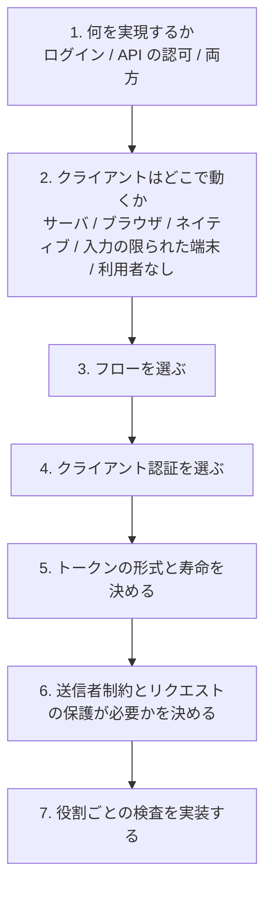
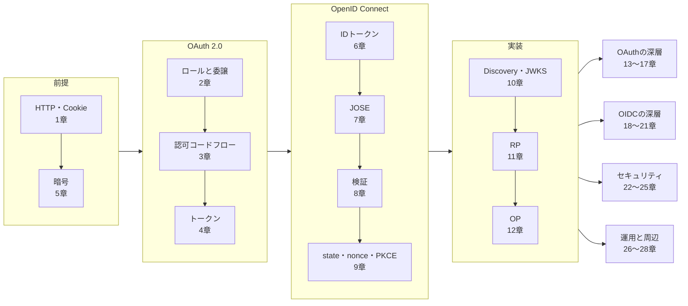

この章でわかること:

- アプリケーションの種類から、使うフローとクライアントの構成を決める手順
- クライアント認証の方式とトークンの形式を選ぶ基準
- RP・OP・リソースサーバのそれぞれが実装しなければならない検査の一覧
- 本書の要素をすべて組み合わせた簡易実装での、正常な流れと7つの攻撃の結果
- なぜ体系に必須か: 個々の仕様の知識は、どの選択肢をどの理由で選ぶかの判断に結びついて、はじめて設計に使えるようになるため

## 判断の順序

本書の27章までは、OAuth 2.0 と OpenID Connect の要素を1つずつ説明してきました。
実際のシステムを設計するときは、これらの要素を選び、組み合わせる必要があります。
この章では、その選択を次の順序で行います。

この図の1つ目の判断は、ログイン(認証)と API の認可(アクセストークン)のどちらが目的かです。
[6章](/oidc/06-oauth-to-oidc/)で説明したとおり、ログインには OpenID Connect の
ID トークンを使い、OAuth 2.0 のアクセストークンだけでログインを実装してはなりません。
アクセストークンには、「誰がログインしたか」をクライアントに伝える役割はありません。
別のクライアント向けに発行されたトークンを受け入れると、トークン置換攻撃が成立します。
API の認可だけが目的であれば OpenID Connect は必須ではありませんが、
認可サーバと OP を同じサービスで兼ねる構成が多いため、両方を同時に扱う設計がよく現れます。

## フローを選ぶ

2つ目と3つ目の判断は、クライアントが動く場所からほぼ一意に決まります。

| クライアント | フロー | クライアントの種類 | 根拠 |
| --- | --- | --- | --- |
| サーバ側で HTML を生成する Web アプリケーション | 認可コードフロー + PKCE | 機密クライアント | [3章](/web-auth/03-authorization-code/)、[9章](/oidc/09-state-nonce-pkce/)、[11章](/rust-impl/11-build-rp/) |
| SPA(ブラウザ上の JavaScript) | BFF を置き、BFF が認可コードフロー + PKCE を行う | BFF が機密クライアント | [24章](/security/24-browser-native/)(RFC 10017) |
| ネイティブアプリ・デスクトップアプリ | 外部ユーザーエージェントでの認可コードフロー + PKCE | パブリッククライアント | [24章](/security/24-browser-native/)(RFC 8252) |
| テレビ、CLI など入力の限られた端末 | デバイス認可グラント | パブリッククライアントが多い | [20章](/oidc-deep/20-other-grants/)(RFC 8628) |
| 利用者のいないサーバ間の通信 | クライアントクレデンシャルグラント | 機密クライアント | [20章](/oidc-deep/20-other-grants/) |
| 受け取ったトークンで別のサービスを呼ぶサービス | トークン交換 | 機密クライアント | [20章](/oidc-deep/20-other-grants/)(RFC 8693) |
| 利用者の別の端末で認証する(コールセンター、店頭の端末) | CIBA | 機密クライアント | [20章](/oidc-deep/20-other-grants/) |

表に現れないフローは、新しい設計で選ぶ理由がないものです。
インプリシットフローはアクセストークンをブラウザの URL に出すため、
RFC 9700 は使うべきではない(SHOULD NOT)と定めています([19章](/oidc-deep/19-flows/))。
リソースオーナーパスワードクレデンシャルグラントについては、RFC 9700 は使ってはならない(MUST NOT)と定めています
([20章](/oidc-deep/20-other-grants/))。
ハイブリッドフローは、ID トークンをフロントチャネルで先に受け取る必要がある場合
(FAPI 1.0 の古い構成など)に限られ、通常は認可コードフローで足ります。

SPA の行で BFF を選んでいるのは、RFC 10017 が挙げる3つのアーキテクチャのうち、
トークンを JavaScript から読める場所に置かずに済むのが BFF だけであるためです。
XSS が起きた場合、ブラウザ内の OAuth クライアントではトークンそのものが読み出されます。
BFF の構成で攻撃者が得られるのは、セッション Cookie 付きでリクエストを送る能力だけであり、
トークンを持ち出して別の場所から使うことはできません([24章](/security/24-browser-native/))。

## クライアント認証を選ぶ

機密クライアントは、トークンエンドポイントで自分を認証します([13章](/oauth-deep/13-client-auth/))。

| 方式 | 秘密の値 | 漏洩時の影響 | 選ぶ場面 |
| --- | --- | --- | --- |
| `client_secret_basic` / `client_secret_post` | 認可サーバと共有するシークレット | 認可サーバがシークレットを復元できる形で保存していると、保存値の漏洩でなりすましが可能になる | 一般的な Web アプリケーション。記号を含むシークレットでは basic の符号化の実装差に注意する |
| `client_secret_jwt` | 共有シークレット(HMAC の鍵) | 認可サーバは MAC を検証するために鍵そのものを保存する必要があり、保存値の漏洩でなりすましが可能になる | 選ぶ理由は少ない |
| `private_key_jwt` | クライアントだけが持つ秘密鍵 | 認可サーバは公開鍵しか持たない | 高いセキュリティが必要な場合。FAPI 2.0 で使える方式の1つ |
| `tls_client_auth` / `self_signed_tls_client_auth` | クライアント証明書の秘密鍵 | 認可サーバは証明書(公開鍵)しか持たない | mTLS を終端できる構成。証明書束縛トークンと組み合わせられる |

方式の違いは、認可サーバ側に保存される値がクライアントのなりすましに使えるかどうかです。
`client_secret_basic` と `client_secret_post` では、認可サーバはシークレットのハッシュ値だけを
保存して照合できます(RFC 6819 5.1.4.1.3節はシークレットを平文で保存しないことを求めています)。
この場合、保存値が漏洩しても、攻撃者はハッシュ値から元のシークレットを得なければなりません。
`client_secret_jwt` では、認可サーバは HMAC を検証するために鍵そのものを持つ必要があるため、
この対策がとれません。`private_key_jwt` と mTLS では、認可サーバは公開鍵しか持ちません。
このため認可サーバのデータベースが漏洩しても、攻撃者はクライアントになりすませません。

パブリッククライアントには認証の手段がありません。このため、パブリッククライアントの
安全性は PKCE([9章](/oidc/09-state-nonce-pkce/))と、リダイレクト URI の完全一致
([22章](/security/22-threats/))と、リフレッシュトークンのローテーションまたは送信者制約
([15章](/oauth-deep/15-refresh-tokens/)、[16章](/oauth-deep/16-sender-constrained/))によって確保します。

## トークンの形式と寿命を決める

アクセストークンの形式には、リソースサーバが自分で検証する JWT
([14章](/oauth-deep/14-token-validation/)の RFC 9068)と、認可サーバに問い合わせる
不透明トークン(RFC 7662 のイントロスペクション)があります。

| 観点 | JWT アクセストークン | 不透明トークン + イントロスペクション |
| --- | --- | --- |
| リソースサーバの検証 | 署名と各クレームをリソースサーバ自身が検査する | リクエストごとに(またはキャッシュして)認可サーバに問い合わせる |
| 失効の反映 | 有効期限まで反映されない | 問い合わせの時点で反映される(キャッシュの期間だけ遅れる) |
| 認可サーバへの負荷 | JWKS の取得だけ | リクエスト数に比例する |
| 内容の秘匿 | ペイロードはクライアントにも読める | クライアントには読めない |

選択の基準は、失効をどれだけ早く反映させる必要があるかです。
JWT アクセストークンを選ぶ場合は寿命を短く(数分程度)し、長く使う権限は
リフレッシュトークンで更新します。リフレッシュトークンは認可サーバだけが検証するので、
失効を即座に反映できます。

どちらの形式でも、ID トークンをアクセストークンの代わりに API に送ってはなりません。
ID トークンの宛先(`aud`)は RP であり、リソースサーバではありません
([8章](/oidc/08-id-token-validation/))。JWT アクセストークンには `typ` に `at+jwt` を付け、
リソースサーバは `typ` を検査して ID トークンとの取り違えを防ぎます
([14章](/oauth-deep/14-token-validation/)、[23章](/security/23-jwt-attacks/))。

## 送信者制約とリクエストの保護

ここまでの選択で、一般的な Web アプリケーションの安全性の要件は満たされます。
次の2つは、扱うデータの重要性に応じて追加する対策です。

- **送信者制約**: アクセストークンが漏洩した場合に、攻撃者がそのトークンを使えないようにします。
  アプリケーション層で行う DPoP と、TLS 層で行う mTLS があります
  ([16章](/oauth-deep/16-sender-constrained/))。パブリッククライアントのリフレッシュトークンを
  保護する手段としても有効です
- **リクエストの保護**: 認可リクエストの改ざんと漏洩を防ぎます。PAR は認可リクエストを
  バックチャネルで事前に送り、JAR はリクエストに署名します。認可レスポンスの `iss` パラメータは
  ミックスアップ攻撃を防ぎます([17章](/oauth-deep/17-request-protection/))

金融 API のように、漏洩や改ざんの影響が大きい場合は、これらを個別に選ぶ代わりに
FAPI 2.0 Security Profile に従います。FAPI 2.0 は PAR、PKCE、送信者制約、
公開鍵によるクライアント認証を組み合わせて必須にしたプロファイルであり、
適合性テストで実装を検査できます([25章](/security/25-high-security/))。

## RP のチェックリスト

7つ目の判断は、役割ごとの検査の実装です。チェックリストの各項目は、
省略したときに成立する攻撃と、それを説明した章に対応しています。

### 認可リクエストを送るとき

- `state` を推測できない値で生成し、ブラウザのセッションに結びつけて保存しています([9章](/oidc/09-state-nonce-pkce/))
- `nonce` を生成して保存し、ID トークンの `nonce` と照合しています([9章](/oidc/09-state-nonce-pkce/))
- PKCE の `code_verifier` を CSPRNG で生成し、`S256` で `code_challenge` を送っています([9章](/oidc/09-state-nonce-pkce/))
- OP の設定値は Discovery から取得し、メタデータの `issuer` が設定値と完全一致することを確かめています([10章](/rust-impl/10-discovery-jwks/))

### 認可レスポンスを受け取るとき

- `state` を照合し、照合後はセッションから削除しています(再送の防止)([11章](/rust-impl/11-build-rp/))
- 認可レスポンスに `iss` があれば、認可リクエストを送った OP の issuer と単純な文字列比較で照合しています。メタデータで `authorization_response_iss_parameter_supported` を宣言している OP からの応答に `iss` がなければ拒否しています(RFC 9207 2.4節)。`iss` に対応しない OP とも接続する場合は、OP ごとにリダイレクト URI を分けるなど、別のミックスアップ対策をとっています([17章](/oauth-deep/17-request-protection/))
- エラー応答(`error`)を、ログイン成功とは別の経路で処理しています([3章](/web-auth/03-authorization-code/))

### トークンを受け取るとき

- ID トークンの署名を、Discovery で得た JWKS の鍵で検証しています。`alg` は許可リストで固定しています([8章](/oidc/08-id-token-validation/))
- `iss`、`aud`(と複数の場合の `azp`)、`exp`、`iat` を検査しています([8章](/oidc/08-id-token-validation/))
- `at_hash` がある場合は、受け取ったアクセストークンと照合しています([8章](/oidc/08-id-token-validation/))
- ユーザーは `iss` と `sub` の組で識別し、`email` だけで既存のアカウントに結びつけていません([18章](/oidc-deep/18-claims-identity/))
- ログイン後にセッション ID を再発行しています(セッション固定攻撃の防止)([11章](/rust-impl/11-build-rp/))

### ログイン後

- セッション Cookie に `Secure`、`HttpOnly`、`SameSite` を付けています。可能なら `__Host-` 接頭辞を使っています([1章](/web-auth/01-http-auth/)、[24章](/security/24-browser-native/))
- トークンをログに出力していません([26章](/practice/26-operations/))
- ログアウトでは自分のセッションを削除し、必要に応じて OP にも RP-Initiated Logout で知らせています。Back-Channel Logout を受け取る場合はログアウトトークンを検証しています([21章](/oidc-deep/21-logout-session/))
- 未知の `kid` を受け取ったら JWKS を取り直し、取り直しの頻度を制限しています([26章](/practice/26-operations/))

## OP のチェックリスト

### 認可エンドポイント

- `client_id` と `redirect_uri` を検証し、登録値と完全一致しない場合はリダイレクトせずにエラーを表示しています。ネイティブアプリのループバックリダイレクト(`http://127.0.0.1:{port}/...`)に限り、ポート番号以外の完全一致で照合しています([12章](/rust-impl/12-build-op/)、[22章](/security/22-threats/)、[24章](/security/24-browser-native/))
- パラメータの重複を拒否しています([12章](/rust-impl/12-build-op/))
- パブリッククライアントには PKCE を必須にし、`plain` を受け付けていません([9章](/oidc/09-state-nonce-pkce/))
- ログイン画面と同意画面に、フレームへの埋め込みを禁止するヘッダを付けています(クリックジャッキングの防止)([12章](/rust-impl/12-build-op/)、[22章](/security/22-threats/))
- 認可レスポンスに `iss` を付けています([17章](/oauth-deep/17-request-protection/))

### 認可コード

- 認可コードは推測できない値で、寿命は短く(1分程度)、1回だけ使えます([12章](/rust-impl/12-build-op/))
- 認可コードを `client_id`、`redirect_uri`、`code_challenge`、`nonce` に結びつけて保存しています([12章](/rust-impl/12-build-op/))
- 使用済みのコードが再度使われたら、そのコードで発行したトークンを失効させています(RFC 6749 4.1.2節の SHOULD)([12章](/rust-impl/12-build-op/))

### トークンエンドポイント

- クライアント認証を、定数時間比較などで正しく行っています([5章](/web-auth/05-crypto/)、[13章](/oauth-deep/13-client-auth/))
- 認可コードの有効期限と、保存した `client_id`・`redirect_uri` との一致を確かめています([12章](/rust-impl/12-build-op/))
- `code_verifier` から計算した値を保存した `code_challenge` と照合しています。`code_challenge` なしで発行したコードの交換に `code_verifier` が付いていた場合は拒否しています(PKCE ダウングレード攻撃の防止。RFC 9700 4.8.2節)([9章](/oidc/09-state-nonce-pkce/))
- レスポンスに `Cache-Control: no-store` を付けています([4章](/web-auth/04-tokens/))
- リフレッシュトークンは、パブリッククライアントにはローテーションか送信者制約を適用しています([15章](/oauth-deep/15-refresh-tokens/))

### 鍵と公開情報

- 署名鍵のローテーションを「公開 → 待機 → 切り替え → 待機 → 削除」の順で行っています([26章](/practice/26-operations/))
- Discovery の `issuer` と ID トークンの `iss` が完全に同じ文字列です([10章](/rust-impl/10-discovery-jwks/))

## リソースサーバのチェックリスト

- Bearer トークンは `Authorization: Bearer` ヘッダで受け付け、クエリパラメータのトークンは受け付けていません([4章](/web-auth/04-tokens/))
- JWT アクセストークンでは `typ`(`at+jwt`)、署名、`iss`、`aud`、`exp` を検査しています([14章](/oauth-deep/14-token-validation/))
- `aud` に自分の識別子が含まれないトークンを拒否しています([14章](/oauth-deep/14-token-validation/))
- スコープの不足は `403` と `insufficient_scope`、トークンの不正は `401` と `invalid_token` で返しています([4章](/web-auth/04-tokens/))
- DPoP を使う場合は、`Authorization: DPoP` ヘッダのトークンと `DPoP` ヘッダの証明を要求し、証明の署名、`htm`、`htu`、`iat`、`jti`、`ath` と、トークンの `cnf.jkt` を照合しています。DPoP に束縛されたトークンが `Bearer` として送られてきた場合は拒否しています(RFC 9449 7節)([16章](/oauth-deep/16-sender-constrained/))
- より強い認証が必要な操作では、RFC 9470 の `insufficient_user_authentication` で再認証を求めています([18章](/oidc-deep/18-claims-identity/))

## 実験: 本書の要素を1つのプロセスで動かす

最後に、本書の要素を1つのプロセスの中に組み合わせた簡易実装を実行します。
OP は ES256 の鍵を生成して ID トークンと JWT アクセストークンに署名し、
RP は `state`・`nonce`・PKCE を使ってログインし、リソースサーバは JWT アクセストークンを検証します。
各部分は、3章(認可コードフロー)、5章(署名)、7章(JWS)、8章(ID トークンの検証)、
9章(state・nonce・PKCE)、12章(認可コードの束縛)、14章(JWT アクセストークン)、
17章(`iss` パラメータ)の実装を短くしたものです。

<RustPlay snippet="ch28/full-flow" title="OP・RP・リソースサーバを1つのプロセスで動かし、7つの攻撃を試す" />

鍵とトークンは実行ごとに生成し直しますが、表示される判定は毎回同じです。

[1]は正常な流れです。RP は認可レスポンスの `state` と `iss` を照合し、
コードを交換して ID トークンを検証し、`sub` が `user-0001` であることを確かめています。
リソースサーバは同じ JWKS でアクセストークンを検証し、`200` を返しています。

[2]から[8]は、攻撃を最初に拒否した検査の結果です。

| 番号 | 攻撃 | 最初に拒否した検査 | 説明した章 |
| --- | --- | --- | --- |
| 2 | 認可コードの再利用と認可レスポンスの再送 | OP のコードの1回限りの取り出しと、RP の `state` の1回限りの取り出し | [11章](/rust-impl/11-build-rp/)、[12章](/rust-impl/12-build-op/) |
| 3 | 横取りしたコードの交換 | PKCE | [9章](/oidc/09-state-nonce-pkce/) |
| 4 | 攻撃者の認可レスポンスの送信(ログイン CSRF) | `state` の照合 | [9章](/oidc/09-state-nonce-pkce/) |
| 5 | 攻撃者の URI へのリダイレクト | `redirect_uri` の完全一致 | [22章](/security/22-threats/) |
| 6 | ID トークンを API に送る | `typ` の検査 | [14章](/oauth-deep/14-token-validation/) |
| 7 | トークンの改ざん | 署名の検証 | [7章](/oidc/07-jwt-jose/) |
| 8 | 期限切れのトークンの使用 | `exp` の検査 | [8章](/oidc/08-id-token-validation/) |

表の検査を1つ取り除いても、攻撃が成功するとは限りません。多くの攻撃は、
複数の検査で重ねて防がれているためです。[3]は、コードを横取りした攻撃者が
クライアントシークレットも得ている場合を想定しています。この攻撃は PKCE だけが防いでおり、
PKCE の検査を取り除くと攻撃者はトークンを得ます。一方、[4]で `state` の検査を外した場合は、
被害者の RP がコードを交換すると PKCE の検査で失敗します(nonce の検査でも失敗します)。
攻撃者のコードは攻撃者の `code_verifier` に結びついているためです。[6]は `typ` の検査を外しても、
ID トークンの `aud` がリソースサーバの識別子ではないため、`aud` の検査で拒否されます。
コードを編集して検査を1つずつ外し、どの攻撃がどの検査でまだ拒否されるかを確かめてください。
1つの攻撃を複数の検査で防いでいる構成では、1つの実装の誤りがそのまま被害には結びつきません。
検査を省くかどうかは、その検査だけが防いでいる攻撃があるかどうかで判断します。

この簡易実装には、実際のシステムに必要なものが欠けています。鍵の保管とローテーション
([26章](/practice/26-operations/))、ログインと同意の画面([12章](/rust-impl/12-build-op/))、
セッション Cookie とセッション ID の再発行([11章](/rust-impl/11-build-rp/))、
リフレッシュトークン([15章](/oauth-deep/15-refresh-tokens/))、ログアウト
([21章](/oidc-deep/21-logout-session/))です。これらを含む実装は、`examples/` の
mini-op・rp・resource-server を参照してください。

## 本書の知識の一覧

最後に、本書の主要な概念を、それを定める仕様と、説明した章に対応づけて一覧にします。
仕様の要約は[RFC・仕様の索引](/appendix/rfc-index/)に、用語の定義は[用語集](/appendix/glossary/)にあります。

この図は本書の構成をそのまま示しています。基礎編の12章は左から順に前提となる関係にあり、
応用編の各 Part は基礎編の全体を前提にしています。

| 概念 | 何を解決するか | 仕様 | 章 |
| --- | --- | --- | --- |
| Basic 認証・セッション Cookie | ステートレスな HTTP での認証の引き継ぎ | RFC 7617、RFC 6265 | [1章](/web-auth/01-http-auth/) |
| 委譲と4つのロール | パスワードを渡さずに限られた権限を渡す | RFC 6749 1節 | [2章](/web-auth/02-delegation/) |
| 認可コードフロー | トークンをブラウザに出さずにクライアントへ渡す | RFC 6749 4.1節 | [3章](/web-auth/03-authorization-code/) |
| Bearer トークンとスコープ | 権限の範囲を表し、API に提示する | RFC 6749 5節、RFC 6750 | [4章](/web-auth/04-tokens/) |
| ハッシュ・HMAC・署名 | 改ざんの検出と発行者の確認 | RFC 7518 | [5章](/web-auth/05-crypto/) |
| ID トークン | 認証の結果を、宛先と発行者を明示して RP に伝える | OIDC Core 2節 | [6章](/oidc/06-oauth-to-oidc/) |
| JWS・JWT・JWK | 署名付きのクレームと公開鍵の表現 | RFC 7515、7517、7519 | [7章](/oidc/07-jwt-jose/) |
| ID トークンの検証 | 他人宛て・偽造・期限切れの ID トークンの拒否 | OIDC Core 3.1.3.7節 | [8章](/oidc/08-id-token-validation/) |
| state・nonce・PKCE | フローの各段を同じブラウザ・同じリクエストに結びつける | RFC 6749 10.12節、RFC 7636 | [9章](/oidc/09-state-nonce-pkce/) |
| Discovery・JWKS | OP の設定値と公開鍵の取得 | OIDC Discovery、RFC 8414 | [10章](/rust-impl/10-discovery-jwks/) |
| クライアント認証 | トークンエンドポイントでのクライアントの確認 | RFC 6749 2.3節、RFC 7523、RFC 8705 | [13章](/oauth-deep/13-client-auth/) |
| JWT アクセストークン・イントロスペクション | リソースサーバでのトークンの検証 | RFC 9068、RFC 7662 | [14章](/oauth-deep/14-token-validation/) |
| リフレッシュトークンのローテーション | 長期の権限の更新と漏洩の検出 | RFC 6749 6節、RFC 9700 | [15章](/oauth-deep/15-refresh-tokens/) |
| DPoP・mTLS | 漏洩したトークンの使用の防止 | RFC 9449、RFC 8705 | [16章](/oauth-deep/16-sender-constrained/) |
| PAR・JAR・iss | 認可リクエストとレスポンスの保護 | RFC 9126、9101、9207 | [17章](/oauth-deep/17-request-protection/) |
| iss+sub による識別 | アカウントの乗っ取りの防止 | OIDC Core 5.7節、8節 | [18章](/oidc-deep/18-claims-identity/) |
| response_type と response_mode | フローの種類と応答の返し方の選択 | Multiple Response Types | [19章](/oidc-deep/19-flows/) |
| デバイス・クライアントクレデンシャル・トークン交換 | 認可コードフローを使えない場面 | RFC 8628、8693 | [20章](/oidc-deep/20-other-grants/) |
| ログアウト | 複数のセッションの終了 | RP-Initiated / Front / Back-Channel Logout | [21章](/oidc-deep/21-logout-session/) |
| 脅威モデル | 攻撃者の能力の整理と対策の対応づけ | RFC 6819、RFC 9700 | [22章](/security/22-threats/) |
| JWT への攻撃 | alg の混同、型の取り違え | RFC 8725 | [23章](/security/23-jwt-attacks/) |
| BFF・ネイティブアプリ | クライアントの実行環境ごとの安全な構成 | RFC 10017、RFC 8252 | [24章](/security/24-browser-native/) |
| OAuth 2.1・FAPI 2.0 | 選択肢を減らした安全な既定値 | draft-ietf-oauth-v2-1、FAPI 2.0 | [25章](/security/25-high-security/) |
| 鍵のローテーション・マルチテナント | 運用中に変わる検証の前提への対応 | OIDC Core 10.1.1節 | [26章](/practice/26-operations/) |
| SD-JWT・Federation・MCP | OIDC の周辺にある標準 | RFC 9901、OpenID Federation | [27章](/practice/27-ecosystem/) |

## まとめ

- 設計は「目的 → クライアントの実行場所 → フロー → クライアント認証 → トークンの形式 → 追加の対策 → 検査の実装」の順に決めます
- ログインには ID トークンを使い、アクセストークンでログインを実装してはなりません
- フローは原則として認可コードフロー + PKCE です。SPA では BFF を置き、ネイティブアプリでは外部ユーザーエージェントを使います
- クライアント認証は、認可サーバの保存値でなりすましができない `private_key_jwt` や mTLS が、共有シークレットより強い方式です
- JWT アクセストークンは寿命を短くし、`typ` で ID トークンと区別します。失効の即時性が必要なら不透明トークンとイントロスペクションを使います
- RP・OP・リソースサーバの検査は、それぞれ特定の攻撃に対応しています。1つの攻撃が複数の検査で重ねて防がれていることも多くあります。検査を省くときは、その検査だけが防いでいる攻撃がないことを説明できなければなりません

OAuth と OpenID Connect の仕様は、現在も更新が続いています。本書で扱った
OAuth 2.1 や JWT BCP の改訂版のように、策定中の文書が RFC になると、推奨事項が変わることがあります。
新しい文書を読むときは、[RFCの読み方](/appendix/reading-rfcs/)の手順に従い、
その文書がどの攻撃に対処し、本書のどの検査を更新するものかを確かめてください。
