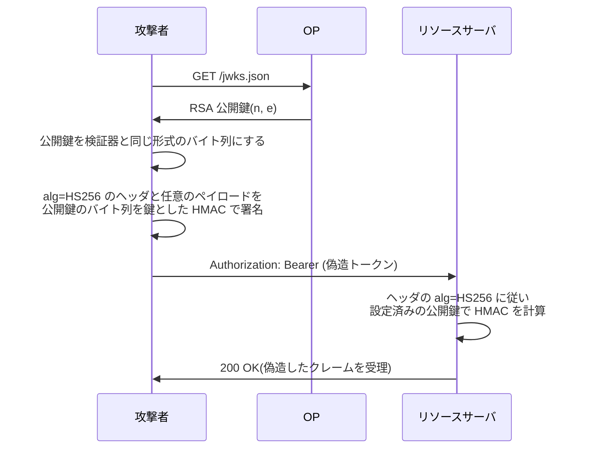

この章でわかること:

- JWT の検証が破られる典型的な経路(alg=none、アルゴリズム混同、kid と jku/x5u、JWT の取り違え)
- RFC 8725(JWT BCP)と改訂版ドラフトが定める対策: 許可リスト、鍵ごとの alg の固定、明示的型付け
- RFC 9864 の完全指定アルゴリズムが解決する問題
- ECDSA の署名形式(raw と DER)、署名の展性、CVE-2022-21449 の仕組み
- なぜ体系に必須か: ID トークン(8章)、JWT アクセストークン(14章)、DPoP 証明(16章)、リクエストオブジェクト(17章)、ログアウトトークン(21章)はすべて JWT です。検証器の1つの欠陥が、これらの保護を同時に無効にします

## JWT の検証は何を信用しているか

[7章](/oidc/07-jwt-jose/)で見たとおり、JWS のコンパクトシリアライゼーションは
`ヘッダ.ペイロード.署名` の3つの部分からなり、署名はヘッダとペイロードの両方を対象にします。
ここに構造上の問題が1つあります。検証に使うアルゴリズムを示す `alg` は、検証の対象であるヘッダの中にあり、
検証が終わるまでは攻撃者が自由に書き換えられる値です。

ヘッダに alg を置く設計は、**暗号アルゴリズムの移行可能性**(cryptographic agility)のためです。
アルゴリズムに弱点が見つかったとき、トークンの形式を変えずに新しいアルゴリズムへ移れるように、
トークン自身が使用したアルゴリズムを示します。問題は、この値を「どう検証するかの指示」として
受け取る実装があったことです。[8章](/oidc/08-id-token-validation/)で「alg の固定」を
ID トークン検証の規則として導入したのは、この問題への対策です。この章は、その規則が防いでいる攻撃を
1つずつ再現し、関連する規則を加えて JWT の検証器の設計を完成させます。

JWT の安全な実装と運用の規則は、**JWT BCP**(JSON Web Token Best Current Practices)にまとめられています。
JWT BCP は RFC 8725(2020年2月、BCP 225、RFC 7519 を更新)として発行されました。
その後に見つかった攻撃を反映する改訂版が、Internet-Draft の draft-ietf-oauth-rfc8725bis として策定中です。
本書が参照する版は draft-ietf-oauth-rfc8725bis-10(2026年8月21日付、有効期限2027年2月22日)で、
確認日は2026年10月16日です。この版は、RFC になった時点で RFC 8725 を廃止(Obsoletes)し、
RFC 7519 を更新する予定です。

## RFCを読む: RFC 8725 2.1節

RFC 8725 は2節で脅威を、3節で対策を列挙し、各脅威から対策の節へ参照しています。
最初の脅威が alg に関するものです。

> Signed JSON Web Tokens carry an explicit indication of the signing algorithm, in the form of the "alg" Header Parameter, to facilitate cryptographic agility. This, in conjunction with design flaws in some libraries and applications, has led to several attacks:
>
> *  The algorithm can be changed to "none" by an attacker, and some libraries would trust this value and "validate" the JWT without checking any signature.
>
> *  An "RS256" (RSA, 2048 bit) parameter value can be changed into "HS256" (HMAC, SHA-256), and some libraries would try to validate the signature using HMAC-SHA256 and using the RSA public key as the HMAC shared secret (see [McLean] and [CVE-2015-9235]).

(RFC 8725 2.1節)

この節は、alg の値を信用する実装に対する2つの攻撃を挙げています。1つは、攻撃者が alg を `none` に
書き換えると、署名を確かめずに JWT を「検証済み」とするライブラリがあったことです。
もう1つは、`RS256` を `HS256` に書き換えると、RSA の公開鍵を HMAC の共有鍵として使って
HMAC-SHA256 で検証しようとするライブラリがあったことです。

前者を **alg=none 攻撃**(alg=none attack)、後者を**アルゴリズム混同攻撃**(algorithm confusion attack)と呼びます。
どちらも、検証器が攻撃者の指定したアルゴリズムで検証することから生じる問題であり、暗号アルゴリズム自体の弱点ではありません。
改訂版ドラフトの2.1節もこの記述を変えていません。

## alg=none とその変形

`none` は RFC 7518 3.6節が定める正規の alg 値で、署名のない JWS を表します。
このような JWS を **Unsecured JWS** と呼びます。

> Implementations that support Unsecured JWSs MUST NOT accept such objects as valid unless the application specifies that it is acceptable for a specific object to not be integrity protected. Implementations MUST NOT accept Unsecured JWSs by default. In order to mitigate downgrade attacks, applications MUST NOT signal acceptance of Unsecured JWSs at a global level, and SHOULD signal acceptance on a per-object basis.

(RFC 7518 3.6節)

この節は、Unsecured JWS を受け入れる条件を定めています。実装は、アプリケーションが
特定のオブジェクトについて完全性保護なしでよいと指定した場合を除き、Unsecured JWS を
有効として受け入れてはなりません(MUST NOT)。既定で受け入れてはならず(MUST NOT)、
アプリケーションは全体の設定として受け入れを示してはなりません(MUST NOT)。
受け入れる場合はオブジェクトごとに示すべきです(SHOULD)。仕様は2015年の時点で
alg=none の危険を認識していましたが、この規定を満たさないライブラリが広く使われました。

alg=none のトークンは、ヘッダ `{"alg":"none"}` と任意のペイロードを Base64url で符号化し、
署名部を空にするだけで作れます。末尾のピリオドは残ります。

```text
eyJhbGciOiJub25lIn0.eyJpc3MiOiJodHRwczovL29wLmV4YW1wbGUiLCJzdWIiOiJhZG1pbiIsImF1ZCI6ImFwaSJ9.
```

alg=none を個別に拒否する修正には、別の欠陥が残る場合がありました。改訂版ドラフトは
これを新しい脅威として追加しています。

> Some JWT implementations included a list of disallowed algorithm names, e.g., do not use "none". These same applications misinterpreted the JOSE specifications when parsing the token, reading algorithm values as if they were case-insensitive. The end result was that an attacker could change the "alg" value to "noNE" and bypass the security check.

(draft-ietf-oauth-rfc8725bis-10 2.11節)

この節は、禁止するアルゴリズム名の一覧(例えば `none`)を持つ実装が、alg の値を大文字小文字を区別せずに
解釈していたため、`noNE` によって検査を回避された事例を述べています。JOSE の alg 値は大文字小文字を区別します。
拒否の判定と実際の処理で、同じ値を異なる規則で解釈したことが原因です。

### 実験: alg=none と大文字小文字の変形

3つの検証器に、正規の HS256 トークンと、`none`・`noNE`・`None` の Unsecured JWS を渡します。
検証器 A はヘッダの alg をそのまま信用します。B は `none` を拒否リストで拒否しますが、
処理の分岐では alg を小文字に変換します。C はこの鍵に HS256 だけを許可します。

<RustPlay snippet="ch23/alg-none" title="alg=none を3種類の検証器に渡す" />

手元で実行した結果の要点は次のとおりです。

```text
[alg=none]
  A ヘッダを信用: 受理
  B 拒否リスト  : 拒否 (拒否リストの none)
  C 許可リスト  : 拒否 (alg=none は許可リストにない)
[alg=noNE]
  A ヘッダを信用: 拒否 (alg=noNE の検証に失敗)
  B 拒否リスト  : 受理
  C 許可リスト  : 拒否 (alg=noNE は許可リストにない)
```

A は `none` をそのまま受理し、署名なしで `"sub":"admin"` のクレームを信用します。
B は `none` を拒否しましたが、`noNE` と `None` は拒否リストの文字列と一致しないため検査を通過し、
その後の小文字変換で `none` の処理に入って受理されました。C は許可リストの `HS256` と
完全に一致する値以外を拒否するため、3つの変形をすべて拒否しています。
拒否リストは攻撃者が使いうる値をすべて列挙できたときにだけ機能しますが、許可リストは
受け入れる値を列挙するだけで済みます。この差が、改訂版ドラフトが許可リストを求める理由です。

## アルゴリズム混同攻撃

アルゴリズム混同攻撃は、検証器の API が「鍵のバイト列」を1つだけ受け取り、
どのアルゴリズムで使うかをヘッダの alg で決める場合に成立します。
OP が RS256 で署名している場合、検証器には RSA の公開鍵が設定されています。
攻撃者は次の手順でトークンを偽造します。



公開鍵は誰でも入手できる値です。[10章](/rust-impl/10-discovery-jwks/)で見たとおり、OP は jwks_uri で
公開鍵を公開しています。

```http
GET /jwks.json HTTP/1.1
Host: op.example
```

```http
HTTP/1.1 200 OK
Content-Type: application/json

{"keys":[{"kty":"RSA","alg":"RS256","use":"sig","kid":"op-2026",
  "n":"ofgWCuLjybRlzo0tZWJjNiuSfb4p4fAkd_wWJcyQoTbji9k0l8W26mPddx...","e":"AQAB"}]}
```

HMAC は鍵を知っている者なら誰でも計算できる対称アルゴリズムです([5章](/web-auth/05-crypto/))。
検証器が公開鍵を HMAC の鍵として使った時点で、公開鍵を知っている全員が有効な MAC を作れます。
攻撃者に必要なのは、検証器が内部で保持している鍵のバイト列の形式(PEM の文字列、DER のバイト列など)を
再現することだけです。形式は鍵の値から決まるため、試行は数通りで済みます。

### 実験: 脆弱な検証器と安全な検証器

RFC 7515 付録A.2 の RS256 の JWS と公開鍵(n, e)を使います。脆弱な検証器は、公開鍵を DER 形式の
RSAPublicKey(ring が RSA 検証に受け取る形式)として1つのバイト列で保持し、ヘッダの alg に応じて
ring の RSA 検証か HMAC-SHA256 にそのバイト列を渡します。安全な検証器は、鍵に `RS256` を固定し、
ヘッダの alg は固定値との一致確認だけに使います。攻撃者は n, e から同じ DER を組み立てて HMAC の鍵にし、
`"sub":"admin"` を加えたペイロードに署名します。

<RustPlay snippet="ch23/alg-confusion" title="アルゴリズム混同: RS256 の公開鍵を HMAC の鍵にする" />

手元で実行した結果は次のとおりです。

```text
公開鍵(RSAPublicKey の DER): 270 バイト、先頭 [30, 82, 01, 0a, 02, 82, 01, 01]

[1] RFC 7515 A.2 の正規トークン (alg=RS256)
  脆弱な検証器: 受理  payload={"iss":"joe", "exp":1300819380, "http://example.com/is_root":true}
  安全な検証器: 受理  payload={"iss":"joe", "exp":1300819380, "http://example.com/is_root":true}

[2] 偽造トークン (alg=HS256、公開鍵の DER を HMAC 鍵に使用)
  脆弱な検証器: 受理  payload={"iss":"joe","exp":1300819380,"http://example.com/is_root":true,"sub":"admin"}
  安全な検証器: 拒否  (ヘッダの alg=HS256 は鍵に固定した RS256 と異なる)
```

[1] では、RFC 7515 付録A.2 の署名が ring の RS256 検証を通過しています。付録の値を正しく扱えていることの確認です
(RSASSA-PKCS1-v1_5 の署名は決定的なので、付録の署名値そのものを検証できます。この実験は exp を検査していません)。
[2] では、脆弱な検証器が偽造トークンを受理しました。攻撃者は秘密鍵を一度も使っていません。
安全な検証器は、署名の計算を始める前に alg の不一致で拒否しています。
alg=none の実験と合わせると、2つの攻撃はどちらも「ヘッダの alg で検証方法を選ぶ」という
同じ欠陥から生じ、同じ対策(鍵ごとの alg の固定)で防がれることがわかります。

## RFCを読む: RFC 8725 3.1節と改訂版の3.1節

> Libraries MUST enable the caller to specify a supported set of algorithms and MUST NOT use any other algorithms when performing cryptographic operations. The library MUST ensure that the "alg" or "enc" header specifies the same algorithm that is used for the cryptographic operation. Moreover, each key MUST be used with exactly one algorithm, and this MUST be checked when the cryptographic operation is performed.

(RFC 8725 3.1節)

この節は、ライブラリの API に対する要請を定めています。ライブラリは、呼び出し側が対応するアルゴリズムの集合を
指定できるようにしなければならず(MUST)、それ以外のアルゴリズムを暗号処理に使ってはなりません(MUST NOT)。
ヘッダの alg(または enc)が、実際に使うアルゴリズムと同じであることを確かめなければなりません(MUST)。
さらに、各鍵はちょうど1つのアルゴリズムで使わなければならず(MUST)、そのことを暗号処理の時点で
確かめなければなりません(MUST)。

改訂版ドラフトの3.1節は、この要請を次のように詳しくしています。

> The library MUST verify that the algorithm specified in the "alg" or "enc" header parameter is consistent with the algorithm associated with the key identified by the corresponding identifier (e.g., "kid") during key lookup.
>
> [...] libraries should use allowlists for critical parameters such as "alg" instead of blocklists, because blocklists cannot anticipate every unsafe or misspelled value an attacker might use.

(draft-ietf-oauth-rfc8725bis-10 3.1節)

追加された点は2つあります。1つ目は、alg の照合相手を「kid などで特定した鍵に結びつけたアルゴリズム」と
明記したことです。実験の安全な検証器は、この形をとっています。2つ目は、alg のような重要なパラメータには
許可リストを使うべきであり、拒否リストは使うべきではないとしたことです(小文字の should で、BCP 14 の要請語ではありません)。
同じ節は、受信者が発行者ごとに許可するアルゴリズムを決めなければならない(MUST)ことも加えています。

「各鍵を1つのアルゴリズムで使う」という規則は、Rust では型で表せます。鍵の種類ごとに列挙子を分け、
検証関数が鍵の列挙子からアルゴリズムを決め、ヘッダの値では決めないようにします。

```rust
enum VerifyingKey {
    Rs256(Vec<u8>), // RSAPublicKey の DER
    Es256(Vec<u8>), // 非圧縮の EC 公開鍵
}

fn verify(key: &VerifyingKey, header_alg: &str, input: &[u8], sig: &[u8]) -> Result<(), Error> {
    let (expected, alg): (&str, &dyn ring::signature::VerificationAlgorithm) = match key {
        VerifyingKey::Rs256(_) => ("RS256", &ring::signature::RSA_PKCS1_2048_8192_SHA256),
        VerifyingKey::Es256(_) => ("ES256", &ring::signature::ECDSA_P256_SHA256_FIXED),
    };
    if header_alg != expected {
        return Err(Error::AlgMismatch);
    }
    // 以降はヘッダを参照しない
    todo!()
}
```

この形では、HS256 の分岐を持たない限り、RSA の鍵が HMAC に渡る経路がありません。
JWK の `alg` パラメータを鍵の読み込み時に必須にし、この列挙子に変換するのが実用的な方法です。

## kid・jku・x5u: ヘッダが鍵を指す場合

JOSE ヘッダには、alg のほかにも検証に使う鍵を示すパラメータがあります。いずれも検証前の値なので、
alg と同じく攻撃者が自由に設定できます。

`kid`(Key ID)は、どの鍵で署名したかを示すヒントです。RFC 7515 4.1.4節は、
kid の構造は規定しないとしています。検証器は kid を使って鍵を検索します([10章](/rust-impl/10-discovery-jwks/))。
**kid インジェクション**(kid injection)は、検証器が kid をデータベースの検索条件やファイルパスに
そのまま埋め込む実装に対して、kid に SQL 断片やパス(例えば `../../../../dev/null`)を入れて
検証鍵を攻撃者の知っている値に変える攻撃です。空のファイルを鍵として読み込ませれば、
空のバイト列を鍵にした HMAC で偽造できます。

```json
{"alg":"HS256","kid":"../../../../dev/null"}
```

`jku`(JWK Set URL)は鍵の集合を取得する URL、`x5u`(X.509 URL)は証明書(チェーン)を取得する URL、
`x5c`(X.509 Certificate Chain)は証明書チェーンそのものを Base64 で埋め込むヘッダパラメータです
(RFC 7515 4.1.2節、4.1.5節、4.1.6節)。検証器がこれらに従って鍵を取得すると、
攻撃者は自分の JWK Set の URL を jku に入れ、自分の秘密鍵で署名したトークンを有効にできます。
x5c も、証明書チェーンを信頼できる認証局まで検証しなければ、攻撃者の自己署名証明書の鍵を受け入れることになります。

URL に従う処理には、もう1つの問題があります。[13章](/oauth-deep/13-client-auth/)で説明した SSRF
(server-side request forgery)です。jku に `http://169.254.169.254/` のような内部アドレスを入れれば、検証器が攻撃者の代わりに内部ネットワークへアクセスします。

## RFCを読む: draft-ietf-oauth-rfc8725bis-10 3.10節

RFC 8725 3.10節の題は「Do Not Trust Received Claims」でしたが、改訂版では
「Carefully Evaluate Received Claims」に変わり、内容が補強されています。

> Treat claim values as being potentially attacker-provided input.
>
> The "kid" (key ID) header is used by the relying application to perform key lookup. Applications MUST ensure that this does not create SQL or LDAP injection vulnerabilities by validating and/or sanitizing the received value.
>
> Similarly, uncritically following a "jku" (JWK set URL) or "x5u" (X.509 URL) header, which may contain an arbitrary URL, could result in server-side request forgery (SSRF) attacks. Applications SHOULD protect against such attacks, e.g., by matching the URL to an allowlist of permitted locations and ensuring no cookies are sent in the GET request, unless there are no local resources to protect (e.g., a hosted sandbox).

(draft-ietf-oauth-rfc8725bis-10 3.10節)

この節は、クレームとヘッダの値を攻撃者が与えた入力として扱うことを求めています。
アプリケーションは、kid による鍵の検索が SQL や LDAP のインジェクションの脆弱性にならないよう、
受け取った値を検証または無害化しなければなりません(MUST)。RFC 8725 では should でしたが、改訂版で MUST になりました。
jku や x5u に無批判に従うと SSRF の原因になるため、許可リストとの照合や Cookie を送らないことで
防ぐべきです(SHOULD)。続く段落は、許可リストがない場合、認可サーバはホスト名の解決結果を確かめ、ループバックや
ローカルの IP アドレスに解決されるならリクエストを送ってはならない(MUST)としています。

OIDC と OAuth の範囲では、より単純な対策があります。検証鍵は発行者のメタデータの jwks_uri から取得し、
トークンのヘッダが指す場所からは取得しません。RFC 8725 3.8節は、iss を含む JWT について、
暗号処理に使った鍵がその発行者のものであることを確かめなければならない(MUST)とし、その例として
OpenID Connect の issuer と jwks_uri の関係を挙げています。この方式では jku と x5u を読む必要がなく、
kid は発行者の JWK Set の中から鍵を選ぶ文字列比較にだけ使います。
[25章](/security/25-high-security/)の FAPI 2.0 も、jwks_uri を提供するサーバは x5u と jku を
使うべきではない(should not)としています。

## JWT の取り違えと明示的型付け

署名が正しく、発行者も正しい JWT でも、別の用途のために発行されたものかもしれません。
同じ OP が同じ鍵で ID トークン、JWT アクセストークン、ログアウトトークンを発行していれば、
これらは署名の検証だけでは区別できません。RFC 8725 2.8節は、ある目的で発行された JWT が別の目的に
転用されることを **JWT の取り違え**(cross-JWT confusion)と呼び、置換攻撃の一種としています。
[6章](/oidc/06-oauth-to-oidc/)のトークン置換攻撃は、同じ種類のトークンを別の受信者に使う置換攻撃でした。

典型的な例は、ID トークンをアクセストークンとしてリソースサーバに送る攻撃です。
ID トークンは RP 宛ての認証結果であり、API の認可に使うものではありません([8章](/oidc/08-id-token-validation/))。
RP の多くはフロントエンドに ID トークンを渡すため、ID トークンはアクセストークンより多くの場所に現れます。
リソースサーバが「OP の鍵で署名され、iss と exp が正しい」ことだけを確かめていれば、ID トークンを受理してしまいます。

**明示的型付け**(explicit typing)は、JWT の種類ごとに異なる `typ` ヘッダの値を付け、
検証側がその値を確かめることで取り違えを防ぐ方法です。本書で扱う JWT の typ は次のとおりです。

| JWT の種類 | typ の値 | 定義 | 本書の章 |
| --- | --- | --- | --- |
| JWT アクセストークン | `at+jwt` | RFC 9068 2.1節 | [14章](/oauth-deep/14-token-validation/) |
| DPoP 証明 | `dpop+jwt` | RFC 9449 4.2節 | [16章](/oauth-deep/16-sender-constrained/) |
| リクエストオブジェクト | `oauth-authz-req+jwt` | RFC 9101 4節 | [17章](/oauth-deep/17-request-protection/) |
| ログアウトトークン | `logout+jwt`(RECOMMENDED) | Back-Channel Logout 1.0 | [21章](/oidc-deep/21-logout-session/) |
| ID トークン | 規定なし(`JWT` が多い) | OIDC Core 1.0 | [8章](/oidc/08-id-token-validation/) |

ID トークンには明示的な型がありません。OIDC Core が RFC 8725 より前に定められたためです。
このため、取り違えの防止は「新しい種類の JWT が明示的な型を持ち、受信側がそれを要求する」という方向で行います。
RFC 9068 4節は、リソースサーバが typ の値を `at+jwt` か `application/at+jwt` であると確かめ、
それ以外を拒否しなければならない(MUST)と定めています。

### 実験: ID トークンをリソースサーバに送る

同じ OP の同じ ES256 鍵で、アクセストークン(typ=at+jwt)、ID トークン(typ=JWT)、
別の RP 宛ての ID トークン(typ なし)を作ります。ID トークンの aud はクライアント ID の
`https://app.example` です。このアプリは、自分の API の識別子(アクセストークンの aud)にも同じ URL を使っています。
3つの検証規則(署名+iss+exp、それに aud を加えたもの、さらに typ を加えたもの)で判定します。
鍵と ECDSA の署名は実行ごとに変わりますが、判定結果は変わりません。

<RustPlay snippet="ch23/typ-confusion" title="ID トークンをアクセストークンとして受理するか" />

手元で実行した結果は次のとおりです。

```text
[アクセストークン(typ=at+jwt)]
  署名+iss+exp: 受理
  +aud        : 受理
  +aud+typ    : 受理
[同じアプリ宛の ID トークン(typ=JWT)]
  署名+iss+exp: 受理
  +aud        : 受理
  +aud+typ    : 拒否 (typ="JWT" はアクセストークンではない)
[別 RP 宛の ID トークン(typ なし)]
  署名+iss+exp: 受理
  +aud        : 拒否 (aud が一致しない)
  +aud+typ    : 拒否 (typ="" はアクセストークンではない)
```

署名・iss・exp だけの規則は、3つすべてを受理しています。aud の検査は、別の RP 宛ての ID トークンを拒否しますが、
クライアント ID と API の識別子が同じ場合の ID トークンは通過させています。typ の検査だけが、
aud が偶然一致した場合にも ID トークンを拒否できます。aud は「誰宛てか」を、typ は「何の種類か」を区別する値であり、
片方で他方を代替できないことがこの出力からわかります。

出力の末尾は typ の正規化です。`at+jwt`・`application/at+jwt`・`AT+JWT` はすべて `application/at+jwt` として扱われます。
この規則は次の読解で説明します。

## RFCを読む: draft-ietf-oauth-rfc8725bis-10 3.11節

> Per Section 4.1.9 of [RFC7515], the "typ" Header Parameter declares the media type of the complete JWS. To keep header values compact, producers are RECOMMENDED to omit the "application/" prefix from "typ" when no other "/" appears in the media type, as specified in that section, unless application requirements or interoperability needs call for including the prefix; recipients using the media type value MUST treat a "typ" value with no "/" as if "application/" were prepended.

(draft-ietf-oauth-rfc8725bis-10 3.11節)

この節は、typ の値の書き方と読み方を定めています。typ は JWS 全体のメディアタイプを宣言する値で、
生成側はメディアタイプに他の `/` がなければ `application/` を省くことが推奨されます(RECOMMENDED)。
受信側は、`/` を含まない typ の値を、先頭に `application/` が付いたものとして扱わなければなりません(MUST)。
RFC 7515 4.1.9節はさらに、メディアタイプは大文字小文字を区別しないと定めています。実験の正規化はこの2つの規則を実装したものです。

同じ節は、既存の種類の JWT についての注意も加えています。

> Another consideration for existing kinds of JWTs is that the use of a "typ" value of "JWT", as originally recommended in Section 5.1 of [RFC7519], does not constitute effective explicit typing.

(draft-ietf-oauth-rfc8725bis-10 3.11節)

`typ: JWT` は RFC 7519 5.1節が当初推奨した値ですが、どの種類の JWT にも付けられるため、明示的型付けとして機能しません。
また原文は、明示的な型を持たない既存の JWT に型の検査を後から必須にすると互換性が失われる一方、
「typ があるなら期待する値でなければならない」という規則の追加は互換性を損なわないと述べています。
ログアウトトークンの検証で nonce の存在を拒否する規則([21章](/oidc-deep/21-logout-session/))は、
型がない場合に ID トークンとの取り違えを防ぐための個別の方法の例として、この節で挙げられています。

3.12節は、同じ発行者が複数の種類の JWT を発行する場合、それぞれの検証規則が互いに排他的でなければならない(MUST)と
定めています。手段として、明示的型付けのほか、必須クレームの違い、鍵の使い分け、aud の使い分け、
発行者の使い分けが挙げられ、新しい用途には明示的型付けが推奨されます(RECOMMENDED)。

## アルゴリズム識別子の曖昧さ: RFC 9864

alg の値そのものにも問題がありました。RFC 9864(2025年10月)は、アルゴリズム識別子を2種類に分けています。

> Fully Specified
>    Those that fully determine the cryptographic operations to be performed, including any curve, key derivation function (KDF), and hash functions. Examples are RS256 and ES256K in both JOSE [IANA.JOSE] and COSE [IANA.COSE] and ES256 in JOSE.
>
> Polymorphic
>    Those requiring information beyond the algorithm identifier to determine the cryptographic operations to be performed. Such additional information could include the actual key value and a curve that it uses. Examples are the Edwards-curve Digital Signature Algorithm (EdDSA) in both JOSE [IANA.JOSE] and COSE [IANA.COSE] and ES256 in COSE.

(RFC 9864 1節)

この節は、**完全指定アルゴリズム**(fully-specified algorithm)と**多相アルゴリズム**(polymorphic algorithm)を区別しています。
完全指定アルゴリズムの識別子は、曲線・鍵導出関数・ハッシュ関数を含めて実行する暗号処理を一意に決めます。
JOSE の `RS256` や `ES256` がこれにあたります。多相アルゴリズムの識別子は、処理を決めるために識別子以外の情報
(鍵の値や鍵が使う曲線)を必要とします。JOSE の `EdDSA` は、Ed25519 と Ed448 のどちらの曲線かを鍵の `crv` で決めます。

原文は、OAuth の認可サーバメタデータや OpenID Connect Discovery が、対応アルゴリズムを alg の値だけで交渉していることを
問題として挙げています。メタデータに `EdDSA` とあっても、Ed25519 と Ed448 のどちらに対応しているかは分かりません。
RFC 9864 は完全指定の `Ed25519` と `Ed448` を JOSE に登録し、`EdDSA` を非推奨(Deprecated)にしました。
同じ RFC の7節は、鍵を1つのアルゴリズムだけで使わなければならない(MUST)と述べ、そのため JWK の `alg` パラメータを
含めることを推奨しています(RECOMMENDED)。これは RFC 8725 3.1節の規則と同じ方向です。
改訂版 JWT BCP の3.2節も、新しいデプロイでは `EdDSA` より `Ed25519` のような完全指定の識別子を使うべきだ(SHOULD)としています。

## ECDSA の署名形式と CVE-2022-21449

ES256 の署名には、ライブラリ間で取り違えやすい点があります。ECDSA の署名は2つの整数 (r, s) の組で、
これをバイト列にする形式が2つあります。

- raw 形式は、r と s をそれぞれ32バイトのビッグエンディアンにして連結した64バイトです。JWS はこの形式を使います(RFC 7518 3.4節)
- **DER**(Distinguished Encoding Rules)形式は、ASN.1 の SEQUENCE の中に2つの INTEGER を入れた可変長の形式です。X.509 証明書や TLS で使われ、多くの暗号ライブラリの既定の出力です

> 1.  The JWS Signature value MUST be a 64-octet sequence. If it is not a 64-octet sequence, the validation has failed.

(RFC 7518 3.4節)

この規定は、ES256 の検証では署名値が64オクテットでなければならず(MUST)、そうでなければ検証失敗とすることを定めています。
DER 形式の署名をそのまま JWS に入れる実装や、検証の前に raw から DER へ変換する実装は、この規定の周辺で不具合を起こしてきました。

**署名の展性**(signature malleability)は、有効な署名から、秘密鍵を使わずに同じメッセージに対する
別の有効な署名を作れる性質です。ECDSA では、(r, s) が有効なら、曲線の位数を n として (r, n - s) も有効です。
署名の展性によって、1つの署名入力(ヘッダとペイロード)に対して有効な署名が複数存在します。
このため、「署名のバイト列が異なれば別のトークンである」という前提が成り立たなくなります(秘密鍵なしに新しいメッセージの署名を作れるわけではありません)。
署名値をリプレイ検知のキーにしている実装では、攻撃者は使用済みのトークンの s を n - s に替えるだけで検知を回避し、
同じヘッダとペイロードのトークンを2回目に使えます。
リプレイの検知には jti のようなクレームを使います。

**CVE-2022-21449** は、Java の ECDSA 実装の脆弱性で、発見者により **Psychic Signatures** と名付けられました。
CVE(Common Vulnerabilities and Exposures)は、公開された脆弱性に一意の識別番号を付ける仕組みです。
ECDSA の検証は、署名 (r, s) が 1 以上 n - 1 以下の範囲にあることを最初に確かめる手順を含みます。
Java 15 で ECDSA の実装が C++ から Java に書き直された際にこの範囲検査が欠け、Java 15〜18 では
r = 0, s = 0 の署名が、任意のメッセージと任意の公開鍵に対して有効と判定されました。
公開された解説によれば、検証式は s の逆元を使いますが、0 の逆元の計算結果は 0 になります。
このため検証式で得られる点が無限遠点になり、その x 座標の扱いが r = 0 と一致して、署名が有効と判定されました。2022年4月の更新で修正されました。
ES256 の JWT なら、署名部を64バイトの0(Base64url で `A` が86文字)にするだけで、影響を受ける検証器は
どの鍵の検証でも受理しました。JWT ライブラリ側に欠陥がなくても、その下の暗号実装の欠陥で検証が無効になった例です。

### 実験: 署名形式、r = s = 0、署名の展性

ring で P-256 の鍵を生成し、3つのことを確かめます。[1] raw と DER の署名の長さと、DER の署名を raw として検証した結果、
[2] r = s = 0 の署名(raw と DER の両方)を ring が受理するか、[3] (r, n - s) が有効な署名として受理されるかです。
鍵と署名は実行ごとに変わり、DER の長さも 70〜72 バイトの範囲で変わります。

<RustPlay snippet="ch23/ecdsa-edge" title="ECDSA の署名形式、ゼロ署名、署名の展性" />

手元で実行した結果の例は次のとおりです。

```text
[1] 署名形式: JWS の raw(r||s) と DER
  raw: 64 バイト
  DER: 71 バイト、先頭 [30, 45, 02, 20]
  raw を raw として検証: 受理
  DER を raw として検証: 拒否

[2] r = s = 0 の署名(CVE-2022-21449 で Java が受理した形)
  raw 64バイトの0: 拒否
  DER 30 06 02 01 00 02 01 00: 拒否

[3] 署名の展性: (r, s) が有効なら (r, n - s) も有効
  元の s    : [d4, 5e, f2, 9a, 8d, 58]...
  n - s     : [2b, a1, 0d, 64, 72, a7]...
  元の署名  : 受理
  (r, n - s): 受理
  2つの署名のバイト列は同じか: false
```

[1] の DER の先頭 `30 45` は「SEQUENCE、長さ 0x45 = 69バイト」、`02 20` は「INTEGER、長さ32バイト」です。この例では r は32バイトで、後に続く s の INTEGER が33バイトです。r や s の最上位ビットが1の場合は正の数を示すために 0x00 が前置されて `02 21`(33バイト)になるため、DER の長さは実行ごとに変わります。
DER を raw として検証すると、長さが64バイトでないため拒否されます。[2] では、ring が raw と DER のどちらの形の
ゼロ署名も拒否しています。ring は検証の前に r と s が範囲内にあることを確かめるため、CVE-2022-21449 の形の署名は受理されません。
[3] では、(r, n - s) も ring に受理され、バイト列は元の署名と異なります。ring は s を小さい側に限定する規則
(一部のブロックチェーンが採用する low-s 規則)を課していないため、この結果は ECDSA の性質のとおりです。

この実験から、JWT の検証器の品質は JWT ライブラリだけでなく、その下の暗号実装にも依存することがわかります。
RFC 8725 3.4節は ECDH-ES の入力について、ライブラリ自身か下層の暗号ライブラリ(または両方)が
入力の妥当性を検証しなければならないと述べています。署名の検証にも同じ考え方が当てはまります。

## 安全な検証器の手順

この章の対策と [8章](/oidc/08-id-token-validation/) の検証手順を合わせると、JWT の検証器は次の順で処理します。
順序には意味があります。署名を検証する前のヘッダとペイロードは攻撃者の入力なので、
そこから読む値は「鍵を選ぶ」「拒否する」の判断にだけ使います。

1. 形式を確かめます。改訂版ドラフト3.14節は、JWT が英数字・`-`・`_`・`.` だけからなることを確かめ、それ以外(特に括弧や引用符)を含むものを拒否しなければならない(MUST)としています。JSON シリアライゼーションで検証してコンパクト形式として読む、という形式の取り違えを防ぎます
2. ヘッダを解析し、typ がこの用途の型であることを確かめます(明示的型付けがある場合)
3. 発行者のメタデータの jwks_uri から取得した鍵の中から、kid で鍵を選びます。jku・x5u・x5c には従いません
4. ヘッダの alg が、その鍵に固定したアルゴリズムと一致することを確かめます。許可リストにない alg と none は拒否します
5. 鍵に固定したアルゴリズムで署名を検証します
6. iss・aud・exp・nbf・iat を検証し、その後で用途固有のクレーム(nonce、scope など)を検証します

## まとめ

- JWT の alg は検証前のヘッダにあり、攻撃者が自由に設定できます。alg=none とアルゴリズム混同は、どちらもヘッダの alg で検証方法を選ぶ欠陥から生じます
- 実験では、ヘッダを信用する検証器が alg=none と HS256 の偽造トークンを受理し、鍵ごとに alg を固定した検証器はどちらも拒否しました。`none` の拒否リストは `noNE` で回避され、許可リストは回避されませんでした
- RFC 8725 3.1節は、各鍵を1つのアルゴリズムだけで使い、それを暗号処理の時点で確かめることを求めます。改訂版 draft-ietf-oauth-rfc8725bis-10(2026年10月16日確認)は、kid で特定した鍵との一致と許可リストの使用を加えています
- kid はインジェクションに、jku と x5u は攻撃者の鍵の受け入れと SSRF に使われます。OIDC では鍵を発行者の jwks_uri から取得し、ヘッダの URL には従いません
- 明示的型付けは、aud が一致しても種類の異なる JWT を拒否できます。実験では、aud の検査を通過した ID トークンを typ の検査だけが拒否しました
- RFC 9864 は `EdDSA` のような多相アルゴリズム識別子を非推奨にし、`Ed25519` などの完全指定アルゴリズムを登録しました
- ES256 の署名は64バイトの raw 形式です。ECDSA には署名の展性があり、Java 15〜18 は r = s = 0 の署名を受理する欠陥(CVE-2022-21449)を持っていました。ring はゼロ署名を拒否しました

次章は、トークンをどこに置くかという問題を扱います。ブラウザで動くアプリケーション(SPA)とネイティブアプリについて、
RFC 10017 が示す3つのアーキテクチャと、RFC 8252 のリダイレクト URI の選択肢を読みます。
