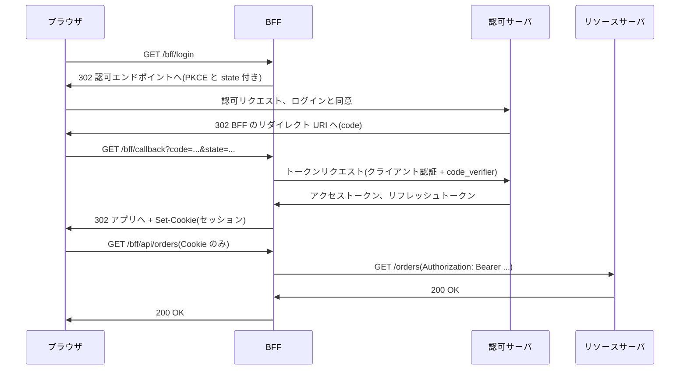
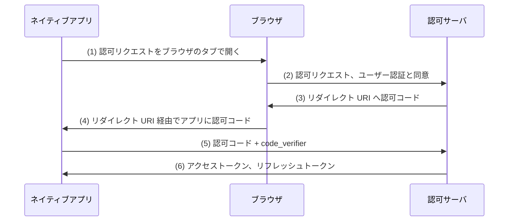

この章でわかること:

- ブラウザで動くアプリケーションがトークンを扱うと何が起こるか(RFC 10017 5節の4つの攻撃シナリオ)
- RFC 10017 の3つのアーキテクチャと、それぞれが防げる攻撃・防げない攻撃
- BFF のセッション Cookie の属性と CSRF 対策(実験で SameSite の判定を確かめる)
- ネイティブアプリが外部ユーザーエージェントを使う理由と、RFC 8252 の3種類のリダイレクト URI
- なぜ体系に必須か: [11章](/rust-impl/11-build-rp/)の RP はサーバ上で動く機密クライアントでした。実際のクライアントの多くはブラウザやスマートフォンで動き、秘密を保持できません。この章は、その環境で基礎編の対策がどこまで成り立つかを示します

## ブラウザで動くクライアント

**SPA**(single-page application)は、最初に読み込んだ1つのページの中で JavaScript が画面を書き換え、
サーバとは API 呼び出しだけでやり取りする Web アプリケーションです。RFC 10017 は、ブラウザにダウンロードされて
実行されるアプリケーションを「ブラウザベースのアプリケーション」と呼び、SPA はその別名だとしています。
ソースコードがユーザーのブラウザに配られるため、SPA は秘密を保持できない
パブリッククライアント([9章](/oidc/09-state-nonce-pkce/)、[13章](/oauth-deep/13-client-auth/))です。

ブラウザの基本的な制約は**同一オリジンポリシー**(same-origin policy)です。**オリジン**(origin)は
スキーム・ホスト名・ポートの組で、`https://app.example.com` と `https://api.example.com` は別のオリジンです。
同一オリジンポリシーは、あるオリジンのスクリプトが別のオリジンのレスポンスを読むことを制限します。
CORS([19章](/oidc-deep/19-flows/))は、サーバがレスポンスヘッダで許可したオリジンに限り、
この制限の例外を認める仕組みです。RFC 9700 2.6節は、トークンエンドポイントなどでは CORS をサポートしてもかまわない(MAY)一方、
認可エンドポイントでは CORS をサポートしてはならない(MUST NOT)としています。クライアントは認可エンドポイントに
ブラウザをリダイレクトするだけで、スクリプトから直接アクセスしないためです。

RFC 10017 4節によると、OAuth 2.0 の策定時には CORS が普及していなかったため、SPA は別オリジンの
トークンエンドポイントへ POST できず、認可コードフローを使えませんでした。これがインプリシットグラント
([19章](/oidc-deep/19-flows/))が定められた理由の1つです。CORS の普及により、SPA も認可コードと PKCE を使えるようになり、
現在はこれが推奨されています。残る問題は、取得したトークンをブラウザの中でどう扱うかです。

## RFCを読む: RFC 10017 5節

RFC 10017(2026年8月、Best Current Practice)は、ブラウザベースのアプリケーションで OAuth を使うときの
脅威と対策をまとめた文書です。BCP の番号は、ネイティブアプリの BCP である RFC 8252 と同じ BCP 212 です。
5節は、悪意ある JavaScript がアプリケーションの中で実行される状況を前提にしています。

> Malicious JavaScript poses a significant risk to browser-based applications. Attack vectors, such as cross-site scripting (XSS) or the compromise of remote code files, give an attacker the capability to run arbitrary code in the application's execution context. This malicious code is not isolated from the main application's code in any way.

(RFC 10017 5節)

この節は、悪意ある JavaScript がアプリケーションの実行環境で任意のコードを実行でき、正規のコードから
一切分離されていないことを前提にしています。経路として挙げられているのが **XSS**(cross-site scripting)と、
外部から読み込むスクリプトファイルの改ざんです。XSS は、攻撃者が用意した文字列がページに埋め込まれ、
スクリプトとして実行される脆弱性です。

原文は、まず攻撃者のコードを実行させないことが重要だとし、出力のエスケープ、第三者リソースの制限、
Subresource Integrity、nonce かハッシュに基づく CSP、オリジンの分離を挙げています。
**SRI**(Subresource Integrity)は、HTML の `script` 要素などの `integrity` 属性に、読み込むファイルのハッシュ値を書いておく仕組みです。
ブラウザは取得した内容のハッシュ値を `integrity` 属性の値と照合し、一致しなければそのファイルを実行しません。
外部の配信元でスクリプトファイルが改ざんされた場合に、改ざんされたファイルの実行を防ぎます。
**CSP**(Content Security Policy)は、ページが読み込み・実行してよいスクリプトなどのリソースを
`Content-Security-Policy` ヘッダで制限する仕組みです。[22章](/security/22-threats/)の `frame-ancestors` も CSP のディレクティブです。

そのうえで原文は、対策を尽くしても悪意あるコードの実行を完全には防げないとし、次の点を強調しています。

> When analyzing the security of browser-based applications in light of the presence of malicious JavaScript, it is crucial to realize that the *malicious JavaScript code has the same privileges as the legitimate application code*.

(RFC 10017 5節)

悪意ある JavaScript は、正規のアプリケーションコードと同じ権限を持ちます。正規のコードが参照できる変数、
呼び出せる関数、送れるリクエストは、悪意あるコードも同じように扱えます。5.1節は、この前提から4つの攻撃シナリオを導いています。

| 節 | シナリオ | 攻撃者がすること | 有効な対策 |
| --- | --- | --- | --- |
| 5.1.1 | 1回限りのトークン窃取 | 保存場所からトークンを読み、攻撃者のサーバに送る | 短い寿命、狭いスコープ、ローテーション、送信者制約 |
| 5.1.2 | 継続的なトークン窃取 | 一定間隔で最新のトークンを送り続ける | 短い寿命とローテーションは無効 |
| 5.1.3 | 新しいトークンの取得 | 隠し iframe でサイレントな認可コードフローを実行し、新しいトークンを得る | フロントエンドの対策はない |
| 5.1.4 | ブラウザ経由の代理リクエスト | アプリの中からリソースサーバへリクエストを送る | アプリケーションレベルの対策はない |

5.1.2節は、攻撃者が最新のリフレッシュトークンを盗んだ後にアプリのトークンを消去すれば、
アプリは最新のトークンを使わず、再利用検知([15章](/oauth-deep/15-refresh-tokens/))が機能しないと指摘しています。

最も影響が大きいのは 5.1.3節です。攻撃者は既存のトークンを使わず、アプリのオリジンで隠し iframe を作り、
認可サーバとのユーザーのセッションを使ってサイレントな認可コードフローを実行します。
リダイレクト URI のページは同一オリジンなので、攻撃者のコードは iframe の URL から認可コードを読めます。

> There are no practical security mechanisms for frontend applications that counter this attack scenario. Short access token lifetimes and refresh token rotation are ineffective, since the attacker has a fresh, independent set of tokens. Advanced security mechanism, such as DPoP [RFC9449], are equally ineffective, since the attacker can use their own key pair to set up and use DPoP for the newly obtained tokens.

(RFC 10017 5.1.3節)

この節は、新しいトークンを取得するシナリオに対して、フロントエンドアプリケーションに実用的な対策がないことを述べています。
攻撃者は独立した新しいトークンを持つため、短い寿命もローテーションも効果がありません。
DPoP([16章](/oauth-deep/16-sender-constrained/))も、攻撃者が自分の鍵ペアで DPoP を設定できるため効果がありません。
パブリッククライアントの安全性は、リダイレクト URI とアプリのオリジンだけに依存しているからです。
この結論が、次に読む3つのアーキテクチャの比較の基準になります。

## RFCを読む: RFC 10017 6節

> There are three main architectural patterns available when building browser-based applications that rely on OAuth for accessing protected resources:
>
> *  A browser-based application that relies on a backend component for handling OAuth responsibilities and forwards all requests through the backend component ("Backend for Frontend" or "BFF")
> *  A browser-based application that relies on a backend component for handling OAuth responsibilities but calls resource servers directly using the access token (token-mediating backend)
> *  A browser-based application acting as the client, handling all OAuth responsibilities in the browser (browser-based OAuth client)

(RFC 10017 6節)

この節は、ブラウザベースのアプリケーションの3つのアーキテクチャを、安全性の高い順に挙げています。

- **BFF**(Backend for Frontend): サーバ側のコンポーネントが機密クライアントとして OAuth のすべてを担当し、トークンを Cookie のセッションに結びつけて保持し、リソースサーバへのリクエストをすべて中継します(6.1節)
- **トークン仲介バックエンド**(token-mediating backend): サーバ側のコンポーネントが機密クライアントとしてトークンを取得し、アクセストークンだけをブラウザのアプリに渡します。アプリはリソースサーバを直接呼び出します(6.2節)
- **ブラウザ内 OAuth クライアント**(browser-based OAuth client): ブラウザのアプリがパブリッククライアントとして OAuth のすべてを担当します(6.3節)

BFF のフローを図にすると次のとおりです。原文の図1の (A)〜(L) を、ログインと API 呼び出しに絞っています。



ブラウザと BFF の間では Cookie だけが送受信され、トークンは BFF の外に出ません。図の最後の2往復は次のメッセージです。

```http
GET /bff/api/orders HTTP/1.1
Host: app.example.com
Cookie: __Host-Http-session=Zm9vYmFyLWR1bW15LXNlc3Npb24
X-Requested-With: bff
```

```http
GET /orders HTTP/1.1
Host: api.example.com
Authorization: Bearer mF_9.B5f-4.1JqM
```

各節の脅威分析(6.1.4、6.2.4、6.3.4節)を、5節のシナリオとの対応表にまとめると次のとおりです。

| シナリオ | BFF | トークン仲介バックエンド | ブラウザ内 OAuth クライアント |
| --- | --- | --- | --- |
| 5.1.1 / 5.1.2 トークン窃取 | 防げる(トークンがない) | アクセストークンは盗まれる。リフレッシュトークンは防げる | 盗まれる |
| 5.1.3 新しいトークンの取得 | 防げる(機密クライアント) | 防げる(機密クライアント) | 防げない |
| 5.1.4 代理リクエスト | 防げない | 防げない | 防げない |

BFF とトークン仲介バックエンドが 5.1.3 を防げるのは、攻撃者が認可コードを得ても、クライアント認証の資格情報がないため
交換できないからです。5.1.4 はどのアーキテクチャでも防げません。原文は、これはブラウザアプリケーションに固有の問題で、
悪意あるコードの実行そのものを止める以外に対策がないとしています。HttpOnly のセッション Cookie を使う従来の
サーバ側 Web アプリケーションでも同じ攻撃が成立します。

原文は 6.1.4.3節で BFF を「業務アプリケーション、機密性の高いアプリケーション、個人データを扱うアプリケーション」に
強く推奨し、6.3.4.3節でブラウザ内 OAuth クライアントをそれらには推奨しないとしています。
トークン仲介バックエンドは、BFF を使えない事情がある場合にだけ検討するものとされています(6.2.4.4節)。

## RFCを読む: RFC 10017 6.1.3.2節

BFF の安全性は、ブラウザと BFF の間のセッション Cookie に依存します。6.1.3.2節は、その属性を定めています。

> *  The BFF MUST enable the Secure flag for its cookies.
> *  The BFF MUST enable the HttpOnly flag for its cookies.
> *  The BFF SHOULD enable the SameSite=Strict flag for its cookies.
> *  The BFF SHOULD set its cookie path to /.
> *  The BFF SHOULD NOT set the Domain attribute for cookies.
> *  The BFF SHOULD start the name of its cookie with a prefix indicating the cookie was set via HTTP, for example, by using the __Host-Http- prefix defined in [COOKIES].

(RFC 10017 6.1.3.2節)

この節は、BFF の Cookie の属性を定めています。Secure と HttpOnly を必ず付け(MUST)、SameSite=Strict を付け、
Path を `/` にし(SHOULD)、Domain 属性を付けず(SHOULD NOT)、Cookie 名を HTTP で設定されたことを示す接頭辞
(例えば `__Host-Http-`)で始めるべきです(SHOULD)。Secure・HttpOnly・SameSite は [1章](/web-auth/01-http-auth/)で説明した属性です。
原文は、SHOULD の項目を MUST にしなかったのは既存の構成が準拠できるようにするためで、新しい構成では
すべてを満たすのが容易だとしています。

Cookie 名の接頭辞は、Cookie 仕様の改訂版(RFC 6265 を改訂する Internet-Draft で、RFC 10017 は
draft-ietf-httpbis-layered-cookies-02 を参照しています)が定める仕組みです。ブラウザは、名前が特定の接頭辞で始まる Cookie に
追加の条件を課し、条件を満たさない Set-Cookie を保存しません。
名前が `__Host-` で始まる Cookie を **Host プレフィックス**(`__Host-` prefix)付きの Cookie と呼びます。
条件は、Secure 属性を持ち、セキュアなオリジンから設定され、Domain 属性を持たず、Path が `/` であることです。
Domain 属性がないため、Cookie は設定したホストにだけ送られ、サブドメインからの上書きもできません。
`__Host-Http-` は、これに加えて HttpOnly を持ち、HTTP の Set-Cookie で設定されたこと(スクリプトで設定されていないこと)を条件にします。
原文は、この接頭辞がサブドメインとの Cookie の共有を防ぎ、サブドメインを使ったセッションハイジャックや
セッション固定攻撃([11章](/rust-impl/11-build-rp/))を防ぐと述べています。

### CSRF と SameSite の限界

ブラウザは BFF への Cookie を自動で送るため、BFF は CSRF を防がなければなりません(6.1.3.3節、MUST)。
SameSite=Strict は他サイトからのリクエストに Cookie を付けさせない属性ですが、判定の単位は
**サイト**(site)であり、オリジンではありません。RFC 10017 はサイトを eTLD+1、つまり `example.com` のように
公開サフィックスの1つ下までの登録可能なドメインとして説明しています。

> For example, subdomains such as https://a.example.com and https://b.example.com are considered to be same site because they share the same site example.com. They are considered to be cross-origin because origins consist of the tuple <scheme, hostname, port>. As a result, a subdomain-takeover attack against b.example.com can enable CSRF attacks against the BFF of a.example.com.

(RFC 10017 6.1.3.3.1節)

この段落は、サブドメインどうしは別オリジンだが同一サイトであり、`b.example.com` を乗っ取られると
`a.example.com` の BFF への CSRF が可能になることを述べています。SameSite はこの場合に効果がありません。

原文は追加の対策として CORS を挙げています(6.1.3.3.2節)。CORS は、スクリプトからの別オリジンへのリクエストのうち、
カスタムヘッダを含むものについて、**プリフライト**(preflight)と呼ばれる事前の OPTIONS リクエストで
サーバの許可を確かめます。許可がなければブラウザは本来のリクエストを送りません。
ただし、フォームの POST のような CORS-safelisted なリクエストはプリフライトなしに送られます。
このため原文は、BFF はアプリにカスタムリクエストヘッダ(例えば `My-Static-Header: 1`)を付けさせるべきであり(SHOULD)、
その場合はすべてのリクエストがそのヘッダを持つことを確かめなければならない(MUST)としています。
上の HTTP の例の `X-Requested-With: bff` はこの静的なヘッダです。

### 実験: 接頭辞の規則と SameSite の判定

BFF の Set-Cookie を組み立て、ブラウザ側の規則を関数で再現して確かめます。[2] は接頭辞の条件を満たさない Cookie を
ブラウザが破棄するかを、[3] は SameSite の値ごとに、どのリクエストに Cookie が付くかを判定します。
サイトの判定は、公開サフィックスの一覧を使わず末尾2ラベルで近似しています。このコードは仕様の規則を関数で再現したものであり、
実際のブラウザでの判定ではありません。

[3] は SameSite の条件だけで判定しています。実際のブラウザでは、fetch の `credentials` オプションも Cookie を付けるかどうかを決めます。
既定値の `same-origin` では、クロスオリジンの fetch に Cookie は付きません。別サブドメインからの fetch もクロスオリジンです。
CSRF を試みる攻撃者のスクリプトは `credentials: "include"` を指定できるため、[3] のクロスオリジンの fetch の行はこの指定を前提にしています。

<RustPlay snippet="ch24/cookie-attrs" title="BFF の Cookie: 接頭辞と SameSite" />

手元で実行した結果の [3] は次のとおりです。

```text
SameSite の条件だけで判定。(include) は fetch に credentials: "include" を指定した場合
Strict   Lax      None
送る     送る     送る     同一オリジンの fetch
送らない 送る     送る     他サイトのリンクから GET で遷移
送らない 送らない 送る     他サイトのフォームから POST
送らない 送らない 送る     他サイトのスクリプトから fetch(include)
送る     送る     送る     同一サイトの別サブドメインから fetch(include)
```

[2] では、Domain 属性付き、Path が `/app`、http のオリジン、スクリプトからの設定の4つの `__Host-` 系 Cookie が破棄され、
接頭辞のない `session` は http のオリジンでも Domain 付きで保存されています。接頭辞は、サーバの設定ミスを
ブラウザが拒否する仕組みです。[3] の最終行は、`b.example.com` から `credentials: "include"` を指定した fetch に、Strict でも Cookie が付くことを示しています。
これは RFC 10017 6.1.3.3.1節が指摘する状況です。SameSite だけでは CSRF 対策として不十分な場合があるため、
カスタムヘッダと CORS を組み合わせます。

## トークンの保存場所とサードパーティ Cookie

トークン仲介バックエンドとブラウザ内 OAuth クライアントでは、ブラウザがトークンを保持します。
RFC 10017 8節は保存場所を比較し、悪意あるコードは正規のコードと同じ方法でトークンを提供元(認可サーバや
トークン仲介バックエンド)に要求できるため、完全に隔離された保存場所でもその脅威には対処できないと述べています。
そのうえで、保存場所ごとの性質を次のように整理しています。

- JavaScript から Cookie にトークンを保存する方法は推奨されません(NOT RECOMMENDED)。Cookie はそのドメインへのすべてのリクエストに自動で付くため、意図しない送信が起こります
- メモリ上の保存は、ページの再読み込みで失われますが、露出を現在の実行環境に限ります。クロージャで隠しても、プロトタイプの書き換えで外部の関数を差し替えられると漏れます
- localStorage・sessionStorage・IndexedDB は永続的で、同一オリジンのすべてのコードから読めます

ブラウザ内 OAuth クライアントのトークン更新には、かつて隠し iframe でのサイレント認証がよく使われました。
この方法は認可サーバのセッション Cookie を iframe から送れることを前提にしており、
サードパーティ Cookie([21章](/oidc-deep/21-logout-session/))を制限するブラウザでは機能しません。
RFC 10017 6.3.2.3節は、この影響でリフレッシュトークンの利用が有力な選択肢になったと述べ、ブラウザベースのアプリに
リフレッシュトークンを発行する認可サーバに次の要請を課しています。

> *  MUST either rotate refresh tokens on each use OR use sender-constrained refresh tokens as described in Section 4.14.2 of [RFC9700]
> *  MUST either set a maximum lifetime on refresh tokens OR expire if the refresh token has not been used within some amount of time
> *  MUST NOT, upon issuing a rotated refresh token, extend the lifetime of the new refresh token beyond the lifetime of the initial refresh token if the refresh token has a preestablished expiration time

(RFC 10017 6.3.2.3節)

この節は、ブラウザベースのアプリに発行するリフレッシュトークンについて、認可サーバに3つの要請を課しています。
使用のたびにローテーションするか送信者制約にしなければならず(MUST)、最大の寿命を設けるか一定期間使われなければ
失効させなければなりません(MUST)。3つ目の要請は、リフレッシュトークンにあらかじめ有効期限が設定されている場合の規定で、
ローテーションで発行する新しいトークンの寿命を最初のトークンの寿命より延ばしてはなりません(MUST NOT)。
原文の例では、8時間のリフレッシュトークンで開始すると、10分後のローテーションで発行されるトークンの寿命は7時間50分になり、
最初の認可から8時間が経つとリフレッシュトークンによる更新は失敗します。アプリは認可コードフローを開始し直さなければならず、
そのフローはユーザーの認証か、すでに確立した認可サーバとのセッションに依拠します。盗まれたリフレッシュトークンが無期限に使われることを防ぐ規則で、
[15章](/oauth-deep/15-refresh-tokens/)の絶対有効期限にあたります。

## ネイティブアプリと外部ユーザーエージェント

**ネイティブアプリ**(native app)は、ユーザーが端末にインストールして実行するアプリケーションです。
RFC 8252(2017年10月、BCP 212)は、ネイティブアプリで OAuth を使うための BCP で、RFC 6749 を更新しています。
RFC 8252 8.4節によると、ネイティブアプリは、動的クライアント登録([13章](/oauth-deep/13-client-auth/))のような仕組みで
インスタンスごとの秘密を配布する場合を除き、パブリッククライアントに分類されます。8.5節は、
複数のユーザーに配布するアプリに静的に含めた秘密は、ユーザーが自分のコピーを調べれば分かるため、秘密として扱うべきではないとしています。
SPA と同じくパブリッククライアントであることに加えて、認可リクエストをどの画面で表示するかという別の問題があります。

RFC 8252 3節は、2種類のユーザーエージェントを区別しています。**外部ユーザーエージェント**(external user-agent)は、
アプリとは別のセキュリティ領域にあり、アプリが Cookie の保存場所にアクセスできず、ページの内容を読むことも変更することもできない
ユーザーエージェントです。典型は端末の既定のブラウザです。**埋め込みユーザーエージェント**(embedded user-agent)は、
アプリの一部として動作し、アプリが Cookie やページの内容にアクセスできるユーザーエージェントで、
アプリに埋め込む Web 表示部品である **WebView**(web-view)で実装されることが多いものです。
両者の中間に、**アプリ内ブラウザタブ**(in-app browser tab)があります。アプリの画面の中に表示されますが、
ブラウザのセキュリティ特性と認証状態を保持するブラウザのタブです。

> To conform to this best practice, native apps MUST use an external user-agent to perform OAuth authorization requests. This is achieved by opening the authorization request in the browser (detailed in Section 6) and using a redirect URI that will return the authorization response back to the native app (defined in Section 7).

(RFC 8252 5節)

この節は、ネイティブアプリは認可リクエストを外部ユーザーエージェントで行わなければならない(MUST)と定めています。
アプリはブラウザで認可リクエストを開き、認可レスポンスをアプリに戻すリダイレクト URI を使います。
6節は、アプリ内ブラウザタブが使えるプラットフォームでは、使い勝手のためにそれを使うことを推奨しています(RECOMMENDED)。

埋め込みユーザーエージェントを禁止する理由は 8.12節にあります。原文は、ネイティブアプリは認可リクエストに
埋め込みユーザーエージェントを使ってはならない(MUST NOT)としています。理由として、WebView を使う典型的な実装では、
ホストのアプリがログインフォームへの入力をすべて記録できること、フォームを自動送信して同意を迂回できること、
セッション Cookie をコピーしてユーザーとして操作できることを挙げています。OAuth の目的は、アプリに限定された権限だけを渡し、
パスワードは渡さないことでした([2章](/web-auth/02-delegation/))。埋め込みユーザーエージェントでは、
アプリが資格情報そのものを取得できるため、この目的が成り立ちません。さらに、アドレスバーのない画面で資格情報を入力させることは、
正規のサイトかどうかを確かめずに入力する習慣をユーザーに与えます。



図は RFC 8252 の図1を写したものです。(4) で認可コードをアプリに戻す方法が、次の節で読む3種類のリダイレクト URI です。
6節は、パブリックなネイティブアプリは PKCE を実装しなければならず(MUST)、認可サーバはそれをサポートしなければならない(MUST)としています。
(4) の経路で他のアプリが認可コードを受け取る可能性があるためです([9章](/oidc/09-state-nonce-pkce/)の認可コード横取り攻撃)。

## RFCを読む: RFC 8252 7節

7節は、認可サーバがネイティブアプリに3種類のリダイレクト URI をすべて提供しなければならない(MUST)とし、
アプリはプラットフォームに応じてどれを使ってもかまわない(MAY)としています。

### 7.1節: プライベートユース URI スキーム

アプリが OS に登録した独自のスキーム([9章](/oidc/09-state-nonce-pkce/)のカスタム URI スキーム)を使う方法です。
RFC 8252 はこれを**プライベートユース URI スキーム**(private-use URI scheme)と呼んでいます。

> When choosing a URI scheme to associate with the app, apps MUST use a URI scheme based on a domain name under their control, expressed in reverse order, as recommended by Section 3.8 of [RFC7595] for private-use URI schemes.

(RFC 8252 7.1節)

この節は、アプリが自分の管理するドメイン名を逆順にしたスキームを使わなければならない(MUST)と定めています。
`app.example.com` を管理するアプリは `com.example.app` を使い、`myapp` のようなドメイン名に基づかないスキームは
この要件を満たしません。原文の完全な例は `com.example.app:/oauth2redirect/example-provider` で、
スキームの後のスラッシュは1つだけです(命名権限がないため RFC 3986 3.2節に従います)。
OAuth 2.1(draft-ietf-oauth-v2-1-16)2.3.1節は、認可サーバがピリオドを含まないプライベートユース URI スキームを
拒否すべきだ(SHOULD)としています。ドメイン名に基づくスキームは、2つのアプリが同じスキームを登録したときに、
ドメインの所有者がアプリストアに偽物の削除を求める根拠にもなります。

### 7.2節: claimed https スキーム URI

一部の OS は、アプリがドメインの所有を証明したうえで、そのドメインの https の URI を自分宛てのものとして登録(claim)できるようにしています。
ブラウザがその URI を開くと、ページを読み込む代わりにアプリが起動します。RFC 8252 はこれを
**claimed https スキーム URI**(claimed "https" scheme URI)と呼んでいます。Apple のプラットフォームでは
**Universal Links**、Android では **App Links** という名前で提供されている機能です。

> App-claimed "https" scheme redirect URIs have some advantages compared to other native app redirect options in that the identity of the destination app is guaranteed to the authorization server by the operating system. For this reason, native apps SHOULD use them over the other options where possible.

(RFC 8252 7.2節)

この節は、claimed https のリダイレクト URI は、宛先のアプリの同一性を OS が認可サーバに保証する点で他の方法より利点があり、
可能な場合はこれを使うべきだ(SHOULD)と定めています。プライベートユース URI スキームは複数のアプリが同じスキームを登録できるため
(8.1節)、どのアプリが認可コードを受け取るかが定まりません。ただし原文は、claimed https でもアプリはパブリッククライアントであり、
URI は OS のディスパッチ処理を経由するとして、PKCE を不要にはしていません。

### 7.3節: ループバックインタフェース

デスクトップの OS のように、特別な権限なしにループバックインタフェースでポートを開けるアプリは、
`http://127.0.0.1:{port}/{path}`(IPv6 では `http://[::1]:{port}/{path}`)をリダイレクト URI にできます。
アプリが一時的な HTTP サーバとして認可レスポンスを受け取る方法で、これを**ループバックリダイレクト**(loopback redirect)と呼びます。

> The authorization server MUST allow any port to be specified at the time of the request for loopback IP redirect URIs, to accommodate clients that obtain an available ephemeral port from the operating system at the time of the request.

(RFC 8252 7.3節)

この節は、認可サーバがループバック IP のリダイレクト URI について、リクエスト時に任意のポートの指定を許さなければならない(MUST)と
定めています。アプリはリクエストのたびに OS から空いている一時ポートを取得するため、登録時にポートを決められないからです。
[22章](/security/22-threats/)で読んだ RFC 9700 4.1.3節の、完全一致の唯一の例外はこの規定です。

8.3節は補足として、ループバックの http は TLS を使いませんが、リクエストが端末の外に出ないため許容されること、
ポートは認可リクエストの開始時に開いて応答を受けたら閉じるべきこと、`localhost` の使用は推奨されず
(NOT RECOMMENDED)ループバックの IP リテラルを使うことを述べています。`localhost` は名前解決の設定によって
ループバック以外のインタフェースで待ち受ける可能性があるためです。

### 実験: ループバックでリダイレクトを受け取る

ネイティブアプリの動作を1つのプロセスで再現します。[1] は認可サーバの登録時の検査です。この実験の認可サーバは、
NOT RECOMMENDED とされる `localhost` も登録時に拒否する方針にしています。[2] でアプリは `127.0.0.1:0` に bind して
OS からポートを得て、そのポートを含むリダイレクト URI と PKCE(S256)付きの認可リクエストを作ります。
認可サーバはポート以外の完全一致で照合し、Location を返します。比較のため、`/x/../` を含む未登録のパスも照合します。
[3] でブラウザ役のスレッドが実際に TCP でループバックに接続して GET を送り、アプリは state を照合して待ち受けを閉じます。
state が一致しなければ、アプリは認可コードを破棄して 400 を返し、フローをエラーで終えます。ポート番号・state・code_challenge は実行ごとに変わります。

<RustPlay snippet="ch24/loopback-redirect" title="ループバックリダイレクトで認可コードを受け取る" />

手元で実行した結果の例は次のとおりです(長い URL は省略しています)。

```text
[1] 登録時の検査
  登録可   http://127.0.0.1/oauth2redirect/example-provider
  登録可   com.example.app:/oauth2redirect/example-provider
  登録不可 myapp:/oauth2redirect: ドメイン名に基づかないスキーム(ピリオドを含まない)
  登録不可 http://localhost/oauth2redirect: localhost ではなくループバック IP リテラルを使う
  登録不可 http://192.168.1.10:8080/oauth2redirect: http はループバック以外では使えない

[2] アプリが待ち受けを開始: 127.0.0.1:53228
  認可サーバの照合: 許可(ポート以外が完全一致)
  未登録のパスの照合: 拒否  http://127.0.0.1:53228/x/../oauth2redirect/example-provider
  302 Found  Location: http://127.0.0.1:53228/oauth2redirect/example-provider?code=SplxlOBeZQQYbYS6WxSbIA&state=...

[3] アプリが受信: GET /oauth2redirect/example-provider?code=SplxlOBeZQQYbYS6WxSbIA&state=... HTTP/1.1
  state の照合: 一致
  ブラウザが受けた応答: HTTP/1.1 200 OK
  code = SplxlOBeZQQYbYS6WxSbIA
  待ち受けを閉じた。次はトークンリクエストに code_verifier を付けて送る
```

[1] の5行目は、RFC 9700 2.6節の「ループバック以外の http リダイレクト URI を許可してはならない(MUST NOT)」の適用です。
[2] で登録値にはポートがありませんが、リクエストの `53228` を含む URI が許可されています。
`/x/../` を含む URI は拒否されています。照合は、届いた文字列からポート番号だけを取り除いた値で行い、URL を解析して正規化した値は使わないためです。
正規化してから比べると、この URI は `/oauth2redirect/example-provider` になり、登録値と一致してしまいます。
[3] は、ブラウザからループバックに届いた実際の HTTP リクエストの1行目です。アプリは state が一致した場合にだけ
認可コードを使い、待ち受けを閉じた後に code_verifier を付けてトークンリクエストを送ります。Rust Playground 上でもループバックの TCP 接続は動作しました。

ループバックリダイレクトにも、8.1節が指摘する限界があります。OS によっては、同じループバックインタフェースに
アクセスできる他のアプリが通信を傍受できます。ここでも、認可コードを受け取った他のアプリが交換できないように
するのは PKCE です。

## まとめ

- ブラウザで動くアプリケーションでは、悪意ある JavaScript が正規のコードと同じ権限を持ちます。RFC 10017 は、トークン窃取(1回限りと継続的)、新しいトークンの取得、ブラウザ経由の代理リクエストの4つのシナリオを示します
- 新しいトークンの取得(5.1.3節)には、短い寿命・ローテーション・DPoP のどれも効果がありません。防げるのは、機密クライアントとしてトークンを取得する BFF とトークン仲介バックエンドです
- BFF はトークンをブラウザに一切渡さないため、トークン窃取も防ぎます。RFC 10017 は業務・機密・個人データを扱うアプリに BFF を強く推奨します。ブラウザ経由の代理リクエストは、どのアーキテクチャでも防げません
- BFF の Cookie は Secure と HttpOnly を必須とし、SameSite=Strict、Path=/、Domain なし、`__Host-Http-` 接頭辞を推奨します。SameSite は同一サイトのサブドメインからの CSRF を防げないため、カスタムヘッダと CORS を組み合わせます
- ブラウザベースのアプリのリフレッシュトークンには、ローテーションか送信者制約のどちらか、最大寿命か未使用期間による失効のどちらかが MUST です。有効期限が設定されている場合は、ローテーションで寿命を延長してはなりません(MUST NOT)
- ネイティブアプリは外部ユーザーエージェントで認可リクエストを行わなければならず、埋め込みユーザーエージェントを使ってはなりません。リダイレクト URI はプライベートユース URI スキーム(逆順ドメイン名)、claimed https(推奨)、ループバック(ポートは任意)の3種類で、いずれも PKCE が必須です

次章は、ここまでの BCP の推奨事項を必須の要件としてまとめたプロファイルを扱います。
OAuth 2.1 で何が変わるかと、FAPI 2.0 Security Profile が PAR・PKCE・送信者制約・クライアント認証をどう組み合わせて
攻撃者モデルに対する安全性を示しているかを読みます。
