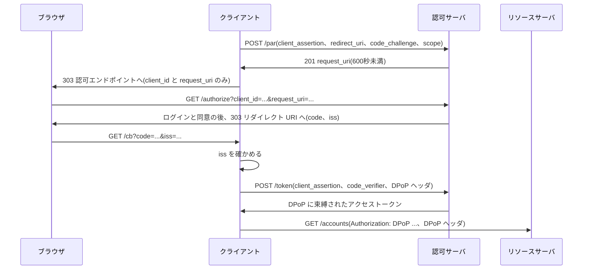

この章でわかること:

- OAuth 2.1 が RFC 6749 から削除し、必須にしたもの(同じリクエストを2つの認可サーバに送って比べる)
- FAPI 2.0 が攻撃者モデルとセキュリティ目標から要件を導き、形式解析で安全性を示す方法
- FAPI 2.0 Security Profile の主要な要件(PAR、PKCE S256、送信者制約、クライアント認証、iss)と、それぞれが防ぐ攻撃
- Message Signing が加える否認防止と、適合性テスト・OpenID 認定の位置づけ
- なぜ体系に必須か: 22〜24章の BCP は推奨の集合で、どれを採用するかは実装者に委ねられています。プロファイルは選択肢を固定し、組み合わせ全体の安全性を検証できるようにします。プロファイルは、本書の対策を1つの構成にまとめたものです

## 選択肢を減らすという設計

RFC 6749 は、自らを「フレームワーク」と呼んでいます。グラントの種類、クライアント認証の方法、
トークンの形式、リダイレクト URI の比較方法など、多くの点を実装と運用に委ねています。
[22章](/security/22-threats/)の RFC 9700 は、その中で安全な選択肢を推奨しましたが、推奨の多くは SHOULD であり、
どれを組み合わせるかは依然として実装者が決めます。選択肢が多いことには2つの問題があります。
1つは、組み合わせによって安全性が変わり、すべての組み合わせを検証できないことです。
もう1つは、相互接続のために双方が多くの選択肢を実装しなければならないことです。

**セキュリティプロファイル**(security profile)は、基盤となる仕様の選択肢を限定し、推奨を必須に変えた
要件の集合です。プロファイルに準拠した実装どうしは、選択肢の交渉なしに接続でき、安全性の分析も
限定された1つの構成について行えます。この章は、性質の異なる2つの仕様を読みます。

- OAuth 2.1 は、RFC 6749 と後続の RFC・BCP を統合し、OAuth の基盤仕様そのものから危険な選択肢を取り除く改訂です
- FAPI 2.0 は、OAuth 2.0 の上に定義された高セキュリティ向けのプロファイルで、攻撃者モデルに対する形式解析を伴います

## OAuth 2.1 の現況

**OAuth 2.1** は、IETF の OAuth ワーキンググループが策定中の、OAuth 2.0 の改訂版の認可フレームワークです。
本書が参照する版は Internet-Draft の draft-ietf-oauth-v2-1-16(2026年9月3日付、有効期限2027年3月7日)で、
確認日は2026年10月16日です。RFC にはなっていないため、節番号や要件は今後の版で変わる可能性があります。

## RFCを読む: draft-ietf-oauth-v2-1-16 10節

10節は、OAuth 2.0 との違いをまとめています。

> This draft consolidates the functionality in OAuth 2.0 [RFC6749], OAuth 2.0 for Native Apps [RFC8252], Proof Key for Code Exchange [RFC7636], OAuth 2.0 for Browser-Based Apps [I-D.ietf-oauth-browser-based-apps], OAuth Security Best Current Practice [RFC9700], and Bearer Token Usage [RFC6750].

(draft-ietf-oauth-v2-1-16 10節)

この節は、OAuth 2.1 が RFC 6749、RFC 8252、RFC 7636、ブラウザベースのアプリの BCP、RFC 9700、RFC 6750 の機能を
1つの文書に統合したものであることを述べています。引用中の [I-D.ietf-oauth-browser-based-apps] は、
2026年8月に RFC 10017([24章](/security/24-browser-native/))として発行された文書です。draft-16 はドラフト名のまま参照しています。

続く非規範的な変更点の一覧は次のとおりです(原文の順に、本書の章と対応づけています)。

> *  The authorization code grant is extended with the functionality from PKCE [RFC7636] such that the default method of using the authorization code grant according to this specification requires the addition of the PKCE parameters
> *  Redirect URIs must be compared using exact string matching as per Section 4.1.3 of [RFC9700]
> *  The Implicit grant (response_type=token) is omitted from this specification as per Section 2.1.2 of [RFC9700]
> *  The Resource Owner Password Credentials grant is omitted from this specification as per Section 2.4 of [RFC9700]
> *  Bearer token usage omits the use of bearer tokens in the query string of URIs as per Section 4.3.2 of [RFC9700]
> *  Refresh tokens for public clients must either be sender-constrained or one-time use as per Section 4.14.2 of [RFC9700]
> *  The token endpoint request containing an authorization code no longer contains the redirect_uri parameter
> *  Authorization servers must support client credentials in the request body
> *  The PKCE plain method is removed

(draft-ietf-oauth-v2-1-16 10節)

この一覧は、OAuth 2.1 が RFC 6749 から変える9つの点を挙げています。

- 認可コードグラントの既定の使い方に PKCE のパラメータが含まれます([9章](/oidc/09-state-nonce-pkce/))
- リダイレクト URI は完全一致で比較します([22章](/security/22-threats/))
- インプリシットグラント(`response_type=token`)は削除されます([19章](/oidc-deep/19-flows/))
- ROPC グラントは削除されます([20章](/oidc-deep/20-other-grants/))
- Bearer トークンをクエリ文字列に入れる方法は削除されます([4章](/web-auth/04-tokens/))
- パブリッククライアントのリフレッシュトークンは、送信者制約か1回限りの使用にします([15章](/oauth-deep/15-refresh-tokens/))
- 認可コードのトークンリクエストに redirect_uri を含めなくなります
- 認可サーバは、リクエスト本文でのクライアント資格情報(client_secret_post)をサポートします([13章](/oauth-deep/13-client-auth/))
- PKCE の plain メソッドは削除されます

いずれも、本書で個別に読んだ RFC と BCP の結論を基盤仕様に取り込んだものであり、新しい機構ではありません。
新しい点は、BCP では SHOULD だった項目の一部が、OAuth 2.1 に準拠するための条件になることです。
OpenID Connect の `response_type=id_token` のような拡張のレスポンスタイプには影響しないことを、10.1節が明記しています。

### 認可コードのトークンリクエストから redirect_uri が消える理由

10.2節は、トークンリクエストの redirect_uri の削除を説明しています。RFC 6749 4.1.3節([3章](/web-auth/03-authorization-code/))で
redirect_uri をトークンリクエストに含めたのは、認可コードインジェクションを防ぐためでした。OAuth 2.1 では
code_challenge と code_verifier がこの攻撃を防ぐため、トークンリクエストに redirect_uri を含める必要がなくなり、削除されました。
ただし、OAuth 2.0 と 2.1 の両方のクライアントを扱う認可サーバは、トークンリクエストの redirect_uri を受け付け、
送られた場合は RFC 6749 のとおりに検査しなければなりません(MUST)。OAuth 2.1 の推奨だけに従うクライアントは
redirect_uri を送らないため、それを要求する古い認可サーバとは接続できない、と原文は注意しています。

## RFCを読む: draft-ietf-oauth-v2-1-16 7.5.1.1節と7.5.2節

PKCE を必須にする要件は、7.5.1.1節にあります。

> To prevent injection of authorization codes into the client, using code_challenge and code_verifier is REQUIRED for clients, and authorization servers MUST enforce their use, unless both of the following criteria are met:
>
> *  The client is a confidential client.
> *  In the specific deployment and the specific request, there is reasonable assurance by the authorization server that the client implements the OpenID Connect nonce mechanism properly.

(draft-ietf-oauth-v2-1-16 7.5.1.1節)

この節は、認可コードのクライアントへのインジェクションを防ぐため、クライアントは code_challenge と code_verifier を
使わなければならず(REQUIRED)、認可サーバはその使用を強制しなければならない(MUST)と定めています。
例外は、クライアントが機密クライアントであり、かつ認可サーバがそのクライアントの nonce の実装を
合理的に確信できる場合だけです。その場合でも PKCE の使用は推奨されます(RECOMMENDED)。

同じ節は、nonce より PKCE を優先する理由を述べています。nonce の検証はクライアントの中で行われるため、
認可サーバはクライアントが実際に検証しているかを確かめられません。インジェクションされた認可コードも
トークンに交換され、クライアントは ID トークンの nonce を確かめた後で初めて拒否します。PKCE は認可サーバが強制するため、
インジェクションを検出した時点でトークンを発行しません。この違いは、[9章](/oidc/09-state-nonce-pkce/)で
「PKCE は機密クライアントにも使う」とした根拠の1つです。

7.5.2節は plain を禁止します。

> The plain code challenge method, defined in [RFC7636], is explicitly forbidden in OAuth 2.1. The plain method offers no protection against authorization code interception by attackers who can read the authorization request (Attacker A4 in [RFC9700]), as the code verifier is transmitted in plaintext in the authorization request.

(draft-ietf-oauth-v2-1-16 7.5.2節)

この節は、plain が OAuth 2.1 で明示的に禁止されることと、その理由を述べています。plain では code_verifier がそのまま
認可リクエストに入るため、認可リクエストを読める攻撃者([22章](/security/22-threats/)の A4)に対して保護になりません。
原文は続けて、plain を残す歴史的な理由(ハッシュ計算ができない端末)は、TLS 1.2 以上を要求する OAuth 2.1 では成り立たないとしています。
TLS 1.2 の証明書検証に SHA-256 が必要なため、OAuth 2.1 を実装できる端末は必ず SHA-256 を計算できるからです。
さらに、plain を受け付ける認可サーバは、正当な制約のある端末と、攻撃者がダウングレードしたリクエストとを区別できません。

### 実験: OAuth 2.0 と OAuth 2.1 の認可サーバに同じリクエストを送る

RFC 6749 の時代に多かった制限の少ない認可サーバ(リダイレクト URI を前方一致で比較し、インプリシット・ROPC・plain・
クエリ文字列のトークンを受け付ける)と、OAuth 2.1 に従う認可サーバ・リソースサーバを関数として実装し、
同じリクエストを送ります。パブリッククライアントからのリクエストを想定しています。

<RustPlay snippet="ch25/oauth21-check" title="OAuth 2.0 と OAuth 2.1 で受理されるリクエストの違い" />

手元で実行した結果の一部は次のとおりです。

```text
[認可] PKCE なし
  OAuth 2.0: 受理
  OAuth 2.1: 拒否 (パブリッククライアントの code_challenge がない)
[認可] redirect_uri にクエリ追加
  OAuth 2.0: 受理
  OAuth 2.1: 拒否 (redirect_uri が登録値と一致しない)
[リソース] クエリで送る
  OAuth 2.0: 受理
  OAuth 2.1: 拒否 (クエリ文字列のトークンは受け付けない)
```

8つのリクエストのうち、OAuth 2.1 の側で受理されたのは、PKCE S256 の認可リクエストと Authorization ヘッダでの
リソースアクセスの2つだけでした。拒否された6つは、それぞれ本書のどこかの章で攻撃の経路として説明したものです。
既存のクライアントを OAuth 2.1 の認可サーバに移すときは、この6種類のリクエストを送っていないかを確かめることになります。

## FAPI 2.0 の文書群

**FAPI 2.0** は、OpenID Foundation の FAPI ワーキンググループが定める、高い価値を持つ API を保護するための
OAuth 2.0 のセキュリティプロファイルです。FAPI は当初 Financial-grade API の略で、金融 API を対象に策定が始まりました。
Security Profile の序文は、医療や行政の API のような機密性の高い個人データを扱う場面にも適用できるよう設計されているとしています。
金融での主な用途は**オープンバンキング**(open banking)です。オープンバンキングは、銀行が口座情報や送金の機能を API として公開し、
顧客の同意に基づいて第三者の事業者が利用できるようにする仕組みで、いくつかの国の制度が FAPI を技術基準として採用しています。

FAPI 2.0 は、次の3つの文書からなります。いずれも OpenID Foundation の最終仕様(Final)です。

| 文書 | 公開日 | 内容 |
| --- | --- | --- |
| FAPI 2.0 Attacker Model | 2025年2月22日 | セキュリティ目標と攻撃者モデル |
| FAPI 2.0 Security Profile | 2025年2月22日 | 認可サーバ・クライアント・リソースサーバの要件 |
| FAPI 2.0 Message Signing | 2025年9月25日 | 否認防止のためのメッセージ署名 |

FAPI の文書は IETF の RFC とは要請語の定義が異なります。各文書の表記規約は、"shall"、"should"、"may" などを
ISO/IEC Directives Part 2 の意味で解釈すると定めています。本書では "shall" を
「〜しなければなりません(shall)」、"shall not" を「〜してはなりません(shall not)」、
"should" を「〜すべきです(should)」と訳し、BCP 14 の大文字の要請語と区別するため小文字で示します。

## 仕様を読む: FAPI 2.0 Attacker Model 5節〜7節

Attacker Model は、要件を導く前提として、セキュリティ目標を先に定めています。

> The FAPI 2.0 Security Profile aims to ensure that no attacker can access protected resources other than their own.

(FAPI 2.0 Attacker Model 5.2節)

この節は、認可についての目標を、どの攻撃者も自分のもの以外の保護されたリソースにアクセスできないことと定めています。
原文は、アクセストークンがリソースへのアクセスの最終的な資格情報であるため、この目標は、どの攻撃者も
他人のリソースのためのアクセストークンを入手して使用できないことと同じだとしています。
5.3節は認証の目標(どの攻撃者も他のユーザーとしてクライアントにログインできないこと)を、
5.4節はセッションの完全性(ユーザーを攻撃者の身元でログインさせたり、攻撃者のリソースを使わせたりできないこと)を定めています。
5.4節は [9章](/oidc/09-state-nonce-pkce/)のログイン CSRF にあたります。

6節は、攻撃者を能力で定義し、具体的な脅威では定義しない理由を次のように述べています。

> In order to not overlook any potential attacks, FAPI 2.0 therefore aims not to address concrete, narrow threats, but to exclude any attacks conceivable for the attacker types listed here. This is supported by a formal security analysis, see Section 9.

(FAPI 2.0 Attacker Model 6節)

この節は、潜在的な攻撃を見落とさないために、FAPI 2.0 は列挙した種類の攻撃者が考えうるすべての攻撃を排除することを目指し、
それを形式的な安全性解析で裏づけると述べています。具体的な狭い脅威への個別の対処は目標にしていません。
**形式解析**(formal security analysis)は、プロトコルと攻撃者を数学的なモデルとして記述し、
モデルの中でセキュリティ目標が常に成り立つことを証明する方法です。[22章](/security/22-threats/)で、
個別の対策を並べる方法では未知の攻撃を判断できないと述べました。FAPI 2.0 はこの問題に、
攻撃者モデルと証明で対処しています。

7節の攻撃者は、RFC 9700 3節と似ていますが、番号の付け方が異なります。

| FAPI 2.0 | 能力 | RFC 9700 での近い攻撃者 |
| --- | --- | --- |
| A1 Web 攻撃者 | 通常の Web 攻撃者。ただし正規の認可サーバの役は担えない | A1 |
| A1a 認可サーバとして参加する Web 攻撃者 | A1 に加えて、エコシステムの認可サーバとして振る舞える | A1(ミックスアップの前提) |
| A2 ネットワーク攻撃者 | ネットワーク全体を制御する | A2 |
| A3a 認可リクエストを読む | フロントチャネルの認可リクエストを読める | A4 |
| A4 トークンエンドポイントでの読み取りと改ざん | 参考としてのみ記載(FAPI 2.0 では対象外) | なし |
| A5 リソースリクエストを読む | リソースサーバが処理した後のリクエストを読める | A5 に近い |

注意すべき点は2つあります。1つ目は、RFC 9700 の A3(認可レスポンスを読む攻撃者)が FAPI 2.0 の攻撃者に含まれないことです。
原文は、現在のブラウザ技術では、認可レスポンスを読める攻撃者はほとんどのセキュリティプロトコルを破れるためだとし、
Security Profile のブラウザ交換攻撃の節を参照しています。2つ目は、A4 が FAPI 1.0 で考慮された設定ミスのトークンエンドポイントのモデルで、
FAPI 2.0 はトークンエンドポイントのアドレスを信頼できるメタデータから取得することを必須にしたため、対象外になったことです。

6節は、攻撃者モデルが正しく機能すると仮定している前提も列挙しています。TLS の接続が破られないこと、
JWKS による鍵の配布が正しく機能すること、リソースオーナーの端末とブラウザが侵害されていないことです。
ユーザーの身元確認・認証・セッション管理は、この攻撃者モデルの範囲外です。8節はこれに加えて、
推測可能な秘密、FAPI 2.0 の範囲外のシステム構成、実装の誤り、時間の経過による技術の変化を限界として挙げています。
FAPI 2.0 に準拠しても、これらは別に評価しなければなりません。

## 仕様を読む: FAPI 2.0 Security Profile 5.3節

Security Profile は、Attacker Model の目標を達成するための要件を、認可サーバ・クライアント・リソースサーバごとに定めています。
最初に、対象をパブリッククライアントを除いた範囲に限定しています。

> The OpenID FAPI Working Group is not currently aware of any mechanisms that would allow public clients to be secured to the same degree and hence their use is not within the scope of this document.

(FAPI 2.0 Security Profile 5.1.1節)

この節は、パブリッククライアントを同じ水準で保護する仕組みが現時点で知られていないため、その使用を範囲外にしていると述べています。
[24章](/security/24-browser-native/)の RFC 10017 5.1.3節で、ブラウザ内のパブリッククライアントには新しいトークンの取得を防ぐ方法がないことを読みました。
FAPI 2.0 はこの結論を、要件の範囲として採用しています。

5.3.2.1節の認可サーバの一般要件のうち、中心となる項目は次のとおりです。

> 3 shall only support confidential clients as defined in [RFC6749];
>
> 4 shall only issue sender-constrained access tokens;
>
> 5 shall use one of the following methods for sender-constrained access tokens: MTLS as described in [RFC8705], DPoP as described in [RFC9449];
>
> 6 shall authenticate clients using one of the following methods: MTLS as specified in Section 2 of [RFC8705], or private_key_jwt as specified in Section 9 of [OIDC];

(FAPI 2.0 Security Profile 5.3.2.1節)

この4項は、認可サーバが機密クライアントだけをサポートし、送信者制約付きのアクセストークンだけを発行しなければならない(shall)と定めています。
送信者制約の方法には MTLS か DPoP を、クライアント認証には MTLS か private_key_jwt を使わなければなりません(shall)。
クライアントシークレットによる認証(client_secret_basic など)は選択肢にありません。RFC 9700 2.5節が推奨した
非対称鍵によるクライアント認証([13章](/oauth-deep/13-client-auth/))と、2.2.1節が推奨した送信者制約
([16章](/oauth-deep/16-sender-constrained/))が、FAPI 2.0 では必須になっています。

5.3.2.2節は、認可エンドポイントを使うフローの要件を定めています。

> 1 shall require the value of response_type described in [RFC6749] to be code;
>
> 2 shall support client-authenticated pushed authorization requests according to [RFC9126];
>
> 3 shall reject authorization requests sent without [RFC9126];
>
> 4 shall reject pushed authorization requests without client authentication;
>
> 5 shall require PKCE [RFC7636] with S256 as the code challenge method;

(FAPI 2.0 Security Profile 5.3.2.2節)

この5項は、認可サーバが response_type を code に限り、クライアント認証付きの PAR([17章](/oauth-deep/17-request-protection/))をサポートしなければならない(shall)と定めています。
さらに、PAR を使わない認可リクエストとクライアント認証のない PAR を拒否し、S256 の PKCE を必須にしなければなりません(shall)。
クライアント側の要件(5.3.3.2節)は、これに対応して、PAR を使い、認可エンドポイントには client_id と request_uri だけを送らなければならない(shall)としています。
また、クライアントは認可レスポンスの iss パラメータを RFC 9207 に従って確かめなければなりません(shall)。

これらの要件を、防ぐ攻撃と本書の章に対応づけると次の表になります。

| 要件(節-項) | 防ぐ攻撃・目的 | 本書の章 |
| --- | --- | --- |
| 機密クライアントのみ(5.3.2.1-3) | 新しいトークンの取得、クライアントのなりすまし | [24章](/security/24-browser-native/) |
| 送信者制約(5.3.2.1-4, 5) | 漏洩したアクセストークンの使用(A5) | [16章](/oauth-deep/16-sender-constrained/) |
| MTLS か private_key_jwt(5.3.2.1-6) | 共有秘密の漏洩 | [13章](/oauth-deep/13-client-auth/) |
| 認可コードの寿命60秒以下(5.3.2.1-11)、再使用の拒否(5.3.2.2-9) | 漏洩した認可コードの使用 | [12章](/rust-impl/12-build-op/) |
| response_type=code のみ(5.3.2.2-1) | フロントチャネルでのトークン漏洩 | [19章](/oidc-deep/19-flows/) |
| PAR 必須(5.3.2.2-2〜4)、request_uri の寿命600秒未満(5.3.2.2-12) | 認可リクエストの内容の改ざんと漏洩(A3a)。request_uri の漏洩は残る(6.4節) | [17章](/oauth-deep/17-request-protection/) |
| PKCE S256(5.3.2.2-5) | CSRF、認可コードインジェクション | [9章](/oidc/09-state-nonce-pkce/) |
| iss パラメータ(5.3.2.2-7) | ミックスアップ(A1a) | [17章](/oauth-deep/17-request-protection/) |
| 307 の禁止(5.3.2.2-10)、オープンリダイレクタの禁止(5.3.2.1-7) | 資格情報の転送、レスポンスの漏洩 | [22章](/security/22-threats/) |

PAR が A3a に対して保護するのは、認可リクエストのパラメータ(redirect_uri、scope、code_challenge など)です。
これらはクライアント認証付きのバックチャネルで送られるため、攻撃者はフロントチャネルで読むことも改ざんすることもできません。
一方で、ブラウザが認可エンドポイントへ送る client_id と request_uri は、PAR を使ってもフロントチャネルを通ります。
Security Profile 6.4節は、この認可リクエストを読んだ攻撃者が、自分でその request_uri を使ってログインし、
得た認可コードを CSRF で正規のユーザーのブラウザからクライアントへ送らせる攻撃を挙げています。
ユーザーは攻撃者のリソースを使うことになり、セッションの完全性(5.4節)が破られます。原文は、リダイレクトを使う実用的なフローの
すべてがこの攻撃を受けうるとし、対策として次の3つを挙げています。

- 認可サーバが request_uri を1回しか受け付けないようにします。正規のユーザーより先に攻撃者が request_uri を使えなかった場合を防ぎます
- クライアントが、認可エンドポイントの呼び出し1回につき認可コードの交換を1回に限ります。正規のユーザーより先に攻撃者が認可レスポンスを送れなかった場合を防ぎます
- 認可コードの寿命を短くし、CSRF を行える時間を短くします

原文は、ユーザーのリクエストを完全に遮断できる攻撃者は1つ目と2つ目の対策を回避できるとも述べています。
PAR は認可リクエストの内容の漏洩と改ざんを防ぎますが、request_uri の漏洩による CSRF は、これらの対策で時間の幅を狭めるものとして残ります。

5.3.2.2節の注記4は、FAPI 2.0 では state を CSRF 防止に使わず、アプリケーションの状態を伝えるためだけに使ってよいとしています。
CSRF の防止は PKCE が担うためです。5.5節の FAPI 1.0 との比較表も、state による保護が PKCE に置き換わり、
フロントチャネルに ID トークンを返さないことで ID トークンの暗号化や分離署名が不要になったと説明しています。

### BCP と異なる要件: リフレッシュトークンのローテーション

5.3.2.1節には、BCP の推奨と逆向きに見える要件があります。認可サーバは、例外的な状況を除いてリフレッシュトークンの
ローテーションを使ってはなりません(shall not)。注記1は理由を次のように説明しています。

> The use of refresh token rotation does not provide security benefits when used with confidential clients and sender-constrained access tokens. This specification prohibits the use of refresh token rotation for security reasons as it causes user experience degradation and operational issues whenever the client fails to store or receive the new refresh token and has no option to retry.

(FAPI 2.0 Security Profile 5.3.2.1節 注記1)

この注記は、機密クライアントと送信者制約付きのアクセストークンを使う構成では、ローテーションは安全性を高めず、
新しいリフレッシュトークンの保存や受信に失敗したクライアントが再試行できなくなるため禁止すると述べています。
RFC 9700 4.14節と RFC 10017 がローテーションを求めたのは、パブリッククライアントのリフレッシュトークンについてでした
([15章](/oauth-deep/15-refresh-tokens/))。機密クライアントのリフレッシュトークンは、使用時にクライアント認証が必要なので、
盗まれただけでは使えません。同じ対策でも、前提とするクライアントの種類によって必要性が変わる例です。

### 時計のずれの許容範囲

5.3.2.1節の13項は、認可サーバが iat または nbf が0〜10秒未来の JWT を受理しなければならず、
60秒より未来のものを拒否しなければならない(shall)と定めています。注記3は、数百ミリ秒の時計のずれでも
「未来に発行された」として JWT が拒否され、相互接続の問題の多くの原因になっていると述べています。
受理の下限(10秒)で相互接続性を確保し、拒否の上限(60秒)で検査の無効化を防ぐ構造です。[8章](/oidc/08-id-token-validation/)の
leeway を、プロファイルが具体的な数値で固定した例です。

## FAPI 2.0 のフロー

Security Profile の要件に従った認可コードフローは次のとおりです。クライアント認証は private_key_jwt、
送信者制約は DPoP の場合を示しています。



フロントチャネル(ブラウザを経由するメッセージ)に現れるのは、client_id・request_uri・code・iss だけです。
認可リクエストの内容は、クライアント認証済みのバックチャネルで PAR として送られます。最初のメッセージは次の形です
(署名値などは省略しています)。

```http
POST /par HTTP/1.1
Host: as.example
Content-Type: application/x-www-form-urlencoded

response_type=code&client_id=s6BhdRkqt3
&redirect_uri=https%3A%2F%2Fclient.example%2Fcb
&code_challenge=E9Melhoa2OwvFrEMTJguCHaoeK1t8URWbuGJSstw-cM&code_challenge_method=S256
&scope=accounts
&client_assertion_type=urn%3Aietf%3Aparams%3Aoauth%3Aclient-assertion-type%3Ajwt-bearer
&client_assertion=eyJhbGciOiJFUzI1NiIsImtpZCI6ImNsaWVudC0xIn0...
```

```http
HTTP/1.1 201 Created
Content-Type: application/json
Cache-Control: no-store

{"request_uri":"urn:ietf:params:oauth:request_uri:6esc_11ACC5bwc014ltc14eY22c","expires_in":60}
```

client_assertion の JWT の aud には、認可サーバの issuer 識別子を文字列(配列ではなく)で入れなければなりません(5.3.3.1節5項)。
ブラウザが送る認可リクエストは次の1行だけです。

```http
GET /authorize?client_id=s6BhdRkqt3&request_uri=urn%3Aietf%3Aparams%3Aoauth%3Arequest_uri%3A6esc_11ACC5bwc014ltc14eY22c HTTP/1.1
Host: as.example
```

## 仕様を読む: FAPI 2.0 Security Profile 6.5節

Attacker Model が認可レスポンスを読む攻撃者を対象外にした理由は、Security Profile 6.5節の
**ブラウザ交換攻撃**(browser-swapping attack)にあります。攻撃者は自分のブラウザでクライアントのフローを開始し、
認可サーバへのリダイレクト URL を被害者に送ります(フィッシングサイトのリンク、メール、QR コードなど)。
被害者がその URL で認証と同意を行うと、攻撃者は被害者のブラウザの認可レスポンスを入手して、自分のブラウザからクライアントに送ります。
クライアントから見ると、認可レスポンスはフローを開始したのと同じブラウザ(攻撃者のブラウザ)から届くため、
PKCE も state も一致し、認可コードを交換します。

> With currently deployed technology, there is no way to completely prevent this attack if the authorization response leaks to an attacker in any redirect-based protocol. It is therefore important to keep the authorization response confidential.

(FAPI 2.0 Security Profile 6.5節)

この節は、リダイレクトを使うどのプロトコルでも、認可レスポンスが攻撃者に漏れればこの攻撃を完全に防ぐ方法は
現在の技術にはなく、認可レスポンスの機密性を保つことが重要だと述べています。原文は、オープンリダイレクタの禁止と、
redirect_uri を認証・暗号化されたチャネル(PAR)で送ることが、この機密性のための要件だとしています。
[22章](/security/22-threats/)で、A3 に対して「経路を減らす対策」と「漏洩後に無効化する対策」の2層があると述べました。
ブラウザ交換攻撃は後者の層では防げない攻撃であり、FAPI 2.0 は前者の層を必須要件にすることで対処しています。

## 実験: 設定が FAPI 2.0 の要件を満たすか検査する

認可サーバとクライアントの設定を構造体で表し、Security Profile の要件の一部を検査する関数を書きます。
従来型の OAuth 2.0 の設定と、FAPI 2.0 を意図して作った設定の2つを検査します。後者には、
境界値の誤りを2つ含めています。最後に、aud と署名鍵の検査関数が個々の値をどう判定するかも表示します。

<RustPlay snippet="ch25/profile-check" title="設定が FAPI 2.0 Security Profile の要件を満たすか" />

手元で実行した結果のうち、2つ目の設定の結果は次のとおりです(OK の行の一部を省略しています)。

```text
[FAPI 2.0 を意図した構成]
  OK (5.3.2.1-3) 機密クライアントのみ
  OK (5.3.2.1-4,5) 送信者制約付きアクセストークンのみ発行(DPoP か MTLS)
  NG (5.3.2.1-13) 未来方向10秒までの iat/nbf を受理し、60秒超を拒否
  OK (5.3.2.2-5) PKCE を S256 で必須にする
  NG (5.3.2.2-12) request_uri の expires_in は600秒未満
  OK (5.4.1-1.2) JWT の alg は PS256/ES256/EdDSA(Ed25519)のみ
  => 不適合 2 件

[aud の判定(期待する issuer は https://as.example)]
  OK issuer の文字列
  NG issuer を含む配列
  NG トークンエンドポイントの URL
  NG 別の issuer

[署名鍵の判定]
  OK alg=EdDSA crv/kty=Ed25519
  OK alg=Ed25519 crv/kty=Ed25519
  NG alg=EdDSA crv/kty=Ed448
  NG alg=RS256 crv/kty=RSA
```

従来型の設定は、17項目のうち16項目が不適合でした(307 を使わない項目だけが適合しています)。
2つ目の設定の不適合は2件です。1つは、未来方向の許容を5秒にしていたことです。60秒の上限は満たしていますが、
10秒までは受理しなければならないという下限を満たしていません。もう1つは、request_uri の expires_in を600秒にしていたことです。
要件は「600秒未満」なので、600秒は不適合です。どちらも「厳しくすれば安全」という直感に反するか、
境界の不等号を取り違えやすい項目です。

末尾の2つの表は、検査関数そのものの判定です。aud の検査は、値が文字列であることに加えて、設定に持つ issuer 識別子と
完全に一致することを確かめます(5.3.3.1節5項)。配列やトークンエンドポイントの URL、別の issuer は不適合です。
署名鍵の検査は、alg だけでなく鍵の `crv` も見ます。`EdDSA` は鍵の曲線で処理が決まる多相アルゴリズムなので、
`crv` が `Ed448` の鍵は、5.4.1節が許す Ed25519 の変種にあたらず不適合です。従来型の設定は、この Ed448 の鍵と、
配列形式の aud でも不適合になっています。

この検査は設定値を見るだけで、実装が設定どおりに動くかは確かめていません。動作の確認には、
次の節の適合性テストを使います。

:::note[暗号アルゴリズムの要件と RFC 9864]
Security Profile 5.4.1節は、JWT のアルゴリズムを PS256・ES256・EdDSA(Ed25519 の変種)に限り、none を使ってはならない(shall not)とし、
RSA 鍵は2048ビット以上、楕円曲線の鍵は224ビット以上、エンドユーザーが扱わない資格情報(アクセストークン、認可コードなど)は
128ビット以上のエントロピーで生成しなければならない(shall)としています。注記は、執筆時点で「Ed25519 を使う EdDSA」を表す
完全指定のアルゴリズムが登録されておらず、将来登録されればそれも使えるとしています。その後、RFC 9864(2025年10月)が
`Ed25519` を登録しました([23章](/security/23-jwt-attacks/))。実験の許可リストに `Ed25519` を含めているのはこのためです。
:::

## 仕様を読む: FAPI 2.0 Message Signing 5.2節

Security Profile は、攻撃者がリソースや身元を不正に得ることを防ぎます。しかし、正規の参加者が自分の送ったメッセージを
後から否定する問題は扱いません。例えば、支払いの指示を送ったクライアントが、そのような指示は送っていないと主張する場合です。
**FAPI 2.0 Message Signing** は、この問題のために、FAPI 2.0 のリクエストとレスポンスにアプリケーションレベルの署名を加えるプロファイルです。

> In the context of this specification, non-repudiation refers to the assurance that the owner of a signature key pair that was capable of generating an existing signature corresponding to certain data cannot convincingly deny having signed the data ([NIST.SP.800-133]).

(FAPI 2.0 Message Signing 5.2節)

この節は[否認防止](/oauth-deep/17-request-protection/)を、あるデータに対する署名を生成できた署名鍵ペアの所有者が、
そのデータに署名したことを説得力をもって否定できないことの保証と定義しています。TLS は通信路を保護しますが、
通信が終わった後に第三者へ示せる証拠を残しません。メッセージ自体に署名し、ペイロードと一緒に保存することで、
後から検証できる証拠になります。

Message Signing が対象にするメッセージと、使う仕様は次のとおりです。

| 対象 | 仕様 | 主な要件 |
| --- | --- | --- |
| NR1/NR2 PAR と認可リクエスト | JAR(RFC 9101) | PAR エンドポイントで署名付きリクエストオブジェクトを必須にする。aud は issuer、nbf は60分以内の過去、exp は nbf から60分以内、クライアントは typ に `oauth-authz-req+jwt` を付けるべきで(should、5.3.2節5項)、認可サーバはその typ のリクエストオブジェクトを受け付けなければならない(shall、5.3.1節5項) |
| NR3 認可レスポンス | JARM | `response_mode=jwt` で署名付きの認可レスポンスを返す |
| NR4 イントロスペクションレスポンス | RFC 9701 | JWT 形式のイントロスペクションレスポンスに署名する |
| NR5 ID トークン | OIDC Core | クライアントが ID トークンの署名を検証する |

JAR・JARM は [17章](/oauth-deep/17-request-protection/)、イントロスペクションは [14章](/oauth-deep/14-token-validation/)で扱っています。
5.1節は、エコシステムによってはこのうち一部だけを必要とするため、3つ(リクエスト、レスポンス、イントロスペクション)を
別々に適合性テストできるようにすると述べています。

6節は限界を明示しています。否認防止は個々のメッセージについてのもので、メッセージの並びについては保証しません(6.3節)。
フロントチャネルの認可リクエストには否認防止がありません(6.4節)。署名されたメッセージを現実の人物に結びつけることは範囲外です(6.5節)。
JARM で署名される値は code や state のような OAuth の処理上の値で、口座番号や金額のような現実の値ではないため、
否認防止としての価値は限られます(6.6節)。

## 適合性テストと OpenID 認定

形式解析が証明するのは、仕様どおりに動く理想的な実装の安全性です。Attacker Model 8.5節は、実際の実装は仕様から外れて
脆弱性を含みうると述べています。Security Profile 5.1.1節は、ゼロから実装するより既存の OpenID Connect・OAuth の実装を基に
構築することを勧め、6.6節は実装の完全性と正しさを確かめる手段を示しています。

> The OpenID Foundation provides tools that can be used to confirm that an implementation is correct:
>
> https://openid.net/certification/
>
> The OpenID Foundation maintains a list of certified implementations:
>
> https://openid.net/developers/certified/
>
> Deployments that use this document should use certified implementations.

(FAPI 2.0 Security Profile 6.6節)

この節は、OpenID Foundation が実装の正しさを確かめるツールと認定済み実装の一覧を提供していることを示し、
この仕様を使うデプロイは認定済みの実装を使うべきだ(should)としています。

**適合性テスト**(conformance testing)は、実装が仕様の要件どおりに動作するかを、定められたテストケースを
実装に対して実行して確かめることです。OpenID Foundation は、OP・RP・FAPI の認可サーバとクライアントなどについて、
テストを自動で実行するテストスイートを公開しています。テストの多くは、正常なフローに加えて、
不正な iss や改ざんされた署名のような拒否すべき入力を実装に送り、実装が正しく拒否するかを確かめる形をとります。**OpenID 認定**(OpenID Certification)は、実装者がテストスイートを自分で実行し、
結果と適合の宣言を OpenID Foundation に提出して、認定済みの実装の一覧に掲載される制度です。
認定は実装者自身の宣言に基づくものであり、第三者による監査ではありません([26章](/practice/26-operations/)の自己認定)。

実験の profile-check は設定値を検査しましたが、適合性テストは動作を検査します。例えば「iss パラメータを確かめる」という
要件は、設定値では表せず、異なる iss を含む認可レスポンスを実際に送って、クライアントがフローを中止するかで確かめるしかありません。
本書の [11章](/rust-impl/11-build-rp/)と [12章](/rust-impl/12-build-op/)で作った RP と OP も、この種のテストの対象になります。

## まとめ

- セキュリティプロファイルは、基盤仕様の選択肢を限定し推奨を必須に変えた要件の集合で、組み合わせ全体の安全性を分析可能にします
- OAuth 2.1(draft-ietf-oauth-v2-1-16、2026年10月16日確認)は、PKCE の既定化、リダイレクト URI の完全一致、インプリシット・ROPC・plain・クエリ文字列のトークンの削除などで、RFC 9700 などの結論を基盤仕様に取り込みます。実験では、制限の少ない認可サーバが受理した8つのリクエストのうち6つを OAuth 2.1 の側が拒否しました
- OAuth 2.1 は、認可サーバが強制できる PKCE を、クライアントの中で検証される nonce より優先します。plain は、A4 に対して保護にならず、TLS 1.2 の要件により存在理由もなくなったため禁止されます
- FAPI 2.0 は、Attacker Model でセキュリティ目標と攻撃者(A1、A1a、A2、A3a、A5)を定め、Security Profile の要件がその攻撃者に対して目標を達成することを形式解析で示します。認可レスポンスを読む攻撃者は、ブラウザ交換攻撃を防げないため対象外とし、認可レスポンスの機密性を要件で確保します
- Security Profile は、機密クライアント、送信者制約(DPoP か MTLS)、MTLS か private_key_jwt のクライアント認証、PAR、PKCE S256、iss パラメータを必須にします。機密クライアントではリフレッシュトークンのローテーションを禁止する点が、パブリッククライアント向けの BCP と異なります
- Message Signing は、JAR・JARM・署名付きイントロスペクション・ID トークンの署名で否認防止を加えますが、メッセージの並びやフロントチャネルの認可リクエストは対象外です
- 形式解析は理想的な実装についての証明なので、実際の実装は適合性テストで確かめ、OpenID 認定済みの実装を使うべきです

次章からは Part VII として運用を扱います。署名鍵のローテーション、JWKS のキャッシュ、時計のずれ、ログとインシデント対応など、
正しく実装したシステムを安全に運用し続けるための手順を説明します。
