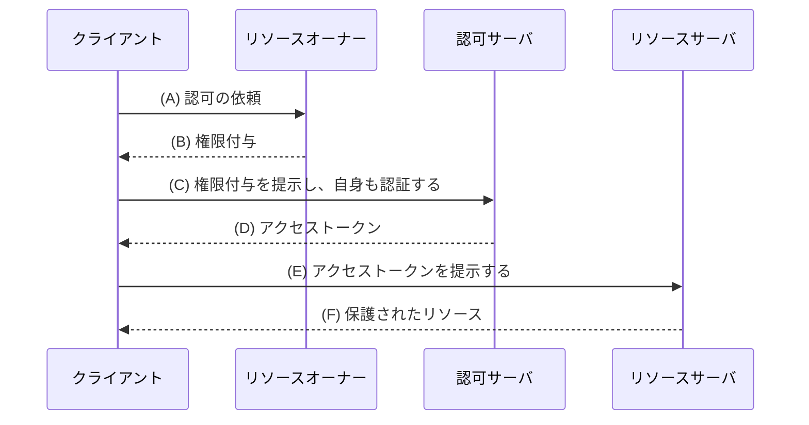
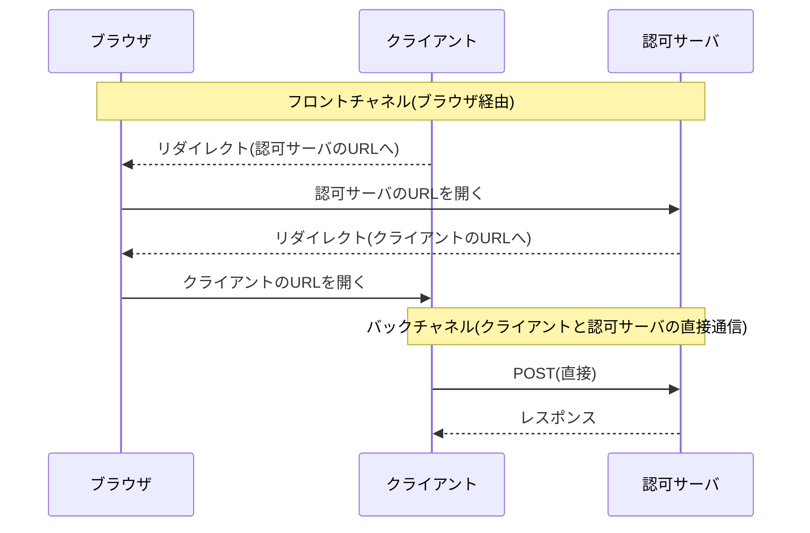

この章でわかること:

- 認証と認可の違い
- 第三者のアプリケーションにパスワードを渡すと生じる3つの問題(権限の範囲、失効、漏洩の範囲)
- 委譲という考え方と、OAuth 2.0の4つのロール
- RFC 6749の抽象フロー(図のAからF)の読み方
- フロントチャネルとバックチャネルの区別

## 認証と認可は別の問い

[1章](/web-auth/01-http-auth/)で扱った認証は、「リクエストを送ってきたのは誰か」という問いに答える処理でした。
Webアプリケーションには、もう1つ別の問いがあります。「その者に、この操作を許してよいか」という問いです。

**認可**(authorization)は、ある主体が特定の資源に対して特定の操作を行うことを許可する、
あるいはその許可の有無を判定する処理です。写真共有サービスで、aliceが自分の写真を削除できて、
bobの写真は削除できないのは、認可の判定によるものです。

2つの処理は順に行われることが多く、認証で「aliceである」と確かめた後に、
認可で「aliceはこの写真を削除してよいか」を判定します。1章の401と403の区別は、
この2段階に対応しています。認証の段階で有効な資格情報がなければ401が返り、
認可の段階で操作が許されなければ403が返ります。403は、サーバがリクエストを理解したうえで
実行を拒否したことを表すコードであり、認可以外の理由による拒否にも使われます。

| | 認証 | 認可 |
| --- | --- | --- |
| 問い | 誰か | 何をしてよいか |
| 入力 | パスワード、セッションIDなど | 認証された主体、対象の資源、操作 |
| 失敗時のステータス | 401 | 403(認可以外の理由の拒否にも使う) |

本書の主題であるOAuth 2.0は認可の仕組みで、OpenID Connectは
OAuth 2.0を基にした認証の仕組みです。OAuth 2.0だけでログインを実装すると
何が問題になるかは[6章](/oidc/06-oauth-to-oidc/)で扱います。この章とPart Iの残りでは、
まずOAuth 2.0が解決しようとした認可の問題を説明します。

## 第三者アプリにパスワードを渡す問題

次の場面を考えます。aliceは写真共有サービス`photos.example.com`に写真を保存しています。
写真をプリントして郵送する印刷サービス`print.example.net`を使いたくなりました。
印刷サービスは写真共有サービスとは別の会社が運営しています。印刷サービスが
aliceの写真を読み出すには、写真共有サービスのAPIを呼ぶ必要があり、
APIはaliceとしての認証を求めます。

最も単純な方法は、aliceが写真共有サービスのユーザー名とパスワードを印刷サービスに入力し、
印刷サービスがそれを使ってBasic認証などでAPIを呼ぶことです。
2000年代のWebでは、この方法が実際に広く使われていました。この方法には、
写真共有サービスの側から見て、次の3つの問題があります。

- **権限の範囲**: パスワードで認証されたリクエストは、aliceが自分で操作した場合と区別できません。
  印刷に必要なのは写真の読み出しだけですが、印刷サービスは写真の削除も、
  住所の閲覧も、パスワードの変更もできます
- **失効**: aliceが印刷サービスの利用をやめたくなったとき、印刷サービスだけを止める手段がありません。
  パスワードを変更するとすべてのアプリケーションがAPIを呼べなくなり、続けて使いたいアプリケーションには
  新しいパスワードを入力し直す必要があります
- **漏洩の範囲**: 印刷サービスはaliceのパスワードを保存しておく必要があります。
  印刷サービスの**データベース**(database、アプリケーションのデータを永続的に保存し、検索・更新する仕組み)が漏洩すると、aliceのパスワードそのものが漏れます。
  aliceが同じパスワードを他のサイトでも使っていれば、被害はそれらにも及びます

これらの問題は、資格情報が「本人であることの証明」と「何をしてよいかの許可」を
区別せずに兼ねていることから生じています。パスワードは本人であることを証明するための値で、
それを渡された者は本人と同じ操作ができます。

## 実験: パスワード共有とスコープ付きトークン

パスワードを共有する方式(方式A)と、アプリケーションごとに権限を限定した値を
発行する方式(方式B)を比べます。方式Bの値をここでは**トークン**(token)と呼びます。
トークンは、何らかの権限や資格を表すために発行される文字列の総称です。
トークンが許可する操作の範囲をスコープ(scope)と呼び、実験の「スコープ付きトークン」は
許可する操作を限定したトークンを指します。スコープの詳細は[4章](/web-auth/04-tokens/)で扱います。
写真共有サービスのAPIには4つの操作があり、それぞれに必要な権限の名前を付けています。

<RustPlay snippet="ch02/delegation" title="パスワード共有とスコープ付きトークンの比較" />

出力の1つ目の表は、パスワードを共有した場合の権限です。印刷アプリもフォトブックアプリも、
写真の削除やパスワードの変更を含むすべての操作が許可されています。APIの側では、
パスワードが合っているかどうかしか判定できないからです。

2つ目の表は、印刷アプリを止めるためにパスワードを変更した後です。印刷アプリだけでなく、
フォトブックアプリもAPIを呼べなくなっています。パスワードは1つしかないので、特定のアプリケーションだけを
止めることはできません。

3つ目の表は、アプリケーションごとに許可する範囲を決めてトークンを発行した場合です。
印刷アプリのトークンは写真の読み出しだけ、フォトブックアプリのトークンは
写真の読み出しと住所の閲覧だけに限られています。パスワードの変更はどちらにも許可されていません。

4つ目の表は、印刷アプリのトークンだけを失効させた後です。フォトブックアプリは
それまでどおり動いています。トークンはアプリケーションごとに別の値なので、
1つだけを無効にできます。

方式Bでは、3つの問題が次のように解決されています。

- 権限の範囲は、トークンを発行するときに決めた範囲に限られます
- 失効は、トークンごとに行えます
- 印刷アプリにはaliceのパスワードが渡らないので、印刷アプリから漏れるのはトークンだけです。
  漏れたトークンで可能なのは許可された範囲の操作だけで、他のサイトのアカウントには影響しません

## 委譲という考え方

方式Bでaliceが行っているのは、自分が持つ権限の一部を、範囲を限定して別の者に与えることです。
この行為を**委譲**(delegation)と呼びます。委譲された側(印刷アプリ)は、
aliceから与えられた範囲でaliceの資源にアクセスし、alice本人として振る舞うことはありません。

委譲を実現するには、方式Bの実験では省略していた部分が必要です。

- トークンを発行する者を決める必要があります。クライアント自身が発行したトークンでは、
  利用者の許可を表せません
- aliceが「印刷アプリに写真の読み出しを許可する」と意思表示する手順が必要です
- その手順の中で、aliceのパスワードを印刷アプリに渡さない必要があります

**OAuth 2.0**は、この委譲の手順を標準化した認可の枠組みです。RFC 6749
(2012年10月、Standards Track)が定めています。OAuth 2.0では、
委譲の結果として発行されるトークンを**アクセストークン**(access token)と呼びます。
アクセストークンは、特定のクライアントに対して、特定の範囲の資源へのアクセスを、
一定の期間だけ許可したことを表す文字列です。アクセストークンの形式や検証の詳細は
[4章](/web-auth/04-tokens/)と[14章](/oauth-deep/14-token-validation/)で扱います。

## OAuth 2.0の4つのロール

OAuth 2.0は、委譲に関わる者を4つの**ロール**(role)に分けます。
写真共有の例にあてはめると、次のようになります。

- **リソースオーナー**(resource owner): 保護された資源へのアクセスを許可できる者です。
  例ではaliceです
- **クライアント**(client): リソースオーナーの許可を得て、リソースオーナーの代わりに
  保護された資源へアクセスするアプリケーションです。例では印刷サービスです
- **認可サーバ**(authorization server): リソースオーナーを認証し、その許可を得たうえで、
  クライアントにアクセストークンを発行するサーバです
- **リソースサーバ**(resource server): 保護された資源を持ち、アクセストークンを
  受け取ってリクエストに応えるサーバです。例では写真共有サービスのAPIです

ここで**保護されたリソース**(protected resource)は、アクセスに認可が必要な資源を指します。
例ではaliceの写真がこれにあたります。

例の写真共有サービスのように、認可サーバとリソースサーバを同じ組織が運営することは
よくあります。それでもOAuth 2.0がこの2つを別のロールとして扱うのは、
トークンを発行する処理とトークンを受け取る処理が別だからです。1つの認可サーバが
発行したアクセストークンを、複数のリソースサーバ(写真API、住所API、決済APIなど)が受け付ける構成も可能です。

「クライアント」という語は、HTTPのクライアント(リクエストを送る側)とは意味が異なります。
OAuth 2.0のクライアントは、印刷サービスのサーバのように、それ自体はHTTPのサーバとして
動いているアプリケーションであることが多いです。本書では、OAuth 2.0のロールを指すときに
「クライアント」と書き、HTTPの送信側を指すときは「送信側」や「ブラウザ」と書いて区別します。

ロールには含まれない要素がもう1つあります。aliceが操作する**ユーザーエージェント**(user agent)です。
ユーザーエージェントは、利用者の代わりにHTTPのリクエストを送るソフトウェアのことで、
ほとんどの場合はWebブラウザです。OAuth 2.0の多くのフローは、ユーザーエージェントを経由して
クライアントと認可サーバの間でメッセージを受け渡します。本書の図では「ブラウザ」と書きます。

## RFCを読む: RFC 6749 1節

RFC 6749の1節は、第三者にパスワードを渡す方式の問題を列挙するところから始まります。
要点の箇条を引用します。

> o Third-party applications gain overly broad access to the resource owner's protected resources, leaving resource owners without any ability to restrict duration or access to a limited subset of resources.
>
> o Resource owners cannot revoke access to an individual third party without revoking access to all third parties, and must do so by changing the third party's password.
>
> o Compromise of any third-party application results in compromise of the end-user's password and all of the data protected by that password.

(RFC 6749 1節)

この節は、パスワードを共有する方式の問題を3つ挙げています。1つ目は、第三者のアプリケーションが
過剰に広い権限を得て、リソースオーナーが期間や範囲を制限できないことです。2つ目は、
特定の第三者だけを失効させられず、パスワードの変更ですべてを失効させるしかないことです。
3つ目は、1つのアプリケーションが侵害されると、パスワードとそれで保護されたデータのすべてが
侵害されることです。実験で確かめた3つの問題と同じです。原文はこのほかに、第三者のアプリケーションが
パスワードを平文で保存する必要があること、サーバがパスワード認証を
受け付け続けなければならないことも挙げています。

RFCは続けて、OAuthがこれらをどう解決するかを述べています。

> OAuth addresses these issues by introducing an authorization layer and separating the role of the client from that of the resource owner. In OAuth, the client requests access to resources controlled by the resource owner and hosted by the resource server, and is issued a different set of credentials than those of the resource owner.

(RFC 6749 1節)

この文は、OAuthが認可のための層を設け、クライアントのロールとリソースオーナーのロールを分ける、
と述べています。クライアントには、リソースオーナーの資格情報(パスワード)とは別の資格情報が
発行されます。この「別の資格情報」がアクセストークンです。RFCは同じ節で、アクセストークンを
「特定の範囲、有効期間、その他のアクセスの属性を表す文字列」と説明しています。

RFCが挙げる例も、本章の例と同じ構造です。

> For example, an end-user (resource owner) can grant a printing service (client) access to her protected photos stored at a photo-sharing service (resource server), without sharing her username and password with the printing service. Instead, she authenticates directly with a server trusted by the photo-sharing service (authorization server), which issues the printing service delegation-specific credentials (access token).

(RFC 6749 1節)

この例の要点は最後の文にあります。利用者は、写真共有サービスが信頼する認可サーバに対して
直接認証し、認可サーバが印刷サービスに委譲専用の資格情報を発行します。
パスワードを入力する相手は認可サーバだけで、印刷サービスはパスワードを一度も受け取りません。

## RFCを読む: RFC 6749 1.1節

4つのロールの定義は1.1節にあります。クライアントの定義を引用します。

> client
>
> An application making protected resource requests on behalf of the resource owner and with its authorization. The term "client" does not imply any particular implementation characteristics (e.g., whether the application executes on a server, a desktop, or other devices).

(RFC 6749 1.1節)

この定義は、クライアントを「リソースオーナーの代わりに、その許可を得て、保護されたリソースへの
リクエストを行うアプリケーション」としています。後半の文は、クライアントという語が
実装の形態を限定しないことを述べています。サーバで動くWebアプリケーションも、
スマートフォンのアプリも、ブラウザ内で動くJavaScriptのアプリケーションも、すべてクライアントです。
形態によってクライアントが秘密の値を安全に保持できるかどうかが変わり、それによって
使える手順が変わります。この区別は[13章](/oauth-deep/13-client-auth/)で扱います。

1.1節の末尾には、認可サーバとリソースサーバの関係について次の記述があります。

> The interaction between the authorization server and resource server is beyond the scope of this specification. The authorization server may be the same server as the resource server or a separate entity. A single authorization server may issue access tokens accepted by multiple resource servers.

(RFC 6749 1.1節)

この文は、認可サーバとリソースサーバの間のやり取りがRFC 6749の範囲外であることを述べています。
リソースサーバが受け取ったアクセストークンをどうやって検証するかは、RFC 6749では決まっていません。
この部分は、後に別のRFCが定めました。アクセストークンを認可サーバに問い合わせる
イントロスペクション(RFC 7662)と、署名付きのJWT形式のアクセストークン(RFC 9068)です。
どちらも[14章](/oauth-deep/14-token-validation/)で扱います。

## RFCを読む: RFC 6749 1.2節

1.2節は、4つのロールの間のやり取りを抽象化した図を示しています。

```text
     +--------+                               +---------------+
     |        |--(A)- Authorization Request ->|   Resource    |
     |        |                               |     Owner     |
     |        |<-(B)-- Authorization Grant ---|               |
     |        |                               +---------------+
     |        |
     |        |                               +---------------+
     |        |--(C)-- Authorization Grant -->| Authorization |
     | Client |                               |     Server    |
     |        |<-(D)----- Access Token -------|               |
     |        |                               +---------------+
     |        |
     |        |                               +---------------+
     |        |--(E)----- Access Token ------>|    Resource   |
     |        |                               |     Server    |
     |        |<-(F)--- Protected Resource ---|               |
     +--------+                               +---------------+

                     Figure 1: Abstract Protocol Flow
```

(RFC 6749 1.2節)

同じ流れをsequenceDiagramで書き直すと、次のようになります。



(B)から(F)の各段階の説明を引用します。

> (B) The client receives an authorization grant, which is a credential representing the resource owner's authorization, expressed using one of four grant types defined in this specification or using an extension grant type.

(RFC 6749 1.2節)

(B)で、クライアントは**権限付与**(authorization grant)を受け取ります。権限付与は、
リソースオーナーがアクセスを許可したことを表す資格情報です。RFC 6749は4種類の権限付与を定め、
拡張の仕組みで種類を追加できるようにしています。

> (C) The client requests an access token by authenticating with the authorization server and presenting the authorization grant.
>
> (D) The authorization server authenticates the client and validates the authorization grant, and if valid, issues an access token.

(RFC 6749 1.2節)

(C)と(D)では、クライアントが認可サーバに権限付与を提示し、アクセストークンと交換します。
秘密の値を安全に保持できるクライアント(原文のconfidential client)のように認証が必要なクライアントは、
ここで自身も認可サーバに対して認証しなければなりません(MUST、RFC 6749 3.2.1節)。
秘密の値を保持できず認証しないクライアント(public client)は、自身の識別子である`client_id`を
提示します(4.1.3節。この区別は[3章](/web-auth/03-authorization-code/)と[13章](/oauth-deep/13-client-auth/)で扱います)。認可サーバは
「この権限付与は、確かにこのクライアントに対して発行したものか」を確かめたうえで、
アクセストークンを発行します。

> (E) The client requests the protected resource from the resource server and authenticates by presenting the access token.
>
> (F) The resource server validates the access token, and if valid, serves the request.

(RFC 6749 1.2節)

(E)と(F)では、クライアントがアクセストークンをリソースサーバに提示し、
リソースサーバはそれを検証して、有効であれば応答します。

この図には、権限付与とアクセストークンという2種類の値が現れます。なぜ1種類ではないのかは、
次の1.3節と[3章](/web-auth/03-authorization-code/)で説明します。
また原文は、(A)と(B)について、図のようにリソースオーナーへ直接依頼するよりも、
認可サーバを仲介させる方法が望ましい(preferably)、と書いています。この仲介の具体的な形が
4.1節の認可コードフローで、Part Iの中心になる手順です。

## RFCを読む: RFC 6749 1.3節

1.3節は権限付与の種類を定めています。

> This specification defines four grant types -- authorization code, implicit, resource owner password credentials, and client credentials -- as well as an extensibility mechanism for defining additional types.

(RFC 6749 1.3節)

4種類のうち、本書の中心は認可コード(authorization code、[3章](/web-auth/03-authorization-code/)で詳しく扱います)です。インプリシット
(implicit)とリソースオーナーパスワードクレデンシャル(resource owner password credentials)は、
後に発行されたRFC 9700(2025年1月、BCP)で使用が非推奨または禁止とされています。
理由はそれぞれ[19章](/oidc-deep/19-flows/)と[20章](/oidc-deep/20-other-grants/)で扱います。
クライアントクレデンシャル(client credentials)は、リソースオーナーが関わらない、
クライアント自身の権限でのアクセスに使う種類で、これも20章で扱います。

認可コードの説明は1.3.1節にあります。

> Before directing the resource owner back to the client with the authorization code, the authorization server authenticates the resource owner and obtains authorization. Because the resource owner only authenticates with the authorization server, the resource owner's credentials are never shared with the client.

(RFC 6749 1.3.1節)

この節は、認可サーバがリソースオーナーを認証して許可を得てから、認可コードを付けて
リソースオーナーをクライアントへ戻すことを述べています。リソースオーナーが認証する相手は
認可サーバだけなので、リソースオーナーの資格情報がクライアントと共有されることはありません。
この性質が、本章の冒頭の3つの問題のうち、漏洩の範囲の問題を解決しています。

## 実験: 抽象フローで各ロールに渡る値

抽象フローの各段階で、どの値がどのロールに渡るかを追跡します。各ロールを
「保持している値の集合」を持つ構造体として表し、AからFの各段階で値が渡るたびに記録します。

<RustPlay snippet="ch02/abstract-flow" title="抽象フローで各ロールが保持する値" />

最後の一覧が、フローの終了時点で各ロールが保持している値です。読むべき点は2つあります。

1つ目は、クライアントの行にパスワードがないことです。パスワードを保持しているのは
リソースオーナーと認可サーバだけです(実際の認可サーバが保存しているのは、
1章で触れた照合用の値です)。クライアントが侵害されたときに漏れうるのは、クライアントが保持している
権限付与、アクセストークン、取得済みの写真であり、パスワードは漏れません。

2つ目は、リソースサーバの行にパスワードも権限付与もないことです。リソースサーバは
アクセストークンだけを受け取り、それが有効かどうかを判定します。リソースサーバが
多様な認証方式(パスワード、多要素認証など)に対応する必要はありません。
RFC 6749の1.4節は、このことを「アクセストークンは抽象化の層を提供する」と表現しています。

この実験は値の流れだけを模したもので、(B)で認可コードがどこで作られ、
どの経路でクライアントに届くかは省略しています。その経路が、次節の主題です。

## フロントチャネルとバックチャネル

OAuth 2.0のやり取りには、経路の異なる2種類の通信があります。

**フロントチャネル**(front channel)は、ユーザーエージェント(ブラウザ)を経由する通信です。
クライアントが認可サーバにメッセージを送るとき、クライアントは
ブラウザに「このURLを開いてください」というリダイレクトを返し、ブラウザがそのURLを開くことで
メッセージが認可サーバに届きます。逆方向も同じで、認可サーバはブラウザをクライアントの
URLへリダイレクトさせて、メッセージを届けます。

**バックチャネル**(back channel)は、ユーザーエージェントのリダイレクトを介さず、
クライアントが認可サーバと直接HTTPで通信する経路です。本章の例ではクライアントがサーバなので、
クライアントのサーバが認可サーバのURLへ直接リクエストを送り、レスポンスを受け取ります。
スマートフォンのアプリのようなネイティブアプリも、同じように認可サーバと直接通信します。



2つの経路は、安全性の性質が大きく異なります。

| | フロントチャネル | バックチャネル |
| --- | --- | --- |
| 経由する者 | ブラウザ、利用者の端末 | なし(クライアントと認可サーバの直接通信) |
| 値が残りうる場所 | ブラウザの履歴、アクセスログ、Refererヘッダ | サーバのログ(設定による) |
| 受信者が確かめられること | 送信元を確かめにくい | TLSで接続先を確認でき、送信元も認証できる |
| 利用者の操作 | 可能(ログイン画面、同意画面を表示できる) | 不可能 |

フロントチャネルを使う理由は、利用者の操作が必要だからです。認可サーバのログイン画面で
パスワードを入力し、同意画面で「許可」を押すのは利用者で、その画面を表示できるのは
ブラウザだけです。一方で、フロントチャネルを通るURLはブラウザの履歴に残り、
リンク先へ送られるRefererヘッダ(遷移元のページのURLを伝えるヘッダで、
[22章](/security/22-threats/)で扱います)に含まれることがあります。攻撃者が用意したページから
偽のリダイレクトを起こすこともできます。

このため、本書で扱う認可コードフローは「利用者の操作が必要な部分だけをフロントチャネルで行い、
価値の高い値(アクセストークン)はバックチャネルで受け渡す」という方針で設計されています。
RFC 6749のすべてのフローがこの方針に従うわけではなく、インプリシット(1.3.2節)は
アクセストークンをフロントチャネルで直接返します。
[3章](/web-auth/03-authorization-code/)で扱う認可コードフローは、この方針をそのまま形にしたもので、
フロントチャネルでは有効期間が短く1回しか使えない認可コードだけを送り、アクセストークンは
バックチャネルで受け取ります。

## OAuth 1.0とOAuth 2.1

OAuth 2.0には前身があります。OAuth 1.0は2007年にコミュニティの仕様として公開され、
2010年にRFC 5849(Informational)として発行されました。OAuth 1.0では、
クライアントがリクエストごとに署名を計算する必要があり、実装の難しさが普及の制約になっていました。
RFC 6749はOAuth 1.0の経験を踏まえて作り直された仕様で、1節に
「OAuth 2.0はOAuth 1.0と後方互換性がない」と明記されています。OAuth 2.0はTLSによる
保護を前提にすることで、リクエストごとの署名を不要にしました。

RFC 6749の発行から10年以上の間に、攻撃手法の研究が進み、多くの追加の規則が
別のRFCとして発行されました。1.3節の読解で触れたRFC 9700は、それらをまとめたセキュリティの指針です。
これらを1つの仕様に統合する作業がOAuth 2.1として進められています。
OAuth 2.1は本書執筆時点でInternet-Draftの段階にあり、最新はdraft-ietf-oauth-v2-1-16です
(2026年10月16日確認)。

**Internet-Draft**は、RFCになる前の作業文書です。IETFのワーキンググループは
Internet-Draftを繰り返し改訂して議論し、合意ができたものがRFCとして発行されます。
Internet-Draftには版番号(末尾の`-16`など)が付き、内容は版ごとに変わりうるため、
引用するときは版番号と確認日を書く必要があります。Internet-DraftはRFCとして発行されるまでは
参照用の文書であり、標準ではありません。OAuth 2.1の変更点は
[25章](/security/25-high-security/)で扱います。

## まとめ

- 認証は「誰か」、認可は「何をしてよいか」を判定する処理です。401は有効な資格情報がないことを表し、
  403はサーバが実行を拒否したことを表します。認可の失敗は403で返します
- 第三者にパスワードを渡すと、権限を限定できない、個別に失効できない、
  漏洩時にパスワードそのものが漏れる、という3つの問題が生じます
- 委譲は、自分の権限の一部を範囲を限定して与えることです。OAuth 2.0は、
  委譲の結果をアクセストークンとして発行する手順を標準化した枠組みです
- OAuth 2.0のロールは、リソースオーナー、クライアント、認可サーバ、リソースサーバの4つです。
  利用者が操作するブラウザはユーザーエージェントと呼びます
- 抽象フローでは、クライアントは権限付与をアクセストークンと交換し、アクセストークンで
  リソースにアクセスします。パスワードはクライアントに渡りません
- 認可コードフローでは、ブラウザを経由するフロントチャネルを利用者の操作に使い、価値の高い値は
  クライアントと認可サーバが直接通信するバックチャネルで受け渡します

次章では、抽象フローの(A)から(D)を具体化した認可コードフローを、HTTPのメッセージの
1つ1つまで追います。認可リクエストのパラメータ、リダイレクト、トークンリクエストを、
1つのプロセスの中で再現して表示します。
