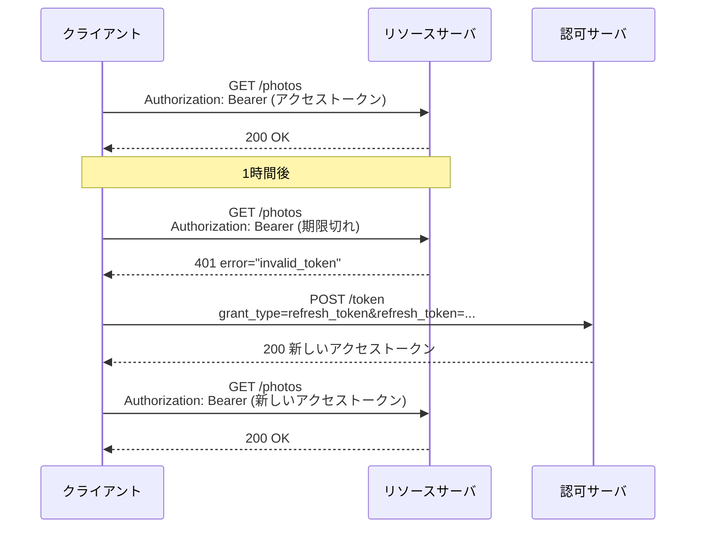

この章でわかること:

- トークンレスポンスとエラーレスポンスの各項目(`access_token`、`token_type`、`expires_in`、`scope`)
- Bearerトークンの定義と、Authorizationヘッダでの送り方(`b64token`の構文)
- アクセストークンをURLのクエリに入れてはいけない理由
- リソースサーバが返す`WWW-Authenticate`ヘッダと、`invalid_token`、`insufficient_scope`の使い分け
- スコープの設計と最小権限、リフレッシュトークンの役割

## トークンレスポンス

[3章](/web-auth/03-authorization-code/)の認可コードフローの最後で、クライアントは
トークンエンドポイントからアクセストークンを受け取りました。このレスポンスを
**トークンレスポンス**(token response)と呼びます。RFC 6750(Bearerトークンの仕様)の4節にある例は
次のとおりです。

```http
HTTP/1.1 200 OK
Content-Type: application/json;charset=UTF-8
Cache-Control: no-store
Pragma: no-cache

{
  "access_token":"mF_9.B5f-4.1JqM",
  "token_type":"Bearer",
  "expires_in":3600,
  "refresh_token":"tGzv3JOkF0XG5Qx2TlKWIA"
}
```

(RFC 6750 4節)

ボディは**JSON**(JavaScript Object Notation)で書かれています。JSONは、
オブジェクト(`{}`で囲んだ名前と値の組の集まり)、配列、文字列、数値、真偽値、nullを
組み合わせてデータを表すテキスト形式です。現在の仕様はRFC 8259です。
トークンレスポンスは、1段のオブジェクトに各項目を並べた形をしています。

## RFCを読む: RFC 6749 5.1節

トークンレスポンスの項目は、RFC 6749の5.1節が定めています。

> access_token  REQUIRED.  The access token issued by the authorization server.
>
> token_type  REQUIRED.  The type of the token issued as described in Section 7.1.  Value is case insensitive.
>
> expires_in  RECOMMENDED.  The lifetime in seconds of the access token.  For example, the value "3600" denotes that the access token will expire in one hour from the time the response was generated. If omitted, the authorization server SHOULD provide the expiration time via other means or document the default value.

(RFC 6749 5.1節)

この節は、成功時のレスポンスの項目を定めています。

`access_token`は、認可サーバが発行したアクセストークンで、必須です。

`token_type`(トークン種別)は、発行したトークンの種類を示す必須の項目で、
値の大文字小文字は区別しません。種類によって、トークンをリソースサーバに提示する方法が決まります。
7.1節は、クライアントは理解できない種類のトークンを使ってはならない(MUST NOT)、と定めています。
現在使われている値は、この章で扱う`Bearer`と、[16章](/oauth-deep/16-sender-constrained/)で扱う
`DPoP`がほとんどです。

`expires_in`(有効期間)は、アクセストークンの残りの有効期間を秒数で表す項目で、推奨(RECOMMENDED)です。
値は認可サーバがレスポンスを生成した時点からの秒数で、有効期限の時刻そのものではない点に注意してください。
クライアントがレスポンスを受け取った時刻にこの値を足すと、通信にかかった時間の分だけ期限を遅く見積もります。
このため、クライアントはトークンリクエストを送信した時刻にこの値を足すなど、通信時間を考慮して
早めに期限切れと判断します。省略された場合、
認可サーバは別の手段で有効期限を提供するか、既定値を文書化すべきです(SHOULD)。

5.1節にはこのほかに2つの項目があります。`refresh_token`は任意(OPTIONAL)の項目で、
後で説明するリフレッシュトークンです。`scope`は、発行したトークンのスコープが
クライアントの要求と同じなら任意、異なるなら必須(REQUIRED)です。認可サーバは
要求されたスコープの一部だけを許可することがあり(利用者が同意画面で一部を外した場合など)、
そのときはクライアントに実際の範囲を知らせなければなりません。

5.1節は、レスポンスのヘッダについても規定しています。

> The authorization server MUST include the HTTP "Cache-Control" response header field [RFC2616] with a value of "no-store" in any response containing tokens, credentials, or other sensitive information, as well as the "Pragma" response header field [RFC2616] with a value of "no-cache".

(RFC 6749 5.1節)

**Cache-Control**ヘッダは、レスポンスをキャッシュ(ブラウザやプロキシが再利用のために保存する写し)に
保存してよいかどうかを指示するヘッダです。値`no-store`は、どのキャッシュにも保存してはならないことを
意味します。認可サーバは、トークンや資格情報を含むすべてのレスポンスに`Cache-Control: no-store`を
付けなければなりません(MUST)。**Pragma**ヘッダの`no-cache`は、HTTP/1.0時代のキャッシュに向けた古い指定で、
RFC 6749は互換性のために両方を求めています(現在のHTTPの仕様では`Pragma`は廃止扱いです)。
トークンを含むレスポンスが途中のプロキシや共有端末のブラウザに保存されると、
後から別の者がそれを読める可能性があるため、この規定があります。

5.1節の最後の段落は、クライアントの側の規則です。クライアントはレスポンス中の認識できない
項目名を無視しなければならず(MUST)、トークンなどの値の長さについて前提を置くべきではありません。

## JSONとserde

Rustでトークンレスポンスを扱うには、JSONを構造体に変換します。**serde**は、
Rustのデータ構造と各種のデータ形式(JSONなど)を相互に変換するためのクレートです。
構造体に`#[derive(Deserialize)]`を付けると、JSONのオブジェクトをその構造体に変換するコードが
コンパイル時に生成されます。JSONそのものの解析は`serde_json`クレートが行います。

```rust
#[derive(Deserialize)]
struct TokenResponse {
    access_token: String,
    token_type: String,
    expires_in: Option<u64>,
    refresh_token: Option<String>,
    scope: Option<String>,
}
```

必須の項目は`String`、任意の項目は`Option`にします。JSONに項目がなければ`None`になります。
serdeは既定で構造体にない項目を無視するので、5.1節の「認識できない項目を無視しなければならない」という
規則はこの定義で満たされます(`#[serde(deny_unknown_fields)]`を付けるとこの規則に違反します)。

型を決めておくことには、もう1つの効果があります。`expires_in`は5.1節でJSONの数値と定められていますが
(「Numerical values are included as JSON numbers」)、文字列`"3600"`で返す認可サーバもあります。
型を`u64`にしておくと、このような形式の違いが解析の段階でエラーとして現れます。
受け入れるかどうかは実装の判断ですが、違いが検出されないまま処理が進むことはなくなります。

## RFCを読む: RFC 6749 5.2節

トークンリクエストが失敗した場合は、5.2節の形式でエラーが返ります。

> The authorization server responds with an HTTP 400 (Bad Request) status code (unless specified otherwise) and includes the following parameters with the response:

(RFC 6749 5.2節)

この節は、エラーのレスポンスは原則としてステータスコード400で返し、ボディに
`error`、`error_description`、`error_uri`をJSONで入れる、と定めています。
項目の意味は[3章](/web-auth/03-authorization-code/)で見た認可エンドポイントのエラーと同じで、
エラーコードの一覧が異なります。

| エラーコード | 意味 |
| --- | --- |
| `invalid_request` | 必須のパラメータがない、パラメータの重複、複数のクライアント認証方式の併用など、形式が不正 |
| `invalid_client` | クライアント認証に失敗した(未知のクライアント、認証情報なし、未対応の方式) |
| `invalid_grant` | 認可コードやリフレッシュトークンが無効、期限切れ、失効済み、リダイレクトURIの不一致、別のクライアントへの発行 |
| `unauthorized_client` | 認証されたクライアントが、このグラントタイプの使用を許されていない |
| `unsupported_grant_type` | 認可サーバがこのグラントタイプをサポートしていない |
| `invalid_scope` | スコープが不正、未知、形式の誤り、またはリソースオーナーが許可した範囲を超えている |

`invalid_client`については追加の規定があります。クライアントがAuthorizationヘッダで認証を試みた場合、
認可サーバはステータスコード401と、クライアントが使った方式に合わせた`WWW-Authenticate`ヘッダを
返さなければなりません(MUST)。[1章](/web-auth/01-http-auth/)で見た「401には
`WWW-Authenticate`を付ける」というHTTPの規則が、ここにも適用されています。

## 実験: トークンレスポンスを解析する

serdeでトークンレスポンスとエラーレスポンスを解析し、5.1節と7.1節の規則を適用する
クライアント側の処理を書きます。成功とエラーの区別はHTTPのステータスコードで行い、
JSONの形からは判断しません。7つのレスポンスを順に処理します。

<RustPlay snippet="ch04/token-response" title="トークンレスポンスとエラーレスポンスの解析" />

[1]はRFC 6750の例です。`expires_in`の3600を、トークンリクエストを送信した仮の時刻1000000に足して
期限の時刻1003600を計算しています。送信時刻はレスポンスの生成より前なので、この期限は
認可サーバの期限より早くなります。`scope`がないので、要求した2つのスコープが
そのまま許可されたと解釈しています(5.1節の「要求と同じなら省略可」の規則を逆に適用しています)。

[2]は、`token_type`が小文字の`bearer`で、`scope`が要求より狭い場合です。
`token_type`は大文字小文字を区別しないので受け入れています。`scope`に`photos:read`しかないので、
`photos:delete`は許可されなかったと判断できます。クライアントは削除の機能を
無効にするなどの対応が必要です。

[3]はRFC 6749の5.1節の例で、`token_type`が`example`になっています。この例は説明用の値で、
クライアントにはこの種類のトークンの使い方が実装されていないので、7.1節に従って使いません。
例にある`example_parameter`は、エラーにならずに無視されています。

[4]は、`expires_in`が文字列で返された場合です。`u64`への変換に失敗し、どの位置で何が
違ったかがエラーメッセージに現れています。

[5]は、`Cache-Control: no-store`がないレスポンスです。これは認可サーバの側の
規則(MUST)への違反で、この実装では警告を出したうえでトークンを受け取っています。
クライアントが拒否しても、そのトークンはすでにレスポンスとしてキャッシュに保存されている可能性があり、
拒否しても防げる被害はありません。認可サーバの実装を確認するときの検査項目として扱います。

[6]と[7]はエラーレスポンスです。`error`だけのもの(RFCの例)と、
`error_description`の付いたものです。[7]の`invalid_grant`は、3章の実験で見た
使用済みの認可コードに対する応答です。

## Bearerトークン

アクセストークンを受け取ったクライアントは、それをリソースサーバに提示します。
`token_type`が`Bearer`のトークンの提示方法を定めているのがRFC 6750
(2012年10月、Standards Track)です。RFC 6750は、**Bearerトークン**(bearer token)を
次のように定義しています。

> A security token with the property that any party in possession of the token (a "bearer") can use the token in any way that any other party in possession of it can.  Using a bearer token does not require a bearer to prove possession of cryptographic key material (proof-of-possession).

(RFC 6750 1.2節)

この定義は、Bearerトークンを「そのトークンを持つ者(bearer)であれば誰でも、他の所持者と同じように
使えるトークン」とし、使うときに暗号の鍵を持っていることの証明を必要としない、と述べています。
bearerは「持参人」を意味する英語です。トークンを正規のクライアントから盗んだ者も、
正規のクライアントとまったく同じようにトークンを使えます。リソースサーバには、
トークンを提示した者が正規のクライアントかどうかを区別する手段がありません。

この性質のため、Bearerトークンの安全性は「トークンを漏らさないこと」だけに依存します。
RFC 6750の5.3節は、推奨事項の最初に次の規則を置いています。

> Client implementations MUST ensure that bearer tokens are not leaked to unintended parties, as they will be able to use them to gain access to protected resources.

(RFC 6750 5.3節)

この文は、クライアントの実装は、Bearerトークンが意図しない相手に漏れないようにしなければならない
(MUST)、と定めています。漏れた相手はそのトークンで保護されたリソースにアクセスできるからです。
同じ節は、常にTLSを使うこと、TLSの証明書の連鎖を検証すること、有効期間の短いトークンを発行すること、
トークンをページのURLに入れないことを推奨事項として挙げています。

盗まれたトークンを使えなくする仕組み(送信者制約)は[16章](/oauth-deep/16-sender-constrained/)で扱います。
この章では、Bearerトークンを安全に送る方法を読みます。

## RFCを読む: RFC 6750 2.1節

RFC 6750の2節は、Bearerトークンを送る方法を3つ定めています。Authorizationヘッダ(2.1節)、
フォームのボディ(2.2節)、URIのクエリ(2.3節)です。そして、1つのリクエストで
2つ以上の方法を使ってはならない(MUST NOT)と定めています。推奨されるのは2.1節の方法です。

```http
GET /resource HTTP/1.1
Host: server.example.com
Authorization: Bearer mF_9.B5f-4.1JqM
```

(RFC 6750 2.1節)

構文は次のABNFで定義されています。

```text
b64token    = 1*( ALPHA / DIGIT /
                  "-" / "." / "_" / "~" / "+" / "/" ) *"="
credentials = "Bearer" 1*SP b64token
```

(RFC 6750 2.1節)

**ABNF**(Augmented Backus-Naur Form)は、RFCで構文を定義するための記法です(読み方は[付録 RFCの読み方](/appendix/reading-rfcs/)にあります)。
**b64token**は、Bearerトークンの値として使える文字の並びを定める構文規則で、
次のように読みます。

- `1*( ... )`は、括弧内のいずれかの文字が1個以上並ぶことを表します
- 使える文字は、英字(`ALPHA`)、数字(`DIGIT`)、`-`、`.`、`_`、`~`、`+`、`/`です
- `*"="`は、末尾に`=`が0個以上続いてもよいことを表します
- `credentials`は、`Bearer`の後に1個以上の空白(`SP`)を置き、`b64token`を続けた形です

名前のとおり、この文字の集合はBase64とBase64url(どちらも[5章](/web-auth/05-crypto/)で扱います)の
出力をそのまま入れられるように選ばれています。例の`mF_9.B5f-4.1JqM`は、`_`と`.`と`-`を
含みますが、すべて許された文字です。空白や`@`や`"`は使えません。この規則は、
RFC 9110 11.2節の`token68`と同じ文字の集合です。`token68`は、Authorizationヘッダの資格情報を
`名前=値`の引数の形ではなく1つの文字列として書くときの構文規則で、
[1章](/web-auth/01-http-auth/)のBasic認証の`QWxhZGRpbjpvcGVuIHNlc2FtZQ==`もこの形です。

スキーム名`Bearer`は、RFC 9110の規則により大文字小文字を区別せずに照合します。
2.1節は、クライアントはAuthorizationヘッダでBearerトークンを送るべきであり(SHOULD)、
リソースサーバはこの方法をサポートしなければならない(MUST)、と定めています。

## RFCを読む: RFC 6750 2.3節

3つ目の方法は、URLのクエリに`access_token`パラメータとして入れる方法です。

```http
GET /resource?access_token=mF_9.B5f-4.1JqM HTTP/1.1
Host: server.example.com
```

(RFC 6750 2.3節)

RFC 6750は、この方法について次のように書いています。

> Because of the security weaknesses associated with the URI method (see Section 5), including the high likelihood that the URL containing the access token will be logged, it SHOULD NOT be used unless it is impossible to transport the access token in the "Authorization" request header field or the HTTP request entity-body.

(RFC 6750 2.3節)

この文は、URLにアクセストークンを入れる方法にはセキュリティ上の弱点があり、特にURLが
ログに記録される可能性が高いため、ヘッダでもボディでも送れない場合を除いて使うべきではない(SHOULD NOT)、
と定めています。URLは、[3章](/web-auth/03-authorization-code/)で認可コードについて見たのと同じ経路で漏れます。
ブラウザの履歴、サーバとプロキシのアクセスログ、Refererヘッダです。
認可コードは有効期間が短く1回しか使えず、交換にクライアント認証が必要でしたが、アクセストークンには
それらの制約がなく、有効期間中は何度でも使えます。

RFC 6750の発行後、RFC 9700(2025年1月、BCP)はこの規則を強めました。

> Clients MUST NOT pass access tokens in a URI query parameter in the way described in Section 2.3 of [RFC6750].

(RFC 9700 4.3.2節)

この文は、クライアントはRFC 6750の2.3節の方法でアクセストークンをURIのクエリに入れてはならない
(MUST NOT)、と定めています。RFC 6750では「すべきではない(SHOULD NOT)」だったものが、
RFC 9700では「してはならない(MUST NOT)」になっています。RFC 9700はRFC 6750を更新する文書なので、
現在はこちらの規則に従います。OAuth 2.1(draft-ietf-oauth-v2-1-16、2026年10月16日確認)の5.1節は、
送る方法をヘッダとボディの2つに限り、クライアントはクエリでアクセストークンを送ってはならず(MUST NOT)、
リソースサーバはクエリのアクセストークンを無視しなければならない(MUST)、と定めています。

## RFCを読む: RFC 6750 3節と3.1節

リソースサーバは、アクセストークンがない、または無効なリクエストに対して、
`WWW-Authenticate`ヘッダで理由を返します。

> If the protected resource request does not include authentication credentials or does not contain an access token that enables access to the protected resource, the resource server MUST include the HTTP "WWW-Authenticate" response header field; it MAY include it in response to other conditions as well.

(RFC 6750 3節)

この文は、リクエストに認証情報がない場合、またはアクセスを可能にするアクセストークンがない場合、
リソースサーバは`WWW-Authenticate`ヘッダを含めなければならない(MUST)、と定めています。
ヘッダのスキーム名は`Bearer`で、`realm`、`scope`、`error`、`error_description`、`error_uri`の
引数を付けられます。認証情報がない場合の例は次のとおりです。

```http
HTTP/1.1 401 Unauthorized
WWW-Authenticate: Bearer realm="example"
```

(RFC 6750 3節)

期限切れのトークンを送った場合の例は次のとおりです。

```http
HTTP/1.1 401 Unauthorized
WWW-Authenticate: Bearer realm="example",
                  error="invalid_token",
                  error_description="The access token expired"
```

(RFC 6750 3節)

`error`の値は3.1節が定めています。

> invalid_token  The access token provided is expired, revoked, malformed, or invalid for other reasons.  The resource SHOULD respond with the HTTP 401 (Unauthorized) status code.  The client MAY request a new access token and retry the protected resource request.
>
> insufficient_scope  The request requires higher privileges than provided by the access token.  The resource server SHOULD respond with the HTTP 403 (Forbidden) status code and MAY include the "scope" attribute with the scope necessary to access the protected resource.

(RFC 6750 3.1節)

この節は、リソースサーバのエラーコードを3つ定めています。

- `invalid_request`: リクエストの形式が不正です(パラメータの欠落や重複、複数の送信方法の併用など)。
  ステータスコードは400にすべきです(SHOULD)
- **invalid_token**: アクセストークンが期限切れ、失効済み、形式が不正、その他の理由で無効です。
  ステータスコードは401にすべきです(SHOULD)。クライアントは新しいアクセストークンを取得して
  再試行してもかまいません(MAY)
- **insufficient_scope**: リクエストに必要な権限が、アクセストークンの権限を超えています。
  ステータスコードは403にすべきで(SHOULD)、必要なスコープを`scope`引数で示してもかまいません(MAY)

`invalid_token`が401、`insufficient_scope`が403である点は、[1章](/web-auth/01-http-auth/)の
401と403の区別と対応しています。トークンが無効ならリクエストに有効な資格情報がないので401、
トークンは有効だが範囲が足りないならサーバがリクエストの実行を拒否するので403です。

3.1節にはもう1つ規則があります。リクエストに認証情報がまったくない場合
(クライアントが認証が必要だと知らなかった場合や、対応していない認証方式を使った場合)は、
リソースサーバはエラーコードを含めるべきではありません(SHOULD NOT)。

原文の`invalid_token`の説明には「malformed」(形式が不正)が含まれていますが、
`invalid_request`の説明にも「malformed」があります。`b64token`の構文に合わない
Authorizationヘッダをどちらで扱うかは、原文から一意には決まらず、実装によって異なります。
本書の実験では、トークンの値そのものの形式の誤りを`invalid_token`として扱っています。

## 実験: Bearerトークンを受け取るリソースサーバ

RFC 6750の規則に従って、Authorizationヘッダを解析し、`WWW-Authenticate`ヘッダを返す
リソースサーバを書きます。トークンの検証は、リソースサーバが持つ表を検索するだけの簡略化したものです
(実際の検証方法は[14章](/oauth-deep/14-token-validation/)で扱います)。9つのリクエストを処理します。

<RustPlay snippet="ch04/bearer" title="Bearerトークンの解析とWWW-Authenticateの生成" />

[1]はAuthorizationヘッダがない場合で、`error`のない`WWW-Authenticate: Bearer realm="example"`を
返しています。RFC 6750 3節の1つ目の例と同じです。

[2]と[3]は有効なトークンです。[3]ではスキーム名が小文字の`bearer`ですが、
大文字小文字を区別せずに照合するので受け付けています。

[4]は、トークンに空白と`@`を含む場合で、`b64token`の構文に合わないため`invalid_token`になっています。

[5]と[6]は、構文は正しいが無効なトークンです。[6]の期限切れのトークンには、
RFC 6750 3節の2つ目の例と同じ`error_description`を付けています。

[7]は、写真の読み出しだけを許可されたトークンで削除を試みた場合です。
ステータスコードは403で、`insufficient_scope`と、必要なスコープ`photos:delete`を返しています。
クライアントはこの`scope`の値を使って、必要なスコープを含めた認可リクエストをやり直せます。

[8]は、ヘッダとクエリの両方でトークンを送った場合です。2節の「2つ以上の方法を使ってはならない」に
違反するので`invalid_request`(400)になっています。OAuth 2.1の草案に従う場合は、
クエリのトークンを無視してヘッダのトークンだけで判定します。

[9]は、Basic認証の資格情報を送った場合です。Bearerの認証情報がないものとして扱い、
3.1節の規則に従って`error`を付けずに401を返しています。

## スコープの設計

**スコープ**(scope)は、アクセストークンが許可するアクセスの範囲です。クライアントは
認可リクエストの`scope`パラメータで範囲を要求し、認可サーバは利用者の同意と自身の方針に従って
許可する範囲を決め、トークンレスポンスの`scope`で実際の範囲を返します。
RFC 6749の3.3節は、構文を次のように定めています。

```text
scope       = scope-token *( SP scope-token )
scope-token = 1*( %x21 / %x23-5B / %x5D-7E )
```

(RFC 6749 3.3節)

スコープは空白で区切った`scope-token`の並びです。`scope-token`に使える文字は、
ASCIIの表示可能な文字から`"`(0x22)と`\`(0x5C)を除いたものです。空白は区切りなので使えません。
同じ節は、スコープの文字列は大文字小文字を区別し、並びの順序には意味がなく、
どの文字列が何を意味するかは認可サーバが決める、と定めています。

スコープの名前の付け方に標準はありません。本書の例では`photos:read`のように
「資源:操作」の形にしています。URLの形(`https://photos.example.com/read`)を使う認可サーバもあります。
OpenID Connectは`openid`や`profile`などのスコープの意味を定めていて、
これは[6章](/oidc/06-oauth-to-oidc/)で扱います。

スコープを設計するときの原則が**最小権限**(least privilege)です。最小権限は、
ある処理に与える権限を、その処理に必要な最小の範囲に限るという原則です。
[2章](/web-auth/02-delegation/)の印刷サービスに必要なのは写真の読み出しだけなので、
`photos:read`だけを要求し、`photos:delete`は要求しません。トークンが漏れたときに
攻撃者ができることは、トークンのスコープの範囲に限られます。RFC 9700の2.3節も、
アクセストークンの権限は特定の用途に必要な最小限に制限すべきである(SHOULD)、と定めています。

スコープの設計で誤りやすい点を挙げます。

- **粗すぎるスコープ**: `photos`という1つのスコープで読み出しも削除もできるようにすると、
  読み出しだけが必要なクライアントにも削除の権限が渡ります。読み出しと書き込みは分けます
- **細かすぎるスコープ**: 写真1枚ごとにスコープを作ると、同意画面が読めなくなり、
  利用者は内容を確かめずに許可するようになります。資源ごとの細かい許可が必要な場合は、
  スコープとは別の仕組み(RFC 9396の`authorization_details`、[17章](/oauth-deep/17-request-protection/))を使います
- **スコープとリソースサーバ側の検査の不一致**: スコープは認可サーバが発行時に付けるラベルで、
  実際の検査を行うのはリソースサーバです。リソースサーバが各APIで必要なスコープを
  確かめていなければ、スコープを分けても効果がありません。実験の`required_scope`関数のように、
  APIと必要なスコープの対応をリソースサーバに明示的に持たせます

## リフレッシュトークン

アクセストークンの有効期間は短くすることが推奨されます(RFC 6750の5.3節は1時間以下を推奨しています)。
しかし、アクセストークンの期限が切れるたびに利用者を認可サーバへリダイレクトして同意し直させるのは
現実的ではありません。この問題を解決するのが**リフレッシュトークン**(refresh token)です。
リフレッシュトークンは、新しいアクセストークンを取得するための資格情報で、
トークンレスポンスの`refresh_token`項目で、アクセストークンと一緒に発行されます。

## RFCを読む: RFC 6749 1.5節

> Refresh tokens are credentials used to obtain access tokens.  Refresh tokens are issued to the client by the authorization server and are used to obtain a new access token when the current access token becomes invalid or expires, or to obtain additional access tokens with identical or narrower scope (access tokens may have a shorter lifetime and fewer permissions than authorized by the resource owner).  Issuing a refresh token is optional at the discretion of the authorization server.

(RFC 6749 1.5節)

この節は、リフレッシュトークンを「アクセストークンを得るための資格情報」と定義しています。
用途は2つで、現在のアクセストークンが無効になったり期限が切れたりしたときに新しいものを得ること、
同じかより狭いスコープの追加のアクセストークンを得ることです。括弧内の文は、
アクセストークンはリソースオーナーが許可した範囲より短い期間・少ない権限で発行してよいことを示しています。
リフレッシュトークンを発行するかどうかは、認可サーバの判断に任されています。

同じ節には、リフレッシュトークンの使われ方の重要な性質が書かれています。

> Unlike access tokens, refresh tokens are intended for use only with authorization servers and are never sent to resource servers.

(RFC 6749 1.5節)

この文は、リフレッシュトークンは認可サーバとの間だけで使うもので、リソースサーバには
決して送られない、と述べています。このため、アクセストークンとリフレッシュトークンは
漏れる経路の数が異なります。アクセストークンはAPIを呼ぶたびに複数のリソースサーバへ送られ、
リソースサーバのログや、侵害されたリソースサーバから漏れる可能性があります。
リフレッシュトークンは、認可サーバのトークンエンドポイントにしか送られません。



図は、RFC 6749の1.5節のFigure 2を、本章のHTTPメッセージに対応させて描き直したものです。
クライアントは、リソースサーバから`invalid_token`を受け取るか、`expires_in`から計算した期限を過ぎたら、
リフレッシュトークンを認可サーバに送って新しいアクセストークンを受け取ります。
このとき、利用者の操作は必要ありません。

有効期間の短いアクセストークンと有効期間の長いリフレッシュトークンを組み合わせると、漏れやすいアクセストークンの
被害の期間を短くしながら、利用者に同意をやり直させずに済みます。一方で、リフレッシュトークンは
有効期間が長く価値が高いため、それ自体が漏れたときの対策が必要です。リフレッシュトークンの有効期間の設計、
使うたびに新しい値に置き換えるローテーション、漏洩の検知は[15章](/oauth-deep/15-refresh-tokens/)で扱います。

## まとめ

- トークンレスポンスはJSONで、`access_token`と`token_type`が必須、`expires_in`は推奨です。
  トークンを含むレスポンスには`Cache-Control: no-store`を付けなければなりません
- クライアントは理解できない`token_type`のトークンを使わず、認識できない項目は無視します。
  serdeの構造体で型を定めると、形式の違いが解析の段階で検出できます
- Bearerトークンは、持っている者なら誰でも使えるトークンです。安全性はトークンを漏らさないことに依存します
- Bearerトークンは`Authorization: Bearer <b64token>`で送ります。URLのクエリに入れる方法は、
  RFC 9700によって禁止されました
- リソースサーバは、トークンがないときはエラーなし、無効なときは`invalid_token`(401)、
  権限が足りないときは`insufficient_scope`(403)を`WWW-Authenticate`ヘッダで返します
- スコープは最小権限の原則で設計し、リソースサーバがAPIごとに検査します
- リフレッシュトークンは認可サーバにだけ送る資格情報で、有効期間の短いアクセストークンを
  利用者の操作なしに更新するために使います

ここまでで、OAuth 2.0の基本的なメッセージがそろいました。後の章では、トークンを署名で
保護する方法、認可コードの横取りを防ぐ方法、トークンを盗まれても使えなくする方法を扱います。
次章では、それらすべてが前提にしている暗号の基礎(ハッシュ関数、MAC、デジタル署名、
Base64url、乱数)を、実験とともに説明します。
